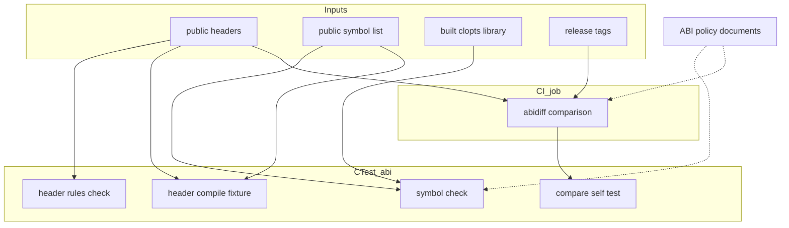
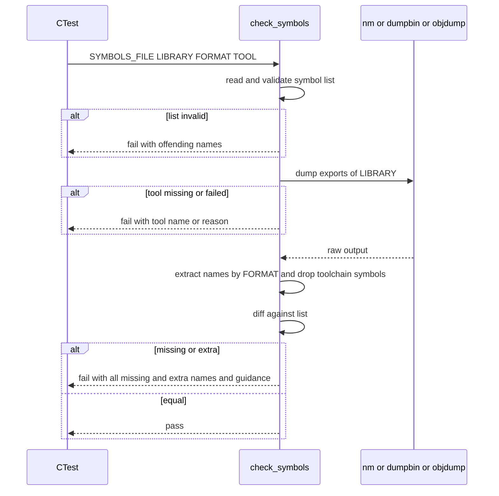
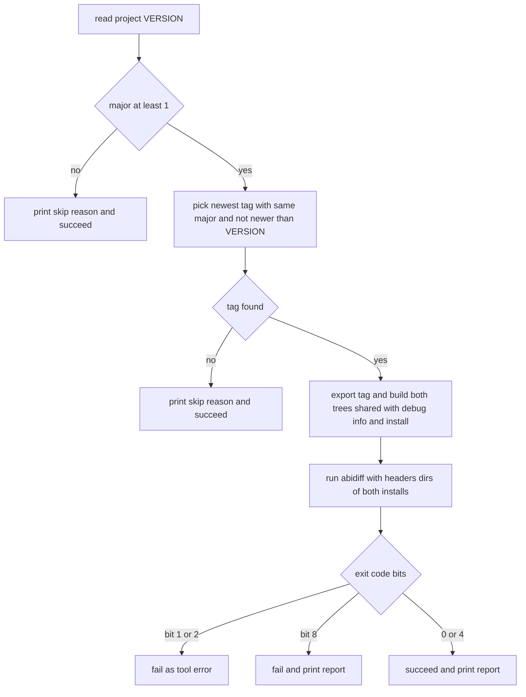

# Design Document: abi-compat

## Overview

**Purpose**: CLOpts の共有ライブラリを、利用側を再ビルドせずに新しい版へ差し替えても壊れないこと（1.0.0 以降の ABI 後方互換）を、方針の文書と、利用側から見える成果物だけを対象にした自動の検査で支える。

**Users**: 保守者は、変更が ABI を壊すかどうかを、レビューの目ではなく CTest と CI の結果で知る。公開関数を足す spec（help-and-messages、platform-argv）の実装者は、手順に従って公開シンボル一覧を更新する。利用者とパッケージ作成者は、文書で SOVERSION の規則と互換の範囲を確かめる。

**Impact**: 新しい検査ディレクトリ `tests/abi/`（ラベル `abi`）、公開シンボル一覧 `abi/clopts.symbols`、文書 `docs/abi.md` と `docs/dev/abi-checks.md`、CI の独立したジョブ `abi-compare` を加える。ライブラリ本体、公開ヘッダ、ビルド設定（`cmake/`）は変えない。

### Goals
- 全 5 環境の共有ビルドで、export されたシンボルが公開シンボル一覧と過不足なく一致することを CTest で検査する。
- 公開関数に `CLOPTS_API` が付き、C99 と C++ の両方からコンパイルでき、C++ から C のリンケージで参照できることを検査する（2026-11-09 に、構造体・共用体の定義がないことの検査を外した。公開構造体は定義してよく、配置を凍結する。配置の変化は abidiff が検出する）。
- 1.0.0 以降、Linux の CI で直近のリリースとの ABI を abidiff で比べ、互換のない変更だけで失敗させる。
- ABI の方針、SOVERSION と macOS の版の規則、変更の分類と手順を文書にする。

### Non-Goals
- ELF のシンボルバージョニング、前方互換、0.x の間の互換、静的ライブラリの ABI、パッケージマネージャ向けの設定。
- `CLOPTS_API`・visibility・VERSION / SOVERSION の設定そのものの変更。
- 公開 API の設計と、公開関数の追加そのもの。
- 利用者向けの取り込み手順とリリース作業（docs-and-release）。

## Boundary Commitments

### This Spec Owns
- 公開シンボル一覧 `abi/clopts.symbols` の形式と、初期の内容（本 spec の実装時点の全公開関数）。
- シンボル照合（一覧の形式検査、export の読み出しと正規化、過不足の報告）と、その自己テスト。
- 公開ヘッダの静的検査（`CLOPTS_API` の付け漏れ）と、その自己テスト。
- 公開ヘッダの C99 / C++ のコンパイル検査と、C++ からのリンク検査。
- abidiff による版の間の比較スクリプト、基準の選択と終了コードの判定の規則、CI の `abi-compare` ジョブ。
- ABI 方針の文書（`docs/abi.md`）と保守者向けの検査・手順の文書（`docs/dev/abi-checks.md`）。
- CTest のラベル `abi` と、テスト名 `abi.*`。

### Out of Boundary
- `include/clopts/export.h`、`cmake/CloptsLibrary.cmake` の SOVERSION・visibility・`DEFINE_SYMBOL` の設定（project-foundation）。検査が違反を見つけても、本 spec はそれらを直さない。
- 公開ヘッダの内容と公開関数の増減（core-parser、help-and-messages、platform-argv）。それらの spec は、公開関数を変えるときに `abi/clopts.symbols` を同じ変更の中で更新する。
- `.github/workflows/ci.yml` の既存のマトリクスジョブの構成（project-foundation）。本 spec は独立したジョブを足すだけで、既存のジョブを変えない。
- リリースタグの作成、`release.yml`、`docs/dev/release.md`、README からのリンク（docs-and-release）。
- macOS の `MACHO_COMPATIBILITY_VERSION` / `MACHO_CURRENT_VERSION` の明示的な設定（設定しない方針を採る。変えるなら project-foundation の変更になる）。

### Allowed Dependencies
- CMake 3.21 以上（`cmake -P`、CTest、`check_language`、`$<TARGET_FILE>`）。
- 既存の `tests/cmake/run_fixture.cmake`（変更しない）と `cmake/CloptsCompilerOptions.cmake` の `clopts_apply_compiler_options`（子プロジェクトから include して使う。変更しない）。
- 各 OS の標準ツール: `nm`（Linux、macOS）、`link.exe /dump` または `dumpbin`（MSVC）、`objdump`（MinGW）。CMake が見つけた `CMAKE_NM`、`CMAKE_OBJDUMP`、`CMAKE_LINKER` を使う。
- Linux の CI ジョブでだけ: `git`、`abigail-tools`（Ubuntu の universe）、GCC。
- 検査は公開ヘッダ（`include/clopts/`）、ビルドされた `clopts` ターゲット、install された成果物だけを見る。`src/` の内部ヘッダやソースを読まない。

### Revalidation Triggers
- `abi/clopts.symbols` の場所または形式の変更 → 公開関数を足す全 spec と docs-and-release が手順を見直す。
- `CLOPTS_API` の定義、`export.h` の判定の順、visibility の設定の変更（project-foundation）→ 本 spec の照合とヘッダ検査を見直す。
- SOVERSION の規則の変更（project-foundation）→ `docs/abi.md` と abidiff の基準の選択規則を見直す。
- install の配置（`include/clopts/`、ライブラリのディレクトリ）の変更 → `run_abidiff.cmake` を見直す。
- リリースタグの命名（`vX.Y.Z`）の変更（docs-and-release）→ 基準の選択規則を見直す。
- 前方互換を保証の範囲に入れる判断 → macOS の版の方針と project-foundation の設定を見直す。
- テスト名・ラベル（`abi.*`、`abi`）の変更 → CI と docs-and-release の参照を見直す。

## Architecture

### Existing Architecture Analysis
- テストは `tests/CMakeLists.txt` が `add_subdirectory` で各ディレクトリを登録する。`cmake -P` の検査は `<module>.<name>` の名前とラベルで登録する（例: `platform.no_shell32`）。
- 子プロジェクトの検査は `tests/cmake/run_fixture.cmake` が担い、`EXPECT=build_ok` などの期待と比べ、失敗時は子の出力を表示する。
- 共有ビルドでは `clopts` に `C_VISIBILITY_PRESET hidden`（Windows 以外）、`DEFINE_SYMBOL CLOPTS_BUILDING`、`VERSION`、`SOVERSION`（0.x は `0.<minor>`、1.x 以降は `<major>`）が設定済み。
- CI はマトリクス 5 環境 × 静的／共有の 10 ジョブ。共有のジョブは `ctest` で全テストを流すので、`abi.exports` は追加の設定なしで 5 環境の共有ビルドで動く。

### Architecture Pattern & Boundary Map



**Architecture Integration**:
- Selected pattern: 外側からの検査（成果物を入力にした独立したスクリプトと子プロジェクト）。各検査は互いに呼び合わず、共有するのは公開シンボル一覧だけ。
- Domain/feature boundaries: 入力（ヘッダ、一覧、ライブラリ、タグ）はすべて読み取り専用。検査は何も書き換えず、作業ディレクトリはビルドツリーの下（CI では `RUNNER_TEMP`）に作る。
- Existing patterns preserved: `cmake -P` の検査、`run_fixture.cmake` による子プロジェクト、`clopts_apply_compiler_options` の警告設定、テスト名 `<label>.<name>`。
- New components rationale: 下の Components の表を参照。
- Steering compliance: 外部依存を増やさない（CMake と各 OS の標準ツールだけ。abidiff は Linux の CI ジョブだけ）。CLOpts 本体の `project()` に C++ を足さない。グローバルな設定を足さない。

**Dependency direction**: `abi/clopts.symbols`（データ）← 各検査スクリプト ← `tests/abi/CMakeLists.txt`（登録）← `tests/CMakeLists.txt`。検査スクリプトは互いに include しない。`run_abidiff.cmake` は CTest の登録からは `MODE=self_test` でだけ呼ばれ、比較そのものは CI のジョブから呼ばれる。

### Technology Stack

| Layer | Choice / Version | Role in Feature | Notes |
|-------|------------------|-----------------|-------|
| Build / Test | CMake 3.21+、CTest | 検査スクリプト（`cmake -P`）、子プロジェクト、テスト登録 | 既存と同じ。新しい依存なし |
| Toolchain tools | `nm`（binutils / LLVM / Apple）、`link.exe /dump`・`dumpbin`、`objdump`（binutils） | export の読み出し | CMake が見つけたパスを使う |
| C++ compiler | 各環境の C++ コンパイラ（g++、clang++、Apple clang++、cl、MinGW g++） | C++ のコンパイル・リンク検査 | テストの子プロジェクトだけで使う。C++11 |
| CI | GitHub Actions `ubuntu-latest`、`abigail-tools`（apt）、`git` | 版の間の ABI 比較 | 独立したジョブ `abi-compare` |

## File Structure Plan

### Directory Structure
```
abi/
└── clopts.symbols                  # 公開シンボル一覧（唯一の基準）
docs/
├── abi.md                          # ABI 方針（利用者・保守者向け）
└── dev/
    └── abi-checks.md               # 検査の内容と保守者の手順
tests/abi/
├── CMakeLists.txt                  # abi.* のテスト登録（形式の選択、C++ の有無の判定）
├── check_symbols.cmake             # 一覧の形式検査と export との照合（cmake -P）
├── check_header_rules.cmake        # 公開ヘッダの静的検査（cmake -P）
├── run_abidiff.cmake               # 基準の選択・両版のビルド・abidiff・判定（cmake -P）
└── fixtures/
    ├── headers/
    │   └── CMakeLists.txt          # C99 / C++ のコンパイル検査の子プロジェクト
    ├── header_rules/
    │   ├── good/                   # 違反のない例（前方宣言、static inline、関数ポインタ型、コメント中の struct、構造体・共用体の定義）
    │   │   └── *.h
    │   └── bad/                    # 違反ごとに 1 ディレクトリ（missing_api、missing_api_multiline。struct_def・union_def は 2026-11-09 に good/ へ移した）
    │       └── <case>/<case>.h
    └── exports/                    # 各形式のツール出力の記録と、それに対応する一覧
        ├── nm-elf.txt
        ├── nm-macho.txt
        ├── dumpbin.txt
        ├── objdump-pe.txt
        └── expected.symbols
```

### Modified Files
- `tests/CMakeLists.txt` — `add_subdirectory(abi)` を足す。
- `.github/workflows/ci.yml` — 独立したジョブ `abi-compare` を足す。既存の `build-and-test` ジョブとマトリクスは変えない。
- `.kiro/steering/structure.md` — `tests/abi/` の項に公開シンボル一覧の場所（`abi/clopts.symbols`）を追記し、リポジトリ直下の `abi/` を Directory Patterns に加える。

## System Flows

### シンボル照合（`abi.exports`）



### 版の間の比較（`abi-compare` ジョブ）



- ビルドの失敗（基準・現在のどちらか）と abidiff が見つからないことも、ツールの失敗として扱い、成功にしない（6.8）。
- 基準と現在の版は、同じ C コンパイラ（ジョブの `CC`）、同じ生成器、同じ `CMAKE_BUILD_TYPE=Debug` でビルドする（6.4）。

## Requirements Traceability

| Requirement | Summary | Components | Interfaces | Flows |
|-------------|---------|------------|------------|-------|
| 1.1–1.9 | 保証の範囲、SOVERSION、Windows の DLL 名、macOS の版、変更の分類、手順 | AbiPolicyDocs | `docs/abi.md` の章立て | — |
| 1.10 | 各検査の内容と動く構成 | AbiPolicyDocs | `docs/dev/abi-checks.md` の章立て | — |
| 1.11 | 日本語、識別子は英語 | AbiPolicyDocs | — | — |
| 2.1, 2.2, 2.4 | 唯一の一覧、1 行 1 名、空行と注釈 | SymbolList, SymbolCheck | 一覧の形式 | シンボル照合 |
| 2.3 | 重複・接頭辞の誤りで失敗 | SymbolCheck | `abi.symbol_list` | シンボル照合 |
| 3.1, 3.2 | 共有ビルドだけ登録 | AbiTestRegistration | `abi.exports` | — |
| 3.3, 3.4 | 5 環境、正規化と除外 | SymbolCheck, AbiTestRegistration | FORMAT ごとの規則 | シンボル照合 |
| 3.5–3.7, 3.9 | 不足・余分の報告、案内、成功 | SymbolCheck | 報告の形式 | シンボル照合 |
| 3.8 | ツールの欠如・失敗で失敗 | SymbolCheck | エラーの形式 | シンボル照合 |
| 4.1, 4.4–4.6, 4.8 | ヘッダの走査と判定（4.2、4.3 は 2026-11-09 に廃止） | HeaderRulesCheck | `abi.header_rules` | — |
| 4.7 | 両形式で登録 | AbiTestRegistration | — | — |
| 5.1, 5.2, 5.4, 5.7 | 各ヘッダを C99 / C++ で単独コンパイル、同じ警告 | HeaderCompileFixture | `abi.headers_c`, `abi.headers_cxx` | — |
| 5.3 | C のリンケージ | HeaderCompileFixture | C++ のリンク検査 | — |
| 5.5 | 5 環境 | AbiTestRegistration | — | — |
| 5.6, 5.8 | C++ がないときは実行しない、利用側に C++ を要求しない | AbiTestRegistration | `DISABLED` | — |
| 6.1, 6.9 | Linux の CI、独立したジョブ | AbiCompareJob | `ci.yml` の `abi-compare` | 版の間の比較 |
| 6.2, 6.3 | 基準の選択、飛ばす条件 | AbiCompareScript | `select_baseline` | 版の間の比較 |
| 6.4, 6.5 | その場でビルド、ヘッダの指定 | AbiCompareScript | `MODE=compare` | 版の間の比較 |
| 6.6–6.8 | 終了コードの判定 | AbiCompareScript | `classify_exit_code` | 版の間の比較 |

## Components and Interfaces

| Component | Domain/Layer | Intent | Req Coverage | Key Dependencies (P0/P1) | Contracts |
|-----------|--------------|--------|--------------|--------------------------|-----------|
| SymbolList | Data | 公開シンボルの唯一の基準 | 2.1, 2.2, 2.4 | — | State |
| SymbolCheck | Test script | 一覧の形式検査と export との照合 | 2.3, 3.3–3.9 | SymbolList (P0), 各 OS のツール (P0) | Batch |
| HeaderRulesCheck | Test script | 公開ヘッダの静的検査 | 4.1, 4.4–4.6, 4.8 | 公開ヘッダ (P0) | Batch |
| HeaderCompileFixture | Test fixture | C99 / C++ のコンパイルと C++ からのリンク | 5.1–5.4, 5.7 | run_fixture.cmake (P0), CloptsCompilerOptions (P0), SymbolList (P1) | Batch |
| AbiTestRegistration | Test registration | `abi.*` の登録、形式とツールの選択、C++ の有無 | 3.1–3.3, 4.7, 5.5, 5.6, 5.8 | 上の 3 つと AbiCompareScript (P0) | Service |
| AbiCompareScript | Test script | 基準の選択、両版のビルド、abidiff、判定 | 6.2–6.8 | git (P0), abidiff (P0) | Batch |
| AbiCompareJob | CI | Linux での比較の実行 | 6.1, 6.9 | AbiCompareScript (P0) | Batch |
| AbiPolicyDocs | Docs | 方針と手順の文書 | 1.1–1.11 | — | — |

### Data

#### SymbolList（`abi/clopts.symbols`）

| Field | Detail |
|-------|--------|
| Intent | 共有ライブラリが export すべきシンボルの、OS によらない唯一の一覧 |
| Requirements | 2.1, 2.2, 2.4 |

**Contracts**: State [x]

##### State Management
- 形式: UTF-8、LF。1 行に 1 つのシンボル名。行頭と行末の空白は無視する。空行と、`#` で始まる行（先頭の空白の後でもよい）は無視する。
- OS の注記: 特定の OS でだけ宣言・export される公開関数（現在は `include/clopts/platform.h` の `#ifdef _WIN32` の中の `clopts_argv_from_wide`）は、名前の後に空白で区切って注記 `windows` を 1 つ書く（例: `clopts_argv_from_wide windows`）。注記のない名前は全 OS で export されるもの。受け付ける注記は `windows` だけで、それ以外の語や 3 語以上の行は形式の誤り（`invalid platform tag`）とする。注記付きの名前は Windows（`FORMAT` が `dumpbin` / `objdump-pe`）の照合でだけ要求し、それ以外（`nm-elf` / `nm-macho`）では一覧に無いものとして扱う。（実装時に、設計がこの関数を見落としていたことが分かり、2026-11-08 に追記した）
- 名前の規則: `^clopts_[a-z0-9_]+$`。重複は許さない。並び順は自由だが、公開ヘッダごとに `# clopts/<header>.h` の注釈でまとめ、ヘッダの中の宣言順に並べることを推奨する（文書に書く。検査はしない）。
- 初期の内容: 本 spec の実装時点の `include/clopts/` の全公開関数（`decl.h`、`help.h`、`parse.h`、`platform.h` の `CLOPTS_API` 付きの宣言）。`static inline` の `clopts_file_write` は載せない。
- 不変条件: 公開ヘッダの `CLOPTS_API` 付きの関数の集合、共有ライブラリの export の集合、この一覧の集合は等しい（OS の注記付きの名前は、その OS でだけ数える）。前の 2 つの等しさは SymbolCheck が、ヘッダと一覧の対応は HeaderCompileFixture の C++ リンク検査（一覧にあってヘッダにない名前はコンパイルで失敗する）と SymbolCheck の組み合わせで保つ。
- 更新: 公開関数を足す・消す変更は、同じコミットでこの一覧を更新する（`docs/dev/abi-checks.md` の手順）。

### Test scripts

#### SymbolCheck（`tests/abi/check_symbols.cmake`）

| Field | Detail |
|-------|--------|
| Intent | 一覧の形式を検査し、export されたシンボルの集合と一覧の集合を比べて差を報告する |
| Requirements | 2.3, 3.3, 3.4, 3.5, 3.6, 3.7, 3.8, 3.9 |

**Responsibilities & Constraints**
- 一覧を読み、2.3 の誤り（重複、規則に合わない名前、未知の OS の注記）をすべて集めてから失敗する。
- `FORMAT` から照合の対象の OS を決める（`dumpbin` / `objdump-pe` は Windows、`nm-elf` / `nm-macho` はそれ以外）。Windows でなければ、注記 `windows` の付いた名前を期待する集合から外す。
- export の出力を得る。`DUMP_FILE` があればそれを読み、なければ `TOOL` を実行する。
- `FORMAT` ごとの規則で名前を取り出し、除外リストの名前を取り除き、集合として一覧と比べる。
- 何も書き換えない。ファイルは読むだけ。

**Dependencies**
- Inbound: AbiTestRegistration — 引数を渡して起動する (P0)
- External: `nm` / `link.exe` / `dumpbin` / `objdump` — export の読み出し (P0)

**Contracts**: Batch [x]

##### Batch / Job Contract
- Trigger: `cmake -D<VAR>=<value>... -P check_symbols.cmake`
- Input:

| 変数 | 必須 | 意味 |
|------|------|------|
| `SYMBOLS_FILE` | 常に | 公開シンボル一覧のパス |
| `FORMAT` | `LIBRARY` か `DUMP_FILE` があるとき | `nm-elf` / `nm-macho` / `dumpbin` / `objdump-pe` |
| `LIBRARY` | 照合のとき | 共有ライブラリの実体（`$<TARGET_FILE:clopts>`） |
| `TOOL` | `LIBRARY` があるとき | ツールのパス。空ならツールなしとして失敗する |
| `DUMP_FILE` | 自己テストのとき | ツールの出力を記録したファイル（`LIBRARY` と `TOOL` の代わり） |

`LIBRARY` も `DUMP_FILE` もないときは、一覧の形式検査だけを行う。

- 形式ごとの規則:

| FORMAT | ツールの起動 | 名前の取り出し | 除外する名前 |
|--------|--------------|----------------|--------------|
| `nm-elf` | `<TOOL> -D --defined-only <LIBRARY>` | `<値> <型> <名前>` の 3 列の行の第 3 列 | `_init`, `_fini`, `_edata`, `_end`, `__bss_start` |
| `nm-macho` | `<TOOL> -gU <LIBRARY>` | 3 列の行の第 3 列から、先頭の `_` を 1 つ除く | なし |
| `dumpbin` | `<TOOL> /exports <LIBRARY>`（`link.exe` のときは `/dump /exports`） | `ordinal hint RVA name` の表の行（数字・16 進・16 進・名前）の名前。`=` 以降は捨てる | なし |
| `objdump-pe` | `<TOOL> -p <LIBRARY>` | `[Ordinal/Name Pointer] Table` の節の、`[` で始まる各行の最後の語（最初の行の前の見出し行は読み飛ばす） | なし |

除外リストは「あれば取り除く」集合で、無くても失敗しない。項目は理由の注釈付きでスクリプトの先頭にまとめる。

- Output（成功）: 終了コード 0。照合した名前の数を 1 行で表示する。
- Output（失敗）: 終了コード非 0（`message(FATAL_ERROR)`）。報告の形:
  ```
  abi symbol check failed (<FORMAT>, <LIBRARY>)
    missing (in the list but not exported):
      clopts_xxx
    extra (exported but not in the list):
      clopts_core_yyy
  The public symbol list is <SYMBOLS_FILE>.
  If the change is intended, update the list; otherwise stop exporting the symbol
  (internal functions must not carry CLOPTS_API). See docs/dev/abi-checks.md.
  ```
  不足・余分は名前順ですべて出す。一覧の形式の誤りは `<SYMBOLS_FILE>:<行>: duplicate symbol 'x'` / `invalid symbol name 'x'` / `invalid platform tag 'x'` の形で出す。ツールの欠如は `export dump tool not found for FORMAT <FORMAT>`、ツールの失敗は終了コードと出力を添えて出す。取り出した名前が 0 個のときも、出力の形式が想定と違うものとして失敗する。
- Idempotency & recovery: 副作用なし。何度実行しても同じ結果。

**Implementation Notes**
- Integration: 3.4 の「CLOpts のソースに由来しないシンボル」は除外リストで扱う。未知のシンボルが CI で出たら、報告に出た名前を確かめ、ツールチェーン由来なら理由付きで除外リストに足す（CLOpts 由来なら一覧か export を直す）。
- Validation: 記録したツール出力（`fixtures/exports/`）で、4 形式の取り出し・除外・不足・余分の報告を自己テストする（Testing Strategy を参照）。
- Risks: `objdump -p` の列の形式は binutils の版で変わるので、「行の最後の語」の規則に限る。binutils 2.44 以降は節の見出しの直後に `Ordinal   Hint Name` の列見出しを出す（CI の MinGW で判明）。

#### HeaderRulesCheck（`tests/abi/check_header_rules.cmake`）

| Field | Detail |
|-------|--------|
| Intent | 公開ヘッダの関数の宣言に `CLOPTS_API` が付いていることを検査する（2026-11-09 に、構造体・共用体の定義の検査を外した） |
| Requirements | 4.1, 4.4, 4.5, 4.6, 4.8 |

**Responsibilities & Constraints**
- `HEADER_DIR` の直下の `*.h` を毎回列挙して対象にする（4.1）。名前順に処理し、結果を決定的にする。
- 各ファイルを次の順で正規化する。行番号を保つため、取り除いた部分は改行だけを残す。
  1. `/* ... */`（複数行にまたがってもよい）と `//` から行末までのコメントを除く（4.6）。文字列リテラルの中は `extern "C"` 以外に現れないので、特別に扱わない。
  2. 前処理指令の行（先頭の空白の後に `#` で始まる行と、その `\` による継続行）を除く。
- 正規化した内容を、波括弧の深さを追いながら最上位の文に区切る。
  - `extern "C" {` とそれに対応する `}` は透過的に扱う（中を最上位として扱う）。
  - 深さ 0 の `;` で文が終わる。`static` で始まる文と、本体の前に `(` を含む文（関数の定義）は、本体の `{ ... }` が閉じたところで終わる。
- 文の分類と判定:

| 文の形 | 判定 |
|--------|------|
| `typedef` で始まる文（前方宣言、構造体・共用体・列挙の定義、関数ポインタ型） | 許可（4.5） |
| `static` で始まる文（`static inline` の関数定義） | `CLOPTS_API` の検査の対象外（4.5） |
| 上のどれでもなく、`<識別子> (` を含む文（関数の宣言） | 先頭の語が `CLOPTS_API` でなければ違反: `function '<name>' lacks CLOPTS_API`（4.4）。名前は最初の `(` の直前の識別子 |
| それ以外（`typedef` のない構造体・共用体・列挙の定義、構造体の前方宣言） | 判定しない |

- 文の分類には、文の頭（最初の `{` より前の部分。本体がなければ文全体）を使う。
- 2026-11-09 に、構造体・共用体の定義を違反とする行（旧 4.2）と、前方宣言を許す行（旧 4.3）を削除した。公開構造体は steering の「公開構造体は凍結する」に従って定義してよく、既存の公開構造体の配置の変化は、1.0.0 以降の AbiCompare（abidiff）が検出する。

- 違反をすべて集めてから、`<file>:<line>: <reason>` の形で出して失敗する。行は文の開始行。違反がなければ、検査したヘッダと関数の数を表示して成功する（4.8）。
- 扱わない構文（関数を返す関数、`extern` 変数、マクロで包んだ宣言）は、スクリプトの先頭の注釈と `docs/dev/abi-checks.md` に書く。公開ヘッダに現れたら走査器を広げる。

**Dependencies**
- Inbound: AbiTestRegistration (P0)
- External: なし（CMake の文字列処理だけ）

**Contracts**: Batch [x]

##### Batch / Job Contract
- Trigger: `cmake -DHEADER_DIR=<dir> -P check_header_rules.cmake`
- Input: `HEADER_DIR`（必須。ディレクトリでなければ失敗）。
- Output: 成功は終了コード 0。失敗は `message(FATAL_ERROR)` と違反の一覧。
- Idempotency & recovery: 副作用なし。

#### HeaderCompileFixture（`tests/abi/fixtures/headers/CMakeLists.txt`）

| Field | Detail |
|-------|--------|
| Intent | 各公開ヘッダを単独で include した翻訳単位を C99 / C++ でコンパイルし、C++ からは一覧の全シンボルを参照してリンクする |
| Requirements | 5.1, 5.2, 5.3, 5.4, 5.7 |

**Responsibilities & Constraints**
- `run_fixture.cmake` から `EXPECT=build_ok` で構成・ビルドされる子プロジェクト。入力は `-DCLOPTS_SOURCE_DIR`、`-DHEADER_CHECK_LANG=C|CXX`、`-DSYMBOLS_FILE`、`-DCLOPTS_BUILD_SHARED`、`-DCLOPTS_WERROR=ON`、（C++ のとき）`-DCMAKE_CXX_COMPILER`。
- 構成時に `${CLOPTS_SOURCE_DIR}/include/clopts/*.h` を列挙し、ヘッダごとに翻訳単位をビルドツリーに生成する。名前は `check_<header>.c` / `check_<header>.cpp` とし、失敗したヘッダと言語がビルドの出力から分かるようにする（5.7）。各翻訳単位は `#include "clopts/<header>.h"` と、空の翻訳単位の警告を避けるための `typedef` を 1 つ持つ。
- `HEADER_CHECK_LANG=C`:
  - `project(... LANGUAGES C)`。生成した `.c` をまとめたオブジェクトライブラリに `include(${CLOPTS_SOURCE_DIR}/cmake/CloptsCompilerOptions.cmake)` の `clopts_apply_compiler_options` を適用する（C99、拡張なし、CLOpts と同じ警告、`CLOPTS_WERROR=ON` で警告をエラーに）（5.1、5.4）。
- `HEADER_CHECK_LANG=CXX`:
  - `project(... LANGUAGES C CXX)`。生成した `.cpp` をまとめたオブジェクトライブラリを `CXX_STANDARD 11`、`CXX_STANDARD_REQUIRED ON`、`CXX_EXTENSIONS OFF` でコンパイルする（5.2）。
  - 警告は CLOpts の C の設定に対応させる: GCC / Clang / AppleClang は `-Wall -Wextra -Wpedantic -Werror`、MSVC は `/W4 /WX /utf-8 /Zc:preprocessor /Zc:__cplusplus /EHsc`（5.4）。
  - `add_subdirectory(${CLOPTS_SOURCE_DIR} clopts)` で CLOpts を取り込み（`CLOPTS_BUILD_TESTING=OFF` は `run_fixture.cmake` が渡す）、リンク検査の実行ファイル `abi_link_check` を作る。その翻訳単位 `link_check.cpp` は構成時に一覧から生成し、`#include "clopts/clopts.h"` の後、一覧の全シンボルのアドレスを `reinterpret_cast<void (*)(void)>(&<name>)` の配列に入れ、`main` で配列の要素数を返す。OS の注記 `windows` の付いた名前は `#ifdef _WIN32` / `#endif` で囲んで生成する。`CLOpts::clopts` にリンクする（5.3）。関数が C++ のリンケージで宣言されていると、修飾された名前が解決できずリンクで失敗する。一覧にあってヘッダにない名前はコンパイルで失敗する。
- 実行はしない（`build_ok`）。Windows の共有版でも DLL を実行ファイルの横に置く必要がない。
- 実装で決めた点（2026-11-08 追記。理由は tasks.md の Implementation Notes 2.4）:
  - CLOpts は C と CXX のどちらでも `add_subdirectory(${CLOPTS_SOURCE_DIR} clopts EXCLUDE_FROM_ALL)` で取り込む。ヘッダごとの検査のオブジェクトライブラリは `CLOpts::clopts` にリンクせず、`$<TARGET_PROPERTY:clopts,INTERFACE_INCLUDE_DIRECTORIES>` と `INTERFACE_COMPILE_DEFINITIONS` を受け取る（利用側と同じく、静的版では `CLOPTS_STATIC` が付き、共有版では付かない）。リンクすると CLOpts 本体のソースが先にコンパイルされて失敗し、`check_<header>` の名前が出力に出ないため。
  - CXX では `add_dependencies(clopts abi_header_check)` で、ヘッダの検査を CLOpts 本体より先にコンパイルする。
  - 翻訳単位は、ヘッダが include する `clopts/` のヘッダの数の少ない順（同じなら名前順）に並べ、壊れたヘッダ自身の `check_<header>` が傘ヘッダより先に失敗するようにする。
  - `extern "C"` が欠けたときの失敗は、`check_<header>.cpp` ではなく `abi_link_check` の修飾名の未定義参照として出る。

**Dependencies**
- Inbound: AbiTestRegistration (P0)
- Outbound: `tests/cmake/run_fixture.cmake` (P0)、`cmake/CloptsCompilerOptions.cmake` (P0)、CLOpts のルート `CMakeLists.txt`（`add_subdirectory`）(P0)、SymbolList (P1)

**Contracts**: Batch [x]

##### Batch / Job Contract
- Trigger: `abi.headers_c` / `abi.headers_cxx` から `run_fixture.cmake` 経由。
- Output: ビルドの成否。失敗時は `run_fixture.cmake` が子の出力全体（失敗した `check_<header>.<ext>` を含む）を表示する。
- Idempotency & recovery: 作業ディレクトリは `run_fixture.cmake` が毎回作り直す。

#### AbiCompareScript（`tests/abi/run_abidiff.cmake`）

| Field | Detail |
|-------|--------|
| Intent | 直近のリリースタグを基準にした ABI 比較を、飛ばす判定から結果の判定まで 1 か所で行う |
| Requirements | 6.2, 6.3, 6.4, 6.5, 6.6, 6.7, 6.8 |

**Responsibilities & Constraints**
- `MODE=compare`（既定）:
  1. `${SOURCE_DIR}/CMakeLists.txt` の `project(clopts VERSION <x.y.z> ...)` から現在の版を読む。読めなければ失敗する。
  2. major が 0 なら `abi-compare: skipped: version <v> is before 1.0.0` を表示して成功する（6.3）。
  3. `git -C <SOURCE_DIR> tag --list "v*"` の結果から基準を選ぶ（`select_baseline`）。なければ `abi-compare: skipped: no release tag with SOVERSION <major>` を表示して成功する（6.3）。
  4. `git archive <tag>` で基準のソースを `<WORK_DIR>/baseline-src` に取り出す（`cmake -E tar` で展開）。リポジトリの作業ツリーとタグは変えない。
  5. 基準と現在のソースのそれぞれを、`-DCLOPTS_BUILD_SHARED=ON -DCLOPTS_BUILD_TESTING=OFF -DCLOPTS_INSTALL=ON -DCMAKE_BUILD_TYPE=Debug -DCMAKE_INSTALL_PREFIX=<WORK_DIR>/<side>-prefix` と同じ生成器・同じ C コンパイラ（`C_COMPILER`、空なら環境の `CC`）で構成・ビルド・install する（6.4）。どれかが失敗したら、その出力を添えて失敗する（6.8）。
  6. 各 prefix の `lib*/` から、シンボリックリンクでない `libclopts.so.*` の実体を 1 つ見つける。見つからないか複数なら失敗する。
  7. `abidiff --headers-dir1 <base>/include --headers-dir2 <cur>/include --drop-private-types <base-lib> <cur-lib>` を実行する（6.5）。`abidiff` が見つからなければ失敗する（6.8）。
  8. 終了コードを `classify_exit_code` で判定し、abidiff の出力を常に表示する（6.6、6.7）。
- `MODE=self_test`: `select_baseline` と `classify_exit_code` を、スクリプト内の表で検査する。ビルドも git も abidiff も使わない。

**Dependencies**
- Inbound: AbiCompareJob (P0)、AbiTestRegistration（`MODE=self_test`）(P0)
- External: `git` (P0)、`abidiff`（libabigail）(P0)、CMake と C コンパイラ (P0)

**Contracts**: Batch [x]

##### Batch / Job Contract
- Trigger: `cmake -DSOURCE_DIR=<repo> -DWORK_DIR=<dir> [-DC_COMPILER=<cc>] [-DGENERATOR=<gen>] [-DMODE=compare|self_test] -P run_abidiff.cmake`
- 基準の選択 `select_baseline(<current_version> <tags> <out>)`:
  - タグは `^v([0-9]+)\.([0-9]+)\.([0-9]+)$` に合うものだけを候補にする（`v1.2.0-rc1` などは除く）。
  - 候補のうち major が現在の major と等しく、版が現在の版以下のもの（同じ SOVERSION を持つ過去のリリース）から、版が最大のものを選ぶ。比較は数値で行う（`v1.10.0` > `v1.9.0`）。
  - 現在の版が 1.0.0 未満なら候補を探さず、空を返す。
- 終了コードの判定 `classify_exit_code(<code> <out>)`:

| 条件（ビット） | 結果 | ジョブ |
|----------------|------|--------|
| `code & 1` または `code & 2` | `tool_error` | 失敗（6.8） |
| それ以外で `code & 8` | `incompatible` | 失敗し、報告を表示（6.6） |
| `code` が 0 または 4 | `compatible` | 成功し、報告を表示（6.7） |
| それ以外（未知のビット） | `tool_error` | 失敗（6.8） |

- Output: 成功は終了コード 0、失敗は `message(FATAL_ERROR)`。最初の行に `abi-compare: <skipped|compatible|incompatible|tool error>: <理由>` を出す。
- Idempotency & recovery: `<WORK_DIR>` を毎回消して作り直す。リポジトリの状態を変えない。

**Implementation Notes**
- Validation: `abi.compare_selftest` が全 OS で選択と判定の規則を検査する。比較そのものは 1.0.0 以降の CI で初めて実行される。
- Risks: 1.0.0 までは比較の経路が CI で通らない。`docs/dev/abi-checks.md` に、手元の Linux で過去のタグを仮に基準にして経路を確かめる方法（`MODE=compare` を一時的な `v1.0.0` 相当のタグで実行する手順）を書く。

### Test registration

#### AbiTestRegistration（`tests/abi/CMakeLists.txt`）

| Field | Detail |
|-------|--------|
| Intent | `abi.*` のテストを、ビルドの形式と環境に応じて登録する |
| Requirements | 3.1, 3.2, 3.3, 4.7, 5.5, 5.6, 5.8 |

**Contracts**: Service [x]

##### Service Interface
登録するテスト（すべてラベル `abi`）:

| テスト名 | 登録の条件 | 内容 |
|----------|------------|------|
| `abi.symbol_list` | 常に | `check_symbols.cmake` で `abi/clopts.symbols` の形式だけを検査（2.3） |
| `abi.exports` | `CLOPTS_BUILD_SHARED` が ON | `check_symbols.cmake` に `LIBRARY=$<TARGET_FILE:clopts>`、`FORMAT`、`TOOL` を渡して照合（3.1） |
| `abi.symbols_selftest.<format>` | 常に | 4 形式それぞれの記録した出力を `DUMP_FILE` で渡し、`expected.symbols` と一致して成功することを検査 |
| `abi.symbols_selftest.mismatch` | 常に | 記録した出力と、1 つ欠けて 1 つ余分な一覧を渡し、`PASS_REGULAR_EXPRESSION` で両方の名前が報告されることを検査 |
| `abi.symbols_selftest.bad_list` | 常に | 重複と規則外の名前を含む一覧で、`PASS_REGULAR_EXPRESSION` で両方の報告を検査 |
| `abi.header_rules` | 常に | `check_header_rules.cmake` に `HEADER_DIR=include/clopts` |
| `abi.header_rules_selftest.good` | 常に | `fixtures/header_rules/good` が成功すること |
| `abi.header_rules_selftest.<case>` | 常に | `HEADER_DIR=fixtures/header_rules/bad/<case>` で、期待する違反の行が報告されること（`PASS_REGULAR_EXPRESSION`） |
| `abi.headers_c` | 常に | HeaderCompileFixture を `HEADER_CHECK_LANG=C` で |
| `abi.headers_cxx` | 常に（C++ がなければ `DISABLED`） | HeaderCompileFixture を `HEADER_CHECK_LANG=CXX` で |
| `abi.compare_selftest` | 常に | `run_abidiff.cmake` を `MODE=self_test` で |

- 静的ビルドでは `abi.exports` を登録しない（3.2）。他のテストは両形式で同じ内容を登録する（4.7）。
- `FORMAT` と `TOOL` の選択（3.3）:

| 条件 | FORMAT | TOOL |
|------|--------|------|
| `MSVC` | `dumpbin` | `CMAKE_LINKER` のディレクトリにある `dumpbin`（`find_program` で `HINTS` に指定）。なければ `CMAKE_LINKER` が MSVC の `link.exe` ならそれを `/dump` 付きで使う |
| `MINGW` | `objdump-pe` | `CMAKE_OBJDUMP` |
| `APPLE` | `nm-macho` | `CMAKE_NM` |
| その他 | `nm-elf` | `CMAKE_NM` |

  ツールが見つからなくてもテストは登録し、空の `TOOL` を渡して、実行時に 3.8 の失敗として報告させる（構成は止めない）。
- C++ の有無（5.6、5.8）: `include(CheckLanguage)` と `check_language(CXX)` で判定する。`CMAKE_CXX_COMPILER` が見つからなければ `abi.headers_cxx` に `DISABLED TRUE` を付ける。Visual Studio 生成器以外では、見つかった `CMAKE_CXX_COMPILER` を `EXTRA_ARGS` で子に渡す。CLOpts のルートの `project()` に `CXX` を足さない。
- 子プロジェクトの起動は `tests/toolchain/CMakeLists.txt` と同じ引数（生成器、プラットフォーム、C コンパイラ、構成）で `run_fixture.cmake` を呼ぶ。`CLOPTS_BUILD_SHARED` はこのビルドツリーの値を渡す（共有版のツリーでは共有版の CLOpts にリンクして C++ のリンク検査を行う）。

**Implementation Notes**
- Integration: `tests/CMakeLists.txt` に `add_subdirectory(abi)` を足す。CI の既存のジョブは `ctest` で全テストを流すので、`ci.yml` のマトリクスを変えずに 5 環境 × 2 形式で動く（5.5）。

### CI

#### AbiCompareJob（`.github/workflows/ci.yml` のジョブ `abi-compare`）

| Field | Detail |
|-------|--------|
| Intent | Linux で AbiCompareScript を実行し、結果を独立したジョブとして示す |
| Requirements | 6.1, 6.9 |

**Contracts**: Batch [x]

##### Batch / Job Contract
- Trigger: `ci.yml` の既存のトリガ（main への push と pull request）（6.1）。既存の `build-and-test` ジョブに `needs` で依存せず、既存のジョブもこのジョブに依存しない（6.9）。
- Steps:
  1. `actions/checkout@v4` を `fetch-depth: 0`（タグを含む全履歴）で。
  2. `sudo apt-get update && sudo apt-get install -y abigail-tools`。
  3. `cmake -DSOURCE_DIR=$GITHUB_WORKSPACE -DWORK_DIR=$RUNNER_TEMP/abi -DC_COMPILER=gcc -DGENERATOR="Unix Makefiles" -P tests/abi/run_abidiff.cmake`。
- Output: ジョブの成否と、スクリプトの最初の行（skipped / compatible / incompatible / tool error）と abidiff の報告。
- Idempotency & recovery: 毎回 `RUNNER_TEMP` の下に作り直す。キャッシュを使わない。

### Docs

#### AbiPolicyDocs（`docs/abi.md`、`docs/dev/abi-checks.md`）

| Field | Detail |
|-------|--------|
| Intent | 方針（利用者と保守者が共有する基準）と、保守者の手順・検査の説明 |
| Requirements | 1.1–1.11 |

**Responsibilities & Constraints**
- `docs/abi.md`（利用者向けの章。`docs/dev/` へはリンクしない）:
  - 保証の範囲: 1.0.0 からの後方互換、0.x は minor ごとに壊れ得る、前方互換と静的ライブラリは対象外（1.1、1.2）。
  - 版と SOVERSION: 0.x は `0.<minor>`、1.0.0 以降は `<major>`。Linux のファイル名（`libclopts.so.<SOVERSION>`）の例（1.3）。
  - Windows: DLL のファイル名は `clopts.dll`（MinGW では CMake の既定で `libclopts.dll`）で版が入らず、版の取り違えをファイル名で防げない。利用側の実行ファイルの横に、ビルドに使った版と同じ SOVERSION の DLL を置くこと（1.4）。
  - macOS: compatibility version は SOVERSION から（0.x は `0.<minor>.0`、1.x は `1.0.0`）、current version は `project(VERSION)` から作る。minor ごとには上げない。そのため、新しい minor に対してビルドした利用側を古い minor のライブラリで動かすと、読み込み時ではなく足りない関数を解決するときに失敗する（前方互換は保証しない）（1.5）。
  - 互換を保つ変更: 公開関数の追加、列挙の末尾への値の追加、新しい公開構造体の追加（追加した後は配置を凍結する）、不透明型の内部の変更、公開関数の内部の挙動の修正（契約の範囲内）（1.6）。
  - 互換を壊す変更: 公開関数の削除・改名、引数・戻り値の型や数の変更、既存の列挙値の変更・並べ替え・途中への挿入、既存の公開構造体・共用体の配置の変更（メンバーの追加・削除・並べ替え・型の変更）、関数ポインタ型のシグネチャの変更（1.7）。公開構造体を拡張するときは、別の型と別の関数を足す（例: `clopts_allocator2_t` と `clopts_set_allocator2`）。
  - 壊すときは major（0.x は minor）を上げ、SOVERSION が変わる（1.8）。
- `docs/dev/abi-checks.md`（保守者向け）:
  - 公開関数を足す・消すときの手順: 宣言に `CLOPTS_API` を付け、同じ変更で `abi/clopts.symbols` を更新する。一覧の形式と推奨する並べ方（1.9）。
  - 各検査の表: テスト名、検出するもの、登録の条件（共有ビルドだけか、全形式か）、動く OS、有効になる版（abidiff は 1.0.0 以降、同じ SOVERSION の直近のタグがあるとき）（1.10）。
  - 失敗したときの読み方（不足・余分、ヘッダの違反、abidiff の報告）と、除外リストに足すときの判断基準。
  - ヘッダの走査器が扱わない構文。
  - 手元での abidiff の実行方法と、1.0.0 前に比較の経路を確かめる方法。
- 日本語で書き、識別子・コマンド・ファイル名は英語のまま（1.11）。

## Error Handling

### Error Strategy
すべての検査は「黙って成功しない」ことを優先する。入力の不備（一覧の形式、ツールの欠如、出力の形式の想定外、ビルドの失敗、abidiff の失敗）は、検査対象の違反と区別した文言で失敗として報告する。ただし、検査の前提が意図して満たされない場合（静的ビルドでの `abi.exports`、C++ コンパイラのない環境、1.0.0 前の比較）は、失敗ではなく「登録しない」「実行しない」「飛ばした理由を示して成功」として扱う。

### Error Categories and Responses
- **検査対象の違反**: 不足・余分のシンボル、ヘッダの違反、互換のない変更 → すべての違反を集めてから一度に報告し、直し方の案内を添える。
- **入力・環境の不備**: ツールの欠如・失敗、出力から名前が 1 つも取れない、版が読めない、ビルドの失敗、abidiff の失敗 → 原因（ツール名、終了コード、子の出力）を添えて失敗する。
- **意図した対象外**: 上の 3 つの場合 → 理由を表示（比較）するか、CTest の状態（未登録、`Not Run (Disabled)`）で示す。

### Monitoring
CI のジョブの結果とログで確認する。`abi-compare` の最初の行の状態（skipped / compatible / incompatible / tool error）を見れば、飛ばしたのか比較して通ったのかが分かる。

## Testing Strategy

### 自己テスト（全 OS、両形式）
- `abi.symbols_selftest.<format>`: 4 形式それぞれの記録した出力から、除外リストの名前（`nm-elf` の `_init` など）を取り除き、`nm-macho` の先頭の `_` を外し、`dumpbin` の表と `objdump-pe` の節から名前を取り出して、`expected.symbols` と一致すること（3.4、3.9）。`expected.symbols` は注記 `windows` の付いた名前を 1 つ含み、その名前は Windows の 2 形式の記録にだけ現れる。
- `abi.symbols_selftest.mismatch`: 1 つ欠けて 1 つ余分な一覧に対し、不足と余分の両方の名前と一覧の場所・案内が報告されること（3.5、3.6、3.7）。
- `abi.symbols_selftest.bad_list`: 重複と接頭辞のない名前と未知の OS の注記がそれぞれ行番号付きで報告されること。空行と注釈の行は誤りにならないこと（2.3、2.4）。
- `abi.header_rules_selftest.*`: `good` に置いた前方宣言・`typedef enum`・関数ポインタ型・`static inline` の定義・コメント中の `struct x { }`・構造体と共用体の定義（`struct_def.h`、`union_def.h`。2026-11-09 に `bad` から移した）が違反にならないこと。`bad` の `CLOPTS_API` のない関数宣言（引数が次の行に続く形を含む）が、ファイルと行と理由付きで報告されること（4.4〜4.6）。
- `abi.compare_selftest`: 基準の選択（0.x は空、同じ major の最大、`v1.10.0` と `v1.9.0` の数値比較、現在より新しいタグと別の major と `-rc` の除外、候補なし）と、終了コードの判定（0 → compatible、4 → compatible、12 → incompatible、1・2・3・13 → tool_error、16 → tool_error）（6.2、6.3、6.6〜6.8）。

### 本物の成果物に対する検査
- `abi.exports`（共有ビルド、5 環境）: 実際の `clopts` の export が `abi/clopts.symbols` と一致すること（3.1、3.3）。
- `abi.header_rules`（両形式、5 環境）: 実際の `include/clopts/` に違反がないこと（4.1、4.7、4.8）。
- `abi.headers_c` / `abi.headers_cxx`（両形式、5 環境）: 各ヘッダの C99 / C++11 での単独コンパイルと、C++ からの全シンボルのリンク（5.1〜5.5、5.7）。
- `abi.symbol_list`（両形式）: 実際の一覧の形式（2.1〜2.4）。

### CI
- 既存のマトリクスの `ctest` で `abi.*` が 10 ジョブすべてで動き、静的ジョブには `abi.exports` が現れないこと（3.2）を CI のログで確かめる。
- `abi-compare` ジョブが 0.1.0 では `skipped: version 0.1.0 is before 1.0.0` を出して成功すること（6.1、6.3、6.9）。

### 手作業の確認（実装時に 1 回）
- 内部関数に `CLOPTS_API` を付けた一時的な変更で `abi.exports` が余分を報告し、一覧から 1 つ消した変更で余分を、一覧に export されない名前を足した変更で不足を報告することを、Linux で確かめる。
- 手元の Linux で仮のタグ（例: 版を 1.0.0 にした一時的なコミットに付けたローカルのタグ）を作り、公開関数の削除で `incompatible`、追加で `compatible` になることを確かめる（6.4〜6.7）。結果は `docs/dev/abi-checks.md` の手順の例に反映する。
