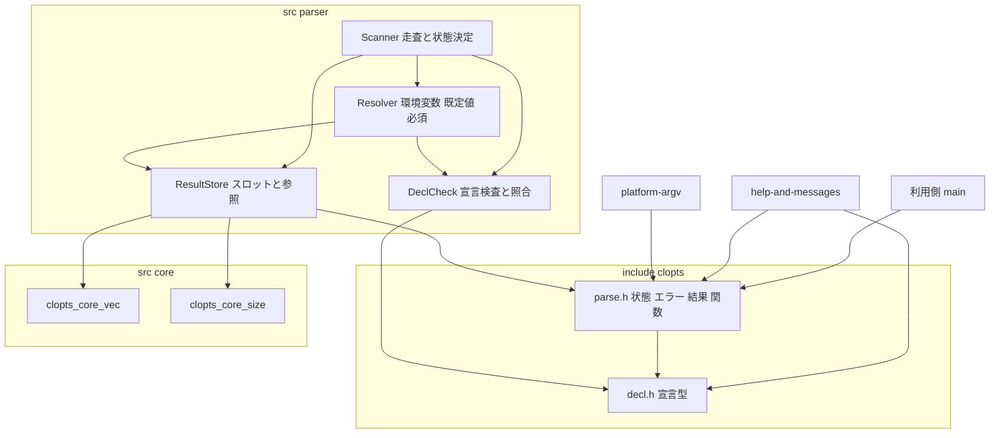
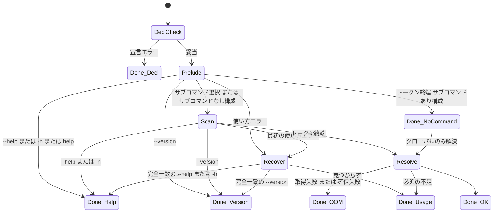
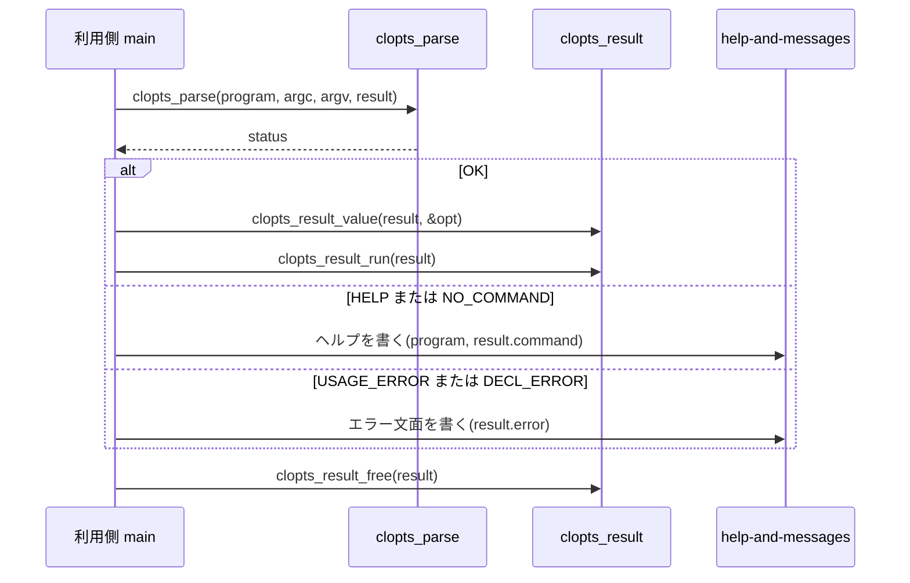
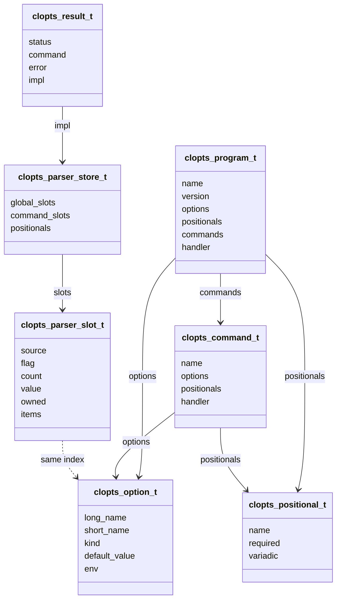

# Technical Design: core-parser

## Overview

**Purpose**: core-parser は、CLOpts の中核となる内部モジュール `parser` と、その公開契約（宣言型・状態・構造化エラー・結果・解析関数）を提供する。利用側は `static const` の宣言テーブルを書き、`clopts_parse` を 1 回呼ぶだけで、解析結果か構造化エラーを受け取る。

**Users**: C で CLI ツールを書く開発者が、サブコマンド・オプション・位置引数を宣言し、値を記述子ポインタで参照し、選択されたサブコマンドのハンドラを呼ぶ。help-and-messages は本 spec の型から文面を生成し、platform-argv は本 spec の環境変数取得関数の型に合わせた関数を提供する。

**Impact**: 新しい内部モジュール `src/parser/` とテスト `tests/parser/`、公開ヘッダ `include/clopts/decl.h` と `include/clopts/parse.h` を追加する。既存の変更は `src/CMakeLists.txt`、`tests/CMakeLists.txt`、傘ヘッダ `include/clopts/clopts.h` への 1 行ずつの追加に限る。

### Goals
- 公開ヘッダの宣言型・状態・エラー型・結果型を確定させ、help-and-messages と platform-argv が依存できる契約にする。
- 要件 1〜13 の挙動（宣言検査、走査規則、値の解決、必須検査、help / version の優先、構造化エラー、記述子ポインタ参照、メモリ所有）を 1 つのモジュールで満たす。
- I/O をせず、`exit` せず、宣言と argv を書き換えない。
- 架空の宣言だけを使う Naos テストで、全状態・全エラー種別を到達させる。

### Non-Goals
- 文面の生成（help-and-messages）、Windows での argv / 環境変数の UTF-8 取得（platform-argv）、利用者向け文書とサンプル（docs-and-release）。
- 値の型変換・妥当性検査、前方一致、候補提示、入れ子サブコマンド、グループ化・排他、隠しオプション・別名、設定ファイル、レスポンスファイル。
- Monde との API 互換。

## Boundary Commitments

### This Spec Owns
- 公開ヘッダ `include/clopts/decl.h`（宣言型 `clopts_program_t` / `clopts_command_t` / `clopts_option_t` / `clopts_positional_t`、`clopts_kind_t`、`clopts_handler_fn`）と `include/clopts/parse.h`（`clopts_status_t`、`clopts_usage_error_t`、`clopts_decl_error_t`、`clopts_error_t`、`clopts_source_t`、`clopts_result_t`、`clopts_getenv_fn`、公開関数）。
- 宣言検査の規則と宣言エラー種別の列挙。
- 走査規則（サブコマンド選択、グローバルオプション、長短オプション、まとめ書き、`--`、`-`、位置引数、`--no-<name>`、COUNT、LIST の分割）。
- 値の解決順（明示 > 環境変数 > 既定値）と出所、必須検査、help / version の優先と回復走査、最初の使い方エラーだけの報告。
- 結果ストア（スロット、位置引数、リスト項目と環境変数値の複製）、記述子ポインタによる参照 API、ハンドラ呼び出し、結果の解放。
- 既定の環境変数取得関数（`getenv` の戻り値を即座に複製する）。
- `tests/parser/` の単体テスト。

### Out of Boundary
- 文面（ヘルプ・使い方・バージョン・エラー）の生成と `FILE*` への出力。本 spec は文面に必要な情報（`value_name`、`summary`、`description`、エラーの各フィールド）を型に持たせるだけで、文字列を組み立てない。
- Windows の `GetCommandLineW` 分割と `GetEnvironmentVariableW`。本 spec は `clopts_getenv_fn` の型と既定実装（`getenv`）だけを持つ。
- 値の型変換や妥当性検査、オプション間の制約。
- サンプルプログラム、README、API リファレンス。

### Allowed Dependencies
- `include/clopts/writer.h`（project-foundation）: 公開ヘッダの傘からの include のみ。`parser` は writer を使わない。
- `src/core/core_internal.h`（project-foundation）: `clopts_core_vec_*`、`clopts_core_size_*`。
- C 標準ライブラリ: `<stddef.h>`、`<stdbool.h>`、`<stdlib.h>`（`malloc` / `calloc` / `free` / `getenv`）、`<string.h>`、`<assert.h>`、`<limits.h>`。`<stdio.h>` は使わない。
- 依存方向: `include/clopts/decl.h` ← `include/clopts/parse.h` ← `src/parser/parser_internal.h` ← `src/parser/*.c`。`src/parser/` が include してよい内部ヘッダは `core/core_internal.h` だけ。`help` / `platform` を include しない。

### Revalidation Triggers
- `decl.h` の宣言型のフィールド追加・変更・並び替え（`static const` 初期化子の互換に影響）→ help-and-messages、docs-and-release、examples。
- `clopts_usage_error_t` / `clopts_decl_error_t` / `clopts_status_t` の列挙値の追加・改名 → help-and-messages の文面表と網羅テスト。
- `clopts_error_t` のフィールドの意味（いつ有効か）の変更 → help-and-messages。
- `clopts_getenv_fn` のシグネチャ、戻り値、`*out` の所有権の変更 → platform-argv。
- 結果の殻 `clopts_result_t` の公開フィールド（`status` / `command` / `error`）の変更 → help-and-messages（`result.command` を読む）。
- 走査規則・予約名・既定値の変更 → docs-and-release の解析規則の章。

## Architecture

### Existing Architecture Analysis
- project-foundation が `clopts` ターゲット、`clopts_add_module` / `clopts_add_module_tests`、`src/core/`（可変長配列、サイズ計算、writer）、`include/clopts/{clopts,writer}.h` を提供している。本 spec は tech.md の内部モジュール図の `parser` を埋める。
- 傘ヘッダ `clopts.h` は現在 `writer.h` を include するだけ。`decl.h` と `parse.h` を加える。
- `_CRT_SECURE_NO_WARNINGS` は `clopts` ターゲットに PRIVATE 定義済みで、`getenv` を MSVC で警告なしに呼べる。
- Monde の `cli_args` の内部構造（型 ← 宣言検査 ← 結果 ← 走査器）と走査表・回復走査を踏襲し、グローバルオプション・否定・カウント・環境変数・記述子ポインタ参照を加える（research.md）。

### Architecture Pattern & Boundary Map



**Architecture Integration**:
- Selected pattern: 静的宣言テーブル + 単一パス走査器 + 構造化結果（roadmap 案A）。走査器は「前段（サブコマンド前）→ 本走査 → 回復走査 → 走査後の解決と検査」の 4 段。
- Domain/feature boundaries: DeclCheck は宣言だけを見る。Scanner は argv を読み、Store に記録を依頼し、状態を決める。Resolver は走査後にスロットを見て環境変数・既定値・必須を解決する。Store だけがメモリを所有する。
- Existing patterns preserved: `clopts_add_module`、内部ヘッダ `<module>_internal.h`、`clopts_core_` の再利用、`assert` による契約違反の検出、Allman スタイル。
- New components rationale: 4 つの責務（検査・走査・解決・保持）を 1 ファイルずつにして、テストもその単位で書く。
- Steering compliance: I/O なし、`exit` なし、宣言と argv は読み取り専用、確保はリスト項目と環境変数値と結果ストアのみ。

### Technology Stack

| Layer | Choice / Version | Role in Feature | Notes |
|-------|------------------|-----------------|-------|
| Language | C99 | 公開ヘッダと `src/parser/` | `<stdbool.h>` を使う。VLA、`_Complex` 不使用 |
| Internal utilities | project-foundation `core_internal.h` | 位置引数とリスト項目の可変長配列、サイズ計算の検査 | `clopts_core_vec_t`、`clopts_core_size_mul` |
| Build | CMake 3.21+、`clopts_add_module(parser ...)` | `clopts` ターゲットへのソース追加 | `src/parser/CMakeLists.txt` |
| Test | Naos v0.4.0、`clopts_add_module_tests(parser ...)` | `parser_tests`、ラベル `parser` | `tests/parser/CMakeLists.txt` |

## File Structure Plan

### Directory Structure
```
include/clopts/
├── clopts.h                 # 傘ヘッダ。decl.h と parse.h の include を追加（変更）
├── decl.h                   # 宣言型: clopts_kind_t、clopts_option_t、clopts_positional_t、clopts_handler_fn、clopts_command_t、clopts_program_t、CLOPTS_COUNT_MAX_DEFAULT
└── parse.h                  # 解析契約: clopts_status_t、clopts_usage_error_t、clopts_decl_error_t、clopts_error_t、clopts_source_t、clopts_result_t、clopts_env_status_t、clopts_getenv_fn、公開関数
src/parser/
├── CMakeLists.txt           # clopts_add_module(parser SOURCES parser_decl.c parser_store.c parser_resolve.c parser_scan.c)
├── parser_internal.h        # 内部契約: clopts_parser_store_t と slot、DeclCheck / Store / Resolver の内部関数
├── parser_decl.c            # DeclCheck: clopts_decl_validate と照合関数（コマンド、長い名前、短い名前、否定形）
├── parser_store.c           # ResultStore: ストアの確保・記録・解放、公開アクセサ、clopts_result_free、clopts_result_run
├── parser_resolve.c         # Resolver: 環境変数フォールバック、既定値、必須検査、既定の getenv 取得関数
└── parser_scan.c            # Scanner: clopts_parse / clopts_parse_with_env、前段、本走査、回復走査、状態決定
tests/parser/
├── CMakeLists.txt           # clopts_add_module_tests(parser SOURCES ...)
├── parser_tests_main.c      # NAOS_MAIN にスイートを並べる
├── test_fixtures.h          # 架空のプログラム宣言（サブコマンドあり "tool"、なし "filt"）と環境変数のモック取得関数の宣言
├── test_fixtures.c          # 上記の定義
├── test_decl_check.c        # スイート decl: 宣言エラー種別ごとに 1 件以上、clopts_decl_validate
├── test_dispatch.c          # スイート dispatch: サブコマンド選択、グローバルオプション、NO_COMMAND、help / --help / --version の前段
├── test_long.c              # スイート long: 長いオプション、=、値の消費、不明、--no-<name>
├── test_short.c             # スイート short: まとめ書き、値の連結、-h、不明な 1 文字
├── test_values.c            # スイート values: FLAG / COUNT / VALUE / LIST の繰り返し規則、区切り、クランプ
├── test_positional.c        # スイート positional: 混在、--、-、必須 / 任意 / 可変長、余分な引数
├── test_resolve.c           # スイート resolve: 環境変数（モック）、既定値、出所、必須、スコープ限定、ENV_FAILED → OUT_OF_MEMORY
├── test_errors.c            # スイート errors: 構造化エラーの各フィールド、最初のエラー、回復走査、help / version の優先
└── test_result.c            # スイート result: 記述子ポインタ参照、位置引数、run、解放の冪等性、ゼロ初期化の解放、OOM 後の解放
```

### Modified Files
- `include/clopts/clopts.h` — `#include "clopts/decl.h"` と `#include "clopts/parse.h"` を追加。
- `src/CMakeLists.txt` — `add_subdirectory(parser)` を追加。
- `tests/CMakeLists.txt` — `add_subdirectory(parser)` を追加。

## System Flows

### 解析の全体の流れ



- Prelude（前段）は argv の先頭からサブコマンド名が現れるまでを処理する。サブコマンドなし構成では Prelude を経ずに Scan に入る。
- Scan 中の `--help` / `-h` / `--version` は即座に状態を決める（以降のトークンは見ない）。
- Recover は最初の使い方エラーのトークンの次から `--` の手前までを見る（9.12）。
- Resolve は「環境変数 → 既定値 → 必須検査」の順で、選択されたスコープ（グローバル + 選択コマンド、または program）に限って行う。NO_COMMAND ではグローバルのみ（7.8、8.6）。

### 利用側の典型的な流れ



## Requirements Traceability

| Requirement | Summary | Components | Interfaces | Flows |
|-------------|---------|------------|------------|-------|
| 1.1, 1.2, 1.3, 1.4, 1.5, 1.6, 1.7, 1.9 | 宣言型と `static const` 初期化、サブコマンドあり / なし構成 | PublicHeaders | `decl.h` の型 | — |
| 1.8 | 宣言と argv を書き換えない | Scanner, ResultStore | `const` 修飾、`char *const *argv` | — |
| 2.1, 2.2, 2.18 | 解析前の宣言検査、単独検査、最初の 1 件 | DeclCheck, Scanner | `clopts_decl_validate`、`clopts_parser_decl_check` | DeclCheck 状態 |
| 2.3, 2.4, 2.5, 2.6, 2.7, 2.8, 2.9, 2.10, 2.11, 2.12, 2.13, 2.14, 2.15, 2.16 | 宣言エラーの各規則 | DeclCheck | `clopts_decl_error_t`、宣言検査の規則表 | — |
| 2.17 | 宣言エラーの構造体 | DeclCheck, PublicHeaders | `clopts_error_t` | — |
| 3.1, 3.2, 3.3 | 解析関数、7 状態、I/O なし | Scanner, PublicHeaders | `clopts_parse`、`clopts_status_t` | 全体の流れ |
| 3.4, 3.5 | OK / HELP での結果参照 | ResultStore, Scanner | `clopts_result_t.command`、アクセサ | — |
| 3.6, 3.8 | NO_COMMAND、`argc == 0` | Scanner, Resolver | 前段の表 | Done_NoCommand |
| 3.7 | OUT_OF_MEMORY | ResultStore, Resolver, Scanner | 全確保点の失敗伝播 | Done_OOM |
| 4.1, 4.2, 4.3, 4.4, 4.5, 4.6 | サブコマンド選択とグローバルオプション | Scanner, DeclCheck | 前段の表、照合関数 | Prelude, Scan |
| 5.1, 5.2, 5.3, 5.4, 5.5, 5.6, 5.7 | 長いオプション | Scanner, DeclCheck | 本走査の表、`clopts_parser_find_long` | Scan |
| 5.8, 5.9, 5.10, 5.11 | 短いオプションとまとめ書き | Scanner, DeclCheck | 短いオプションの手順、`clopts_parser_find_short` | Scan |
| 5.12, 5.13, 5.14, 5.15 | `--`、`-`、位置引数の混在、余分な引数 | Scanner, ResultStore | 本走査の表、`clopts_parser_store_add_positional` | Scan |
| 6.1, 6.2, 6.3, 6.4, 6.5 | FLAG と否定 | Scanner, DeclCheck, ResultStore | `clopts_parser_find_negation`、`clopts_parser_store_set_flag` | Scan |
| 6.6, 6.7 | COUNT とクランプ | ResultStore | `clopts_parser_store_add_count`、`count_max` | — |
| 6.8, 6.9, 6.10, 6.11, 6.12 | VALUE の後勝ち、LIST の連結と分割、文字列のまま | ResultStore | `clopts_parser_store_set_value`、`clopts_parser_store_append_list` | — |
| 7.1, 7.2, 7.3, 7.4, 7.5 | 解決順と出所、LIST の分割 | Resolver, ResultStore | `clopts_source_t`、`clopts_parser_resolve` | Resolve |
| 7.6, 7.7, 7.9 | 取得関数の差し替え、複製、失敗 | Resolver, PublicHeaders | `clopts_getenv_fn`、`clopts_parse_with_env`、`clopts_parser_getenv_default` | Resolve |
| 7.8 | 参照スコープの限定 | Resolver | `clopts_parser_resolve` の引数 | Resolve |
| 8.1, 8.2, 8.3, 8.4, 8.5, 8.6, 8.7 | 必須検査と位置引数の個数 | Resolver, Scanner | `clopts_parser_check_required`、位置引数の割り当て規則 | Resolve |
| 9.1, 9.2, 9.3, 9.4, 9.5, 9.6, 9.7, 9.8, 9.9, 9.10, 9.11, 9.12 | help / version の検出と優先、回復走査 | Scanner | 前段の表、本走査の表、回復走査 | Prelude, Scan, Recover |
| 10.1, 10.2, 10.6 | エラー種別の列挙と状態による区別 | PublicHeaders | `clopts_usage_error_t`、`clopts_decl_error_t` | — |
| 10.3, 10.4, 10.5, 10.7 | エラー構造体のフィールド | PublicHeaders, Scanner, DeclCheck | `clopts_error_t` | — |
| 11.1, 11.2, 11.3 | 記述子ポインタ参照、出所、契約違反の検出 | ResultStore | `clopts_result_flag` ほか、`clopts_parser_store_slot` | — |
| 11.4 | 選択コマンドと位置引数の参照 | ResultStore | `clopts_result_t.command`、`clopts_result_positional_*` | — |
| 11.5, 11.6 | ハンドラ呼び出し | ResultStore | `clopts_result_run` | 利用側の流れ |
| 11.7, 11.8 | 値の指し先と複製の範囲 | ResultStore, Resolver | スロットの `value` / `owned` / `items` | — |
| 12.1, 12.2, 12.3, 12.4 | 解放の契約 | ResultStore | `clopts_result_free` | — |
| 12.5, 12.6 | オーバーフロー検査、OOM 後の保持 | ResultStore | `clopts_core_size_mul`、`clopts_core_vec_push` の失敗時不変 | — |
| 13.1, 13.2, 13.3, 13.4, 13.5, 13.6 | 単体テスト | ParserTests | `tests/parser/` | — |

## Components and Interfaces

| Component | Domain/Layer | Intent | Req Coverage | Key Dependencies (P0/P1) | Contracts |
|-----------|--------------|--------|--------------|--------------------------|-----------|
| PublicHeaders | 公開 API | 宣言型、状態、エラー、結果、公開関数の契約 | 1.1〜1.9, 2.17, 3.2, 7.6, 10.1〜10.7 | writer.h (P2) | State |
| DeclCheck | parser | 宣言検査と宣言の照合（コマンド、長い名前、短い名前、否定形） | 2.1〜2.18, 4.5, 5.7, 6.4 | PublicHeaders (P0) | Service |
| ResultStore | parser | スロットと位置引数の保持、記述子ポインタ参照、解放、ハンドラ呼び出し | 3.4, 5.15, 6.1〜6.12, 11.1〜11.8, 12.1〜12.6 | CoreVec (P0), CoreSize (P0), DeclCheck (P1) | Service, State |
| Resolver | parser | 環境変数・既定値・必須の解決、既定の取得関数 | 7.1〜7.9, 8.1〜8.7 | ResultStore (P0), DeclCheck (P1) | Service |
| Scanner | parser | 前段・本走査・回復走査・状態決定、`clopts_parse` | 3.1〜3.8, 4.1〜4.6, 5.1〜5.15, 9.1〜9.12, 10.3〜10.4 | DeclCheck (P0), ResultStore (P0), Resolver (P0) | Service |
| ParserTests | テスト | `tests/parser/` の Naos テスト | 13.1〜13.6 | Naos (P0) | — |

### 公開 API

#### PublicHeaders（`include/clopts/decl.h`、`include/clopts/parse.h`）

| Field | Detail |
|-------|--------|
| Intent | 利用側と downstream spec が依存する型と関数の契約 |
| Requirements | 1.1〜1.9, 2.17, 3.2, 7.6, 10.1〜10.7 |

**Responsibilities & Constraints**
- `decl.h` は `<stddef.h>`、`<stdbool.h>`、`<limits.h>` だけを include し、他の CLOpts ヘッダに依存しない。`parse.h` は `decl.h` を include する。
- すべての型は `typedef struct clopts_x { ... } clopts_x_t;` の形。列挙値は `CLOPTS_` 接頭辞。`extern "C"` ガードを持つ。
- 利用側が `static const` の初期化子で書けるよう、宣言型は POD で、関数ポインタと `void *` 以外は `const char *`、`char`、`bool`、`unsigned`、`size_t`、列挙だけを持つ。

**Contracts**: State [x]

```c
/* include/clopts/decl.h */
typedef enum clopts_kind
{
    CLOPTS_FLAG,   /* 値を取らない。指定で真。negatable なら --no-<name> で偽 */
    CLOPTS_COUNT,  /* 値を取らない。指定回数を数える。count_max でクランプ */
    CLOPTS_VALUE,  /* 単一の値。繰り返すと後勝ち */
    CLOPTS_LIST    /* リスト値。繰り返すと連結。list_delimiter で分割 */
} clopts_kind_t;

typedef struct clopts_option
{
    const char *long_name;      /* 先頭の "--" を含まない。NULL なら短い名前のみ */
    char short_name;            /* 1 文字。'\0' なら長い名前のみ */
    clopts_kind_t kind;
    const char *value_name;     /* VALUE / LIST のヘルプ上の値名。NULL 可（help 側が既定を補う） */
    const char *help;           /* 説明（英語、1 行）。NULL 可 */
    const char *default_value;  /* VALUE / LIST のみ。NULL ならなし。LIST は list_delimiter で分割される */
    const char *env;            /* VALUE / LIST のみ。フォールバック先の環境変数名。NULL ならなし */
    char list_delimiter;        /* LIST のみ。'\0' なら 1 回の指定を 1 項目とする */
    unsigned count_max;         /* COUNT のみ。0 なら CLOPTS_COUNT_MAX_DEFAULT */
    bool required;              /* VALUE / LIST のみ */
    bool negatable;             /* FLAG のみ。--no-<long_name> を受け付ける */
} clopts_option_t;

#define CLOPTS_COUNT_MAX_DEFAULT UINT_MAX   /* <limits.h> */

typedef struct clopts_positional
{
    const char *name;   /* ヘルプとメッセージ上の名前（例: "FILE"）。山括弧を含まない */
    const char *help;   /* NULL 可 */
    bool required;
    bool variadic;      /* 残りのトークンをすべて受ける。配列の末尾でのみ可 */
} clopts_positional_t;

struct clopts_result;
typedef int (*clopts_handler_fn)(const struct clopts_result *result, void *userdata);

typedef struct clopts_command
{
    const char *name;
    const char *summary;                      /* 全体ヘルプの 1 行説明。NULL 可 */
    const char *description;                  /* サブコマンドヘルプの説明。NULL なら help 側が summary を使う */
    const clopts_option_t *options;           /* option_count == 0 なら NULL 可 */
    size_t option_count;
    const clopts_positional_t *positionals;   /* positional_count == 0 なら NULL 可 */
    size_t positional_count;
    clopts_handler_fn handler;                /* NULL 可 */
    void *userdata;
} clopts_command_t;

typedef struct clopts_program
{
    const char *name;                         /* 必須。空でない */
    const char *description;                  /* NULL 可 */
    const char *version;                      /* NULL なら --version を予約しない */
    const clopts_option_t *options;           /* サブコマンドあり構成ではグローバルオプション、なし構成ではオプション */
    size_t option_count;
    const clopts_positional_t *positionals;   /* サブコマンドなし構成のみ解析対象。あり構成では無視 */
    size_t positional_count;
    const clopts_command_t *commands;         /* command_count == 0 ならサブコマンドなし構成 */
    size_t command_count;
    clopts_handler_fn handler;                /* サブコマンドなし構成のみ。あり構成では無視 */
    void *userdata;
} clopts_program_t;
```

```c
/* include/clopts/parse.h */
typedef enum clopts_status
{
    CLOPTS_OK,
    CLOPTS_HELP,            /* result->command が NULL なら全体、非 NULL ならそのサブコマンド */
    CLOPTS_VERSION,
    CLOPTS_NO_COMMAND,      /* サブコマンドあり構成でサブコマンドが現れなかった。グローバルの値は参照可 */
    CLOPTS_USAGE_ERROR,     /* result->error.usage が有効 */
    CLOPTS_DECL_ERROR,      /* result->error.decl が有効。argv は読んでいない */
    CLOPTS_OUT_OF_MEMORY
} clopts_status_t;

typedef enum clopts_usage_error
{
    CLOPTS_USAGE_UNKNOWN_COMMAND,     /* token: 不明な名前 */
    CLOPTS_USAGE_UNKNOWN_OPTION,      /* token, name_len または short_name */
    CLOPTS_USAGE_MISSING_VALUE,       /* option, token */
    CLOPTS_USAGE_UNEXPECTED_VALUE,    /* option（予約オプションなら NULL）, token */
    CLOPTS_USAGE_MISSING_OPTION,      /* option */
    CLOPTS_USAGE_MISSING_ARGUMENT,    /* positional */
    CLOPTS_USAGE_UNEXPECTED_ARGUMENT  /* token */
} clopts_usage_error_t;

typedef enum clopts_decl_error
{
    CLOPTS_DECL_INVALID_NAME,          /* program / command / option の名前や env の形式 (2.7, 2.16) */
    CLOPTS_DECL_NO_NAME,               /* 長い名前も短い名前もない (2.6) */
    CLOPTS_DECL_DUPLICATE_COMMAND,     /* (2.4) */
    CLOPTS_DECL_DUPLICATE_OPTION,      /* 同一スコープまたはグローバルと command の間 (2.3) */
    CLOPTS_DECL_RESERVED_NAME,         /* help / h / version / help コマンド (2.5) */
    CLOPTS_DECL_NOT_NEGATABLE,         /* FLAG 以外に negatable (2.8) */
    CLOPTS_DECL_NEGATION_CONFLICT,     /* 否定可能な x と実名 no-x (2.9) */
    CLOPTS_DECL_DEFAULT_NOT_ALLOWED,   /* FLAG / COUNT に default_value (2.10) */
    CLOPTS_DECL_ENV_NOT_ALLOWED,       /* FLAG / COUNT に env (2.11) */
    CLOPTS_DECL_REQUIRED_WITH_DEFAULT, /* (2.12) */
    CLOPTS_DECL_REQUIRED_NOT_ALLOWED,  /* FLAG / COUNT に required (2.13) */
    CLOPTS_DECL_POSITIONAL_ORDER,      /* 任意の後ろに必須 (2.14) */
    CLOPTS_DECL_VARIADIC_POSITION      /* 可変長が末尾以外、または 2 つ以上 (2.15) */
} clopts_decl_error_t;

typedef struct clopts_error
{
    clopts_usage_error_t usage;          /* status == CLOPTS_USAGE_ERROR のとき有効 */
    clopts_decl_error_t decl;            /* status == CLOPTS_DECL_ERROR のとき有効 */
    const clopts_command_t *command;     /* 該当する command。program 直下 / 選択前なら NULL */
    const clopts_option_t *option;       /* 該当する option。なければ NULL */
    const clopts_positional_t *positional; /* 該当する positional。なければ NULL */
    const char *token;                   /* 使い方エラー: 該当する argv 要素。なければ NULL */
    int argv_index;                      /* 使い方エラー: token の argv 添字。なければ -1 */
    size_t name_len;                     /* UNKNOWN_OPTION の長い形: token 内の "--name" の長さ（"=" の手前まで）。他は 0 */
    char short_name;                     /* まとめ書き中の該当 1 文字。該当なしなら '\0' */
} clopts_error_t;

typedef enum clopts_source
{
    CLOPTS_SOURCE_NONE,      /* 未指定 */
    CLOPTS_SOURCE_DEFAULT,
    CLOPTS_SOURCE_ENV,
    CLOPTS_SOURCE_EXPLICIT
} clopts_source_t;

typedef struct clopts_result
{
    clopts_status_t status;
    const clopts_command_t *command;     /* 選択されたサブコマンド。なし構成 / 未選択なら NULL */
    clopts_error_t error;                /* USAGE_ERROR / DECL_ERROR で有効 */
    struct clopts_parser_store *impl;    /* 内部。ゼロ初期化 (NULL) は有効な空状態 */
} clopts_result_t;

typedef enum clopts_env_status
{
    CLOPTS_ENV_FOUND,   /* *out に malloc 系で確保した複製を入れた。ライブラリが free() する */
    CLOPTS_ENV_UNSET,   /* 未設定。*out は触らない */
    CLOPTS_ENV_FAILED   /* 取得失敗（メモリ不足、変換失敗）。*out は触らない。解析は OUT_OF_MEMORY */
} clopts_env_status_t;

typedef clopts_env_status_t (*clopts_getenv_fn)(void *ctx, const char *name, char **out);

/* 宣言だけを検査する。妥当なら CLOPTS_OK、そうでなければ CLOPTS_DECL_ERROR と *error（NULL 可） */
clopts_status_t clopts_decl_validate(const clopts_program_t *program, clopts_error_t *error);

/* argv[0] を読み飛ばし argv[1..argc-1] を解析する。既定の取得関数（getenv の複製）を使う */
clopts_status_t clopts_parse(const clopts_program_t *program, int argc, char *const *argv,
                             clopts_result_t *result);
/* getenv_fn が NULL なら既定の取得関数 */
clopts_status_t clopts_parse_with_env(const clopts_program_t *program, int argc, char *const *argv,
                                      clopts_getenv_fn getenv_fn, void *env_ctx,
                                      clopts_result_t *result);

/* 値の参照。option は解析に使った宣言テーブルの要素でなければならない（契約違反は assert） */
bool clopts_result_flag(const clopts_result_t *result, const clopts_option_t *option);
unsigned clopts_result_count(const clopts_result_t *result, const clopts_option_t *option);
const char *clopts_result_value(const clopts_result_t *result, const clopts_option_t *option);
size_t clopts_result_list_count(const clopts_result_t *result, const clopts_option_t *option);
const char *clopts_result_list_at(const clopts_result_t *result, const clopts_option_t *option,
                                  size_t index);
clopts_source_t clopts_result_source(const clopts_result_t *result, const clopts_option_t *option);
size_t clopts_result_positional_count(const clopts_result_t *result);
const char *clopts_result_positional_at(const clopts_result_t *result, size_t index);

/* status == CLOPTS_OK のとき、選択コマンド（なし構成では program）の handler を呼び、その戻り値を返す */
int clopts_result_run(const clopts_result_t *result);

/* 確保した領域を解放し impl = NULL に戻す。ゼロ初期化・解放済みに対しても安全。status / command / error は変えない */
void clopts_result_free(clopts_result_t *result);
```

- 事前条件: `clopts_parse*` は `program != NULL`、`result != NULL`、`argc >= 0`、`argv[0..argc-1]` が NUL 終端（`argc == 0` のとき `argv` の要素は読まない）。`result` は未初期化でも、ゼロ初期化でも、前回の解析結果でもよく、前回の `impl` は解放してから書く。
- 事後条件: 戻り値 `== result->status`。`CLOPTS_OK` では全スロットの解決済み、位置引数の個数が宣言の範囲内。`CLOPTS_HELP` / `CLOPTS_VERSION` / `CLOPTS_NO_COMMAND` では `error` を触らない。`CLOPTS_DECL_ERROR` では argv を読まない。どの状態でも `clopts_result_free` を呼べる。
- 不変条件: 宣言テーブルと argv は変更されない。`CLOPTS_OK` / `CLOPTS_NO_COMMAND` 以外では値の参照関数を呼ばない（契約違反は `assert`）。

**Implementation Notes**
- Integration: 傘ヘッダに 2 行追加。install は `include/clopts/` ごと行われるため変更不要。
- Validation: `tests/parser/test_result.c` で `clopts_result_t result = {0};` を直接 `clopts_result_free` し、C++ からの include を `extern "C"` で守る（integration テストは project-foundation が持つ C のみのため、C++ の検証は docs-and-release に委ねる）。
- Risks: `clopts_option_t` のフィールド順は `static const` の位置指定なし初期化子に影響する。利用者には指示付き初期化子（C99 `.name = ...`）を推奨する（docs-and-release）。

### parser モジュール

#### DeclCheck（`src/parser/parser_decl.c`）

| Field | Detail |
|-------|--------|
| Intent | 宣言の妥当性検査と、走査器・リゾルバが使う宣言の照合 |
| Requirements | 2.1〜2.18, 4.5, 5.7, 6.4 |

**Responsibilities & Constraints**
- 検査は宣言テーブルの先頭から順（program → グローバルオプション → 各 command の名前 → その options → その positionals）に行い、最初の違反で止めて `clopts_error_t` を埋める（2.18）。
- 照合はバイト単位の完全一致で、大文字小文字を区別する（4.5、5.7）。前方一致はしない。
- 予約名: 長い名前 `help`、短い名前 `h`、コマンド名 `help`、および `program->version != NULL` のときの長い名前 `version`。

宣言検査の規則（違反時の種別）:

| 規則 | 種別 |
|---|---|
| `program->name` が NULL でも空でもない。各 command の `name` が NULL でも空でもなく、`-` で始まらず、空白を含まない | `INVALID_NAME` |
| option は `long_name != NULL` または `short_name != '\0'` | `NO_NAME` |
| `long_name` は空でなく、`-` で始まらず、`=` と空白を含まない。`short_name` は `-`、`=`、空白でない。`env` は NULL か空でない | `INVALID_NAME` |
| 同じスコープ内、およびグローバルと各 command の間で、`long_name` と `short_name` がそれぞれ重複しない | `DUPLICATE_OPTION` |
| command の `name` が重複しない | `DUPLICATE_COMMAND` |
| `long_name` が `help` / `version`（version 非 NULL 時）でない、`short_name` が `h` でない、command の `name` が `help` でない | `RESERVED_NAME` |
| `negatable` は `kind == CLOPTS_FLAG` のときだけ | `NOT_NEGATABLE` |
| 否定可能な FLAG `x` と同じ照合範囲（同じスコープ、またはグローバルと command）に `long_name == "no-x"` の option がない | `NEGATION_CONFLICT` |
| `default_value` は VALUE / LIST のみ | `DEFAULT_NOT_ALLOWED` |
| `env` は VALUE / LIST のみ | `ENV_NOT_ALLOWED` |
| `required` と `default_value` を同時に持たない | `REQUIRED_WITH_DEFAULT` |
| `required` は VALUE / LIST のみ | `REQUIRED_NOT_ALLOWED` |
| positionals で `required == false` の後ろに `required == true` がない | `POSITIONAL_ORDER` |
| `variadic` は配列の末尾の 1 つだけ | `VARIADIC_POSITION` |

- サブコマンドあり構成（`command_count > 0`）では `program->positionals` と `program->handler` は検査も解析もしない（1.4）。
- 同一スコープのオプション同士の重複はグローバルと command の間も含めて検査するが、異なる command 同士の重複は許す。

**Dependencies**
- Inbound: Scanner、Resolver、ResultStore — 照合と検査（P0）
- Outbound: PublicHeaders — 型（P0）

**Contracts**: Service [x]

```c
/* src/parser/parser_internal.h */

/* どちらの配列のオプションかを示す */
typedef struct clopts_parser_ref
{
    const clopts_option_t *option;  /* NULL なら見つからなかった */
    bool global;                    /* true: program->options、false: command->options */
    size_t index;                   /* その配列内の添字 */
    bool negated;                   /* --no-<name> で見つかった */
} clopts_parser_ref_t;

/* 宣言検査。妥当なら 0、違反なら -1 と *error */
int clopts_parser_decl_check(const clopts_program_t *program, clopts_error_t *error);

const clopts_command_t *clopts_parser_find_command(const clopts_program_t *program,
                                                   const char *name);
/* command（NULL 可）の options を先に、次に program->options を探す。name は name_len バイト */
clopts_parser_ref_t clopts_parser_find_long(const clopts_program_t *program,
                                            const clopts_command_t *command,
                                            const char *name, size_t name_len);
/* 完全一致がなく name が "no-" で始まるとき、残りを negatable な FLAG として探す */
clopts_parser_ref_t clopts_parser_find_negation(const clopts_program_t *program,
                                                const clopts_command_t *command,
                                                const char *name, size_t name_len);
clopts_parser_ref_t clopts_parser_find_short(const clopts_program_t *program,
                                             const clopts_command_t *command, char c);
```

**Implementation Notes**
- Validation: `test_decl_check.c` で規則表の各行に 1 件以上、かつ `clopts_decl_validate` が argv なしで同じ結果を返すこと。
- Risks: 予約名の判定が `version != NULL` に依存するため、「`version` を NULL にしたら `--version` という自前のオプションが許される」ことをテストで固定する。

#### ResultStore（`src/parser/parser_store.c`）

| Field | Detail |
|-------|--------|
| Intent | スロット（値・出所・所有メモリ）と位置引数の保持、公開アクセサ、解放、ハンドラ呼び出し |
| Requirements | 3.4, 5.15, 6.1〜6.12, 11.1〜11.8, 12.1〜12.6 |

**Responsibilities & Constraints**
- ストアはグローバル用と選択コマンド用の 2 本のスロット配列を持つ。スロットは option と同じ添字。配列は `calloc` で確保し、サイズ計算は `clopts_core_size_mul` で検査する（12.5）。
- VALUE の `value` は argv または宣言の既定値、または環境変数の複製（スロットが所有）を指す（11.7、11.8）。LIST の項目は常に複製し `char *` の `clopts_core_vec_t` で持つ。位置引数は argv を指す `const char *` の `clopts_core_vec_t`。
- 記録関数は出所を引数に取り、FLAG は真偽（否定なら偽）、COUNT は `+1` して `count_max`（0 なら `CLOPTS_COUNT_MAX_DEFAULT`）でクランプ、VALUE は置換、LIST は区切りで分割して追加（空の項目も追加）。同じスロットへの記録は出所も上書きする。
- 記述子ポインタ → スロットの解決は、選択コマンドの `options[i]`、次に `program->options[i]` の要素アドレスとの等値比較で行う。見つからなければ `assert(0)`（11.3）。`NDEBUG` では未指定相当（`false` / `0` / `NULL` / `CLOPTS_SOURCE_NONE`）を返す。
- 確保失敗時はストアの既存の内容を保ち `-1` を返す（12.6）。`clopts_core_vec_push` の失敗時不変に依存する。
- `clopts_result_free` は `impl` 配下（環境変数の複製、リスト項目、2 本の vec、スロット配列、ストア本体）を解放し `impl = NULL`。`impl == NULL` なら何もしない（12.1〜12.3）。
- `clopts_result_run` は `status == CLOPTS_OK` かつ対象の `handler != NULL` を `assert` し、`handler(result, userdata)` の戻り値を返す（11.5、11.6）。

**Dependencies**
- Inbound: Scanner、Resolver — 記録（P0）；利用側 — アクセサ（P0）
- Outbound: CoreVec、CoreSize — 可変長配列とサイズ検査（P0）；DeclCheck — なし（照合は Scanner が行い `ref` を渡す）

**Contracts**: Service [x] / State [x]

```c
/* src/parser/parser_internal.h */
typedef struct clopts_parser_slot
{
    clopts_source_t source;
    bool flag;
    unsigned count;
    const char *value;        /* VALUE: argv / 既定値 / owned を指す。なければ NULL */
    char *owned;              /* 環境変数の複製。スロットが所有。なければ NULL */
    clopts_core_vec_t items;  /* LIST: char * の配列。各項目を所有 */
} clopts_parser_slot_t;

typedef struct clopts_parser_store
{
    const clopts_program_t *program;
    const clopts_command_t *command;      /* 選択コマンド。NULL 可 */
    clopts_parser_slot_t *global_slots;   /* program->option_count 個 */
    clopts_parser_slot_t *command_slots;  /* command->option_count 個。command が NULL なら NULL */
    clopts_core_vec_t positionals;        /* const char * */
} clopts_parser_store_t;

/* 確保して result->impl に設定する。前の impl は解放する。失敗なら -1 */
int clopts_parser_store_begin(clopts_result_t *result, const clopts_program_t *program);
/* サブコマンド選択時に command_slots を確保する。失敗なら -1 */
int clopts_parser_store_select(clopts_result_t *result, const clopts_command_t *command);
clopts_parser_slot_t *clopts_parser_store_slot(clopts_parser_store_t *store,
                                               const clopts_parser_ref_t *ref);
void clopts_parser_store_set_flag(clopts_parser_slot_t *slot, bool value, clopts_source_t source);
void clopts_parser_store_add_count(clopts_parser_slot_t *slot, unsigned count_max);
void clopts_parser_store_set_value(clopts_parser_slot_t *slot, const char *value,
                                   clopts_source_t source);
/* value を delimiter で分割して追加。delimiter が '\0' なら 1 項目。失敗なら -1 */
int clopts_parser_store_append_list(clopts_parser_slot_t *slot, const char *value,
                                    char delimiter, clopts_source_t source);
/* 環境変数の複製の所有権を slot に移す（VALUE）。既存の owned は解放する */
void clopts_parser_store_own(clopts_parser_slot_t *slot, char *owned);
int clopts_parser_store_add_positional(clopts_parser_store_t *store, const char *token);
```

**State Management**
- State model: `impl == NULL`（空）→ `begin` 後（グローバルのスロットあり）→ `select` 後（コマンドのスロットあり）→ `free` で空に戻る。
- Persistence & consistency: スロットの `source` と値は常に対になって更新される。`owned` が非 NULL のとき `value == owned`。
- Concurrency strategy: 結果は呼び出し側のスレッドに閉じる。ライブラリはグローバル可変状態を持たない。

**Implementation Notes**
- Validation: `test_result.c` でアクセサ、`run`、解放の冪等性、ゼロ初期化の解放、`CLOPTS_ENV_FAILED` 経由の OUT_OF_MEMORY 後の解放。`test_values.c` で記録規則。
- Risks: スロット配列を `calloc` した直後は `items.elem_size == 0` のため、`begin` / `select` で各スロットの `items` を `clopts_core_vec_init(sizeof(char *))` で初期化する。

#### Resolver（`src/parser/parser_resolve.c`）

| Field | Detail |
|-------|--------|
| Intent | 走査後の値の解決（環境変数 → 既定値）、必須検査、既定の環境変数取得関数 |
| Requirements | 7.1〜7.9, 8.1〜8.7 |

**Responsibilities & Constraints**
- 解決の対象は、ストアにスロットがある範囲（グローバル + 選択コマンド、または program）だけ（7.8）。宣言順（グローバル → コマンド）に、`source == CLOPTS_SOURCE_NONE` の VALUE / LIST のスロットについて、`env` があれば取得関数を呼び、`FOUND` なら VALUE は `own` して `set_value(ENV)`、LIST は分割して `append_list(ENV)` の後に複製を `free`。`UNSET` で `default_value` があれば `set_value(DEFAULT)` / `append_list(DEFAULT)`。`FAILED` または確保失敗なら即座に `-1`（→ OUT_OF_MEMORY）（7.2〜7.5、7.9）。
- 必須検査は解決の後に宣言順（グローバル → コマンド → 位置引数）で行い、最初の不足を `clopts_error_t` に入れて `MISSING_OPTION` / `MISSING_ARGUMENT` を返す（8.1〜8.3、8.7）。位置引数は「必須の positional の個数 > 記録した位置引数の個数」で不足とし、可変長かつ必須は 1 個以上を要求する（8.4、8.5）。
- NO_COMMAND では解決と必須検査をグローバルに限る（8.6）。
- 既定の取得関数 `clopts_parser_getenv_default` は `getenv(name)` の戻り値を即座に `malloc` + コピーし、NULL なら `UNSET`、確保失敗なら `FAILED`。

**Dependencies**
- Inbound: Scanner — 走査後に呼ぶ（P0）
- Outbound: ResultStore — 記録（P0）；取得関数 — 差し替え可（P1）

**Contracts**: Service [x]

```c
/* src/parser/parser_internal.h */
clopts_env_status_t clopts_parser_getenv_default(void *ctx, const char *name, char **out);

/* 環境変数と既定値を解決する。include_command が false ならグローバルのみ。失敗（取得失敗・確保失敗）なら -1 */
int clopts_parser_resolve(clopts_result_t *result, clopts_getenv_fn getenv_fn, void *env_ctx,
                          bool include_command);
/* 必須オプションと必須位置引数を検査する。不足があれば -1 と result->error */
int clopts_parser_check_required(clopts_result_t *result, bool include_command);
```

**Implementation Notes**
- Validation: `test_resolve.c` はモック取得関数（名前 → 値の表、`FAILED` を返すモード）を使い、実際のプロセス環境に依存しない（13.5）。出所の 4 区分、LIST の既定値と環境変数の分割、環境変数が空文字列のときの `FOUND`、選択されなかったコマンドの `env` を参照しないこと（モックの呼び出し記録で検証）。
- Risks: `getenv` の戻り値は後続の `getenv` / `putenv` で無効になりうるため、既定の取得関数は複製以外の用途で保持しない。

#### Scanner（`src/parser/parser_scan.c`）

| Field | Detail |
|-------|--------|
| Intent | `clopts_parse` / `clopts_parse_with_env` の実装。前段・本走査・回復走査・状態決定 |
| Requirements | 3.1〜3.8, 4.1〜4.6, 5.1〜5.15, 6.1〜6.5, 9.1〜9.12, 10.3〜10.5, 10.7 |

**Responsibilities & Constraints**
- 手順: (1) `result->status` 以外を初期化し `clopts_parser_decl_check`。違反なら `DECL_ERROR`（argv を読まない）。(2) `store_begin`。(3) サブコマンドあり構成なら前段、なし構成なら本走査。(4) 使い方エラーが保留されていれば回復走査。(5) HELP / VERSION ならそのまま返す。(6) `resolve` → `check_required`。(7) `OK` または `NO_COMMAND`。
- `stdout` / `stderr` に書かず、`exit` / `abort` を呼ばない（3.3）。
- 使い方エラーは保留 1 件だけ。`clopts_error_t` に種別・command・option / positional・token・argv_index・name_len / short_name を入れる（10.3、10.4）。

前段（サブコマンドあり構成、`argv[1]` から順に）:

| トークン | 扱い |
|---|---|
| なし | `NO_COMMAND`（3.6、3.8） |
| `--help` / `-h`（まとめ書き内の `h` を含む） | `HELP`、`command = NULL`。以降は見ない（9.1） |
| `--version`（version 非 NULL） | `VERSION`。以降は見ない（9.4） |
| `--` | 次のトークンから位置引数扱いになるが、サブコマンドが未選択なので最初の位置引数は `UNKNOWN_COMMAND`（4.2） |
| `help` | 次がなければ `HELP`（全体）。次がサブコマンド名ならその command の `HELP`、さらに次があれば `UNEXPECTED_ARGUMENT`。次がサブコマンド名でなければ `UNKNOWN_COMMAND`（9.2、9.3、9.11） |
| サブコマンド名 | `store_select` して本走査へ（4.1） |
| `-` で始まる（`-` 単体を除く） | グローバルオプションとして本走査と同じ規則で照合・記録（4.3）。見つからなければ `UNKNOWN_OPTION` |
| 上記以外（`-` 単体を含む） | `UNKNOWN_COMMAND`（4.2） |

本走査（選択コマンドまたはサブコマンドなし構成。`--` を見るまで）:

| トークン | 扱い |
|---|---|
| `--` | 以降すべて位置引数（5.12） |
| `--help` / `--version`（version 非 NULL） | `HELP`（選択コマンド）/ `VERSION`。以降は見ない（9.1、9.4） |
| `--help=<x>` / `--version=<x>` | `UNEXPECTED_VALUE`、`option = NULL` |
| `--<name>` / `--<name>=<value>` | `<name>` は最初の `=` まで。`find_long` → なければ `find_negation`。FLAG: `set_flag(!negated, EXPLICIT)`、`=` があれば `UNEXPECTED_VALUE`。COUNT: `add_count`、`=` があれば `UNEXPECTED_VALUE`。VALUE / LIST: `=` があればその後ろ全体、なければ次のトークンをそのまま消費、次がなければ `MISSING_VALUE`（5.1〜5.6、6.2〜6.5）。見つからなければ `UNKNOWN_OPTION`（`name_len` = `=` の手前までの長さ） |
| `-` 単体 | 位置引数（5.13） |
| `-<c1><c2>...` | 下記の 1 文字ずつの処理（5.8〜5.11） |
| `-` で始まらない | 位置引数。宣言数を超え、末尾が可変長でなければ `UNEXPECTED_ARGUMENT`（5.14、5.15） |

短いオプションの各文字 `c`:
1. `c == 'h'` なら `HELP`（9.1）。
2. `find_short(c)`。なければ `UNKNOWN_OPTION`、`short_name = c`（5.11）。
3. FLAG: `set_flag(true, EXPLICIT)`。COUNT: `add_count`。次の文字へ。
4. VALUE / LIST: 残りの文字列があればそれを値（`=` を含めてそのまま、5.10）、なければ次のトークンをそのまま消費、なければ `MISSING_VALUE`（`short_name = c`）。このトークンの処理を終える。

回復走査（9.12）: 保留した使い方エラーのトークンの次から `--` の手前まで、`--help` / `-h` / `--version`（version 非 NULL）に完全一致するトークンだけを探す。見つかれば `HELP`（選択済みなら選択コマンド）/ `VERSION`、見つからなければ `USAGE_ERROR`。HELP と VERSION が両方あれば先に現れたほう（9.7）。

**Dependencies**
- Inbound: 利用側 — `clopts_parse*`（P0）
- Outbound: DeclCheck（P0）、ResultStore（P0）、Resolver（P0）

**Contracts**: Service [x]（公開関数は PublicHeaders に記載）

**Implementation Notes**
- Integration: 走査の状態（現在位置、選択コマンド、保留エラー、`--` 到達、HELP / VERSION 要求）は 1 つの `static` 構造体 `scan_state` にまとめ、表の各行を小関数に分ける。
- Validation: `test_dispatch.c`（前段）、`test_long.c` / `test_short.c`（本走査）、`test_errors.c`（回復走査、優先度、エラーのフィールド）。
- Risks: 前段で `--` を見た場合の扱いは要件に明示がないため、表のとおり「次のトークンを `UNKNOWN_COMMAND`」とし、テストで固定する。

### テスト

#### ParserTests（`tests/parser/`）

| Field | Detail |
|-------|--------|
| Intent | 要件 1〜12 の挙動を架空の宣言で検証する Naos テスト |
| Requirements | 13.1〜13.6 |

**Responsibilities & Constraints**
- 架空のプログラム 2 つ: サブコマンドあり `tool 1.2.3`（グローバル `-v/--verbose` COUNT、`--color` negatable FLAG、`--config` VALUE env `TOOL_CONFIG`；サブコマンド `build`（`-o/--output` VALUE required、`-k/--keys` LIST `,`、`-j` COUNT max 8、位置 `SRC` required、`EXTRA` variadic）、`copy`（`SRC` required、`DST` required）、`cat`（`FILE` variadic optional））と、サブコマンドなし `filt`（`-n/--lines` VALUE default "10" env `FILT_LINES`、`FILE` variadic optional、handler あり、version NULL）。実在のツールの宣言は使わない（13.2）。
- 宣言エラーのテストは、妥当な宣言をコピーして 1 か所だけ壊した `static const` を個別に持つ。
- 環境変数のモック取得関数は名前 → 値の表と「次の呼び出しで `FAILED` を返す」フラグ、呼び出された名前の記録を持つ。
- 各テストは argv を配列リテラルで持ち、解析後に内容が変わっていないことを確認する（1.8）。
- 全状態（7 つ）、全使い方エラー種別（7 つ）、全宣言エラー種別（13 個）を少なくとも 1 件ずつ到達させる（13.3）。

**Implementation Notes**
- Validation: `ctest -L parser`。
- Risks: OUT_OF_MEMORY は `CLOPTS_ENV_FAILED` 経由でのみ到達させる。`malloc` の失敗は注入しない。

## Data Models

### Domain Model
- **宣言（読み取り専用）**: `clopts_program_t` を根とする木。program は options（グローバル / なし構成のオプション）と commands、なし構成では positionals / handler を持つ。command は options、positionals、handler を持つ。宣言の妥当性は DeclCheck の規則表が不変条件。
- **結果（ライブラリが所有）**: `clopts_result_t`（殻）→ `clopts_parser_store_t` → スロット配列 2 本 + 位置引数の vec。スロットは option と 1:1（同じ添字）。
- **エラー（値型）**: `clopts_error_t` は宣言と argv を指すポインタと整数だけで、所有するメモリはない。



### Logical Data Model
- スロット配列の長さは対応する `option_count`。`calloc(count, sizeof(slot))` のサイズは `clopts_core_size_mul` で検査する。
- `clopts_parser_slot_t.items` は `char *` の vec で、各項目は `malloc` した NUL 終端文字列。`owned` は VALUE の環境変数の複製。
- 位置引数の vec は `const char *` で、argv の要素を指す。
- 寿命: 宣言テーブル、argv、`userdata`、`version` は結果より長く生存しなければならない（利用側の責務、12.4）。

## Error Handling

### Error Strategy
- 使い方エラー: `CLOPTS_USAGE_ERROR` と `result->error`（1 件）。表示と終了コードは利用側。
- 宣言エラー: `CLOPTS_DECL_ERROR` と `result->error`（1 件）。argv を読まない。開発者の不具合として扱う。
- メモリ不足・取得失敗: `CLOPTS_OUT_OF_MEMORY`。ストアは解放可能な状態を保つ。`error` は触らない。
- 契約違反（NULL 渡し、未宣言の記述子、OK 以外での値参照、`handler == NULL` での `run`）: `assert`。戻り値で報告しない（tech.md）。

### Error Categories and Responses
| 分類 | 状態 | `error` の内容 | 利用側の対応 |
|---|---|---|---|
| 利用者の入力 | `USAGE_ERROR` | `usage`、`command`、`option` / `positional`、`token`、`argv_index`、`name_len` / `short_name` | help-and-messages で文面化、終了コード決定 |
| 開発者の宣言 | `DECL_ERROR` | `decl`、`command`、`option` / `positional` | 修正。テストで本番の宣言を `clopts_decl_validate` に通す |
| 資源 | `OUT_OF_MEMORY` | 変更なし | 終了。`clopts_result_free` は安全 |

## Testing Strategy

### Unit Tests（`tests/parser/`、ラベル `parser`）
- **decl**: 規則表の 14 行それぞれで `DECL_ERROR` と対応する `decl` 種別、`command` / `option` / `positional` の指し先。妥当な宣言 2 つで `OK`。`clopts_decl_validate` と `clopts_parse` の結果が一致。`version == NULL` のとき `--version` を自前のオプションとして宣言できる（2.1〜2.18）。
- **dispatch**: `tool build x -o y` が `build` を選択。`tool bulid` が `UNKNOWN_COMMAND`。`tool Build` も不明。`tool -v build x -o y` でグローバル COUNT が 1、`tool build -v x -o y` でも 1（4.1〜4.4）。`tool -o y build` が `UNKNOWN_OPTION`。`tool`、`tool -vv` が `NO_COMMAND` で COUNT 2。`tool --help`、`tool -h`、`tool help`、`tool help copy`、`tool help nope`、`tool help copy x`、`tool --version`、`tool --version build` の状態と `command`（3.6、3.8、9.1〜9.5、9.11）。`filt a b` がなし構成で位置引数 2（4.6）。
- **long**: `--output y`、`--output -y`（値として消費）、`--output=`（空）、`--output=a=b`、末尾の `--output`（`MISSING_VALUE`）、`--verbose=1`（`UNEXPECTED_VALUE`）、`--out`（不明、前方一致なし）、`--Output`（不明）、`--no-color` で偽・出所 EXPLICIT、`--color --no-color` で偽、`--no-color --color` で真、`--no-output`（不明）、`--no-color=1`（`UNEXPECTED_VALUE`）、`--help=1`（5.1〜5.7、6.1〜6.5）。
- **short**: `-vvv` で 3、`-vj4` で `j` に `4`、`-vo file`、`-vofile`、`-o=file` で値 `=file`、`-vx` で `UNKNOWN_OPTION` と `short_name == 'x'`、末尾の `-o`（`MISSING_VALUE`、`short_name == 'o'`）、`-vh` が `HELP`（5.8〜5.11、9.1）。
- **values**: `-k a,b -k c` で 3 項目、`-k " a , b"` の空白保持、`-k a,,b` で空項目を保持（3 項目）、`-k ,` で 2 つの空項目、区切りなしの LIST で 1 回 1 項目、`--output a --output b` で `b`、`-j` を 9 回で 8（クランプ）、`-v` の既定上限でクランプされないこと（大きな回数でも増える）（6.6〜6.12）。
- **positional**: `tool build -o y src a b` で `SRC` と `EXTRA` 2 個、`tool build -o y -- -x --y` で位置引数 2、`tool build -o y -` で `-`、`tool copy a` が `MISSING_ARGUMENT`（`DST`）、`tool copy a b c` が `UNEXPECTED_ARGUMENT`（`c`）、`tool cat` が OK で 0 個、`tool build -o y` が `MISSING_ARGUMENT`（`SRC`）（5.12〜5.15、8.3〜8.5）。
- **resolve**: モックで `TOOL_CONFIG=/etc/t` → `--config` が ENV、`--config x` で EXPLICIT、未設定で NONE（VALUE は NULL）、`filt` の `--lines` が未設定で DEFAULT `10`、環境変数が空文字列で ENV `""`、LIST の既定値と環境変数の分割、`tool build ...` でモックが `build` 以外のコマンドの `env` を照会しないこと、`FAILED` で `OUT_OF_MEMORY`、`required` が環境変数で満たされること、`tool build x` が `MISSING_OPTION`（`--output`）、`tool -vv` の NO_COMMAND で必須のグローバルがあれば `MISSING_OPTION`（7.1〜7.9、8.1、8.2、8.6、8.7）。
- **errors**: 各使い方エラーの `token` が argv の該当要素を指し `argv_index` が一致、`command` が選択後なら非 NULL、`name_len` が `--out=1` で 5、`tool build --bad --worse x` が `--bad` を示す、`tool build --bad -h` が `HELP`、`tool build x --help`（必須の欠落を含む）が `HELP`、`tool build -o -h x` が `-h` を値として解析、`tool build --bad --version` が `VERSION`、`tool build --version --help` が `VERSION`、`tool build --help --version` が `HELP`、宣言エラーの宣言に `--help` を渡しても `DECL_ERROR`（9.6〜9.10、9.12、10.3〜10.7）。
- **result**: 記述子ポインタで FLAG / COUNT / VALUE / LIST / 出所を参照、`clopts_result_t.command` と位置引数、`clopts_result_run` が `filt` の handler を呼び `userdata` と戻り値を伝える、`tool build ...` の handler 呼び出し、`clopts_result_free` を 2 回、`clopts_result_t r = {0}` の解放、`FAILED` で `OUT_OF_MEMORY` になった結果の解放、解析後に argv の各要素が変わっていない（1.8、3.4、11.1〜11.8、12.1〜12.4、13.6）。

### Integration Tests
- 本 spec では追加しない。公開ヘッダの取り込み経路（`FetchContent` / `find_package`）の検証は project-foundation の `tests/integration/` が傘ヘッダ経由で行っており、傘ヘッダに追加した `decl.h` / `parse.h` も同じ fixture でコンパイルされる。

## Performance & Scalability
- 宣言検査は O(オプション数²)、照合は O(オプション数)、記述子ポインタの解決は O(オプション数)。想定規模（コマンド 10 個、各 10〜20 オプション）では無視できる。
- 確保は解析ごとに: ストア 1 回、スロット配列 1〜2 回、位置引数とリスト項目の vec の成長、リスト項目と環境変数値の複製。VALUE の値と位置引数は複製しない。

## Supporting References
- 走査規則と宣言検査の出発点: `ref/monde/.kiro/specs/cli-args/design.md`（「解析規則」「DeclCheck」の節）。本書の表はそれをグローバルオプション・否定・COUNT・環境変数・位置引数ごとの必須 / 可変長に合わせて書き直したもの。
- 内部ユーティリティの契約: `src/core/core_internal.h`。
