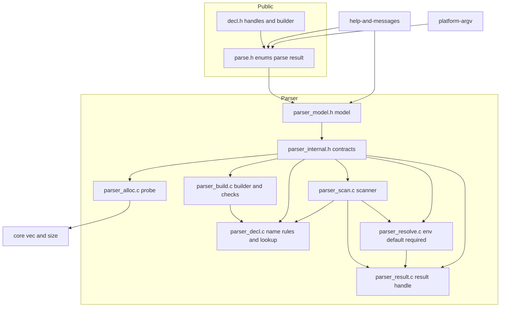
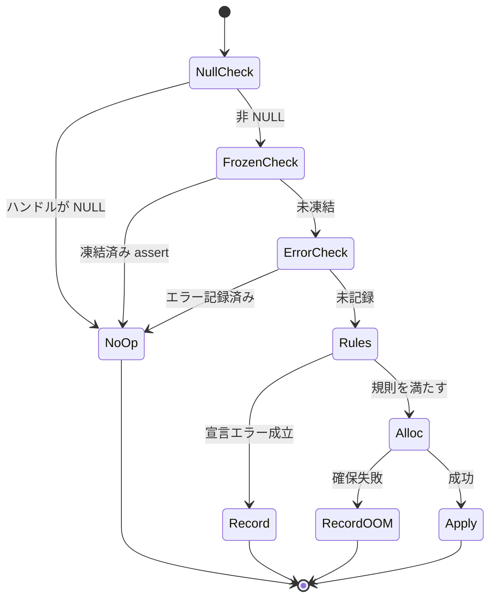
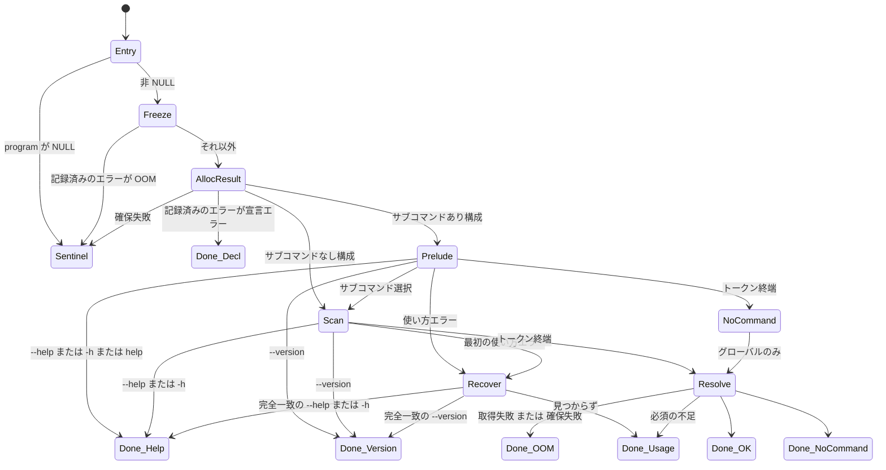
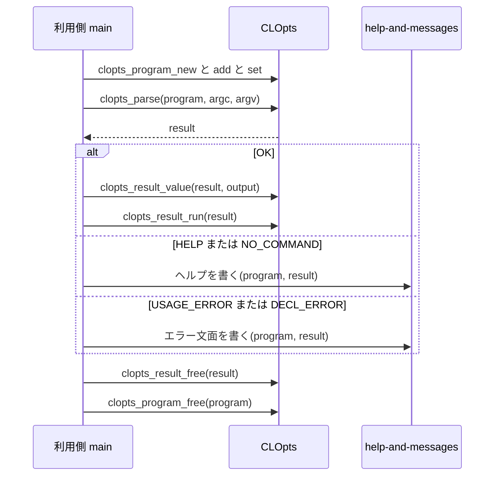
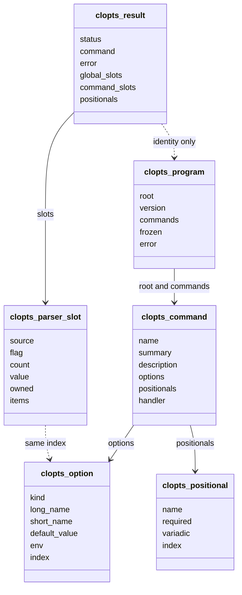

# Technical Design: core-parser

## Overview

**Purpose**: core-parser は CLOpts の中核である。宣言のビルダー API、解析関数、結果ハンドルの 3 つを提供する。利用側は `clopts_program_new` から始め、`clopts_program_add_command` や `clopts_command_add_value` などで宣言を組み立てる。そのうえで `clopts_parse` を 1 回呼ぶと、状態・値・出所・位置引数・構造化エラーを読める結果ハンドルが返る。
**Users**: C でコマンドラインツールを書く開発者が、宣言・解析・ディスパッチに使う。downstream の help-and-messages は、内部の宣言モデルと結果ハンドルのアクセサを読んで文面を作る。platform-argv は環境変数の取得コールバックを差し込む。
**Impact**: 初版（2026-11-07）は `static const` の宣言構造体と公開の結果構造体を使っていた。これを不透明ハンドルとビルダーに置き換える。走査規則・値の解決・必須検査・エラー優先度は初版の実装（`src/parser/`）を流用し、宣言の参照先と結果の置き場所だけを差し替える。0.x の間なので、初版の公開 API との互換は持たない。

### Goals
- 公開ヘッダに構造体の定義を置かず、ハンドル・列挙・関数ポインタ型・関数だけで宣言から解放まで完結させる（14.1〜14.6）。
- ビルダーは NULL を渡しても安全にし、最初のエラーを program に記録して以降は何もしない（2.1〜2.8）。宣言エラーは、ビルダー呼び出しの順で最初に成立したもの 1 件にする（3.19）。
- 初版の走査規則とテストの観点をすべて保つ（5〜10、15.8）。
- ビルダー・解析・結果確保のそれぞれで、メモリ不足の経路をテストで再現し、漏れがないことを確かめる（15.7）。

### Non-Goals
- 文面の生成（help-and-messages）、Windows の argv / 環境変数の UTF-8 取得（platform-argv）、公開シンボル一覧と ABI 検査（abi-compat）。
- 宣言のイントロスペクション API。ハンドルから名前を読む公開関数も含めない。
- 同じ program を複数のスレッドから同時に解析すること（凍結フラグを書くため）。異なる program・異なる結果ハンドルは独立に使える。
- 初版の API との互換、および初版の API から移行する手段。

## Boundary Commitments

### This Spec Owns
- 公開ヘッダ `include/clopts/decl.h`（ハンドル型、handler 型、ビルダー関数）と `include/clopts/parse.h`（状態・使い方エラー・宣言エラー・出所・環境変数の状態の列挙、環境変数の取得コールバック型、解析・検査関数、結果ハンドルのアクセサ、解放）。
- 内部の宣言モデル `src/parser/parser_model.h`。program / command / option / positional の構造体と、その不変条件を定める。help-and-messages はこれを読み取り専用で読む。
- ビルダーの即時検査（宣言エラーの全規則）と、program へのエラーの記録。
- 走査器、値の解決（環境変数 → 既定値）、必須検査、エラー優先度、ハンドラ呼び出し。
- 結果ハンドル（OOM 用の番兵を含む）、所有と寿命の規則。
- テスト用の確保プローブ。失敗の注入と、生存する確保ブロックの計数を行う内部の口で、公開しない。
- `tests/parser/` の単体テストと、統合テストの利用側コード `tests/integration/fixtures/consumer/main.c` を新しい API に合わせること。

### Out of Boundary
- 文面・桁揃え・出力先（help-and-messages）。本 spec は文字列を整形しない。
- argv の取得と UTF-8 変換、Windows 用の環境変数取得関数（platform-argv）。本 spec が持つのはコールバックの型と既定の取得だけ。
- 公開シンボル一覧の作成・照合、abidiff（abi-compat）。本 spec は公開関数のすべてに `CLOPTS_API` を付ける。
- ビルド構成、CI、`clopts_testing` の仕組み、統合テストの枠組み（project-foundation）。本 spec が変えるのは `src/parser/CMakeLists.txt` と `tests/parser/CMakeLists.txt` のソース一覧、および consumer fixture の `main.c` の中身だけ。
- 値の型変換・妥当性検査、前方一致、候補提示、入れ子のサブコマンド、別名、排他。

### Allowed Dependencies
- C99 標準ライブラリ（`<stdlib.h>`、`<string.h>`、`<stdbool.h>`、`<stddef.h>`、`<limits.h>`、`<assert.h>`）。
- `src/core/core_internal.h`（`clopts_core_vec_t`、`clopts_core_size_mul` / `add`）。core の構造体のフィールドを読むのは、確保プローブ（`parser_alloc.c`）だけ。
- `include/clopts/export.h`（`CLOPTS_API`）。
- 依存の向き: `export.h` → 公開ヘッダ（`decl.h` → `parse.h`）→ `parser_model.h` → `parser_internal.h` → 各 `.c`。help-and-messages は `parser_model.h` と公開ヘッダだけを include してよい。`parser_internal.h` は include しない。

### Revalidation Triggers
- `parser_model.h` の構造体のフィールド・不変条件の変更 → help-and-messages を再検証する。
- 使い方エラー・宣言エラーの列挙への追加 → help-and-messages の文面表を追従させる。
- `clopts_getenv_fn` のシグネチャや借用の規則の変更 → platform-argv を再検証する。
- 公開関数の追加・削除・改名 → abi-compat の公開シンボル一覧を更新する。
- 結果ハンドルから得た文字列の寿命の規則の変更 → docs-and-release の API リファレンスを更新する。

## Architecture

### Existing Architecture Analysis
- `src/parser/` には 4 つのファイル（decl / scan / resolve / store）と `parser_internal.h` がある。照合の結果は「どちらのスコープか（グローバル / 選択コマンド）+ 添字」の ref で表し、スロットは option と同じ添字を持つ。新しい設計もこの形を保つ。
- 宣言は「配列 + 要素数」だった。これを「ポインタの vec」に変えるので、参照箇所（scan 15、decl 45、resolve 23、store 16 か所）を機械的に置き換える。
- 結果は `clopts_result_t`（公開の殻）と `impl`（store）の 2 段だった。これを 1 つの内部構造体 `struct clopts_result` にまとめる。
- テストは共有ビルドでは `clopts_testing`（静的コピー）に、静的ビルドでは `clopts` にリンクする（project-foundation 7.2）。どちらでも内部関数を呼べるので、確保プローブを内部関数として置ける。

### Architecture Pattern & Boundary Map



**Architecture Integration**:
- **Selected pattern**: 不透明ハンドル + ビルダー + 内部モデル（研究ノートの案C の改良）。宣言エラーはすべてビルダー呼び出しの中で即時に検査する。設定関数で付ける属性に「種類に合うか」の検査をその場で掛けるので、凍結時の一括検査や通し番号は要らない。
- **Domain boundaries**: 宣言の組み立てと検査は Build（+ Decl の規則関数）、走査は Scan、解決は Resolve、結果の保持と参照は Result。モデルの構造体を書くのは Build だけ。Scan / Resolve / Result はモデルを読むだけ。
- **Existing patterns preserved**: ref + スロット添字、4 段の走査（前段・本走査・回復走査・走査後）、`assert` による契約違反の検出、Allman スタイル。
- **New components rationale**: Build（ビルダーが新設のため）、Model（help-and-messages との継ぎ目）、Alloc（15.7 の注入と計数）、Result（store と殻を 1 つにした結果ハンドル）。
- **Steering compliance**: 公開ヘッダに構造体なし、全公開関数に `CLOPTS_API`、列挙値は明示、利用側の確保したメモリを解放しない、`FILE*` を受けない、グローバルな可変状態を持たない（番兵は `const`）。

### Technology Stack

| Layer | Choice / Version | Role in Feature | Notes |
|-------|------------------|-----------------|-------|
| 言語 | C99 | 全実装 | VLA なし、`//` コメントなし |
| ビルド | CMake 3.21（project-foundation） | `clopts_add_module` / `clopts_add_module_tests` | ソース一覧だけ変える |
| テスト | Naos v0.4.0（project-foundation） | `tests/parser/` | ラベル `parser` |
| 内部ユーティリティ | `src/core`（vec、size） | 子の一覧、スロット、位置引数、リスト項目 | vec の要素はポインタ（ハンドルの安定のため） |

## File Structure Plan

### Directory Structure
```
include/clopts/
├── decl.h            # 書き直し: ハンドル型、clopts_handler_fn、ビルダー関数（program / command / option / positional）
└── parse.h           # 書き直し: 列挙（値を明示）、clopts_getenv_fn、解析・検査関数、結果ハンドルのアクセサ、解放
src/parser/
├── parser_model.h    # 新規: 内部の宣言モデル（struct clopts_program / command / option / positional、clopts_parser_kind_t）と不変条件。help-and-messages が読む
├── parser_internal.h # 書き直し: 結果の構造体、スロット、ref、確保プローブ、各ファイル間の内部関数の宣言
├── parser_alloc.c    # 新規: 確保の窓口（malloc / calloc / strdup / vec_push / free）と確保プローブ
├── parser_build.c    # 新規: ビルダー関数の公開実装、即時検査、エラーの記録、凍結、program の解放
├── parser_decl.c     # 書き直し: 名前の形式の規則、照合範囲での重複・否定形の検出、照合関数（find_command / find_long / find_negation / find_short）
├── parser_scan.c     # 変更: clopts_parse / clopts_parse_with_env / clopts_program_validate の実装、前段・本走査・回復走査
├── parser_resolve.c  # 変更: 既定の環境変数取得（借用）、環境変数 → 既定値の解決、必須検査
├── parser_result.c   # 新規（parser_store.c を置き換え）: 結果ハンドルの確保、番兵、スロットへの記録、全アクセサ、run、free
└── CMakeLists.txt    # 変更: ソース一覧
tests/parser/
├── test_fixtures.h / .c  # 書き直し: 架空の program をビルダーで組み立てる関数、ハンドルをまとめた構造体、環境変数の模擬関数
├── test_build.c      # 新規: NULL 安全、最初のエラー、文字列の複製、凍結、ハンドルの安定、root
├── test_oom.c        # 新規: 確保プローブで失敗位置を 1 から順に動かす網羅試験と、生存ブロック 0 の確認
├── test_decl_check.c # 書き直し: 即時検査の規則表の各行、呼び出し順、検査関数
├── test_dispatch.c / test_long.c / test_short.c / test_values.c / test_positional.c / test_resolve.c / test_errors.c / test_result.c
│                     # 変更: 宣言をフィクスチャのハンドルに、参照を新しいアクセサに置き換える。観点は変えない
├── parser_tests_main.c # 変更: 新しいスイートの登録
└── CMakeLists.txt    # 変更: ソース一覧
```

### Modified Files
- `src/parser/parser_store.c` — 削除する。内容は `parser_result.c` に移す。
- `tests/integration/fixtures/consumer/main.c` — 宣言 → 解析 → 参照 → 解放を公開関数だけで行う流れを足す（14.6）。期待と違えば終了コード 1 にする。`consumer_cpp.cpp` は `decltype(&clopts_parse)` で追従するので変えない。
- `include/clopts/clopts.h` — 変えない（`decl.h` / `parse.h` / `writer.h` を include したまま）。

## System Flows

### ビルダー呼び出しの共通の前処理



- NoOp では宣言を変えない。ハンドルを返す関数は NULL を返す（2.2、2.3、1.12）。
- 追加関数で宣言エラーが成立した場合も、確保に成功していれば新しいオブジェクトを宣言に繋ぎ、エラーの該当ハンドルとして記録し、そのハンドルを返す。help-and-messages がその名前を読めるようにするためである。設定関数で宣言エラーが成立した場合は、属性を変えずにエラーだけを記録する。
- 追加関数は「確保 → 親の vec に繋ぐ → 名前の複製」の順に進める。途中で失敗しても、確保済みのものは親から辿れるので、`clopts_program_free` で漏れなく解放できる（13.7）。

### 解析の全体の流れ



- 凍結（`program->frozen = true`）は、エラーの有無にかかわらず最初に行う（1.12）。`clopts_program_validate` も同じ入口を通り、AllocResult の後は DECL_ERROR か OK で終わる。
- Prelude 以降は初版と同じ規則である（「Scanner」の表）。Recover は保留した使い方エラーのトークン自身から `--` の手前までを見る。
- Resolve は「環境変数 → 既定値 → 必須検査」の順で、選択されたスコープに限って行う。NO_COMMAND ではグローバルだけ（8.9、9.6）。

### 利用側の典型的な流れ



## Requirements Traceability

| Requirement | Summary | Components | Interfaces | Flows |
|-------------|---------|------------|------------|-------|
| 1.1, 1.2, 1.3, 1.4, 1.5 | 生成・解放・追加 | Build, Model | `clopts_program_new` / `_free` / `_root` / `_add_command`、`clopts_command_add_*` | ビルダー前処理 |
| 1.6, 1.7, 1.9 | 属性の設定、後勝ち | Build | `clopts_option_set_*`、`clopts_positional_set_*`、`clopts_command_set_*`、`clopts_program_set_version` | ビルダー前処理 |
| 1.8 | 文字列の複製 | Build, Alloc | `clopts_parser_strdup` | — |
| 1.10, 1.11 | 追加順の保持、ハンドルの安定 | Model, Build | 子はポインタの vec | — |
| 1.12 | 解析後の凍結 | Build, Scan | `frozen` フラグ | 解析の入口 |
| 2.1, 2.2, 2.3, 2.4, 2.7 | 最初のエラー、NULL 安全 | Build | `program->error` | ビルダー前処理 |
| 2.5, 2.6 | NULL / エラー済みの program の解析 | Scan, Result | 番兵、DECL_ERROR | 解析の入口 |
| 2.8 | 別 program のハンドル | Build | ビルダー関数は 2 つ以上のハンドルを受けない | — |
| 3.1, 3.2 | 解析時の宣言エラー、検査関数 | Scan, Result | `clopts_program_validate` | 解析の入口 |
| 3.3, 3.4, 3.5, 3.6, 3.7, 3.8, 3.9, 3.10, 3.11, 3.12, 3.13, 3.14, 3.15, 3.16, 3.17 | 宣言エラーの各規則 | Build, Decl | 即時検査の規則表 | ビルダー前処理 |
| 3.18, 3.19 | 該当ハンドル、呼び出し順で最初 | Build, Result | `clopts_result_error_*` | ビルダー前処理 |
| 4.1, 4.2, 4.3, 4.4, 4.5, 4.6, 4.7, 4.9, 4.10, 4.11 | 解析と状態 | Scan, Result | `clopts_parse*`、`clopts_result_status` / `_command` | 解析の全体 |
| 4.8 | 結果自体の確保失敗 | Result | 番兵 | 解析の入口 |
| 5.1, 5.2, 5.3, 5.4, 5.5, 5.6 | サブコマンドとグローバル | Scan, Decl | 前段の表 | Prelude |
| 6.1, 6.2, 6.3, 6.4, 6.5, 6.6, 6.7, 6.8, 6.9, 6.10, 6.11, 6.12, 6.13, 6.14, 6.15 | 走査規則 | Scan, Decl | 本走査の表 | Scan |
| 7.1, 7.2, 7.3, 7.4, 7.5, 7.6, 7.7, 7.8, 7.9, 7.10, 7.11, 7.12 | 値の種類と繰り返し | Scan, Result | スロットへの記録関数 | Scan |
| 8.1, 8.2, 8.3, 8.4, 8.5, 8.9, 8.10 | 解決順、出所 | Resolve | `clopts_parser_resolve` | Resolve |
| 8.6, 8.7, 8.8 | コールバックと借用 | Resolve | `clopts_getenv_fn`、`clopts_parse_with_env` | Resolve |
| 9.1, 9.2, 9.3, 9.4, 9.5, 9.6, 9.7 | 必須検査 | Resolve | `clopts_parser_check_required` | Resolve |
| 10.1, 10.2, 10.3, 10.4, 10.5, 10.6, 10.7, 10.8, 10.9, 10.10, 10.11, 10.12 | HELP / VERSION と優先度 | Scan | 前段・本走査・回復走査 | Prelude, Scan, Recover |
| 11.1, 11.2, 11.6 | 列挙と状態の区別 | 公開ヘッダ | `clopts_usage_error_t`、`clopts_decl_error_t` | — |
| 11.3, 11.4, 11.5, 11.7, 11.8 | エラーのアクセサ | Result | `clopts_result_error_*` | — |
| 12.1, 12.2, 12.3, 12.4, 12.7 | 値の参照 | Result | `clopts_result_flag` など | — |
| 12.5, 12.6 | handler | Result | `clopts_result_run` | — |
| 12.8 | 文字列の寿命 | Result | 寿命の規則（データモデル） | — |
| 13.1, 13.2, 13.3, 13.4, 13.6 | 結果の解放 | Result | `clopts_result_free` | — |
| 13.5 | サイズ計算の検査 | Alloc | `clopts_core_size_mul` / `add` | — |
| 13.7 | ビルダー中の OOM | Build, Alloc | 確保 → 接続 → 複製の順 | ビルダー前処理 |
| 14.1, 14.2, 14.3, 14.4, 14.5, 14.6 | 公開 API の形 | 公開ヘッダ, Model | `CLOPTS_API`、列挙値の明示、consumer fixture | — |
| 15.1, 15.2, 15.3, 15.4, 15.5, 15.6, 15.7, 15.8 | 単体テスト | ParserTests, Alloc | 確保プローブ | — |

## Components and Interfaces

| Component | Domain | Intent | Req Coverage | Key Dependencies | Contracts |
|-----------|--------|--------|--------------|------------------|-----------|
| PublicHeaders | 公開 API | ハンドル・列挙・関数の契約 | 1, 4, 8.6, 11, 12, 13, 14 | export.h（P0） | API |
| Model | parser | 内部の宣言モデルと不変条件 | 1.10, 1.11, 14.5 | core vec（P0） | State |
| Alloc | parser | 確保の窓口と確保プローブ | 1.8, 13.5, 13.7, 15.7 | core（P0） | Service |
| Build | parser | ビルダー、即時検査、エラーの記録、凍結 | 1, 2, 3 | Decl, Alloc（P0） | Service, State |
| Decl | parser | 名前の規則と照合 | 3.3〜3.9, 5.5, 6.7 | Model（P0） | Service |
| Scan | parser | 解析の入口と走査 | 2.5, 2.6, 3.1, 4, 5, 6, 7, 10 | Decl, Result, Resolve（P0） | Service |
| Resolve | parser | 環境変数・既定値・必須 | 8, 9 | Result（P0） | Service |
| Result | parser | 結果ハンドルとアクセサ | 4.8, 11, 12, 13 | Alloc（P0） | API, State |
| ParserTests | tests | 架空の宣言による網羅試験 | 15 | 全コンポーネント | — |

### 公開 API

#### PublicHeaders（`include/clopts/decl.h`、`include/clopts/parse.h`）

| Field | Detail |
|-------|--------|
| Intent | 利用側と downstream spec が依存する契約 |
| Requirements | 1.1〜1.12, 3.2, 4.1, 4.2, 8.6, 8.7, 11.1〜11.8, 12.1〜12.8, 13.1〜13.3, 14.1〜14.4 |

**Responsibilities & Constraints**
- 両ヘッダは `clopts/export.h`、`<stdbool.h>`、`<stddef.h>` だけを include する（`parse.h` は `decl.h` も）。`extern "C"` ガードを持つ。
- 型は不透明型の前方宣言、列挙（全列挙子に値を明示、14.4）、関数ポインタ型だけ（14.1）。引数・戻り値は、ハンドルのポインタ、`const char *`、`char`、`bool`、`unsigned`、`size_t`、`int`、列挙、関数ポインタ、`void *` に限る（14.3）。
- すべての公開関数に `CLOPTS_API` を付ける（14.2）。

**Contracts**: API [x]

```c
/* include/clopts/decl.h */
typedef struct clopts_program clopts_program_t;
typedef struct clopts_command clopts_command_t;
typedef struct clopts_option clopts_option_t;
typedef struct clopts_positional clopts_positional_t;
typedef struct clopts_result clopts_result_t;

/* 選択されたスコープの handler。戻り値は clopts_result_run がそのまま返す */
typedef int (*clopts_handler_fn)(const clopts_result_t *result, void *userdata);

/* ---- program ---- */
/* name を複製して program を作る。確保に失敗したら NULL。name が不正でも program は返り、INVALID_NAME が記録される */
CLOPTS_API clopts_program_t *clopts_program_new(const char *name);
/* program と、そこから派生したすべてのハンドルを解放する。NULL なら何もしない */
CLOPTS_API void clopts_program_free(clopts_program_t *program);
/* バージョン文字列を複製して設定する。NULL で解除（--version を予約しない） */
CLOPTS_API void clopts_program_set_version(clopts_program_t *program, const char *version);
/* program 直下のスコープ（グローバルオプション、サブコマンドなし構成の位置引数と handler、program の説明文）。
 * program が NULL なら NULL。エラーや凍結の有無にかかわらず同じハンドルを返す（ビルダー呼び出しではない） */
CLOPTS_API clopts_command_t *clopts_program_root(clopts_program_t *program);
CLOPTS_API clopts_command_t *clopts_program_add_command(clopts_program_t *program, const char *name);

/* ---- command（root を含む） ---- */
CLOPTS_API void clopts_command_set_summary(clopts_command_t *command, const char *summary);         /* 全体ヘルプの 1 行説明。root では使われない */
CLOPTS_API void clopts_command_set_description(clopts_command_t *command, const char *description); /* root では program の説明文 */
CLOPTS_API void clopts_command_set_handler(clopts_command_t *command, clopts_handler_fn handler, void *userdata);
/* long_name は先頭の "--" を含まない（NULL でなし）。short_name は '\0' でなし */
CLOPTS_API clopts_option_t *clopts_command_add_flag(clopts_command_t *scope, const char *long_name, char short_name);
CLOPTS_API clopts_option_t *clopts_command_add_count(clopts_command_t *scope, const char *long_name, char short_name);
CLOPTS_API clopts_option_t *clopts_command_add_value(clopts_command_t *scope, const char *long_name, char short_name);
CLOPTS_API clopts_option_t *clopts_command_add_list(clopts_command_t *scope, const char *long_name, char short_name);
CLOPTS_API clopts_positional_t *clopts_command_add_positional(clopts_command_t *scope, const char *name);

/* ---- option ---- 文字列は複製、NULL で解除 */
CLOPTS_API void clopts_option_set_help(clopts_option_t *option, const char *help);
CLOPTS_API void clopts_option_set_value_name(clopts_option_t *option, const char *value_name);
CLOPTS_API void clopts_option_set_env(clopts_option_t *option, const char *env);
CLOPTS_API void clopts_option_set_default(clopts_option_t *option, const char *default_value);
CLOPTS_API void clopts_option_set_required(clopts_option_t *option, bool required);
CLOPTS_API void clopts_option_set_negatable(clopts_option_t *option, bool negatable);
CLOPTS_API void clopts_option_set_delimiter(clopts_option_t *option, char delimiter);   /* '\0' で解除 */
CLOPTS_API void clopts_option_set_count_max(clopts_option_t *option, unsigned count_max); /* 0 で既定（UINT_MAX） */

/* ---- positional ---- */
CLOPTS_API void clopts_positional_set_help(clopts_positional_t *positional, const char *help);
CLOPTS_API void clopts_positional_set_required(clopts_positional_t *positional, bool required);
CLOPTS_API void clopts_positional_set_variadic(clopts_positional_t *positional, bool variadic);
```

```c
/* include/clopts/parse.h */
typedef enum clopts_status
{
    CLOPTS_OK = 0,
    CLOPTS_HELP = 1,            /* clopts_result_command が NULL なら全体、非 NULL ならそのサブコマンド */
    CLOPTS_VERSION = 2,
    CLOPTS_NO_COMMAND = 3,
    CLOPTS_USAGE_ERROR = 4,
    CLOPTS_DECL_ERROR = 5,
    CLOPTS_OUT_OF_MEMORY = 6
} clopts_status_t;

typedef enum clopts_usage_error
{
    CLOPTS_USAGE_NONE = 0,
    CLOPTS_USAGE_UNKNOWN_COMMAND = 1,     /* token */
    CLOPTS_USAGE_UNKNOWN_OPTION = 2,      /* token、name_len または short_name */
    CLOPTS_USAGE_MISSING_VALUE = 3,       /* option、token */
    CLOPTS_USAGE_UNEXPECTED_VALUE = 4,    /* option（予約オプションなら NULL）、token */
    CLOPTS_USAGE_MISSING_OPTION = 5,      /* option */
    CLOPTS_USAGE_MISSING_ARGUMENT = 6,    /* positional */
    CLOPTS_USAGE_UNEXPECTED_ARGUMENT = 7  /* token */
} clopts_usage_error_t;

typedef enum clopts_decl_error
{
    CLOPTS_DECL_NONE = 0,
    CLOPTS_DECL_INVALID_NAME = 1,
    CLOPTS_DECL_NO_NAME = 2,
    CLOPTS_DECL_DUPLICATE_COMMAND = 3,
    CLOPTS_DECL_DUPLICATE_OPTION = 4,
    CLOPTS_DECL_RESERVED_NAME = 5,
    CLOPTS_DECL_NOT_NEGATABLE = 6,
    CLOPTS_DECL_NEGATION_CONFLICT = 7,
    CLOPTS_DECL_DEFAULT_NOT_ALLOWED = 8,
    CLOPTS_DECL_ENV_NOT_ALLOWED = 9,
    CLOPTS_DECL_REQUIRED_WITH_DEFAULT = 10,
    CLOPTS_DECL_REQUIRED_NOT_ALLOWED = 11,
    CLOPTS_DECL_POSITIONAL_ORDER = 12,
    CLOPTS_DECL_VARIADIC_POSITION = 13,
    CLOPTS_DECL_ATTRIBUTE_KIND = 14,     /* 区切り文字を LIST 以外に、上限を COUNT 以外に (3.16) */
    CLOPTS_DECL_MIXED_LAYOUT = 15        /* サブコマンドを持つ program の root に位置引数か handler (3.17) */
} clopts_decl_error_t;

typedef enum clopts_source
{
    CLOPTS_SOURCE_NONE = 0,
    CLOPTS_SOURCE_DEFAULT = 1,
    CLOPTS_SOURCE_ENV = 2,
    CLOPTS_SOURCE_EXPLICIT = 3
} clopts_source_t;

typedef enum clopts_env_status
{
    CLOPTS_ENV_FOUND = 0,   /* *value に借用の文字列を入れた */
    CLOPTS_ENV_UNSET = 1,   /* 未設定。*value は読まない */
    CLOPTS_ENV_FAILED = 2   /* 取得失敗。解析は OUT_OF_MEMORY */
} clopts_env_status_t;

/* *value に返す文字列はコールバック側の所有。次にこのコールバックを呼ぶか、解析関数が返るまで有効であればよい。
 * ライブラリはコールバックから戻った直後に複製し、以後は参照も解放もしない */
typedef clopts_env_status_t (*clopts_getenv_fn)(void *ctx, const char *name, const char **value);

/* argv[0] を読み飛ばして解析する。戻り値は NULL にならない（確保失敗時は OUT_OF_MEMORY の番兵） */
CLOPTS_API clopts_result_t *clopts_parse(clopts_program_t *program, int argc, char *const *argv);
/* getenv_fn が NULL なら既定の取得（getenv 相当） */
CLOPTS_API clopts_result_t *clopts_parse_with_env(clopts_program_t *program, int argc, char *const *argv,
                                                  clopts_getenv_fn getenv_fn, void *env_ctx);
/* 宣言だけを検査する。状態は OK / DECL_ERROR / OUT_OF_MEMORY。エラーは同じアクセサで読む */
CLOPTS_API clopts_result_t *clopts_program_validate(clopts_program_t *program);

CLOPTS_API clopts_status_t clopts_result_status(const clopts_result_t *result);
/* OK / NO_COMMAND / USAGE_ERROR: 選択されたサブコマンド。HELP: ヘルプの対象。なし構成・未選択なら NULL */
CLOPTS_API const clopts_command_t *clopts_result_command(const clopts_result_t *result);

/* エラー（11.3、11.4、11.7）。該当なしは NONE / NULL / -1 / 0 / '\0' */
CLOPTS_API clopts_usage_error_t clopts_result_usage_error(const clopts_result_t *result);
CLOPTS_API clopts_decl_error_t clopts_result_decl_error(const clopts_result_t *result);
CLOPTS_API const clopts_command_t *clopts_result_error_command(const clopts_result_t *result);
CLOPTS_API const clopts_option_t *clopts_result_error_option(const clopts_result_t *result);
CLOPTS_API const clopts_positional_t *clopts_result_error_positional(const clopts_result_t *result);
CLOPTS_API const char *clopts_result_error_token(const clopts_result_t *result);
CLOPTS_API int clopts_result_error_argv_index(const clopts_result_t *result);
CLOPTS_API size_t clopts_result_error_name_len(const clopts_result_t *result);  /* UNKNOWN_OPTION の長い形: "=" の手前までの "--name" の長さ */
CLOPTS_API char clopts_result_error_short_name(const clopts_result_t *result);

/* 値（12.1〜12.3、12.7） */
CLOPTS_API bool clopts_result_flag(const clopts_result_t *result, const clopts_option_t *option);
CLOPTS_API unsigned clopts_result_count(const clopts_result_t *result, const clopts_option_t *option);
CLOPTS_API const char *clopts_result_value(const clopts_result_t *result, const clopts_option_t *option);
CLOPTS_API size_t clopts_result_list_count(const clopts_result_t *result, const clopts_option_t *option);
CLOPTS_API const char *clopts_result_list_at(const clopts_result_t *result, const clopts_option_t *option, size_t index);
CLOPTS_API clopts_source_t clopts_result_source(const clopts_result_t *result, const clopts_option_t *option);
CLOPTS_API size_t clopts_result_positional_count(const clopts_result_t *result);
CLOPTS_API const char *clopts_result_positional_at(const clopts_result_t *result, size_t index);

CLOPTS_API int clopts_result_run(const clopts_result_t *result);
/* NULL・番兵なら何もしない。program の解放の前後どちらでもよい */
CLOPTS_API void clopts_result_free(clopts_result_t *result);
```

- **事前条件**:
  - `argc >= 0`、`argv[0..argc-1]` は NUL 終端。`argc == 0` のときは `argv` の要素を読まない。
  - アクセサ・`clopts_result_run` は、その結果を作った program を解放する前にだけ呼べる（13.3）。
  - `clopts_result_list_at` / `clopts_result_positional_at` の `index` は個数未満（契約違反は `assert`）。
- **事後条件**:
  - 解析関数は NULL を返さない（4.8）。
  - 状態が USAGE_ERROR / DECL_ERROR 以外なら、エラーのアクセサは NONE / NULL / -1 / 0 / `'\0'` を返す（11.7）。
  - 状態が OK / NO_COMMAND 以外なら、値のアクセサは未指定の値（偽、0、NULL、0 個、`CLOPTS_SOURCE_NONE`）を返す（12.7）。NO_COMMAND ではグローバルオプションの値だけが有効。
- **NULL の扱い**: 結果のアクセサに NULL の `result` を渡すと、番兵と同じ値を返す（状態は OUT_OF_MEMORY）。NULL の `option` を渡すと、未指定の値を返す。どちらも、ビルダーが NULL を返した後の利用側のコードを短くするためで、契約違反とはしない。
- **契約違反**（`assert`）:
  - 別の program に属する option を値のアクセサに渡すこと（12.3）。
  - 状態 OK 以外の結果、検査関数の結果、handler のないスコープで `clopts_result_run` を呼ぶこと（12.6）。
  - 凍結後のビルダー呼び出し（1.12）。
  - 範囲外の添字。

**Implementation Notes**
- Integration: 傘ヘッダは変えない。初版の `clopts_kind_t`、`clopts_error_t`、公開の結果構造体は削除する（種類は内部の `clopts_parser_kind_t` へ移す）。
- Validation: `test_build.c` と `test_result.c` で NULL・番兵・状態ごとの既定値を確かめる。consumer fixture で、共有版の利用側が公開関数だけで一連の流れを実行できることを確かめる（14.6）。
- Risks: アクセサの数が多い（公開関数は約 48 個）。abi-compat の公開シンボル一覧の初版を、この節の宣言から作る。

### parser モジュール

#### Model（`src/parser/parser_model.h`）

| Field | Detail |
|-------|--------|
| Intent | 宣言の唯一の表現。help-and-messages との継ぎ目 |
| Requirements | 1.4, 1.10, 1.11, 14.5 |

**Contracts**: State [x]

```c
/* src/parser/parser_model.h */
#include "clopts/parse.h"
#include "core/core_internal.h"

typedef enum clopts_parser_kind
{
    CLOPTS_PARSER_FLAG,
    CLOPTS_PARSER_COUNT,
    CLOPTS_PARSER_VALUE,
    CLOPTS_PARSER_LIST
} clopts_parser_kind_t;

struct clopts_option
{
    clopts_program_t *program;     /* 所有者。値のアクセサの検査に使う */
    clopts_command_t *scope;       /* 属するスコープ（root を含む） */
    size_t index;                  /* scope->options 内の添字 = スロットの添字 */
    clopts_parser_kind_t kind;
    char *long_name;               /* NULL 可 */
    char short_name;               /* '\0' でなし */
    char *help, *value_name, *default_value, *env;  /* NULL 可。すべて所有する複製 */
    char delimiter;                /* LIST のみ非 '\0' */
    unsigned count_max;            /* COUNT のみ非 0。0 は既定（UINT_MAX） */
    bool required;                 /* VALUE / LIST のみ真 */
    bool negatable;                /* FLAG のみ真 */
};

struct clopts_positional
{
    clopts_program_t *program;
    clopts_command_t *scope;
    size_t index;
    char *name;                    /* 空でない */
    char *help;
    bool required;
    bool variadic;                 /* scope の末尾の 1 つだけ真 */
};

struct clopts_command
{
    clopts_program_t *program;
    const char *name;              /* root では program の名前（program と同じブロック）。それ以外は所有する複製 */
    char *summary, *description;
    clopts_core_vec_t options;     /* clopts_option_t * の列。追加順 */
    clopts_core_vec_t positionals; /* clopts_positional_t * の列。追加順 */
    clopts_handler_fn handler;
    void *userdata;
};

struct clopts_program
{
    clopts_command_t root;         /* program 直下のスコープ。&program->root が root のハンドル */
    char *version;                 /* NULL 可 */
    clopts_core_vec_t commands;    /* clopts_command_t * の列。追加順。空ならサブコマンドなし構成 */
    bool frozen;
    struct
    {
        clopts_status_t status;    /* OK / DECL_ERROR / OUT_OF_MEMORY */
        clopts_decl_error_t kind;
        clopts_command_t *command; /* root なら NULL として報告する */
        clopts_option_t *option;
        clopts_positional_t *positional;
    } error;
    struct clopts_parser_probe *probe; /* テスト専用。通常は NULL */
};
```

- **不変条件**（`error.status == CLOPTS_OK` の program について、Build が保証する）:
  - 名前と属性は、即時検査の規則表をすべて満たす。
  - 各ハンドルのアドレスは `clopts_program_free` まで変わらない（1.11）。子は個別に確保し、vec にはポインタだけを持つ。
  - `index` は vec 内の位置と一致する。
- **読み出しの規則**: help-and-messages は `const` のポインタで読むだけにし、書き込まない。エラーのある program では不変条件が崩れていることがあるので、名前を読むときは NULL を許す。

#### Alloc（`src/parser/parser_alloc.c`）

| Field | Detail |
|-------|--------|
| Intent | parser のすべての確保・解放の窓口。テストで失敗を注入し、生存ブロックを数える |
| Requirements | 1.8, 13.5, 13.7, 15.7 |

**Contracts**: Service [x]

```c
/* src/parser/parser_internal.h */
typedef struct clopts_parser_probe
{
    size_t fail_at;   /* 0: 注入しない。n: n 回目以降の確保点をすべて失敗させる */
    size_t calls;     /* 通過した確保点の数 */
    long live;        /* 生存している確保ブロックの数（オブジェクト、文字列、バッファを持つ vec を 1 つずつ） */
} clopts_parser_probe_t;

/* program_new の直後に呼ぶ（それ以前の確保は数えない）。結果ハンドルは解析時のプローブを受け継ぐ */
void clopts_parser_set_probe(clopts_program_t *program, clopts_parser_probe_t *probe);

void *clopts_parser_malloc(clopts_parser_probe_t *probe, size_t size);
void *clopts_parser_calloc(clopts_parser_probe_t *probe, size_t count, size_t size); /* clopts_core_size_mul で検査 */
char *clopts_parser_strdup(clopts_parser_probe_t *probe, const char *s);             /* NULL なら NULL を返し、確保点にしない */
char *clopts_parser_strndup(clopts_parser_probe_t *probe, const char *s, size_t len);
int clopts_parser_vec_push(clopts_parser_probe_t *probe, clopts_core_vec_t *vec, const void *elem);
void clopts_parser_vec_free(clopts_parser_probe_t *probe, clopts_core_vec_t *vec);
void clopts_parser_free(clopts_parser_probe_t *probe, void *ptr);
```

- `probe == NULL` のときは、`malloc` / `calloc` / `free` / `clopts_core_vec_push` / `clopts_core_vec_free` を直接呼ぶだけ（tech.md の「`malloc` を直接使う」の範囲）。
- 確保点は、上の関数の呼び出し 1 回につき 1 つ。`vec_push` は、バッファの再確保が要らない場合も確保点として数える。これは、実際に失敗しうる位置の上位集合で、網羅のためには十分である。
- `live` の計数: 確保の成功で +1、解放で -1。vec はバッファが NULL から非 NULL になった時点で +1、`vec_free` でバッファが非 NULL なら -1。
- `clopts_program_new` は、program の構造体と名前の複製を 1 ブロックで確保する。部分的な失敗がないので、プローブの対象外でよい。
- プローブは内部関数で、共有版では hidden（14.5）。単体テストは、静的版では `clopts` から、共有版では `clopts_testing` から呼べる。

#### Build（`src/parser/parser_build.c`）

| Field | Detail |
|-------|--------|
| Intent | `decl.h` の全関数の実装。即時検査、エラーの記録、凍結の検査、program の解放 |
| Requirements | 1.1〜1.12, 2.1〜2.4, 2.7, 2.8, 3.3〜3.19, 13.7 |

**Responsibilities & Constraints**
- 共通の前処理（「ビルダー呼び出しの共通の前処理」の図）を、1 つの内部関数 `begin(program)` にまとめる。この関数は「続行してよいか」を返す。凍結済みのときは `assert(!program->frozen)` で止め、`NDEBUG` では何もしない。
- 規則は呼び出しの中で、下の表の順に検査する。最初に成立したものを記録して終える（3.19）。成立した時点が呼び出しの順なので、通し番号は要らない。
- 文字列の引数はすべて `clopts_parser_strdup` で複製する（1.8）。設定し直したときは、古い複製を解放してから入れ替える（1.9）。
- 2.8: ハンドルを 2 つ以上受け取るビルダー関数は作らない。したがって、ビルダーで別 program のハンドルを混ぜる経路はない。混在の検出は、値のアクセサで行う（12.3）。

**即時検査の規則表**（照合範囲 = 追加先のスコープ。root ならすべての command も、command なら root も含む）

| 呼び出し | 規則（上から順に検査） | 種別 | 報告するハンドル |
|---|---|---|---|
| `clopts_program_new(name)` | `name` が NULL・空・`-` で始まる・空白を含む | `INVALID_NAME` | なし |
| `clopts_program_set_version(v)` | `v != NULL` で、照合範囲のどこかに長い名前 `version` がある | `RESERVED_NAME` | 宣言順で最初のその option と、そのスコープ |
| `clopts_program_add_command(name)` | `name` が NULL・空・`-` で始まる・空白を含む | `INVALID_NAME` | 新しい command |
| 〃 | `name` が `help` | `RESERVED_NAME` | 新しい command |
| 〃 | 同名の command がある | `DUPLICATE_COMMAND` | 新しい command |
| 〃 | root に位置引数か handler がある | `MIXED_LAYOUT` | 新しい command |
| `clopts_command_set_handler(root, h)` | `h != NULL` で、command が 1 つ以上ある | `MIXED_LAYOUT` | なし |
| `clopts_command_add_<kind>(scope, l, s)` | `l == NULL` かつ `s == '\0'` | `NO_NAME` | 新しい option |
| 〃 | `l` が空・`-` で始まる・`=` か空白を含む。または `s` が `-`、`=`、空白 | `INVALID_NAME` | 新しい option |
| 〃 | `l` が `help`、`l` が `version` で version 設定済み、`s` が `h` | `RESERVED_NAME` | 新しい option |
| 〃 | 照合範囲に同じ長い名前か短い名前がある | `DUPLICATE_OPTION` | 新しい option |
| 〃 | `l` が `no-x` で、照合範囲に否定可能な FLAG `x` がある | `NEGATION_CONFLICT` | 新しい option |
| `clopts_command_add_positional(scope, n)` | `n` が NULL・空 | `INVALID_NAME` | 新しい positional |
| 〃 | `scope` が root で、command が 1 つ以上ある | `MIXED_LAYOUT` | 新しい positional |
| 〃 | `scope` の末尾の位置引数が可変長 | `VARIADIC_POSITION` | 新しい positional |
| `clopts_option_set_env(o, e)` | `e != NULL` で、`o` が FLAG / COUNT | `ENV_NOT_ALLOWED` | `o` |
| 〃 | `e` が空 | `INVALID_NAME` | `o` |
| `clopts_option_set_default(o, d)` | `d != NULL` で、`o` が FLAG / COUNT | `DEFAULT_NOT_ALLOWED` | `o` |
| 〃 | `d != NULL` で、`o` が必須 | `REQUIRED_WITH_DEFAULT` | `o` |
| `clopts_option_set_required(o, true)` | `o` が FLAG / COUNT | `REQUIRED_NOT_ALLOWED` | `o` |
| 〃 | `o` に既定値がある | `REQUIRED_WITH_DEFAULT` | `o` |
| `clopts_option_set_negatable(o, true)` | `o` が FLAG でない | `NOT_NEGATABLE` | `o` |
| 〃 | `o` に長い名前 `x` があり、照合範囲に長い名前 `no-x` がある | `NEGATION_CONFLICT` | `o` |
| `clopts_option_set_delimiter(o, c)` | `c != '\0'` で、`o` が LIST でない | `ATTRIBUTE_KIND` | `o` |
| `clopts_option_set_count_max(o, n)` | `n != 0` で、`o` が COUNT でない | `ATTRIBUTE_KIND` | `o` |
| `clopts_positional_set_required(p, true)` | `p` より前に任意の位置引数がある | `POSITIONAL_ORDER` | `p` |
| `clopts_positional_set_required(p, false)` | `p` より後ろに必須の位置引数がある | `POSITIONAL_ORDER` | `p` |
| `clopts_positional_set_variadic(p, true)` | `p` が `scope` の末尾でない | `VARIADIC_POSITION` | `p` |

- 「報告するハンドル」の command は、そのハンドルのスコープとする。root なら NULL として報告する（3.18）。
- 照合範囲の重複検査は、異なる command 同士の重複を許す（初版と同じ）。
- 否定可能でも長い名前のない FLAG は、宣言エラーにしない（`--no-` の形がないので、効果がないだけ）。
- 解除（NULL、`false`、`'\0'`、`0` の設定）では、規則を検査しない。ただし `set_required(p, false)` だけは、後ろの必須との順序を検査する。

**Contracts**: Service [x] / State [x]
- 状態の遷移: `error.status` は OK → DECL_ERROR または OUT_OF_MEMORY に一度だけ変わり、戻らない。`frozen` は false → true に一度だけ変わる。
- `clopts_program_free`: 全 command（root を含む）について、option・positional・文字列・vec を解放し、最後に program のブロックを解放する。結果ハンドルは参照しない（13.3）。

**Implementation Notes**
- Validation: `test_decl_check.c` で、規則表の各行に 1 件以上のテストを置く。`test_build.c` で前処理と複製を確かめる。
- Risks: 規則表の行が多い。名前の形式・照合範囲の走査は Decl の関数に寄せ、Build は「どの規則をどの順で呼ぶか」だけを持つ。

#### Decl（`src/parser/parser_decl.c`）

| Field | Detail |
|-------|--------|
| Intent | 名前の規則と照合（Build と Scan が共有する） |
| Requirements | 3.3〜3.9, 5.5, 6.7 |

**Contracts**: Service [x]

```c
/* src/parser/parser_internal.h */
typedef struct clopts_parser_ref
{
    const clopts_option_t *option;  /* NULL なら見つからない */
    bool global;                    /* true: root、false: 選択コマンド */
    size_t index;                   /* そのスコープ内の添字 */
    bool negated;
} clopts_parser_ref_t;

bool clopts_parser_valid_command_name(const char *name);        /* program と command に共通 */
bool clopts_parser_valid_long_name(const char *name);
bool clopts_parser_valid_short_name(char c);
/* scope の照合範囲から、長い名前 l（NULL 可）または短い名前 s が一致する option を探す */
const clopts_option_t *clopts_parser_find_conflict(const clopts_command_t *scope, const char *l, char s);
/* 照合範囲から、長い名前 name（name_len バイト）の option を探す（no-x の衝突検査用） */
const clopts_option_t *clopts_parser_find_named(const clopts_command_t *scope, const char *name, size_t name_len);

const clopts_command_t *clopts_parser_find_command(const clopts_program_t *program, const char *name);
clopts_parser_ref_t clopts_parser_find_long(const clopts_program_t *program, const clopts_command_t *command,
                                            const char *name, size_t name_len);
clopts_parser_ref_t clopts_parser_find_negation(const clopts_program_t *program, const clopts_command_t *command,
                                                const char *name, size_t name_len);
clopts_parser_ref_t clopts_parser_find_short(const clopts_program_t *program, const clopts_command_t *command, char c);
```

- 照合はバイト単位の完全一致で、大文字小文字を区別する（5.5、6.7）。`find_*` は、選択コマンド（NULL 可）を先に、次に root を探す。
- 初版の `clopts_parser_decl_check`（テーブル全体の検査）は削除する。

#### Scan（`src/parser/parser_scan.c`）

| Field | Detail |
|-------|--------|
| Intent | 解析・検査関数の入口と走査 |
| Requirements | 2.5, 2.6, 3.1, 3.2, 4.1〜4.11, 5.1〜5.6, 6.1〜6.15, 7.1〜7.12, 10.1〜10.12, 11.3, 11.4 |

**Responsibilities & Constraints**
- 入口: 「解析の全体の流れ」の図のとおり。program が NULL か OOM を記録済みなら番兵を返す。結果の確保に失敗した場合も番兵を返す。DECL_ERROR を記録済みなら、結果にエラーを写して返し、argv は読まない（3.1、2.6、11.6）。
- サブコマンドの有無は `program->commands.count > 0` で判定する。スロットは root の option 数だけ確保し、サブコマンドを選択した時点でその command の分を確保する。
- `stdout` / `stderr` に書かず、`exit` / `abort` を呼ばない（4.3）。program と argv を書き換えない（4.11）。書き込むのは `frozen` だけ。
- 走査の状態（位置、選択コマンド、保留エラー、`--` 到達、HELP / VERSION の要求）は、自動変数の `scan_state_t` 1 つにまとめる。

前段（サブコマンドあり構成、`argv[1]` から順に）:

| トークン | 扱い |
|---|---|
| なし | `NO_COMMAND`（4.6、4.9） |
| `--help` / `-h`（まとめ書き内の `h` を含む） | `HELP`、対象は program 全体。以降は見ない（10.1） |
| `--version`（version あり） | `VERSION`。以降は見ない（10.5） |
| `--` | 次のトークンから位置引数として扱う。サブコマンドが未選択なので、最初の位置引数は `UNKNOWN_COMMAND`（5.2） |
| `help` | 次がなければ `HELP`（全体）。次がサブコマンド名ならその command の `HELP`。さらに後ろがあれば `UNEXPECTED_ARGUMENT`（エラーの command はその command）。次がサブコマンド名でなければ `UNKNOWN_COMMAND`（10.2〜10.4） |
| サブコマンド名 | 選択して本走査へ（5.1） |
| `-` で始まる（`-` 単体を除く） | グローバルオプションとして、本走査と同じ規則で照合・記録する（5.3）。見つからなければ `UNKNOWN_OPTION` |
| 上記以外（`-` 単体を含む） | `UNKNOWN_COMMAND`（5.2） |

本走査（選択コマンド、またはサブコマンドなし構成。`--` を見るまで）:

| トークン | 扱い |
|---|---|
| `--` | 以降はすべて位置引数（6.12） |
| `--help` / `--version`（version あり） | `HELP`（選択コマンド）/ `VERSION`。以降は見ない（10.1、10.5） |
| `--help=<x>` / `--version=<x>` | `UNEXPECTED_VALUE`、option は NULL |
| `--<name>[=<value>]` | `<name>` は最初の `=` まで。`find_long` で探し、なければ `find_negation`。<br>FLAG: 真（否定なら偽）を EXPLICIT で記録。`=` があれば `UNEXPECTED_VALUE`。<br>COUNT: +1。`=` があれば `UNEXPECTED_VALUE`。<br>VALUE / LIST: `=` があればその後ろ全体、なければ次のトークンをそのまま消費。次がなければ `MISSING_VALUE`。<br>見つからなければ `UNKNOWN_OPTION`（`name_len` は `=` の手前までの長さ）（6.1〜6.7、7.2〜7.5、10.6） |
| `-` 単体 | 位置引数（6.13） |
| `-<c1><c2>...` | 1 文字ずつ処理する（下記）（6.8〜6.11） |
| `-` で始まらない | 位置引数。宣言数を超え、末尾が可変長でなければ `UNEXPECTED_ARGUMENT`（5.6、6.14、6.15） |

短いオプションの各文字 `c`:
1. `c == 'h'` なら `HELP`（10.1）。
2. `find_short(c)` で探す。なければ `UNKNOWN_OPTION`、`short_name = c`（6.11）。
3. FLAG は真を記録、COUNT は +1。次の文字へ進む。
4. VALUE / LIST は、残りの文字列があればそれを値にする（`=` も含めてそのまま、6.10）。なければ次のトークンを消費し、それもなければ `MISSING_VALUE`（`short_name = c`）。このトークンの処理を終える。

回復走査（10.7）:
- 範囲は、保留した使い方エラーのトークン自身から `--` の手前まで。エラーより前に `--` に達していれば行わない。
- その範囲で、`--help` / `-h` / `--version`（version あり）に完全一致するトークンだけを探す。見つかれば `HELP`（選択済みなら選択コマンド）/ `VERSION`、なければ `USAGE_ERROR` を返す。
- HELP と VERSION が両方あれば、先に現れたほうを返す（10.9）。

値の記録（7.1〜7.12）: FLAG は後勝ち、COUNT は `count_max`（0 なら `UINT_MAX`）でクランプ、VALUE は後勝ち、LIST は指定順に連結する。区切り文字があれば分割し、空の項目も保持する。

**Implementation Notes**
- Integration: 初版の `parser_scan.c` の表の処理をそのまま残し、`program->options[i]` などの参照を `clopts_core_vec_at` に、`result->error` への書き込みを `parser_result.c` の記録関数に置き換える。
- Validation: `test_dispatch.c`（前段）、`test_long.c` / `test_short.c` / `test_values.c`（本走査）、`test_errors.c`（回復走査と優先度）。

#### Resolve（`src/parser/parser_resolve.c`）

| Field | Detail |
|-------|--------|
| Intent | 環境変数 → 既定値の解決と、必須検査 |
| Requirements | 8.1〜8.10, 9.1〜9.7 |

**Contracts**: Service [x]

```c
/* src/parser/parser_internal.h */
/* 既定の取得。getenv(name) の戻り値をそのまま借用として返す。ctx は使わない */
clopts_env_status_t clopts_parser_getenv_default(void *ctx, const char *name, const char **value);
/* argv から値を得ていない VALUE / LIST のスロットを、宣言順に解決する。include_command が偽なら root だけ */
int clopts_parser_resolve(clopts_result_t *result, const clopts_program_t *program,
                          clopts_getenv_fn getenv_fn, void *env_ctx, bool include_command);
/* 宣言順（root の option、選択コマンドの option、位置引数）で最初の不足を記録する */
int clopts_parser_check_required(clopts_result_t *result, const clopts_program_t *program, bool include_command);
```

- `CLOPTS_ENV_FOUND` を受けたら、次にコールバックを呼ぶ前に `clopts_parser_strdup` で複製する（8.8）。VALUE なら複製をスロットが所有し、LIST なら複製を分割して項目を作る（8.5）。
- `CLOPTS_ENV_FAILED` または複製の失敗は、-1（OUT_OF_MEMORY）で返す（8.10）。黙って既定値に進まない。
- 既定値は、モデルの複製を借用する。VALUE はスロットがそのポインタを指す。LIST は項目として複製する。
- 照会する環境変数は、選択されたスコープ（root と選択コマンド）の option だけ（8.9）。
- 必須の判定は、出所が EXPLICIT または ENV であること（9.2）。

#### Result（`src/parser/parser_result.c`）

| Field | Detail |
|-------|--------|
| Intent | 結果ハンドルの確保・記録・参照・実行・解放 |
| Requirements | 2.5, 4.2, 4.4, 4.5, 4.8, 11.3〜11.8, 12.1〜12.8, 13.1〜13.6 |

**Contracts**: API [x] / State [x]

```c
/* src/parser/parser_internal.h */
typedef struct clopts_parser_slot
{
    clopts_source_t source;
    bool flag;
    unsigned count;
    const char *value;        /* VALUE: argv / モデルの既定値 / owned を指す */
    char *owned;              /* 環境変数の複製。value == owned */
    clopts_core_vec_t items;  /* LIST: 所有する char * */
} clopts_parser_slot_t;

struct clopts_result
{
    clopts_status_t status;
    const clopts_program_t *program;   /* 所有者の照合と run に使う。free では参照しない */
    const clopts_command_t *command;   /* 選択コマンド / ヘルプの対象 */
    struct
    {
        clopts_usage_error_t usage;
        clopts_decl_error_t decl;
        const clopts_command_t *command;
        const clopts_option_t *option;
        const clopts_positional_t *positional;
        const char *token;             /* argv の要素 */
        int argv_index;                /* なしなら -1 */
        size_t name_len;
        char short_name;
    } error;
    bool parsed;                        /* clopts_parse* の結果（validate では偽） */
    clopts_parser_slot_t *global_slots; size_t global_count;
    clopts_parser_slot_t *command_slots; size_t command_count;
    clopts_core_vec_t positionals;      /* const char *（argv の要素） */
    clopts_parser_probe_t *probe;
};

/* program から結果を確保する。失敗なら NULL（呼び出し側が番兵に替える） */
clopts_result_t *clopts_parser_result_new(const clopts_program_t *program);
clopts_result_t *clopts_parser_result_oom(void);   /* 番兵 */
int clopts_parser_result_select(clopts_result_t *result, const clopts_command_t *command);
clopts_parser_slot_t *clopts_parser_result_slot(clopts_result_t *result, const clopts_parser_ref_t *ref);
void clopts_parser_slot_set_flag(clopts_parser_slot_t *slot, bool value, clopts_source_t source);
void clopts_parser_slot_add_count(clopts_parser_slot_t *slot, unsigned count_max);
void clopts_parser_slot_set_value(clopts_parser_probe_t *probe, clopts_parser_slot_t *slot, const char *value,
                                  clopts_source_t source);
int clopts_parser_slot_append_list(clopts_parser_probe_t *probe, clopts_parser_slot_t *slot, const char *value,
                                   char delimiter, clopts_source_t source);
void clopts_parser_slot_own(clopts_parser_probe_t *probe, clopts_parser_slot_t *slot, char *owned);
int clopts_parser_result_add_positional(clopts_result_t *result, const char *token);
```

- **番兵**: `static const struct clopts_result` で、`status = CLOPTS_OUT_OF_MEMORY`、エラーは NONE / -1、スロットなし。`(clopts_result_t *)` にキャストして返すが、どの関数も書き込まない。`clopts_result_free` はアドレスで番兵を見分けて何もしない（4.8、13.1）。`const` の静的オブジェクトなので、スレッド間で共有しても安全。
- **値のアクセサ**: `option->program != result->program` なら `assert`（12.3）。`option->scope` が root なら `global_slots[index]`、選択コマンドなら `command_slots[index]` を返す。それ以外（選択されなかった command）なら、未指定の値を返す。状態が OK / NO_COMMAND でなければ、未指定の値を返す（12.7）。
- **`clopts_result_run`**: `parsed` かつ状態 OK で、対象のスコープ（選択コマンド、なし構成なら root）に handler があることを `assert` する。そのうえで `handler(result, userdata)` を返す（12.5、12.6）。
- **`clopts_result_free`**: NULL と番兵は無視する。スロットの owned・items、位置引数の vec、結果自身を、`probe` を通して解放する。program は読まない（13.2、13.3）。
- 途中で失敗した場合も、確保済みのものは結果に繋がっているので、`free` で漏れなく解放できる（13.6）。

### テスト

#### ParserTests（`tests/parser/`）

| Field | Detail |
|-------|--------|
| Intent | 要件 1〜14 の挙動を、架空の宣言で検証する |
| Requirements | 15.1〜15.8 |

**Responsibilities & Constraints**
- `test_fixtures.c` に、架空の program を組み立てる関数を置く。program は初版と同じ 3 つ（`tool 1.2.3`、`filt`、`strict`）で、各関数はハンドルをまとめた構造体（例: `fixture_tool_t { clopts_program_t *program; clopts_command_t *root, *build, *copy, *cat; clopts_option_t *verbose, *color, *config, *output, *keys, *jobs, *tags; clopts_positional_t *build_src, *build_extra, ... }`）を埋める。プローブを受け取る引数を持ち、`clopts_program_new` の直後に `clopts_parser_set_probe` を呼ぶ。
- 環境変数の模擬関数は、名前 → 値の表、「次の呼び出しで FAILED を返す」フラグ、照会された名前の記録を持つ。値は表の文字列の借用として返し、返した直後に表のバッファを書き換えるモードを持つ。これで、ライブラリが複製していることを確かめる（8.8）。
- 宣言エラーのテストは、妥当な宣言を途中まで組み立て、1 か所だけ誤った呼び出しを足す。

**Implementation Notes**
- Validation: `ctest -L parser` を、静的版と共有版の両方のビルドで実行する（15.1）。
- Risks: 初版のテストは約 270 件ある。宣言の部分をフィクスチャのハンドルに置き換え、検証の部分は関数名の置換に留めて、観点の取りこぼしを防ぐ（15.8）。

## Data Models

### Domain Model
- **宣言（ライブラリが所有）**: program を根とする木。program は root（スコープ）と commands を持ち、各スコープは options と positionals を持つ。宣言の妥当性は即時検査の規則表が不変条件で、Build だけが書く。
- **結果（ライブラリが所有）**: `struct clopts_result` が、スロット配列 2 本と位置引数の vec を持つ。スロットは option と 1:1（同じ添字）。
- **エラー**: 結果の中の値の組。宣言のハンドルと argv の要素を指すだけで、所有するメモリはない。



### Logical Data Model（所有と寿命）

| 文字列・オブジェクト | 所有者 | 有効な期間 |
|---|---|---|
| ビルダーに渡した文字列の複製、各ハンドル | program | `clopts_program_free` まで |
| VALUE の値（明示指定）、位置引数のトークン、エラーのトークン | 利用側の argv（借用） | 結果を解放するまで、かつ利用側が argv を保持している間（11.8、12.8） |
| VALUE の値（既定値） | program（借用） | 結果を解放するまで、かつ program を解放するまで |
| VALUE の値（環境変数）、LIST の項目 | 結果 | 結果を解放するまで |
| 番兵 | ライブラリ（静的） | 常に |
| `userdata`、argv、コールバックの文字列 | 利用側 | ライブラリは解放しない（13.4） |

- API の説明（`parse.h` のコメントと docs-and-release の API リファレンス）には、「結果から得た文字列は、結果を解放するまで、かつ program と argv を保持している間だけ有効」とまとめて書く。13.3 で、アクセサは program を解放する前にだけ呼べると決めているので、この条件と矛盾しない。
- サイズ計算: スロット配列は `clopts_parser_calloc`（`clopts_core_size_mul`）、文字列の複製は `clopts_core_size_add(len, 1)` で検査する（13.5）。

## Error Handling

### Error Strategy
- 使い方エラー: `CLOPTS_USAGE_ERROR`。1 件を結果に持つ。表示と終了コードは利用側が決める。
- 宣言エラー: ビルダーで program に記録する（最初の 1 件）。解析・検査では `CLOPTS_DECL_ERROR` として結果に写す。argv は読まない。
- メモリ不足: ビルダーなら program に記録し、以降は何もしない。解析中なら `CLOPTS_OUT_OF_MEMORY` の結果（解放可能）。結果自体を確保できなければ番兵。
- 契約違反: `assert` で止める。戻り値では報告しない（tech.md）。

### Error Categories and Responses

| 分類 | 状態 | 読める項目 | 利用側の対応 |
|---|---|---|---|
| 利用者の入力 | `USAGE_ERROR` | usage、command、option / positional、token、argv_index、name_len / short_name | help-and-messages で文面にし、終了コードを決める |
| 開発者の宣言 | `DECL_ERROR` | decl、command、option / positional | 修正する。テストで本番の宣言を `clopts_program_validate` に通す |
| 資源 | `OUT_OF_MEMORY` | なし | 終了する。`clopts_result_free` と `clopts_program_free` は安全 |

## Testing Strategy

### Unit Tests（`tests/parser/`、ラベル `parser`）
- **build**（新規）:
  - 全ビルダー関数に NULL を渡しても落ちず、ハンドルを返す関数は NULL を返す（2.3）。
  - 最初のエラー（`INVALID_NAME`）の後で `add_value` が NULL を返し、検査関数の結果が最初のエラーを示す（2.1、2.2、3.19）。
  - 呼び出しの後で元の文字列を書き換えても、照合と値が変わらない（1.8）。
  - 同じ属性を 2 回設定すると後の値になる（1.9）。
  - option を 100 個追加しても、最初のハンドルで値を参照できる（1.11）。
  - 解析後の `add_flag` が NULL を返し、宣言が変わらない（`NDEBUG` のビルドでだけ実行し、それ以外ではスキップする。CI は Release 構成なので、CI では実行される）（1.12）。
  - `clopts_program_free(NULL)`（2.7）。
- **decl**（書き直し）:
  - 即時検査の規則表の各行で、`clopts_program_validate` が DECL_ERROR、対応する種別、報告するハンドルを返す（3.3〜3.18）。
  - 同じ誤りで `clopts_parse` も DECL_ERROR を返し、`--help` を含めても変わらない（3.1、10.11）。
  - 呼び出し順の例: `--version` の option を足した後に version を設定すると `RESERVED_NAME`。逆順でも `RESERVED_NAME`。2 つの誤りがあれば先の呼び出しのもの（3.19）。
  - version を設定しなければ `--version` を自前で宣言できる（3.5、10.6）。
  - NULL の program で OUT_OF_MEMORY（2.5）。
- **dispatch / long / short / values / positional / resolve / errors / result**: 初版の design.md の Testing Strategy の各項目を、そのまま新しい API で検証する（4.x、5.x、6.x、7.x、8.x、9.x、10.x、11.x、12.x）。追加の観点は次のとおり:
  - resolve: 模擬関数が返した直後にバッファを書き換えても値が変わらない（8.8）。
  - result: 状態ごとの既定値（11.7、12.7）、別 program の option（`NDEBUG` でない構成で `assert` を確かめる手段がないので、テストでは扱わず、コードレビューで確かめる）、program を先に解放してから結果を解放する（13.3）。
  - result: 番兵の各アクセサ、`clopts_result_free` を番兵と NULL に（4.8、13.1、13.2）。
- **oom**（新規）:
  - 次の 3 つの場面それぞれについて、`fail_at = 1, 2, …` と動かし、失敗が起きなくなるまで回す（15.7）。
    - フィクスチャ `tool` の組み立て（ビルダー）
    - `tool build -k a,b -o x src` の解析（結果の確保を含む）
    - 環境変数と LIST の既定値の解決
  - 各回で次の 3 つを確かめる。
    - 状態が OUT_OF_MEMORY か、失敗しなかったときと同じ結果になること。
    - 結果と program を解放した後に `probe.live == 0` であること。
    - ビルダーの失敗後は、解析が番兵を返すこと。

### Integration Tests
- `integration.subdirectory` / `integration.install_find_package`（project-foundation の既存テスト、静的・共有の両方）: consumer の `main.c` で、`consumer` という program に VALUE の `--name` を宣言し、固定の argv `{"consumer", "--name", "ok"}` を解析する。値が `ok` であることを確かめ、結果と program を解放する。期待と違えば終了コード 1 にする（14.2、14.6）。
- `integration.internal_hidden`（既存）: 変えない。内部関数のプローブ（`clopts_parser_set_probe`）も hidden であることは、同じ仕組みで保証される（14.5）。

## Performance & Scalability
- 宣言の追加は、照合範囲の線形走査で O(オプション数)。宣言全体の構築は O(n²) だが、想定規模（コマンド 10 個、各 10〜20 オプション）では無視できる。
- 解析ごとの確保は次のとおり。VALUE の値と位置引数は複製しない。
  - 結果 1 回
  - スロット配列 1〜2 回
  - 位置引数の vec とリスト項目の vec の成長
  - リスト項目と環境変数の値の複製

## Supporting References
- 走査規則・優先度の出発点: 初版の本書（git 履歴、2026-11-08 以前）と `ref/monde/.kiro/specs/cli-args/design.md`。
- ギャップ分析と設計判断の経緯: `research.md` の「ギャップ分析: ビルダー API と不透明ハンドルへの改訂」と「設計判断（2026-11-08 改訂）」。
- 内部ユーティリティの契約: `src/core/core_internal.h`。
