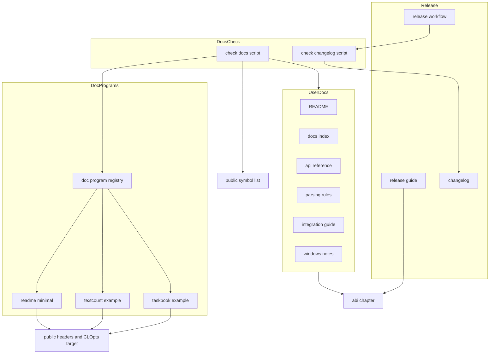
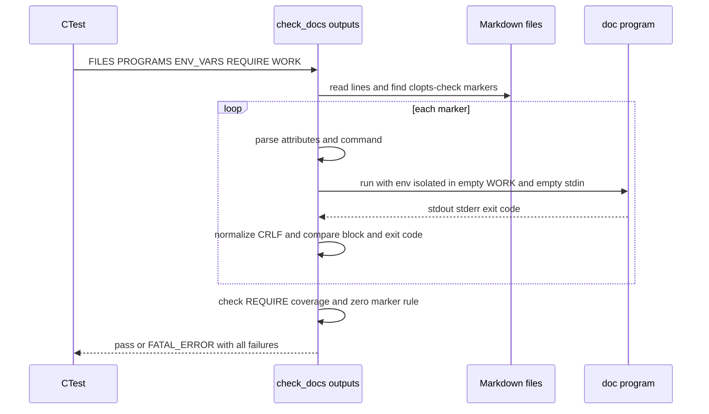
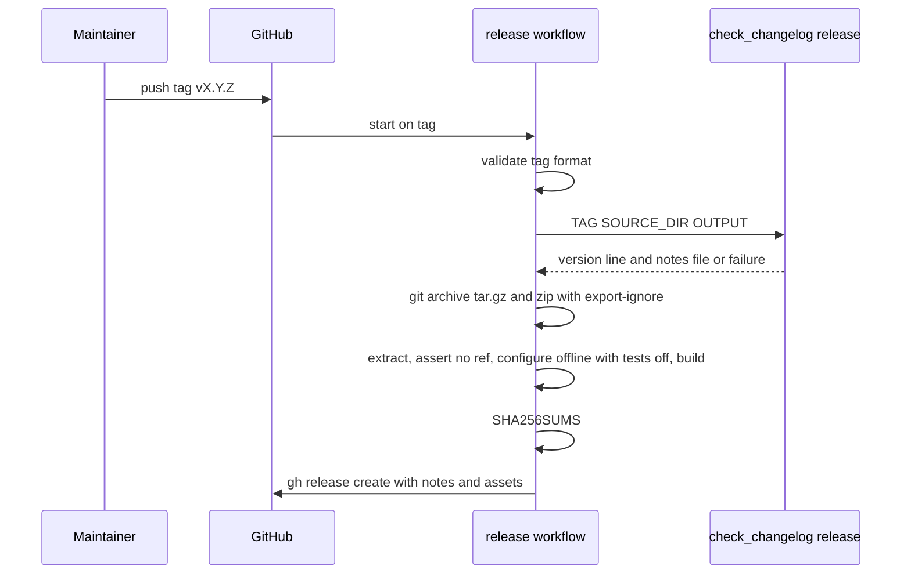

# Design Document

## Overview

**Purpose**: docs-and-release は、CLOpts を使う開発者がソースを読まずに CLOpts を取り込み、宣言・解析・表示を書けるようにする。そのために、利用者向けの文書（README と `docs/` の 4 章）と 2 つのサンプルプログラムを用意する。保守者に対しては、版番号の規則、リリース手順、変更履歴の形式、タグから GitHub Release を作るワークフローを用意する。

**Users**: CLOpts で CLI ツールを書く開発者は、README と `docs/` を読んで取り込み方と API を知り、サンプルを雛形にする。CLOpts の保守者は、`docs/dev/release.md` に沿って版を上げてタグを打ち、変更のたびに `CHANGELOG.md` を更新する。

**Impact**: 現在の `README.md` は 1 行だけで、`docs/` には ABI の章（`docs/abi.md`）と保守者向けの `docs/dev/abi-checks.md` しかない。本 spec は文書を書き足し、サンプル（`examples/`）とビルドオプション `CLOPTS_BUILD_EXAMPLES` を加える。さらに、文書の記述を実行結果・ソース・公開シンボル一覧と照合する CTest の検査（ラベル `docs`）と、リリースのワークフローを加える。ライブラリのソースと公開ヘッダは変更しない。

### Goals
- README だけで、CLOpts の位置づけ、取り込み方 3 通り、静的と共有の選び方、最小のサンプル、ライセンスがわかる。
- `docs/` の 4 章（API リファレンス、解析規則、取り込み手順、Windows での注意）が、公開 API のすべての関数と、steering の Product Rules のすべてを説明している。
- 文書に載せたサンプル出力、README の最小サンプルのコード、公開関数の網羅、相対リンクが CI の全環境で自動で検査され、食い違えばテストが失敗する。
- タグを push すると、版番号と CHANGELOG が検査され、ソースアーカイブと変更履歴を添えた GitHub Release ができる。

### Non-Goals
- ライブラリの機能・挙動・公開 API の変更。
- 英語版の README・文書。
- 取り込み経路の統合テストの追加（FetchContent 経路を含む）。
- v0.1.0 を含む実際のリリースの発行。
- パッケージマネージャへの登録、単一ファイル化、事前ビルド済みバイナリ。
- ABI 方針の文書（`docs/abi.md`）と ABI の検査の変更。

## Boundary Commitments

### This Spec Owns
- `README.md`、`docs/README.md`（章の入口）、`docs/api.md`、`docs/parsing.md`、`docs/integration.md`、`docs/windows.md` の内容。
- `examples/` の 2 つのサンプルプログラム（taskbook、textcount）と、ビルドオプション `CLOPTS_BUILD_EXAMPLES`。
- 文書用のプログラムを登録する CMake の関数 `clopts_add_doc_program`（`cmake/CloptsExamples.cmake`）。
- 文書の検査（`tests/docs/`、ラベル `docs`）。対象は、出力の照合、ソースの照合、リンクの検査、API の網羅の検査、CHANGELOG の形式の検査と、それぞれの自己テスト。
- 照合用の印の書式（`clopts-check`、`clopts-source`）と、CHANGELOG の書式。
- `docs/dev/release.md`、`docs/dev/naos-feedback.md`、`CHANGELOG.md`、`.github/workflows/release.yml`、`.gitattributes`。

### Out of Boundary
- 公開ヘッダ、`src/` の実装、ヘルプ・エラーの文面（core-parser、help-and-messages、platform-argv）。文書と挙動が食い違えば、文書を直す。
- install / export、package config、静的／共有の選択の仕組み、既存の統合テスト（project-foundation）。
- `docs/abi.md`、`docs/dev/abi-checks.md`、`abi/clopts.symbols`、`tests/abi/`、CI の `abi-compare` ジョブ（abi-compat）。本 spec はこれらを読み、リンクするだけにする。
- `.github/workflows/ci.yml`。本 spec は変更しない。
- 実際のタグの作成と Release の発行。

### Allowed Dependencies
- 文書とサンプルは、公開ヘッダ（`#include <clopts/clopts.h>`）と `CLOpts::clopts` にだけ依存する。内部ヘッダ（`src/`）は使わない。
- `tests/docs/` のスクリプトは CMake（3.21 以上）の `cmake -P` だけで動き、ライブラリのビルドを必要としない。出力の照合だけは、ビルドされた文書用プログラムを実行する。
- `tests/docs/` は `abi/clopts.symbols` を読み取り専用で参照する（API の網羅の検査）。
- `examples/` は `cmake/CloptsCompilerOptions.cmake` の `clopts_apply_compiler_options` を使う。
- リリースのワークフローは、GitHub Actions の `actions/checkout`、ランナーに入っている `git`、`cmake`、`gh` だけを使う。
- 依存の向きは「文書・サンプル → 公開 API」と「検査 → 文書・サンプル・公開シンボル一覧」だけにする。ライブラリ、既存のテスト、`ci.yml` から本 spec の成果物には依存しない。

### Revalidation Triggers
- 公開関数の追加・削除（abi-compat の手順で `abi/clopts.symbols` を更新したとき）→ `docs/api.md` の更新が必要になる（`docs.api_coverage` が失敗して知らせる）。
- ヘルプ・エラーの文面、解析規則の変更（help-and-messages、core-parser）→ 印の付いたサンプル出力の更新が必要になる（`docs.outputs` が失敗して知らせる）。
- install / export、形式の選び方、CMake オプションの変更（project-foundation）→ README と `docs/integration.md` の記述例を見直す。
- SOVERSION の規則や ABI の検査の変更（abi-compat）→ `docs/dev/release.md` の ABI の確認手順を見直す。
- 印の書式や CHANGELOG の書式の変更 → 文書とワークフローの両方を見直す。

## Architecture

### Existing Architecture Analysis
- ライブラリは 1 つのターゲット `clopts`（別名 `CLOpts::clopts`）で、トップレベルを既定とするオプションで、テスト・install・警告のエラー化を囲む。サンプルも同じ型で `CLOPTS_BUILD_EXAMPLES` を足す。
- `src/` に対応しないテストは、`cmake -P` のスクリプトを CTest に登録し、自己テストを `PASS_REGULAR_EXPRESSION` で確かめる（`tests/abi/`）。`tests/docs/` は structure.md が予定しているディレクトリで、この型に合わせる。
- CI はトップレベルとして構成して `ctest` を全件実行する。タグでは起動しない。リリースは別のワークフローにする（structure.md: 「リリースの変更で `ci.yml` を変えない」）。

### Architecture Pattern & Boundary Map



**Architecture Integration**:
- Selected pattern: 文書をデータ、検査をスクリプトとする照合型。文書に印を付け、`cmake -P` のスクリプトが実行結果やファイルと突き合わせる。
- Domain boundaries: 利用者向けの文書、文書用のプログラム、検査、リリースの 4 つに分ける。検査は文書とプログラムを読むだけで、どちらも書き換えない。
- Existing patterns preserved: トップレベルを既定とするオプション、ターゲット単位のコンパイラオプション、`cmake -P` + CTest のラベル + 自己テスト、ワークフローから `tests/` 配下のスクリプトを呼ぶ方式（`abi-compare` と同じ）、Windows で DLL を実行ファイルの横にコピーする方式（`$<TARGET_RUNTIME_DLLS>`）。
- New components rationale: 印の書式を一般化した照合（ヘルプ以外の出力と解析規則の例も照合するため）、文書用プログラムの登録（実行ファイルのパスと環境変数の隔離を一元化するため）、CHANGELOG の検査（Release の本文を自動で作るため）。
- Steering compliance: 文書は日本語で、識別子と文面は英語。文書は `docs/dev/` にリンクしない。サンプルは架空のプログラムを使う。サンプルは公開 API だけを使う。外部依存は増やさない。

### Technology Stack

| Layer | Choice / Version | Role in Feature | Notes |
|-------|------------------|-----------------|-------|
| 文書 | Markdown（GitHub Flavored） | README、`docs/`、`docs/dev/`、CHANGELOG | 照合用の印は HTML コメント |
| サンプル | C99、CLOpts の公開 API | 2 つのサンプルと README の最小サンプル | ライブラリと同じ警告の設定 |
| ビルド | CMake 3.21 以上 | `CLOPTS_BUILD_EXAMPLES`、`clopts_add_doc_program` | 既存の最低版のまま |
| 検査 | CMake スクリプト（`cmake -P`）、CTest | `tests/docs/` の検査と自己テスト | 新しい依存なし |
| リリース | GitHub Actions、`git archive`、`gh` CLI | `release.yml` | ランナーに入っているもののみ |

## File Structure Plan

### Directory Structure
```
README.md                       # 利用者向けの入口（全面的に書き直す）
CHANGELOG.md                    # 変更履歴（新規。未リリースの節だけを持つ）
.gitattributes                  # ref と .gitmodules をソースアーカイブから除く（新規）
docs/
├── README.md                   # 章の入口: 章の一覧と読む順序
├── api.md                      # API リファレンス
├── parsing.md                  # 解析規則（印付きの実行例を含む）
├── integration.md              # 取り込み手順と静的／共有の選び方
├── windows.md                  # Windows での注意
├── abi.md                      # 既存（abi-compat の所有。変更しない）
└── dev/
    ├── release.md              # 版番号の規則、リリース手順、Naos の更新手順、文書の更新の規約
    ├── naos-feedback.md        # Naos への要望の記録（書式だけを持つ新規ファイル）
    └── abi-checks.md           # 既存（abi-compat の所有。変更しない）
cmake/
└── CloptsExamples.cmake        # clopts_add_doc_program: 文書用プログラムの作成と登録
examples/
├── CMakeLists.txt              # 2 つのサンプルを clopts_add_doc_program(... EXAMPLE) で登録
├── taskbook/
│   └── taskbook.c              # サブコマンドありのサンプル
└── textcount/
    └── textcount.c             # サブコマンドなし（フィルタ型）のサンプル
tests/docs/
├── CMakeLists.txt              # docs.* と docs_selftest.* の登録、hello の作成
├── readme_minimal.c            # README の最小サンプルの正（プログラム名 hello）
├── check_docs.cmake            # MODE=outputs|sources|links|api_coverage
├── check_changelog.cmake       # MODE=format|release
└── fixtures/
    ├── outputs/                # 出力の照合の自己テスト用の文書（一致、不一致、書式の誤り、0 件）
    ├── sources/                # ソースの照合の自己テスト用の文書とソース
    ├── links/                  # リンクの検査の自己テスト用の文書（切れたリンク、docs/dev へのリンク）
    ├── api_coverage/           # 網羅の検査の自己テスト用の一覧と文書
    ├── subproject/             # CLOpts を add_subdirectory で取り込む利用側（サンプルの既定の確認）
    └── changelog/              # CHANGELOG の自己テスト用（正しい形式、各種の誤り、タグの不一致）
.github/workflows/
└── release.yml                 # タグから GitHub Release を作る（新規）
```

### Modified Files
- `CMakeLists.txt` — `option(CLOPTS_BUILD_EXAMPLES ... ${PROJECT_IS_TOP_LEVEL})` を足す。`cmake/CloptsExamples.cmake` を include し、`CLOPTS_BUILD_EXAMPLES` が ON のとき `add_subdirectory(examples)` を行う。サンプルの登録を先に済ませるため、この処理はテストのブロックより前に置く。
- `tests/CMakeLists.txt` — `add_subdirectory(docs)` を足す。
- `README.md` — 1 行の見出しだけの現状から、要件 1 の内容に書き直す。

## System Flows

### 出力の照合（`docs.outputs`）



- 失敗はすべて集め、最後に 1 回だけ `FATAL_ERROR` で報告する。各行の先頭には `<文書の相対パス>:<印の行>:` を付ける。
- 環境変数は、登録されているサンプルの環境変数をすべて外してから（`cmake -E env --unset=...`）、印の `env=` で指定したものだけを設定する。

### リリース



- どの段階で失敗しても、Release は作らない（11.2、11.3、11.7）。
- Release がすでにあれば `gh release create` が失敗する。戻し方は release.md に書く（9.9）。

## Requirements Traceability

| Requirement | Summary | Components | Interfaces | Flows |
|-------------|---------|------------|------------|-------|
| 1.1, 1.2, 1.3, 1.4, 1.7, 1.8, 1.9 | README の概要・特徴・最小サンプル・対応環境・導線・ライセンス | ReadmeDoc, ReadmeMinimal | 印 `clopts-source` | — |
| 1.5, 1.6 | README の取り込み方 3 通りと形式の選び方 | ReadmeDoc | — | — |
| 2.1, 2.2, 2.3, 2.4, 2.5, 2.6, 2.7, 2.8 | API リファレンスの内容 | ApiReferenceDoc | — | — |
| 2.9 | 全公開関数が API リファレンスに載る | ApiReferenceDoc, DocsCheckScript | MODE=api_coverage | — |
| 3.1, 3.2, 3.3, 3.4, 3.5, 3.6, 3.7, 3.8 | 解析規則の章 | ParsingDoc, TextcountExample | 印 `clopts-check` | 出力の照合 |
| 4.1, 4.2, 4.3, 4.4, 4.5, 4.6, 4.7 | 取り込み手順の章 | IntegrationDoc | — | — |
| 5.1, 5.2, 5.3, 5.4, 5.5, 5.6 | Windows での注意の章 | WindowsDoc | — | — |
| 6.1 | 章の入口と 4 章の配置 | DocsIndex | — | — |
| 6.2, 6.5 | 相対リンク、docs/dev へのリンクの禁止、切れたリンクの検出 | DocsIndex, DocsCheckScript | MODE=links | — |
| 6.3, 6.4 | 日本語、ABI 方針を重複して書かない | ReadmeDoc, 各章 | — | — |
| 7.1, 7.2, 7.3, 7.4, 7.5 | 2 つのサンプルの内容 | TaskbookExample, TextcountExample | サンプルの出力規約 | — |
| 7.6, 7.7, 7.8 | サンプルのビルド条件と CI | DocProgramRegistry, ExamplesBuild, DocsTests | `CLOPTS_BUILD_EXAMPLES`, `clopts_add_doc_program` | — |
| 8.1, 8.2, 8.3, 8.4, 8.5, 8.8 | 出力の照合 | DocsCheckScript, DocsTests | MODE=outputs | 出力の照合 |
| 8.6 | README の最小サンプルの照合 | DocsCheckScript, ReadmeMinimal | MODE=sources | — |
| 8.7 | 公開関数の網羅 | DocsCheckScript | MODE=api_coverage | — |
| 9.1, 9.2, 9.3, 9.4, 9.5, 9.6, 9.7, 9.8, 9.9 | リリース手順書 | ReleaseGuide, NaosFeedback | — | リリース |
| 10.1, 10.2, 10.3, 10.4 | CHANGELOG の形式 | Changelog, ChangelogCheckScript | MODE=format | — |
| 10.5 | 変更のたびに未リリースの節へ足す規約 | ReleaseGuide | — | — |
| 11.1, 11.2, 11.3, 11.4, 11.5, 11.6, 11.7, 11.8 | リリースのワークフロー | ReleaseWorkflow, ChangelogCheckScript, GitAttributes | MODE=release, ワークフローの契約 | リリース |

## Components and Interfaces

| Component | Domain | Intent | Req Coverage | Key Dependencies | Contracts |
|-----------|--------|--------|--------------|------------------|-----------|
| ReadmeDoc | 利用者向けの文書 | 入口としての概要と導線 | 1.1–1.9, 6.3, 6.4, 8.3 | DocsIndex (P1) | — |
| DocsIndex | 利用者向けの文書 | `docs/` の章の一覧 | 6.1, 6.2 | 各章 (P1) | — |
| ApiReferenceDoc | 利用者向けの文書 | 公開 API の説明 | 2.1–2.9 | 公開ヘッダ (P0) | — |
| ParsingDoc | 利用者向けの文書 | 解析規則と実行例 | 3.1–3.8 | TextcountExample (P0) | 印 |
| IntegrationDoc | 利用者向けの文書 | 取り込み手順と形式の選択 | 4.1–4.7 | 統合テストの fixture (P1) | — |
| WindowsDoc | 利用者向けの文書 | Windows 固有の注意 | 5.1–5.6 | `docs/abi.md` (P2) | — |
| DocProgramRegistry | ビルド | 文書用プログラムの作成と登録 | 7.6–7.8 | `clopts_apply_compiler_options` (P0) | Service, State |
| ExamplesBuild | ビルド | `CLOPTS_BUILD_EXAMPLES` とサンプルの登録 | 7.6–7.8 | DocProgramRegistry (P0) | — |
| TaskbookExample | サンプル | サブコマンドありの雛形 | 7.1–7.5 | 公開 API (P0) | 出力の規約 |
| TextcountExample | サンプル | フィルタ型の雛形と規則の実演 | 7.1–7.5, 3.1–3.8 | 公開 API (P0) | 出力の規約 |
| ReadmeMinimal | 検査 | README の最小サンプルの正 | 1.4, 8.6 | 公開 API (P0) | — |
| DocsCheckScript | 検査 | 文書の照合とリンク・網羅の検査 | 2.9, 6.5, 8.1–8.8 | DocProgramRegistry (P0), `abi/clopts.symbols` (P0) | Batch |
| ChangelogCheckScript | 検査 | CHANGELOG の検査とリリースノートの抜き出し | 10.1–10.4, 11.2–11.4 | CHANGELOG (P0), `CMakeLists.txt` (P0) | Batch |
| DocsTests | 検査 | CTest への登録と自己テスト | 6.5, 7.6, 7.7, 8.1, 10.1 | DocsCheckScript, ChangelogCheckScript (P0) | — |
| ReleaseGuide | リリース | 保守者の手順書 | 9.1–9.9, 10.5 | `docs/abi.md`, `docs/dev/abi-checks.md` (P1) | — |
| NaosFeedback | リリース | Naos への要望の記録先 | 9.8 | — | — |
| Changelog | リリース | 変更履歴 | 10.1–10.4 | — | 書式 |
| ReleaseWorkflow | リリース | タグから Release を作る | 11.1–11.8 | ChangelogCheckScript (P0), `gh` (P0) | Event, Batch |
| GitAttributes | リリース | アーカイブから除くパス | 11.6 | — | — |

### 利用者向けの文書

すべての章に共通の規約は次のとおり。日本語で書き、識別子・コマンド・文面は英語のまま示す（6.3）。章の間は相対リンクで結ぶ。`docs/dev/` にはリンクしない（6.2）。ABI の方針は `docs/abi.md` へのリンクで示し、内容を書き写さない（6.4）。照合用の印の書式は「Data Models」に示す。

#### ReadmeDoc（`README.md`）

| Field | Detail |
|-------|--------|
| Intent | CLOpts の位置づけを示し、取り込みと最初のプログラムまでを導く |
| Requirements | 1.1–1.9, 6.3, 6.4, 8.3 |

**Responsibilities & Constraints**
- 節の構成: 概要（1.1。Sirraide/clopts とは別のプロジェクトであること、1.2）、特徴（1.3）、最小のサンプル（1.4）、取り込み方（1.5、1.6）、対応環境（1.7）、文書（`docs/` の各章への相対リンク、1.8）、ライセンス（1.9）。
- 最小のサンプルは `<!-- clopts-source: tests/docs/readme_minimal.c -->` の直後の ```` ```c ```` ブロックに置き、ファイルの内容と完全に一致させる。続けて `hello --help` の出力を `clopts-check` の印付きで載せる。
- 取り込み方の記述例は IntegrationDoc と同じ形にする。FetchContent は `GIT_REPOSITORY https://github.com/ktdevx/clopts-private.git` と `GIT_TAG v<版>` で書く（公開先が決まったら、この 2 か所を直す）。
- 対応環境は、CMake 3.21 以上、C99、CI のマトリクス（Linux の GCC と Clang、macOS の Apple Clang、Windows の MSVC と MinGW-w64）、静的版と共有版。
- ライセンス欄は「MIT License、Copyright (c) The CLOpts Authors」と `LICENSE` へのリンクだけにする。Monde には触れない。
- 8.3 の「2 つのサンプルのヘルプと使い方エラーの出力」は、README ではなく `docs/parsing.md` と `docs/api.md` に置いてもよい。検査は文書全体で数える。

#### DocsIndex（`docs/README.md`）
- 章の表（章のリンクと内容の一文）で、`api.md`、`parsing.md`、`integration.md`、`windows.md`、`abi.md` を並べ、読む順序を示す（6.1）。`../README.md` に戻る導線を持つ。Monde の `docs/README.md` と同じ構成にする。

#### ApiReferenceDoc（`docs/api.md`）

| Field | Detail |
|-------|--------|
| Intent | 公開 API の型・関数・寿命・所有・エラーを 1 か所で説明する |
| Requirements | 2.1–2.9 |

**Responsibilities & Constraints**
- 節の構成は公開ヘッダに沿わせる。
  1. 全体の流れ（宣言 → 解析 → 状態で分岐 → 値を読む／文面を出す → 解放）。taskbook の抜粋を使う。
  2. ハンドルと寿命（2.1）: `clopts_program_t`、`clopts_command_t`（root を含む）、`clopts_option_t`、`clopts_positional_t`、`clopts_result_t`、`clopts_argv_t`、`clopts_env_t` の表。列は、表すもの、作る関数、解放する関数、有効な期間、依存するハンドル。
  3. 宣言（2.2、2.3）: program、command、option（4 種の追加関数と属性の設定関数）、positional の関数の一覧。最初のエラーを記録する方式、NULL の安全性、`clopts_program_validate`、凍結。
  4. 解析と状態（2.4）: `clopts_parse`、`clopts_parse_with_env`、`clopts_status_t` の 7 値と、それぞれで利用側がとる処理の表（サンプルの終了コードの規約と同じ）。
  5. 結果とエラーのアクセサ（2.5）、エラー種別（2.6）: `clopts_usage_error_t` の 7 種と `clopts_decl_error_t` の 15 種の表（起きる入力の例とセットされるアクセサ）、`clopts_source_t`。
  6. 文面の出力（2.8）: `clopts_write_*` の 5 関数、`clopts_write_status_t`、接頭辞のフラグ、`clopts_write_fn`、`clopts_file_write`。
  7. メモリの所有と寿命（2.7）: 文字列の複製、ライブラリが確保したものはライブラリが解放すること、argv を書き換えないこと、結果の文字列が argv を借用すること、`clopts_result_free` と `clopts_program_free` の順序、スレッド。
  8. プラットフォーム（`clopts_argv_*`、`clopts_env_*`）の関数の一覧。使い方の説明は WindowsDoc へリンクする。
- 各公開関数の名前は、バッククォートで囲んだ `clopts_xxx` の形で少なくとも 1 回書く（2.9 の検査の対象になる）。
- 少なくとも taskbook の使い方エラーの出力を印付きで載せる（8.3）。

#### ParsingDoc（`docs/parsing.md`）

| Field | Detail |
|-------|--------|
| Intent | 解析規則を一覧にし、規則ごとに実行例を示す |
| Requirements | 3.1–3.8 |

**Responsibilities & Constraints**
- 規則ごとに節を設け、各節に textcount（一部は taskbook）の実行例を `clopts-check` の印付きで載せる。対象は、長い／短いオプションとまとめ書き（3.1）、`--` と `-`（3.2）、グローバルオプションと並べ替え（3.3）、前方一致をしないことと大文字小文字（3.4。前方一致を試した入力が unknown option のエラーになる例）、繰り返し・`--no-<name>`・カウント（3.5）、優先順位と出所（3.6。印の `env=` を使う）、ヘルプ・バージョンの優先と最初のエラーだけを報告すること（3.7）、値は文字列で型変換は利用側が行うこと（3.8）。
- textcount と taskbook のヘルプ出力を印付きで載せる（8.3）。

#### IntegrationDoc（`docs/integration.md`）

| Field | Detail |
|-------|--------|
| Intent | 取り込み方 3 通りと形式の選び方を、状況に応じて選べる詳しさで示す |
| Requirements | 4.1–4.7 |

**Responsibilities & Constraints**
- 3 通りの手順（4.1）。`add_subdirectory`、`FetchContent`（`GIT_TAG v<版>`、4.2）、install（`cmake --install`）→ `find_package(CLOpts <版> CONFIG REQUIRED)`。どれも `target_link_libraries(app PRIVATE CLOpts::clopts)` で終える。
- CMake オプションの表（4.3）: `CLOPTS_BUILD_SHARED`（既定は `BUILD_SHARED_LIBS`）、`CLOPTS_BUILD_TESTING`、`CLOPTS_BUILD_EXAMPLES`、`CLOPTS_INSTALL`、`CLOPTS_WERROR`（後ろの 4 つの既定はトップレベルなら ON）。親プロジェクトからは `set(CLOPTS_BUILD_SHARED ON)` を `add_subdirectory` / `FetchContent_MakeAvailable` の前に書いて上書きする。
- 形式の選択（4.4）: install 経路では 1 つの prefix に 1 つの形式が入り、`find_package` はその形式を提供すること（`CLOpts_LIBRARY_TYPE`）、両方を使うときは別々の prefix に install して `CMAKE_PREFIX_PATH` で選ぶこと、同じ prefix に別の形式を install すると後の方で置き換わり前の形式のライブラリのファイルが残ること。`cmake/CLOptsConfig.cmake.in` の挙動に合わせる。
- 静的と共有の選び方の目安（4.5）と、`docs/abi.md` へのリンク。
- MSVC の CRT（4.6）: 利用側の `CMAKE_MSVC_RUNTIME_LIBRARY` を継承すること、install した静的版と利用側で CRT 種別が違えば package config が警告すること。
- CI での検査（4.7）: `add_subdirectory` と install → `find_package` の経路が、5 環境 × 静的／共有で統合テストに通ることを示す。FetchContent は `add_subdirectory` と同じ取り込み方である（FetchContent は取得したソースを `add_subdirectory` 相当で加える）と説明する。記述例のターゲット名と `find_package` の呼び方は、`tests/integration/fixtures/consumer` と同じにする。

#### WindowsDoc（`docs/windows.md`）

| Field | Detail |
|-------|--------|
| Intent | Windows で UTF-8 の引数と DLL を正しく扱う方法を示す |
| Requirements | 5.1–5.6 |

**Responsibilities & Constraints**
- `clopts_argv_get` で UTF-8 の argv を得て、`clopts_parse` に渡し、結果を使い終えてから `clopts_argv_free` で解放する手順と、状態 `CLOPTS_ARGV_INVALID_UTF16` などの扱い（5.1）。他の OS ではパススルーであること。
- `wmain` から `clopts_argv_from_wide` を使う方法（5.2）。
- `clopts_env_new` / `clopts_env_lookup` を `clopts_parse_with_env` に渡す方法と、`clopts_env_free` の時期（5.3）。
- `activeCodePage` との関係（5.4）。
- DLL 名に版が入らないことと PATH 上の衝突（5.5）。詳細は `docs/abi.md` の「Windows の DLL 名」へのリンクで示す。
- コンソールのコードページと UTF-8 の出力（5.6）。`SetConsoleOutputCP(CP_UTF8)` を利用側が決めること、ライブラリは出力しないこと。

### 文書用のプログラム

#### DocProgramRegistry（`cmake/CloptsExamples.cmake`）

| Field | Detail |
|-------|--------|
| Intent | 文書が参照する実行ファイルを、一様な設定で作り、検査に登録する |
| Requirements | 7.6, 7.7, 7.8 |

**Responsibilities & Constraints**
- サンプルと README の最小サンプルの実行ファイルを作り、`CLOpts::clopts` をリンクし、`clopts_apply_compiler_options` を付ける。
- Windows の共有ビルドでは、POST_BUILD で `$<TARGET_RUNTIME_DLLS>` を実行ファイルの横にコピーする（統合テストの fixture と同じ方式）。
- 名前・ターゲット・環境変数をグローバルプロパティに記録する。install はしない。

**Dependencies**
- Inbound: `examples/CMakeLists.txt`、`tests/docs/CMakeLists.txt` — プログラムの登録 (P0)
- Outbound: `clopts_apply_compiler_options`、`CLOpts::clopts` (P0)

**Contracts**: Service [x] / State [x]

##### Service Interface
```cmake
# clopts_add_doc_program(<name> SOURCES <file>... [ENV <var>...] [EXAMPLE])
#
#   <name>   文書の印で使うプログラム名。[a-z][a-z0-9_-]* で、登録済みの名前と重複しない。
#   SOURCES  C のソース（呼び出し元のディレクトリからの相対パス可）。
#   ENV      プログラムが読む環境変数の名前。出力の照合で隔離する。
#   EXAMPLE  examples/ のサンプルであることを示す。8.3 の検査の対象になる。
#
# 作るもの: 実行ファイルのターゲット clopts_doc_<name>（OUTPUT_NAME は <name>）
```
- Preconditions: `CLOpts::clopts` が存在する。名前が規則に合い、重複しない（違反は `FATAL_ERROR` で、呼び出し元のファイルを示す）。
- Postconditions: ターゲットができ、次のグローバルプロパティに追記される。

##### State Management
- `CLOPTS_DOC_PROGRAMS`: `<name>` の一覧。
- `CLOPTS_DOC_PROGRAM_TARGET_<name>`: ターゲット名。
- `CLOPTS_DOC_PROGRAM_ENV_<name>`: 環境変数の名前の一覧。
- `CLOPTS_DOC_EXAMPLES`: `EXAMPLE` を付けた `<name>` の一覧。
- 登録は構成時に 1 回だけ行う。`tests/docs/` は、`examples/` が先に処理されたあとでこれらを読む（ルートの `CMakeLists.txt` の順序で保証する）。

#### ExamplesBuild（`CMakeLists.txt` の変更、`examples/CMakeLists.txt`）
- `option(CLOPTS_BUILD_EXAMPLES "Build CLOpts examples" ${PROJECT_IS_TOP_LEVEL})` を加える（7.6、7.7）。通常変数による親からの上書きは、既存のオプションと同じく CMP0077 に従う。
- `examples/CMakeLists.txt` は `clopts_add_doc_program(taskbook ... ENV TASKBOOK_FORMAT EXAMPLE)` と `clopts_add_doc_program(textcount ... ENV TEXTCOUNT_ENCODING EXAMPLE)` だけを持つ。
- CI はトップレベルとして構成するので、5 環境 × 静的／共有で、`CLOPTS_WERROR=ON` のもとでサンプルがビルドされる（7.8）。`ci.yml` は変えない。

#### サンプルの共通の規約（TaskbookExample、TextcountExample、ReadmeMinimal）

| 項目 | 規約 |
|------|------|
| 引数 | `clopts_argv_get(argc, argv)` で UTF-8 の argv を得る（7.3）。状態が `CLOPTS_ARGV_OK` でなければ、標準エラーに 1 行を出して 1 で終える |
| 環境変数 | `clopts_env_new` と `clopts_parse_with_env` で UTF-8 で読む（README の最小サンプルは `clopts_parse` だけでよい） |
| 状態と終了コード | OK → 処理の結果を標準出力へ出し、0 を返す。HELP → ヘルプを標準出力へ出し、0。VERSION → 版を標準出力へ出し、0。USAGE_ERROR → `clopts_write_error`（`CLOPTS_PREFIX_PROGRAM \| CLOPTS_PREFIX_ERROR`）と `clopts_write_usage_hint` を標準エラーへ出し、2。NO_COMMAND → 使い方と使い方の案内を標準エラーへ出し、2。DECL_ERROR と OUT_OF_MEMORY → `clopts_write_error` を標準エラーへ出し、1 |
| 後始末 | 結果 → env → argv → program の順に、すべての経路で解放する（7.4） |
| 宣言 | 架空のプログラム名と版（taskbook 1.2.3、textcount 0.4.0、hello 1.0.0）を使う（7.5）。実在のツールの宣言は使わない |
| 出力 | 解析の結果を `<key>: <value>` の行で報告する。値には出所を `(explicit)` / `(env)` / `(default)` で添える。ファイルの読み書き、時刻、乱数は使わない |

#### TaskbookExample（`examples/taskbook/taskbook.c`）
- サブコマンドありの構成。グローバルオプションは `-v/--verbose`（カウント、上限 3）と `--color`（`--no-color` で否定できるフラグ）。
- `add TITLE`（`-t/--tag TAG`: 区切り文字 `,` のリスト、`-p/--priority LEVEL`: 既定値 `normal` の単一値）。
- `list`（`-a/--all`: フラグ、`--format FORMAT`: 環境変数 `TASKBOOK_FORMAT`、既定値 `text`）。
- `done ID...`（可変長の必須の位置引数）。
- 各サブコマンドにハンドラを設定し、`clopts_result_run` で呼ぶ。

#### TextcountExample（`examples/textcount/textcount.c`）
- サブコマンドなしの構成で、`textcount [options] FILE...` の形。
- `-l/--lines`・`-w/--words`（フラグ）、`--total`（否定できるフラグ）、`-q/--quiet`（カウント）、`-e/--encoding NAME`（環境変数 `TEXTCOUNT_ENCODING`、既定値 `utf-8`）、`-x/--exclude PATTERN`（区切り文字 `,` のリスト）、`FILE`（可変長の必須の位置引数）。
- 2 つのサンプルを合わせて、7.2 の項目をすべて示す。対応は次のとおり。グローバルオプション（taskbook）、サブコマンドごとのオプション（taskbook）、位置引数（両方）、フラグ（両方）、カウント（両方）、単一値（両方）、リスト（両方）、否定（両方）、既定値（両方）、環境変数（両方）、ヘルプとバージョン（両方）、使い方エラーと終了コード（両方）。

#### ReadmeMinimal（`tests/docs/readme_minimal.c`）
- README に載せる最小のプログラム（プログラム名 `hello`、オプション 1 つと位置引数 1 つ）。宣言、`clopts_parse`、状態による分岐、値の参照、ヘルプ・エラーの出力、解放までを含む（1.4）。`tests/docs/CMakeLists.txt` が `clopts_add_doc_program(hello SOURCES readme_minimal.c)` で作る。

### 検査

#### DocsCheckScript（`tests/docs/check_docs.cmake`）

| Field | Detail |
|-------|--------|
| Intent | 文書の記述を、実行結果・ソース・公開シンボル一覧・ファイルの存在と照合する |
| Requirements | 2.9, 6.2, 6.5, 8.1–8.8 |

**Responsibilities & Constraints**
- 文書を読むだけで、書き換えない。失敗はすべて集め、最後に `docs_check (<MODE>): <n> failure(s)` に続けて 1 件ずつ報告する。各行は `<文書の相対パス>:<行>: ` で始める。
- 照合の対象が 0 件のときは失敗する（8.8）。対象とは、outputs なら印、sources なら印、links なら相対リンク、api_coverage なら一覧の名前である。
- 指定されたファイルが存在しないときも失敗する。
- フェンスで囲んだコードブロックの中にある印やリンクは、照合の対象にしない。ただし、印の直後にある期待出力のブロックは除く。

**Dependencies**
- Inbound: DocsTests — CTest からの起動 (P0)
- Outbound: 文書用プログラムの実行ファイル (P0)、`abi/clopts.symbols` (P0)
- External: CMake 3.21 の `execute_process`、`separate_arguments`、`cmake -E env` (P0)

**Contracts**: Batch [x]

##### Batch / Job Contract

| MODE | 入力変数 | 検査 | 成功時 |
|------|----------|------|--------|
| `outputs` | `SOURCE_DIR`、`FILES`（`;` 区切りの相対パス）、`PROGRAMS`（`<name>=<path>` の並び）、`ENV_VARS`（`<name>=<var>,<var>` の並び）、`REQUIRE`（8.3 の対象の名前）、`WORK` | 各 `clopts-check` の印について、空の `WORK` と空の標準入力で、登録された環境変数を外し、`env=` だけを設定してプログラムを実行し、選んだ出力先の内容と終了コードを、印の直後のブロックと比べる（8.2）。`REQUIRE` の各名前について、終了コード 0 の印と 0 以外の印が少なくとも 1 つずつあること（8.3） | `docs_check: checked <n> output marker(s)` |
| `sources` | `SOURCE_DIR`、`FILES` | 各 `clopts-source` の印について、印の直後のブロックと、指定されたファイル（`SOURCE_DIR` からの相対パス）の内容が一致すること（8.6） | `docs_check: checked <n> source marker(s)` |
| `links` | `SOURCE_DIR`、`FILES` | 相対リンク（`[t](target)`、``）の先がファイルかディレクトリとして存在すること（6.5）と、`docs/dev/` を指さないこと（6.2）。`http://`、`https://`、`mailto:`、`#` だけのリンクは飛ばし、`#` 以降は外し、コードスパンとコードブロックの中は無視する | `docs_check: checked <n> link(s)` |
| `api_coverage` | `SOURCE_DIR`、`SYMBOLS`（一覧のパス）、`FILES`（API リファレンス） | 一覧の各名前（空行と `#` 注釈を除く）が、文書のどこかにバッククォート付き（`` `name` `` または `` `name()` ``）で現れること（8.7） | `docs_check: checked <n> symbol(s)` |

失敗の報告（いずれも `<文書>:<行>:` を前置する）:
- 出力の不一致（8.4）: `output of '<program> <args>' differs (first difference at <文書>:<行>)`。続けて `expected (document): <行>`、`actual (<stream>): <行>`、`files: <期待のファイル> <実際のファイル>`（`WORK` に書き出す）。終了コードが違うときは `exit code <実際> (expected <期待>)`。
- 印の書式の誤り（8.5）: `malformed marker: <理由>`。理由は、`--` がない、未知の属性、`exit` が整数でない、`stream` が stdout / stderr でない、`env` に `=` がない、プログラムが未登録（`unknown program '<name>' (registered: ...)`）、直後の行がフェンスでない、ブロックが閉じていない。
- ソースの不一致: `code block differs from <ファイル> (first difference at line <n>)`。ファイルが存在しないときは `source file not found: <ファイル>`。
- リンク: `broken link: <target>`、`link to maintainer docs: <target>`。
- 網羅: `not documented in <文書>: <name>`（該当する名前をすべて列挙する）。
- 8.3: `<program>: no output marker with exit code 0` / `... with a nonzero exit code`。

比較の規則:
- 両側の CRLF を LF にそろえる。それ以外の正規化はしない。期待出力は、ブロックの各行に LF を付けて連結したものとする。
- 実行ファイルの出力の末尾に改行がなければ、そのまま比べる（違いとして報告する）。

#### ChangelogCheckScript（`tests/docs/check_changelog.cmake`）

| Field | Detail |
|-------|--------|
| Intent | CHANGELOG の形式を検査し、リリースのときはタグと版を照合してリリースノートを抜き出す |
| Requirements | 10.1–10.4, 11.2, 11.3, 11.4 |

**Contracts**: Batch [x]

##### Batch / Job Contract

| MODE | 入力変数 | 処理 | 成功時の出力 |
|------|----------|------|--------------|
| `format` | `CHANGELOG`（パス） | 「Data Models」の書式に合うことを検査する。最初の `## ` 見出しが `## [Unreleased]` であること（10.2）、版の見出しが `## [X.Y.Z] - YYYY-MM-DD` の形で（10.3）、版が新しい順に重複なく並ぶこと（10.2）、`### ` 見出しが決まった分類だけであること（10.4）、`### 互換性のない変更` を置くならその節の最初の分類であること（10.4） | `changelog: <n> release section(s)` |
| `release` | `TAG`、`SOURCE_DIR`、`OUTPUT`（ノートの出力先）。`CHANGELOG` は省略すると `${SOURCE_DIR}/CHANGELOG.md` | `format` の検査のあと、`TAG` が `v<X.Y.Z>` の形であること、`${SOURCE_DIR}/CMakeLists.txt` の `project(clopts VERSION X.Y.Z` がちょうど 1 つあってタグと一致すること（11.2）、`## [X.Y.Z]` の節があって中身が空でないこと（11.3）を確かめ、その節の本文（見出しの次の行から次の `## ` の前まで）を `OUTPUT` に書く（11.4） | 標準出力に `version X.Y.Z` |

失敗の報告:
- `tag <TAG> does not match project VERSION <A.B.C>`（11.2）
- `no section for version <X.Y.Z> in CHANGELOG.md`（11.3）
- `section for version <X.Y.Z> is empty`
- `CHANGELOG.md:<行>: <理由>`（書式の誤り。理由は、見出しの形、日付の形、版の順序、重複、未知の分類、`互換性のない変更` の位置）

#### DocsTests（`tests/docs/CMakeLists.txt`）
- `clopts_add_doc_program(hello SOURCES readme_minimal.c)` で README の最小サンプルを作る。
- 登録するテスト（ラベル `docs`）:

| テスト名 | 起動 | 登録の条件 |
|----------|------|------------|
| `docs.outputs` | `check_docs.cmake` MODE=outputs、FILES=`README.md` と `docs/*.md`、PROGRAMS と ENV_VARS は `CLOPTS_DOC_PROGRAMS` から `$<TARGET_FILE:...>` で組み立てる、REQUIRE=`CLOPTS_DOC_EXAMPLES` | `CLOPTS_BUILD_EXAMPLES` が ON |
| `docs.sources` | MODE=sources、FILES=`README.md` | 常に |
| `docs.links` | MODE=links、FILES=`README.md` と `docs/*.md`（再帰しない） | 常に |
| `docs.api_coverage` | MODE=api_coverage、SYMBOLS=`abi/clopts.symbols`、FILES=`docs/api.md` | 常に |
| `docs.changelog` | `check_changelog.cmake` MODE=format、CHANGELOG=`CHANGELOG.md` | 常に |
| `docs.examples_subproject_default` | `tests/cmake/run_fixture.cmake`（EXPECT=configure_ok）で `fixtures/subproject` を構成する。fixture は `TARGET clopts_doc_taskbook` があれば `FATAL_ERROR` にする（7.7） | 常に |
| `docs.examples_subproject_on` | 同じ fixture を `-DCLOPTS_BUILD_EXAMPLES=ON -DEXPECT_EXAMPLES=ON` で構成する。ターゲットがなければ `FATAL_ERROR`（親からの上書き、7.6） | 常に |
| `docs_selftest.<case>` | 各スクリプトを `fixtures/` の入力で起動し、`PASS_REGULAR_EXPRESSION` で期待する報告を確かめる | 常に |

- `docs/*.md` は `file(GLOB ... CONFIGURE_DEPENDS)` で集め、名前の順に並べる。`docs/dev/` は含めない。
- 出力の照合の自己テストは、ライブラリのサンプルに頼らず、`cmake` 自身をプログラムとして登録する（例: `PROGRAMS=cmake=${CMAKE_COMMAND}` と、`-- cmake -E echo hello` のような印）。標準エラーと終了コードの場合は、`cmake -E cat <存在しないファイル>` を使う。
- 自己テストの組は次のとおり。outputs: 一致、出力の不一致、終了コードの不一致、書式の誤りの各種、未登録のプログラム、印が 0 件、REQUIRE の不足。sources: 一致、不一致、ファイルがない。links: 切れたリンク、`docs/dev/` へのリンク、コードスパンの中のリンクを無視すること、0 件。api_coverage: 不足する名前の列挙。changelog: 正しい形式、各種の書式の誤り、タグと版の不一致、節がない、節が空、抜き出した本文の内容。

### リリース

#### ReleaseGuide（`docs/dev/release.md`）

| Field | Detail |
|-------|--------|
| Intent | 版番号の規則、リリース手順、Naos の更新手順、文書と CHANGELOG の更新の規約を、保守者に示す |
| Requirements | 9.1–9.9, 10.5 |

**Responsibilities & Constraints**
- 節の構成（Monde の release.md を下敷きにする）。
  1. 関係するファイルの表。
  2. 版番号の規則（9.1、9.2）: semver。タグは `vX.Y.Z`。版番号を書くのは `project(clopts VERSION ...)` だけ。1.0.0 より前は minor で API / ABI を壊してよく、1.0.0 から共有ライブラリの ABI の後方互換を保証する。SOVERSION は `docs/abi.md` に従う。
  3. SOVERSION を上げるかの判断（9.5、9.6）: 前回のタグからの差分（`git diff v<前回>.. -- include/ abi/clopts.symbols`）と CHANGELOG の `互換性のない変更` を確かめ、`docs/abi.md` の「互換を壊す変更」に当たるなら major（0.x の間は minor）を上げ、CHANGELOG に利用側の対応を書く。
  4. リリースの手順（9.3、9.4）: 版と CHANGELOG を更新し（未リリースの節を `## [X.Y.Z] - YYYY-MM-DD` にして、新しい未リリースの節を作る）、手元で `cmake -DMODE=release -DTAG=vX.Y.Z -DSOURCE_DIR=. -DOUTPUT=notes.md -P tests/docs/check_changelog.cmake`、ビルド、`ctest -L docs`、`ctest -L abi` を実行する。PR を作ってマージし、main の CI（10 ジョブと `abi-compare`）がすべて成功していることを確かめ（1.0.0 以降は `abi-compare` が skipped でなく成功していること）、`git tag vX.Y.Z && git push origin vX.Y.Z` を実行し、Release の本文と添付ファイル（tar.gz、zip、SHA256SUMS）を確かめる。README と `docs/integration.md` の FetchContent の URL が公開先と一致していることも確かめる。ABI の検査の読み方は `docs/dev/abi-checks.md` を参照する。
  5. ワークフローの動き（9.7）: ソースだけを配ること、事前ビルド済みバイナリを配らない理由（MSVC の CRT 種別の不一致、共有ライブラリは利用環境でビルドする）、GitHub が自動で付ける Source code アーカイブとの違い。
  6. 失敗したときの戻し方（9.9）: Release が作られる前の失敗では、タグを消し（`git push origin :refs/tags/vX.Y.Z` と `git tag -d vX.Y.Z`）、直してから打ち直す。Release が作られたあとに不備が見つかった場合は、Release とタグを消して打ち直すか、patch 版を出すかを判断する基準を書く。
  7. 文書の更新の規約（10.5）: 機能を変える PR は同じ PR で CHANGELOG の未リリースの節に項目を足すこと、印の書式と検査の一覧、ヘルプの出力が変わったときの印の直し方、公開関数を足したときに `docs/api.md` に足すこと。
  8. Naos の更新手順（9.8）: `cmake/CloptsNaos.cmake` の 1 か所でタグとコミット SHA の両方を更新し、`-L` で全ラベルを実行し、CI の全環境で成功を確かめる。不足や回避策は `docs/dev/naos-feedback.md` に記録し、Naos のリポジトリには Issue やコメントを作らない。
  9. リリースのワークフローを試す方法: フォークか仮のタグで試し、試したあとはタグと Release を消す。

#### NaosFeedback（`docs/dev/naos-feedback.md`）
- 記録の書式（Monde の naos-feedback.md と同じ項目: 状態、重要度、対象、確度、背景、要望、現在の回避策）と、追記だけを行う規約を持つ。最初の版は記録 0 件とする。

#### Changelog（`CHANGELOG.md`）
- 「Data Models」の書式に従う。最初の版は、冒頭の説明と `## [Unreleased]` の節だけを持つ。その節の `### 追加` に、初版で入る機能（宣言と解析、文面、Windows の UTF-8、静的／共有、文書とサンプル）を列挙する。

#### ReleaseWorkflow（`.github/workflows/release.yml`）

| Field | Detail |
|-------|--------|
| Intent | 版のタグから、検査を経た GitHub Release を作る |
| Requirements | 11.1–11.8 |

**Contracts**: Event [x] / Batch [x]

##### Event Contract
- Subscribed events: `push` の `tags: ['v[0-9]+.[0-9]+.[0-9]+']`（11.1）。`ci.yml` とは独立した別のファイルとし、`ci.yml` は変えない（11.8）。
- Ordering / delivery: `concurrency: { group: release-${{ github.ref_name }}, cancel-in-progress: false }`。

##### Batch / Job Contract
- ジョブ `release`（`ubuntu-latest`）、`permissions: contents: write`（ワークフローの既定は `contents: read`）。タグは `env: TAG: ${{ github.ref_name }}` で渡し、スクリプトに直接埋め込まない。
- 手順:
  1. `actions/checkout@v4`（`fetch-depth: 0`、submodule は取得しない）。
  2. タグの形式（`^v[0-9]+\.[0-9]+\.[0-9]+$`）を確かめる。
  3. `cmake -DMODE=release -DTAG="$TAG" -DSOURCE_DIR="$PWD" -DOUTPUT="$RUNNER_TEMP/notes.md" -P tests/docs/check_changelog.cmake`。標準出力の `version X.Y.Z` から版を得る（11.2、11.3）。
  4. `git archive --format=tar.gz --prefix=clopts-X.Y.Z/ -o clopts-X.Y.Z.tar.gz "$TAG"` と、同じ内容の `.zip` を作る（`.gitattributes` の `export-ignore` で `ref` と `.gitmodules` が除かれる、11.6）。
  5. tar.gz を `$RUNNER_TEMP` に展開し、`clopts-X.Y.Z/ref` と `clopts-X.Y.Z/.gitmodules` がないことを確かめる（11.6）。`-DBUILD_TESTING=OFF -DFETCHCONTENT_FULLY_DISCONNECTED=ON` で構成してビルドする（11.7）。
  6. `sha256sum` で `SHA256SUMS` を作る。
  7. `gh release create "$TAG" --verify-tag --title "CLOpts X.Y.Z" --notes-file "$RUNNER_TEMP/notes.md" clopts-X.Y.Z.tar.gz clopts-X.Y.Z.zip SHA256SUMS`（11.4）。事前ビルド済みのバイナリは作らず、添えない（11.5）。
- Idempotency & recovery: 手順 1〜6 のどれかが失敗すれば、手順 7 に進まない。同じタグの Release がすでにあれば、手順 7 が失敗する（上書きしない）。戻し方は ReleaseGuide に書く。

#### GitAttributes（`.gitattributes`）
- `ref export-ignore` と `.gitmodules export-ignore` の 2 行だけを持つ。行末や差分の属性は、本 spec では設定しない。

## Data Models

### 照合用の印の書式

```
<!-- clopts-check: [exit=<int>] [stream=stdout|stderr] [env=<NAME>=<VALUE>]... -- <program> [<arg>...] -->
```<任意の情報文字列>
<期待する出力の各行>
```
```

- 印は 1 行に収め、行頭から書く（末尾の空白は無視する）。属性は空白で区切り、順序は問わない。既定値は `exit=0`、`stream=stdout`。`env=` は繰り返してよい。
- `--` より後ろを `separate_arguments(UNIX_COMMAND)` で分割する。最初の要素は登録済みのプログラム名で、残りが引数になる。引数に空白を含めるときは二重引用符で囲む。
- 印の次の行は、3 個以上のバッククォートで始まるフェンスでなければならない。同じ数以上のバッククォートだけの行でブロックが閉じる。空のブロックは「出力なし」を意味する。
- 読者向けに実行するコマンドを示したいときは、印の前の本文か別のコードブロックに書く（印はコメントなので、表示されない）。

```
<!-- clopts-source: <SOURCE_DIR からの相対パス> -->
```c
<ファイルの内容と完全に一致する本文>
```
```

### CHANGELOG の書式

```
# 変更履歴

<説明の段落（semver に従うこと、書式の説明）>

## [Unreleased]

### 互換性のない変更      ← あれば最初に置く
- ...
### 追加
### 変更
### 非推奨
### 削除
### 修正
### セキュリティ

## [0.2.0] - 2027-01-15

...
```

- `## ` の見出しは `## [Unreleased]`（ちょうど 1 つ、最初）と `## [X.Y.Z] - YYYY-MM-DD` だけにする。
- `### ` の見出しは上の 7 種だけにする。7 種のうちどれを使うかは自由で、`互換性のない変更` は置くなら最初にする。それ以外の順序は問わない。
- 版の節は、semver の順序で新しいものから並べ、同じ版を 2 回書かない。

## Error Handling

### Error Strategy
- 検査のスクリプトは、成功扱いにする失敗を作らない。入力ファイルがない、照合の対象が 0 件、プログラムを起動できない、のいずれも失敗にする（8.8）。
- 報告は、直す場所がわかる形にする。文書の相対パスと行、期待と実際の最初の違い、書き出したファイルのパスを示す。
- リリースのワークフローは、検査に通らなければ Release を作らない（fail fast）。失敗したステップの名前と、スクリプトの報告がログに残る。

### Error Categories and Responses
- 文書の誤り（不一致、書式の誤り、切れたリンク、網羅の不足）→ 文書を直す。挙動の変化が原因なら、release.md の「文書の更新の規約」に沿って直す。
- 構成の誤り（未登録のプログラム、名前の重複）→ `clopts_add_doc_program` が構成時に `FATAL_ERROR` で止める。
- リリースの誤り（タグと版の不一致、CHANGELOG の節がない、アーカイブのビルドの失敗）→ ReleaseGuide の戻し方に従う。

## Testing Strategy

### スクリプトの自己テスト（`docs_selftest.*`）
- `check_docs.cmake` の outputs: 一致する印が成功すること、標準出力の不一致・標準エラーの不一致・終了コードの不一致のそれぞれで、`<文書>:<行>:` と最初の違いが報告されること、書式の誤りの各種と未登録のプログラムが `malformed marker` で報告されること、印が 0 件で失敗すること、REQUIRE の名前に印が足りないと報告されること（8.2、8.4、8.5、8.8、8.3）。
- `check_docs.cmake` の sources / links / api_coverage: 不一致の行、ファイルがないこと、切れたリンク、`docs/dev/` へのリンク、コードスパンの中のリンクを無視すること、不足する公開関数がすべて列挙されること（8.6、6.5、6.2、8.7）。
- `check_changelog.cmake`: 正しい形式が通ること、見出し・日付・順序・重複・分類・`互換性のない変更` の位置の誤りが行番号付きで報告されること、タグと版の不一致・節がない・節が空で失敗すること、抜き出したノートが期待するファイルと一致すること（10.2–10.4、11.2–11.4）。

### 実際の文書の検査（`docs.*`）
- `docs.outputs`: README と `docs/` の全印が、5 環境 × 静的／共有で実行結果と一致すること（8.1、8.2）。taskbook と textcount のそれぞれに、終了コード 0 と 0 以外の印があること（8.3）。
- `docs.sources`: README の最小サンプルが `tests/docs/readme_minimal.c` と一致すること（8.6）。
- `docs.links`: README と `docs/*.md` の相対リンクがすべて解決し、`docs/dev/` を指さないこと（6.2、6.5）。
- `docs.api_coverage`: `abi/clopts.symbols` の 65 関数がすべて `docs/api.md` に載っていること（2.9、8.7）。
- `docs.changelog`: `CHANGELOG.md` が書式に合うこと（10.1–10.4）。

### ビルドと統合
- CI の 10 ジョブで、`CLOPTS_WERROR=ON` のもとでサンプルと `hello` が警告なくビルドされること（7.8）。
- 取り込まれたときにサンプルが既定で作られないこと、親から `CLOPTS_BUILD_EXAMPLES=ON` を渡せば作られることを、`docs.examples_subproject_default` と `docs.examples_subproject_on` で確かめる（7.6、7.7）。トップレベルで OFF にしたときは、`examples/` を読まないことを構成の分岐そのもので保証する。
- Windows の共有ビルドで、サンプルが DLL を見つけて起動できること（`docs.outputs` が成功することで確かめる）。

### リリース
- タグと版の照合とノートの抜き出しは、自己テストで確かめる（11.2–11.4）。
- ワークフロー全体（アーカイブの作成、`ref` の除外、オフラインでのビルド、Release の作成）は、実装のタスクの中で、フォークか仮のタグで 1 回通して確かめ、結果を記録する（11.1、11.5–11.7）。

## Security Considerations
- リリースのワークフローは、`contents: write` をジョブ単位でだけ与える。タグ名は環境変数で渡し、シェルに直接埋め込まない（タグ名によるコマンドの注入を防ぐ）。
- サンプルは環境変数を読むが、値を表示するだけで、実行したりパスとして開いたりしない。
