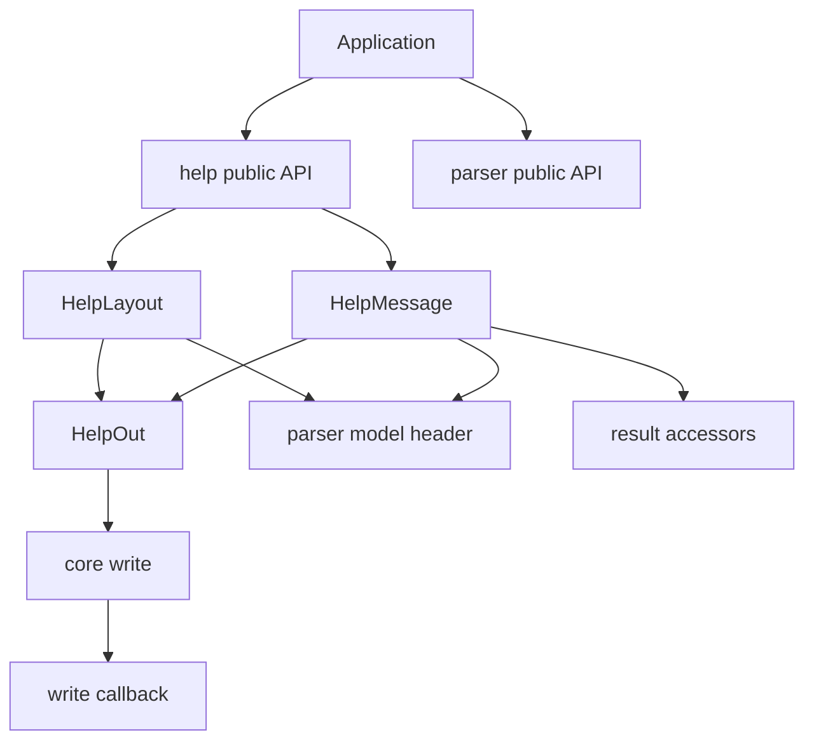
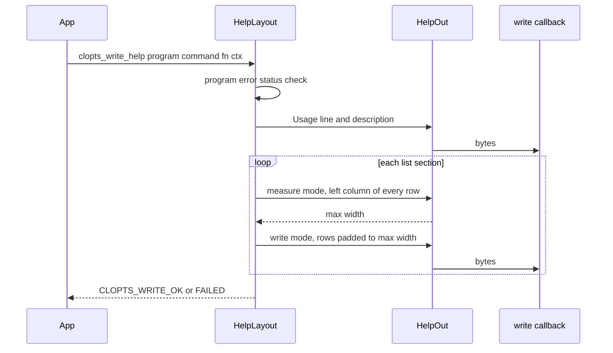
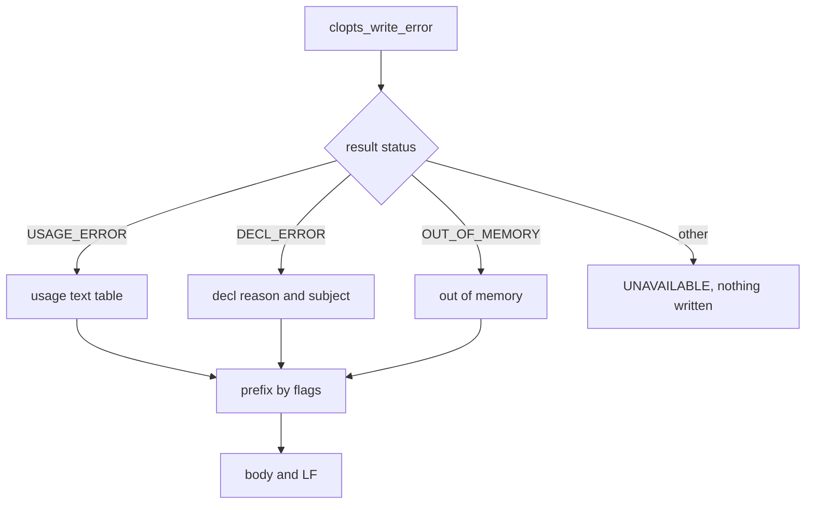

# Design Document: help-and-messages

## Overview

**Purpose**: core-parser で組み立てた宣言と、解析結果の構造化エラーから、利用者向けの英語の文面（ヘルプ、Usage 行、バージョン行、使い方の案内、エラーの 1 行）を生成し、呼び出し側の書き込みコールバックへ書く。
**Users**: CLI ツールの開発者は、`clopts_parse` の状態に応じてこの関数群を呼ぶ。CLI ツールの利用者は、その出力を `--help` やエラーとして読む。
**Impact**: 新しい内部モジュール `src/help/` と公開ヘッダ `include/clopts/help.h` を足す。既存のモジュールは変更せず、傘ヘッダ `clopts/clopts.h` と CMake の登録だけを変える。

### Goals
- 同じ宣言と同じ指定からは常に同じバイト列を書き、テストでバイト単位に検査できる（10.6）。
- 宣言の 1 か所を変えれば、ヘルプとエラー文面が自動的に追従する。
- 利用側が接頭辞を選べる 1 行のエラー文面を、使い方エラー・宣言エラー・メモリ不足のすべての状態で書ける。
- ライブラリ本体は `stdio` に依存せず、メモリを確保しない。

### Non-Goals
- 端末幅での折り返し、複数行の説明の整形、epilog / examples、色付け、候補提示、多言語化、東アジア幅。
- どの状態でどの文面を出すか、stdout / stderr の選択、終了コード（利用側）。
- 宣言のイントロスペクション API の公開（roadmap の Future Phases）。

## Boundary Commitments

### This Spec Owns
- 公開ヘッダ `include/clopts/help.h`: 文面生成の 5 関数、戻り値の列挙 `clopts_write_status_t`、接頭辞のビットフラグ `CLOPTS_PREFIX_*`。
- ヘルプのレイアウト（段落の構成と順、見出し、左列の表記、注記、予約行の文字列、桁揃え）。
- 使い方エラー 7 種別・宣言エラー 15 種別・メモリ不足の文面表と、接頭辞の組み立て。
- 表示幅（UTF-8 のコードポイント数）の計算。
- 書き込みの失敗の検出と、戻り値による報告。
- `tests/help/` の単体テスト。

### Out of Boundary
- 宣言の組み立て・検査、argv の解析、HELP / VERSION の検出とヘルプ対象の決定、エラーの各項目の値（core-parser）。help は与えられた値をそのまま文面にする。
- 書き込みコールバックの型と `clopts_file_write`（project-foundation）。
- 公開シンボル一覧と、その照合の仕組み（abi-compat）。
- サンプルプログラムと文書中の出力例（docs-and-release）。
- 状態に応じた出し分け、出力先の選択、終了コード（利用側）。

### Allowed Dependencies
- `src/parser/parser_model.h`（宣言モデルの読み取り専用の参照）。`parser_internal.h` と走査器・結果ストアの実装は参照しない。
- `include/clopts/parse.h` の結果のアクセサ（`clopts_result_status` と `clopts_result_error_*`）。結果ハンドルの内部は読まない。
- `src/core/core_internal.h` の `clopts_core_write`。
- C 標準ライブラリのうち `<string.h>`、`<stddef.h>`、`<stdbool.h>`、`<assert.h>`。`<stdio.h>` と `<stdlib.h>`（確保）は使わない。
- 依存の向き: core ← parser ← help。help に依存する内部モジュールはない。

### Revalidation Triggers
- core-parser が `clopts_usage_error_t` または `clopts_decl_error_t` に値を足す → 本 spec の文面表とテストの定数を同じ変更で更新する（追従しないと GCC / Clang のビルドか網羅テストが失敗する）。
- `parser_model.h` のフィールドの意味や不変条件が変わる → help のレイアウトとテストを見直す。
- 走査器が設定するエラーの項目（token、name_len、short_name）の意味が変わる → 7.3〜7.6 の文面の引数の決め方を見直す。
- 本 spec の公開関数・列挙・マクロの追加や変更 → abi-compat の公開シンボル一覧、docs-and-release の API リファレンスと出力例を更新する。
- レイアウトや文面の変更 → docs-and-release の文書の出力例（`tests/docs/` で照合する）が壊れる。

## Architecture

### Existing Architecture Analysis
- `clopts` は 1 つのライブラリで、内部モジュールを `clopts_add_module` で足す。共有ビルドでは `CLOPTS_API` の付いたシンボルだけが export され、テストは `clopts_testing` にリンクして内部関数も呼べる。
- core-parser の宣言モデルは、ビルダーの即時検査によって、エラーのない program では常に整合している（名前が規則を満たし、`index` が一致し、位置引数の必須と可変長の順序が正しい）。エラーが記録された program では名前が NULL のことがある。
- 結果ハンドルはメモリ不足のとき共有の番兵になり、program を持たない。

### Architecture Pattern & Boundary Map



**Architecture Integration**:
- Selected pattern: 純粋な関数群と、計測モード付きの出力器。状態を持たず、確保もしない。
- Domain boundaries: HelpLayout（ヘルプ・Usage・バージョン・案内）と HelpMessage（エラーの 1 行）は互いを参照せず、どちらも HelpOut だけを共有する。そのため、2 つは並行して実装できる。
- Existing patterns preserved: Monde のレイアウトと文面、`clopts_add_module`、ファイル名の `help_` 接頭辞、Allman スタイル、契約違反は `assert`。
- New components rationale: HelpOut は、桁揃えのための計測と、失敗後に書かない規則を 1 か所に集める（research.md の Decision「計測と書き込みを 1 つの出力器で行う」）。
- Steering compliance: I/O をしない、`FILE*` を受け取らない、構造体を値で渡さない、公開ヘッダに構造体の定義を置かない。

### Technology Stack

| Layer | Choice / Version | Role in Feature | Notes |
|-------|------------------|-----------------|-------|
| Library | C99、`clopts` ターゲット | 文面生成の実装 | 新しい依存なし |
| Test | Naos v0.4.0（固定済み） | バイト単位の比較、網羅テスト | `tests/help/`、ラベル `help` |
| Build | CMake 3.21、`clopts_add_module` / `clopts_add_module_tests` | モジュールとテストの登録 | 既存の関数を使う |

## File Structure Plan

### Directory Structure
```
include/clopts/
└── help.h                  # 公開: 5 関数、clopts_write_status_t、CLOPTS_PREFIX_*
src/help/
├── CMakeLists.txt          # clopts_add_module(help SOURCES help_out.c help_layout.c help_message.c)
├── help_internal.h         # モジュール内とテストで共有する内部宣言（出力器、幅、文面表、位置引数の表記）
├── help_out.c              # HelpOut: 出力器（書き込み・計測モード、失敗の保持）と UTF-8 の幅
├── help_layout.c           # HelpLayout: clopts_write_help / usage / version / usage_hint と一覧の桁揃え
└── help_message.c          # HelpMessage: clopts_write_error、使い方・宣言エラーの文面表、接頭辞
tests/help/
├── CMakeLists.txt          # clopts_add_module_tests(help SOURCES ...)
├── help_tests_main.c       # Naos の main とスイートの登録
├── test_fixtures.h         # 架空の宣言（tool / filt / bare / wide）の組み立てと、記録用・失敗用のコールバック
├── test_fixtures.c
├── test_out.c              # スイート out: 幅の計算、計測モード、失敗後に書かないこと
├── test_layout.c           # スイート layout: 各ヘルプ・Usage・バージョン・案内のバイト比較
├── test_option_row.c       # スイート option_row: 4.1〜4.12 の表記と注記
└── test_message.c          # スイート message: 全エラー種別の文面、接頭辞、網羅性
```

### Modified Files
- `include/clopts/clopts.h` — `#include "clopts/help.h"` を足す。
- `src/CMakeLists.txt` — `add_subdirectory(help)` を parser の後に足す。
- `tests/CMakeLists.txt` — `add_subdirectory(help)` を parser の後に足す。

## System Flows

### ヘルプの生成（2 パスの桁揃え）



- program に宣言エラーかメモリ不足が記録されていれば、何も書かずに UNAVAILABLE を返す（11.6）。
- 書き込みが一度失敗すると、HelpOut はそれ以降のコールバック呼び出しをすべて飛ばし、最後に FAILED を返す（11.4）。手続きは途中で打ち切らずに最後まで走らせてよい（コールバックは呼ばれない）。

### エラー文面の生成



- 接頭辞は、本文が決まってから書く。どの分岐でも、接頭辞・本文・`\n` を 1 回ずつ出す。

## Requirements Traceability

| Requirement | Summary | Components | Interfaces | Flows |
|-------------|---------|------------|------------|-------|
| 1.1, 1.2, 1.3, 1.4, 1.5, 1.6 | サブコマンドあり構成の全体ヘルプ | HelpLayout | `clopts_write_help(program, NULL)` | ヘルプの生成 |
| 2.1, 2.2, 2.3, 2.4, 2.5, 2.6 | サブコマンドのヘルプ | HelpLayout | `clopts_write_help(program, command)` | ヘルプの生成 |
| 3.1, 3.2, 3.3, 3.4 | サブコマンドなし構成のヘルプ | HelpLayout | `clopts_write_help` | ヘルプの生成 |
| 4.1, 4.2, 4.3, 4.4, 4.5, 4.6 | オプションの左列 | HelpLayout | 左列の表記規則 | — |
| 4.7, 4.8, 4.9, 4.10, 4.11, 4.12 | 注記 | HelpLayout | 注記の規則 | — |
| 5.1, 5.2, 5.3, 5.4 | Usage 行 | HelpLayout | `clopts_write_usage`、Usage 行の規則 | — |
| 6.1, 6.2 | バージョン行 | HelpLayout | `clopts_write_version` | — |
| 6.3, 6.4 | 使い方の案内 | HelpLayout | `clopts_write_usage_hint` | — |
| 7.1, 7.2, 7.3, 7.4, 7.5, 7.6, 7.7, 7.8, 7.9, 7.10 | 使い方エラーの文面 | HelpMessage | `clopts_write_error`、使い方エラーの文面表 | エラー文面の生成 |
| 8.1, 8.2, 8.3, 8.4, 8.5 | 宣言エラー・メモリ不足 | HelpMessage | 宣言エラーの理由表、対象の規則 | エラー文面の生成 |
| 9.1, 9.2, 9.3, 9.4, 9.5, 9.6 | 接頭辞 | HelpMessage | `CLOPTS_PREFIX_*` | エラー文面の生成 |
| 10.1, 10.2, 10.3 | 桁揃えと幅 | HelpOut, HelpLayout | `clopts_help_width`、計測モード | ヘルプの生成 |
| 10.4, 10.5, 10.6, 10.7 | 改行・空行・決定性・無加工 | HelpLayout, HelpMessage | レイアウト規則 | — |
| 11.1, 11.2, 11.3 | 出力先 | HelpOut, help.h | `clopts_write_fn`、`clopts_file_write` | — |
| 11.4, 11.5 | 失敗と戻り値 | HelpOut | `clopts_write_status_t` | ヘルプの生成 |
| 11.6 | エラーが記録された program | HelpLayout | 入口の検査 | ヘルプの生成 |
| 11.7, 11.8 | 不変と ABI | 全コンポーネント | const ハンドル、引数の型 | — |
| 12.1, 12.2 | 文面表の網羅 | HelpMessage, tests | `clopts_help_usage_text`、`clopts_help_decl_reason` | — |
| 12.3, 12.4, 12.5 | テスト | tests/help | Testing Strategy | — |

## Components and Interfaces

| Component | Domain/Layer | Intent | Req Coverage | Key Dependencies (P0/P1) | Contracts |
|-----------|--------------|--------|--------------|--------------------------|-----------|
| help.h | 公開 API | 文面生成の公開契約 | 9.1, 11.1〜11.3, 11.5, 11.8 | writer.h (P0), decl.h / parse.h (P0) | Service |
| HelpOut | 内部 | 書き込み・計測の出力器と UTF-8 の幅 | 10.2, 10.3, 11.1, 11.4, 11.5 | core write (P0) | Service, State |
| HelpLayout | 内部 | ヘルプ・Usage・バージョン・案内 | 1.*, 2.*, 3.*, 4.*, 5.*, 6.*, 10.1, 10.4〜10.7, 11.6, 11.7 | parser model (P0), HelpOut (P0) | Service |
| HelpMessage | 内部 | エラーの 1 行と接頭辞 | 7.*, 8.*, 9.*, 10.4, 10.7, 11.7, 12.1, 12.2 | result accessors (P0), parser model (P0), HelpOut (P0) | Service |

### 公開 API

#### help.h（`include/clopts/help.h`）

| Field | Detail |
|-------|--------|
| Intent | 文面生成の公開関数・戻り値・接頭辞フラグを定める |
| Requirements | 9.1, 11.1, 11.2, 11.3, 11.5, 11.8 |

**Responsibilities & Constraints**
- `clopts/export.h`、`clopts/decl.h`、`clopts/parse.h`、`clopts/writer.h` を include する。構造体の定義を置かない。
- すべての関数に `CLOPTS_API` を付け、C++ から使えるよう `extern "C"` で囲む。
- 引数は const の不透明ハンドル、`clopts_write_fn`、`void *ctx`、`unsigned` だけにする（11.8）。

**Contracts**: Service [x]

##### Service Interface
```c
/* Outcome of a write function. */
typedef enum clopts_write_status
{
    CLOPTS_WRITE_OK = 0,          /* every byte was written */
    CLOPTS_WRITE_FAILED = 1,      /* the callback failed; it was not called again */
    CLOPTS_WRITE_UNAVAILABLE = 2  /* nothing to write; the callback was not called */
} clopts_write_status_t;

/* Prefix flags of clopts_write_error(). Undefined bits are ignored. */
#define CLOPTS_PREFIX_PROGRAM 0x1u  /* "<program>: " or "<program> <command>: " */
#define CLOPTS_PREFIX_ERROR 0x2u    /* "error: " */

/* command: NULL or the root for the program help, a subcommand for its help. */
CLOPTS_API clopts_write_status_t clopts_write_help(const clopts_program_t *program, const clopts_command_t *command,
                                                   clopts_write_fn write_fn, void *ctx);
/* The Usage line of clopts_write_help() alone. */
CLOPTS_API clopts_write_status_t clopts_write_usage(const clopts_program_t *program, const clopts_command_t *command,
                                                    clopts_write_fn write_fn, void *ctx);
/* "<program> <version>\n". UNAVAILABLE without a version. */
CLOPTS_API clopts_write_status_t clopts_write_version(const clopts_program_t *program,
                                                      clopts_write_fn write_fn, void *ctx);
/* "Run '<program> [<command>] --help' for usage.\n". */
CLOPTS_API clopts_write_status_t clopts_write_usage_hint(const clopts_program_t *program,
                                                         const clopts_command_t *command,
                                                         clopts_write_fn write_fn, void *ctx);
/* One line for a USAGE_ERROR / DECL_ERROR / OUT_OF_MEMORY result of program. UNAVAILABLE otherwise. */
CLOPTS_API clopts_write_status_t clopts_write_error(const clopts_program_t *program, const clopts_result_t *result,
                                                    unsigned flags, clopts_write_fn write_fn, void *ctx);
```
- Preconditions（違反は `assert`）: `program != NULL`、`write_fn != NULL`。`command` は NULL か `program` に属する command。`result` は `program` から得たもので、`program` を解放する前に限る（core-parser の寿命規則）。`clopts_result_error_command(result)` が NULL でなければ、その所有者が `program` であること。
- `result == NULL` は、メモリ不足の番兵として読む（parse.h の規則と同じ）。
- Postconditions: OK なら、文面のすべてのバイトを、順にコールバックへ渡し終えている。FAILED なら、最初に失敗した呼び出しより後にはコールバックを呼んでいない。UNAVAILABLE なら、一度も呼んでいない。
- Invariants: 宣言と結果を変更しない（11.7）。メモリを確保しない。同じ program を複数のスレッドから同時に読んでよい（凍結の前後を問わず、ビルダー呼び出しと並行しない限り）。
- コールバックへの分割の仕方（何回呼ぶか、どこで区切るか）は契約に含めない。連結したバイト列だけが契約である。
- `FILE*` へは `clopts_write_help(p, NULL, clopts_file_write, stdout)` のように渡す（11.3）。

### 内部

#### HelpOut（`src/help/help_out.c`）

| Field | Detail |
|-------|--------|
| Intent | 書き込みと計測を同じ呼び出しで行う出力器と、表示幅の計算 |
| Requirements | 10.2, 10.3, 11.1, 11.4, 11.5 |

**Responsibilities & Constraints**
- 書き込みモードでは `clopts_core_write` でコールバックへ渡す。最初の失敗を `failed` に記録し、以降は呼ばない。
- 計測モードでは書かずに、渡された文字列の幅を `width` に足す。
- 幅は UTF-8 の厳密なデコードで数える。正しい列（過長形式・サロゲート・U+10FFFF 超を除く）を 1 桁、不正なバイトを 1 バイトにつき 1 桁とする（10.2、10.3）。
- 長さ 0 の書き込みは、コールバックを呼ばない。

**Contracts**: Service [x] / State [x]

##### Service Interface
```c
typedef struct clopts_help_out
{
    clopts_write_fn fn;   /* NULL: measure mode */
    void *ctx;
    bool failed;          /* write mode: a callback failed; no further calls */
    size_t width;         /* measure mode: code points measured so far */
} clopts_help_out_t;

void clopts_help_out_init(clopts_help_out_t *out, clopts_write_fn fn, void *ctx);  /* fn NULL: measure */
void clopts_help_out_bytes(clopts_help_out_t *out, const char *data, size_t len);
void clopts_help_out_str(clopts_help_out_t *out, const char *s);
void clopts_help_out_char(clopts_help_out_t *out, char c);
void clopts_help_out_spaces(clopts_help_out_t *out, size_t count);
clopts_write_status_t clopts_help_out_status(const clopts_help_out_t *out);  /* OK or FAILED */
size_t clopts_help_width(const char *data, size_t len);
```
- State: `failed` は false → true に一度だけ変わる。

#### HelpLayout（`src/help/help_layout.c`）

| Field | Detail |
|-------|--------|
| Intent | ヘルプ、Usage 行、バージョン行、使い方の案内の生成 |
| Requirements | 1.1〜1.6, 2.1〜2.6, 3.1〜3.4, 4.1〜4.12, 5.1〜5.4, 6.1〜6.4, 10.1, 10.4〜10.7, 11.6, 11.7 |

**Responsibilities & Constraints**
- 入口の検査: `program->error.status != CLOPTS_OK` なら UNAVAILABLE（11.6）。`clopts_write_version` は `program->version == NULL` でも UNAVAILABLE（6.2）。
- `command` が NULL または `&program->root` のときは program のヘルプにする。サブコマンドあり構成なら全体ヘルプ（3.4）、サブコマンドなし構成ならサブコマンドなしのヘルプ。
- 「テキストがある」とは、NULL でなく空文字列でもないことをいう。空文字列の説明・要約・ヘルプは未設定と同じに扱う。
- 一覧は「行の配列」として内部で表し、同じ行生成の手続きを計測モード → 書き込みモードの順に 2 回走らせる（research.md の Decision）。
- 文字列は折り返し・切り詰め・エスケープをせずにそのまま書く（10.7）。

**Contracts**: Service [x]

##### 段落の構成

段落は空行 1 行で区切り、すべての文面は `\n` で終える（10.4、10.5）。`[...]` は条件付きの段落である。

| ヘルプ | 段落（この順） |
|---|---|
| 全体ヘルプ（サブコマンドあり） | Usage 行 / [説明] / `Commands:` / `Options:` / 末尾の案内 |
| サブコマンドのヘルプ | Usage 行 / [説明（なければ要約）] / [`Arguments:`] / `Options:` / [`Global Options:`] |
| サブコマンドなしのヘルプ | Usage 行 / [説明] / [`Arguments:`] / `Options:` |

| 一覧 | 行（この順） |
|---|---|
| `Commands:` | 各サブコマンド（追加順）、`help`（説明 `Show help for a command`） |
| `Options:`（全体・サブコマンドなし） | root のオプション（追加順）、`-h, --help`、[`--version`] |
| `Options:`（サブコマンド） | そのサブコマンドのオプション（追加順）、`-h, --help` |
| `Global Options:` | root のオプション（追加順）、[`--version`]。どちらもなければ段落ごと省く（2.6） |
| `Arguments:` | 位置引数（追加順）。左列は `<NAME>` |

- 予約行の説明は固定: `-h, --help` → `Show this help`、`--version` → `Show version information`。`--version` の左列は `    --version`（長い名前だけの option と同じ字下げ）。
- 末尾の案内: `Run '<program> <command> --help' for help on a command.`（1.1）。

##### Usage 行

| 対象 | 形 |
|---|---|
| 全体（サブコマンドあり） | `Usage: <program> [<options>] <command> [<arguments>]` |
| サブコマンド | `Usage: <program> <command> [<options>]<positionals>` |
| サブコマンドなし | `Usage: <program> [<options>]<positionals>` |

- `<positionals>` は位置引数ごとに半角空白 1 個と、次の表記を追加順に並べたもの（5.2）: 必須 `<NAME>`、任意 `[<NAME>]`、必須で可変長 `<NAME>...`、任意で可変長 `[<NAME>...]`。
- `clopts_write_usage` は、この 1 行と `\n` だけを書く（5.3）。

##### オプションの左列（4.1〜4.6）

| 種類と名前 | 左列 |
|---|---|
| 短い名前と長い名前 | `-c, --name` |
| 長い名前だけ | `    --name`（先頭に空白 4 個） |
| 短い名前だけ | `-c` |
| 否定可能な FLAG（長い名前あり） | 長い名前の部分を `--[no-]name` にする |
| COUNT | 名前の後ろに `...` |
| VALUE | 名前の後ろに ` <V>` |
| LIST（区切り文字 `d`） | 名前の後ろに ` <V>[d<V>...]` |
| LIST（区切り文字なし） | 名前の後ろに ` <V>...` |

- `<V>` は値の表示名で、未設定（NULL か空）なら `VALUE`（4.2）。
- 例: `-c, --[no-]color`、`-v, --verbose...`、`-j...`、`-o, --output <FILE>`、`-k, --keys <KEY>[,<KEY>...]`、`    --tag <TAG>...`、`-n <N>`。
- 否定可能でも長い名前のない FLAG は、短い名前だけの表記にする（`--no-` の形がないため）。

##### 説明と注記（4.7〜4.12）

- 説明の後ろに、注記をこの固定の順で付ける（4.12）: `(required)`、`(default: <value>)`、`[env: <NAME>]`。必須と既定値は宣言検査で両立しないので、同時に出るのは最大 2 個である。
- 説明と注記の間、注記と注記の間は半角空白 1 個。説明がなければ、最初の注記を説明の開始位置から書く（4.11）。
- 説明も注記もない行は左列だけを書き、パディングを出さない（4.10、1.3）。
- 既定値は宣言の文字列のまま書く（LIST の既定値も分割しない）。

##### 桁揃え（10.1）

- 各行は空白 2 個で始める。一覧ごとに、予約行を含むすべての行の左列の幅（コードポイント数）の最大値 `W` を求め、説明・注記を `2 + W + 2` 桁目から書く。左列の幅が `w` の行には、空白を `W - w + 2` 個補う。

##### 出力例（架空の宣言）

```text
Usage: tool [<options>] <command> [<arguments>]

A sample tool for testing.

Commands:
  build  Build an output from a source
  copy   Copy a file
  help   Show help for a command

Options:
  -v, --verbose...     Print more details
  -c, --[no-]color     Colorize the output
      --config <FILE>  Configuration file [env: TOOL_CONFIG]
  -h, --help           Show this help
      --version        Show version information

Run 'tool <command> --help' for help on a command.
```

```text
Usage: tool build [<options>] <SRC> [<EXTRA>...]

Build an output from SRC.

Arguments:
  <SRC>    Source file
  <EXTRA>  Extra inputs

Options:
  -o, --output <FILE>          Write the result to FILE (required)
  -k, --keys <KEY>[,<KEY>...]  Keys to include (default: a,b)
  -h, --help                   Show this help

Global Options:
  -v, --verbose...     Print more details
  -c, --[no-]color     Colorize the output
      --config <FILE>  Configuration file [env: TOOL_CONFIG]
      --version        Show version information
```

- 全体ヘルプの `Options:` の左列の最大幅は `    --config <FILE>` の 19 で、説明は 23 桁目（2 + 19 + 2）から始まる。`build` の `Options:` は `-k, --keys <KEY>[,<KEY>...]` の 27、`Arguments:` は `<EXTRA>` の 7 である。`Global Options:` は `Options:` とは別に最大幅を求める。

##### バージョン行と使い方の案内（6.1〜6.4）
- `clopts_write_version`: `<program> <version>\n`。
- `clopts_write_usage_hint`: command が NULL か root なら `Run '<program> --help' for usage.\n`、サブコマンドなら `Run '<program> <command> --help' for usage.\n`。

- Usage 行の位置引数の表記は `help_layout.c` 内の `static` 関数に閉じる。HelpMessage は、「必須引数がない」の `<NAME>` を `<` + name + `>` で直接書く（Usage の `[...]` や `...` を付けないため）。

**Implementation Notes**
- Integration: `parser_model.h` のフィールドを直接読む。vec の要素は `clopts_core_vec_at` で取り、ポインタの配列として扱う。
- Validation: `tests/help/test_layout.c` と `test_option_row.c` でバイト比較する。
- Risks: 計測と書き込みで別々の分岐をすると、幅がずれる。1 行を作る関数は出力器だけを受け取り、モードで分岐しない。

#### HelpMessage（`src/help/help_message.c`）

| Field | Detail |
|-------|--------|
| Intent | 結果の状態に応じたエラーの 1 行と、その接頭辞 |
| Requirements | 7.1〜7.10, 8.1〜8.5, 9.1〜9.6, 10.4, 10.7, 11.7, 12.1, 12.2 |

**Responsibilities & Constraints**
- 状態は `clopts_result_status` で読む。USAGE_ERROR / DECL_ERROR / OUT_OF_MEMORY 以外なら UNAVAILABLE（8.5）。
- 文面の構成: `[接頭辞] + 本文 + "\n"`。使い方の案内は含めない（7.10）。
- 宣言エラーが記録された program でも動く。名前が NULL・空の対象は省く（8.3）。
- 種別 → 文面の関数は `default` のない `switch` で書き、範囲外の値には NULL を返す（12.1、12.2）。

**Contracts**: Service [x]

##### 接頭辞（9.1〜9.6）

`flags` のうち定義済みのビットだけを見る（9.6）。

| `PROGRAM` | `ERROR` | 接頭辞 |
|---|---|---|
| 0 | 0 | （なし） |
| 0 | 1 | `error: ` |
| 1 | 0 | `<P>: ` |
| 1 | 1 | `<P>: error: ` |

- `<P>` は、エラーに該当する command（`clopts_result_error_command`）が NULL ならプログラム名、そうでなければ `<program> <command>` である（9.2、9.3）。
- プログラム名にテキストがない場合（`clopts_program_new` の INVALID_NAME）は `<P>: ` を出さない。command の名前にテキストがない場合は、プログラム名だけにする。

##### 使い方エラーの文面（7.1〜7.9）

`<opt>` は「利用者が書いた形」のオプション名で、次の順に決める: (1) `short_name` が ASCII（0x01〜0x7F）なら `-<c>`、(2) option に長い名前があれば `--<long>`、(3) option に短い名前があれば `-<c>`、(4) どれもなければ token のうち `=` より前の部分。

| 種別 | 本文 | 引数の出所 |
|---|---|---|
| UNKNOWN_COMMAND | `unknown command '<token>'` | token（7.2） |
| UNKNOWN_OPTION | `unknown option '<arg>'` | short_name が ASCII なら `-<c>`（7.4）。それ以外で name_len > 0 なら token の先頭 name_len バイト（7.3）。どちらでもなければ token 全体 |
| MISSING_VALUE | `option '<opt>' requires a value` | 上の `<opt>`（7.5） |
| UNEXPECTED_VALUE | `option '<opt>' does not take a value` | option があれば `--<long>`（長い名前がなければ `<opt>`）。option が NULL（予約）なら token の `=` より前（7.6） |
| MISSING_OPTION | `missing required option '<name>'` | `--<long>`、なければ `-<c>`（7.7） |
| MISSING_ARGUMENT | `missing argument <NAME>` | positional の名前（7.8） |
| UNEXPECTED_ARGUMENT | `unexpected argument '<token>'` | token（7.9） |

- まとめ書きの中の ASCII 以外のバイトは `-<c>` にせず、token 全体を書く（research.md の「走査器が設定するエラーの項目」）。

##### 宣言エラーの文面（8.1〜8.3）

本文は `invalid declaration: <reason>` で、対象があれば ` (<subject>)` を続ける。

| 種別 | `<reason>` |
|---|---|
| INVALID_NAME | `invalid name` |
| NO_NAME | `option has neither a long nor a short name` |
| DUPLICATE_COMMAND | `duplicate command name` |
| DUPLICATE_OPTION | `duplicate option name` |
| RESERVED_NAME | `reserved name` |
| NOT_NEGATABLE | `only a flag can be negatable` |
| NEGATION_CONFLICT | `conflicts with the negated form of a flag` |
| DEFAULT_NOT_ALLOWED | `a flag or count cannot have a default value` |
| ENV_NOT_ALLOWED | `a flag or count cannot have an environment variable` |
| REQUIRED_WITH_DEFAULT | `a required option cannot have a default value` |
| REQUIRED_NOT_ALLOWED | `a flag or count cannot be required` |
| POSITIONAL_ORDER | `a required argument cannot follow an optional one` |
| VARIADIC_POSITION | `only the last argument can be variadic` |
| ATTRIBUTE_KIND | `attribute does not apply to this kind of option` |
| MIXED_LAYOUT | `a program with subcommands cannot have root arguments or a root handler` |

`<subject>` は次の順で最初に当てはまるもの 1 つとする（8.2、8.3）:
1. option があり名前を持つ → `option '--<long>'`（長い名前がなければ `option '-<c>'`）
2. positional があり名前を持つ → `argument <NAME>`
3. command があり名前を持つ → `command '<name>'`
4. どれもない → 対象を省く

1・2 で、その option / positional が command 配下にある（`clopts_result_error_command` が NULL でない）なら、` in command '<name>'` を続ける。

例: `invalid declaration: duplicate option name (option '--out' in command 'build')`。

##### メモリ不足（8.4）
- 本文は `out of memory`。結果が番兵でも、program からプログラム名の接頭辞を作れる。

##### 内部で提供する関数（テスト用）
```c
/* Body template of a usage error kind; NULL for CLOPTS_USAGE_NONE and values outside the enum. */
const char *clopts_help_usage_text(clopts_usage_error_t kind);
/* Reason of a declaration error kind; NULL for CLOPTS_DECL_NONE and values outside the enum. */
const char *clopts_help_decl_reason(clopts_decl_error_t kind);
```
- `clopts_help_usage_text` は、引数の位置を含まない固定部分の識別子（例: `"unknown command"`）を返す。網羅テストは、空でないことと、種別ごとに異なることを検査する。

**Implementation Notes**
- Integration: アクセサ以外で結果を読まない。program からは、プログラム名（`program->root.name`）だけを読む。
- Validation: `tests/help/test_message.c`。使い方エラーは、架空の宣言に実際の argv を `clopts_parse` で解析させて作る（結果ハンドルを偽造しない）。宣言エラーは、規則表の各種別を起こすビルダー呼び出しで作る。
- Risks: 宣言エラーの対象の名前が規則に違反している（空白を含むなど）ことがある。文面にはそのまま書く（10.7）。

## Data Models

本 spec は永続データを持たない。読むデータは core-parser の宣言モデル（`parser_model.h`）と、結果のアクセサの値である。

| 読むもの | 使い道 |
|---|---|
| `program->root.name`、`program->version`、`program->commands`、`program->error.status` | Usage 行、バージョン行、接頭辞、構成の判定、入口の検査 |
| `command->name / summary / description / options / positionals` | 一覧と説明 |
| `option->kind / long_name / short_name / help / value_name / default_value / env / delimiter / required / negatable` | 左列と注記 |
| `positional->name / help / required / variadic` | Usage 行と `Arguments:` |
| `clopts_result_status`、`clopts_result_usage_error`、`clopts_result_decl_error`、`clopts_result_error_command / option / positional / token / name_len / short_name` | エラーの 1 行 |

`count_max` と handler はヘルプに出さない。

## Error Handling

### Error Strategy

| 状況 | 扱い |
|---|---|
| コールバックが非 0 を返した | 以降のコールバック呼び出しを止め、FAILED を返す（11.4） |
| バージョンのない program で `clopts_write_version` | 何も書かずに UNAVAILABLE（6.2） |
| 宣言エラー・メモリ不足が記録された program でヘルプ系の 4 関数 | 何も書かずに UNAVAILABLE（11.6） |
| 状態がエラーでない結果で `clopts_write_error` | 何も書かずに UNAVAILABLE（8.5） |
| `program` / `write_fn` が NULL、別 program の command | 契約違反。`assert` で止める（`NDEBUG` では未定義） |
| 定義されていない接頭辞のビット | 無視する（9.6） |
| UTF-8 として不正な名前 | 1 バイト 1 桁として数えて、そのまま書く（10.3） |

確保をしないので、メモリ不足は起きない。

## Testing Strategy

テストはすべて `tests/help/` の Naos のテストで、ラベルは `help`。期待値は、設計の規則から手で導いたバイト列をソースに書き、`NAOS_CHECK_MEM_EQ` で長さを含めて比較する。架空の宣言（`test_fixtures.c`）:
- `tool 1.2.3`（サブコマンドあり）: global に `-v/--verbose` COUNT、`-c/--color` 否定可能 FLAG、`--config` VALUE（env）。`build`（必須 VALUE、区切り文字付き LIST と既定値、必須 SRC、任意で可変長 EXTRA、説明あり）、`copy`（要約だけ、必須の位置引数 2 つ）。
- `filt`（サブコマンドなし、版なし）: `-n/--lines` VALUE（既定値、env）、必須で可変長 FILE。
- `bare 0.1`（サブコマンドあり、global オプションなし）: `run`（オプションなし）— 2.6 と、版だけの `Global Options:`。
- `wide`（サブコマンドなし）: `--naïve`、`--日本語 <値>` など非 ASCII の名前と、UTF-8 として不正なバイトを含む表示名。

### Unit Tests（スイート out）
- `clopts_help_width`: ASCII、2〜4 バイトの列、過長形式・サロゲート・途切れた列・単独の継続バイトが 1 バイト 1 桁になること（10.2、10.3）。
- 計測モードでコールバックが呼ばれず、幅が足されること。
- 3 回目の呼び出しで失敗するコールバックで、FAILED が返り、失敗後の呼び出し回数が 0 であること（11.4、12.5）。これを `clopts_write_help`、`clopts_write_error` の公開関数経由でも確かめる。

### Unit Tests（スイート layout）
- `tool` の全体ヘルプ、`build` と `copy` のヘルプ、`filt` のヘルプ、`bare` の `run` のヘルプを完全一致で比較する（1.1〜1.6、2.1〜2.6、3.1〜3.3、12.3）。
- `clopts_write_help(tool, root)` が `NULL` の場合と同じバイト列になること（3.4）。
- 版のない program の全体ヘルプに `--version` がないこと（1.6、3.3）。
- `clopts_write_usage` の 3 形（全体・サブコマンド・サブコマンドなし）と、位置引数 4 表記（5.1〜5.4）。
- `clopts_write_version` の OK と UNAVAILABLE（6.1、6.2）。`clopts_write_usage_hint` の 2 形（6.3、6.4）。
- 宣言エラーを記録した program で、ヘルプ系 4 関数が UNAVAILABLE を返し、コールバックが呼ばれないこと（11.6）。
- 同じ宣言で 2 回生成したバイト列が一致し、どの行も末尾が空白でなく、`\r` を含まず、空行が連続しないこと（10.4〜10.6）。

### Unit Tests（スイート option_row）
- 4.1〜4.6 の左列の各表記、4.7〜4.9 の各注記、注記 2 個の順序（4.12）、説明なし・注記なし（4.10）、説明なし・注記あり（4.11）を、1 行ずつの小さな宣言で検査する（12.4）。
- `wide` の `Options:` で、非 ASCII の左列があっても説明の開始桁（コードポイント）が揃うこと（10.1、10.2、12.4）。

### Unit Tests（スイート message）
- 使い方エラーの 7 種別を、`clopts_parse` で実際に起こして完全一致で比較する: `tool bulid`、`tool build --bad=1`、`tool build -vx`、`tool build -o`（値なし）、`tool --color=yes`、`tool --help=x`（予約・option NULL）、`tool build SRC`（必須オプションなし）、`tool copy a`（必須引数なし）、`tool copy a b c`（余分）（7.1〜7.9）。
- まとめ書きの中の ASCII 以外のバイトで、token 全体を書くこと。
- 宣言エラーの 15 種別を、ビルダー呼び出しで起こして比較する。名前のない対象（`clopts_program_new("")`、NO_NAME、root の `set_handler` の MIXED_LAYOUT）で対象が省かれること（8.1〜8.3）。
- メモリ不足: `clopts_write_error(program, NULL, ...)` で `out of memory` の 1 行になること（8.4）。状態 OK / HELP / VERSION / NO_COMMAND の結果で UNAVAILABLE（8.5）。
- 接頭辞の 4 通りと、command あり・なしの組み合わせ、未定義のビット（`0x4u`、`~0u`）を含めても結果が同じであること（9.1〜9.6）。
- 網羅性: `clopts_help_usage_text` が 1〜7 で空でない互いに異なる文字列を、0 と 8 で NULL を返すこと。`clopts_help_decl_reason` が 1〜15 で同様で、0 と 16 で NULL を返すこと（12.1、12.2）。最大値の定数はテストの中に持ち、列挙に値を足したときに更新を迫る。

### Build-level Checks
- 種別の `switch` に `default` を置かないので、列挙に値を足して文面を足さないと、GCC / Clang（`-Wall -Werror`）のビルドが失敗する（12.2）。
- 共有ビルドの統合テスト（既存）で、`clopts_write_*` が export されていること。公開シンボル一覧との照合は abi-compat が担う。

## Security Considerations
- 利用者の入力（token）を文面にそのまま書く。制御文字やエスケープ列を除去しない（10.7）。端末への安全な表示は利用側の責任であり、API リファレンスに書く（docs-and-release）。
- 長さは NUL 終端と name_len だけに依存し、バッファへのコピーをしないので、溢れの経路がない。
