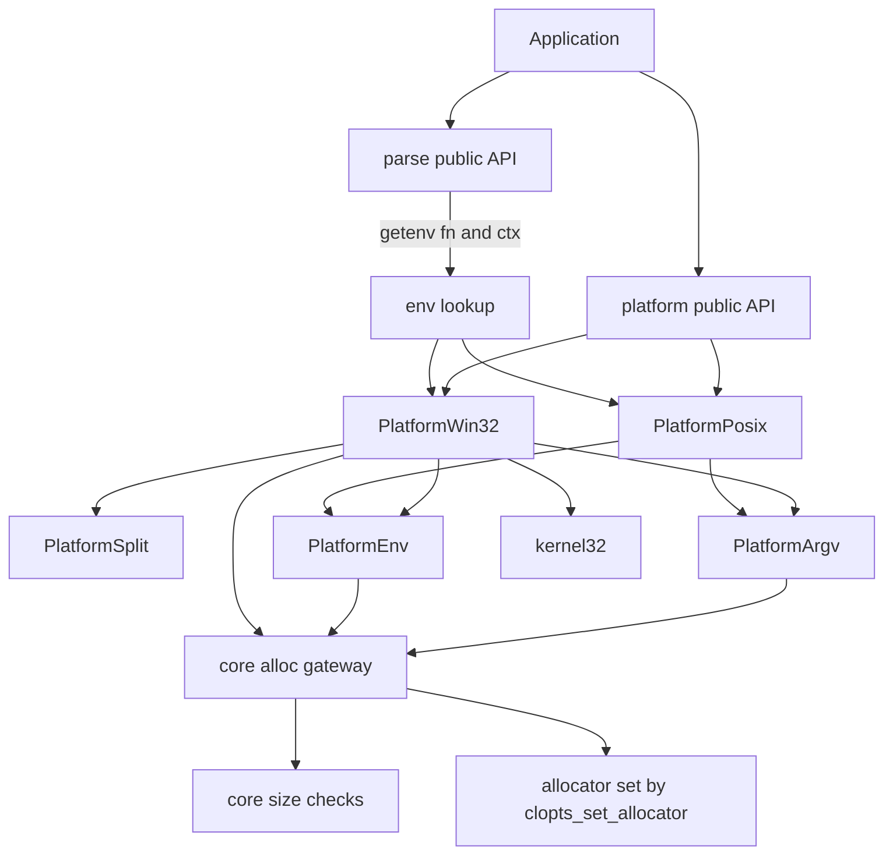
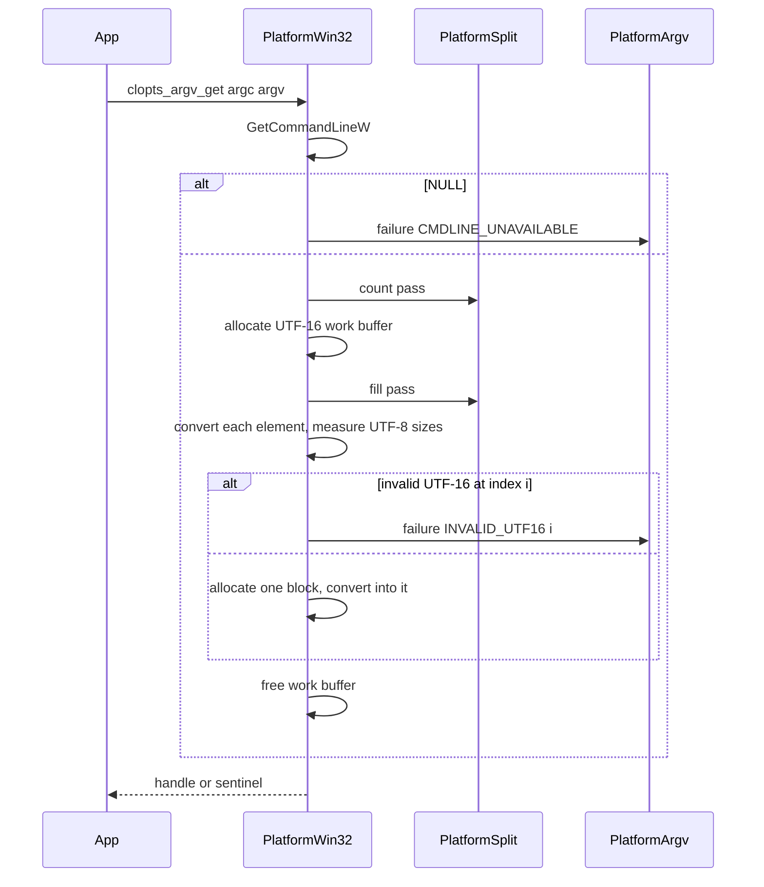
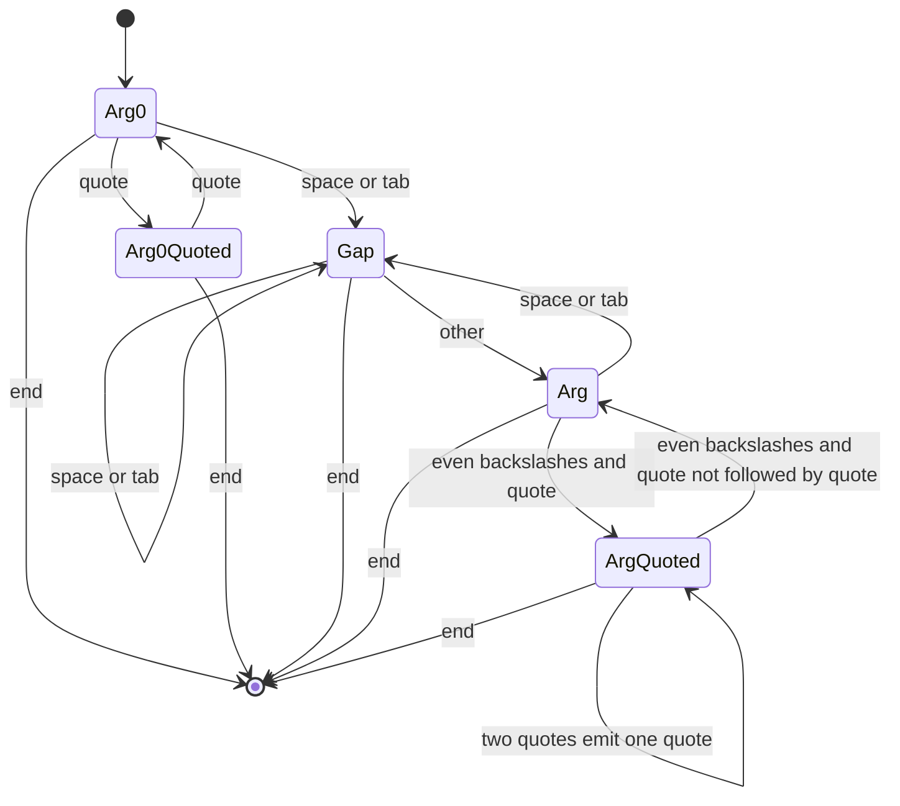

# Design Document: platform-argv

## Overview

**Purpose**: CLOpts の利用者が、Windows でも他の OS と同じように UTF-8 のコマンドライン引数と環境変数を受け取れるようにする。Windows では `GetCommandLineW()` の文字列を現行 MSVC CRT と同じ規則で自前で分割し、UTF-8 に変換した argv を不透明ハンドルで返す。Windows 以外では、渡された argv をそのまま返す。
**Users**: CLI ツールの開発者は、`main` の先頭で `clopts_argv_get` を呼び、得た argv を `clopts_parse` に渡す。環境変数を UTF-8 で読みたいときは、`clopts_env_t` を作って `clopts_parse_with_env` に `clopts_env_lookup` と一緒に渡す。
**Impact**: 新しい内部モジュール `src/platform/` と公開ヘッダ `include/clopts/platform.h` を足す。既存のモジュール（core / parser / help）のソースは変更しない。傘ヘッダ、CMake の登録、統合テストの利用側だけを変える。

### Goals
- Windows で取得した argv が、`main` の argv と要素数・各要素の内容で一致する（ASCII の範囲。2.2）。
- 非 ASCII の引数と環境変数を UTF-8 で受け取れる。不正な UTF-16 は列挙と添字で報告する。
- ライブラリが確保したものはライブラリが解放し、`free` 1 回で片付く。NULL も番兵も安全に解放できる。
- Windows での依存は kernel32 だけ。分割規則は全 OS の CI で表駆動テストする。

### Non-Goals
- `activeCodePage=UTF-8` のマニフェスト、コンソールのコードページ、stdio のバイナリモード。
- ワイルドカードの展開、引数の解析（core-parser）、文面（help-and-messages）、手順書（docs-and-release）。
- `clopts_parse` の既定の環境変数取得の変更（Windows でも `getenv` のまま）。
- msvcrt.dll を使う古い MinGW の `main` の argv との一致（対象は現行の ucrt）。

## Boundary Commitments

### This Spec Owns
- 公開ヘッダ `include/clopts/platform.h`: 不透明型 `clopts_argv_t` / `clopts_env_t`、列挙 `clopts_argv_status_t` / `clopts_env_error_t`、argv の取得・変換・アクセサ・解放の関数、環境変数の文脈と取得関数。
- コマンドライン文字列の分割規則（現行 MSVC CRT の規則）と、その実装 `clopts_platform_split`。
- UTF-16 から UTF-8 への変換（argv、環境変数の値）と、UTF-8 から UTF-16 への変換（環境変数の名前）。失敗の判定。
- argv の取得結果と環境変数の文脈のメモリの所有と解放、メモリ不足の番兵。
- `tests/platform/` の単体テスト、CRT との突き合わせ用の probe、shell32 不使用の検査。

### Out of Boundary
- 解析の挙動と、環境変数コールバックのシグネチャ（`clopts_getenv_fn`、`clopts_env_status_t`。core-parser）。本 spec はそれに合わせるだけで、変更しない。
- `clopts_parse` の既定の環境変数取得（core-parser の `clopts_parser_getenv_default`）。
- 失敗の文面（利用者、または将来の help-and-messages）。本 spec は文字列を作らない。
- 公開シンボル一覧と、その照合の仕組み（abi-compat）。本 spec は追加する関数を列挙するだけ。
- 利用者向けの説明（`clopts_parse_with_env` との組み合わせ方、msvcrt 系 MinGW とワイルドカードの注意。docs-and-release）。

### Allowed Dependencies
- `src/core/core_internal.h` の `clopts_core_size_mul` / `clopts_core_size_add`（確保サイズの桁あふれ検査）と、確保の窓口 `clopts_core_malloc` / `malloc_array` / `free`（core-parser の Alloc。設定されたアロケーターを呼ぶ）。
- 公開ヘッダ `clopts/export.h`（`CLOPTS_API`）と `clopts/parse.h`（`clopts_getenv_fn`、`clopts_env_status_t` の型だけ）。
- C 標準ライブラリ: `<stdlib.h>`（確保、`getenv`）、`<string.h>`、`<stddef.h>`、`<stdint.h>`、`<limits.h>`、`<assert.h>`。`<stdio.h>` は使わない。
- Windows（`platform_win32.c` だけ）: `<windows.h>` の kernel32 の関数 `GetCommandLineW`、`WideCharToMultiByte`、`MultiByteToWideChar`、`GetEnvironmentVariableW`、`GetLastError`、`SetLastError`。shell32（`<shellapi.h>`、`CommandLineToArgvW`）は使わない。
- 依存の向き: core ← platform。platform は parser と help の内部を参照せず、parser と help も platform を参照しない。

### Revalidation Triggers
- core-parser が `clopts_getenv_fn` のシグネチャ、`clopts_env_status_t` の値、または「FAILED で解析を打ち切る」契約を変える → `clopts_env_lookup` と失敗の記録の意味を見直す。
- 本 spec の公開関数・列挙の追加や変更 → abi-compat の公開シンボル一覧、docs-and-release の API リファレンスを更新する。
- 分割規則の変更（CRT の規則が変わった場合を含む） → probe の突き合わせ表と docs-and-release の Windows の章を見直す。
- `clopts_core_size_*` の契約の変更 → 確保サイズの計算を見直す。
- core の確保の窓口（`clopts_core_*`）の契約、またはテスト用のアロケーター（`tests/support/test_alloc`）の確保点の定義の変更 → スイート oom を見直す。

## Architecture

### Existing Architecture Analysis
- `clopts` は 1 つのライブラリで、内部モジュールを `clopts_add_module` で足す。テストは `clopts_add_module_tests` で登録され、共有ビルドでは静的な `clopts_testing` にリンクするため、内部関数も呼べる。
- 結果ハンドルは、メモリ不足のとき `static const` の番兵を返し、NULL は番兵と同じに読む（core-parser）。ライブラリのすべての確保は core の窓口を通り、窓口は `clopts_set_allocator` で設定されたアロケーター（ライブラリ全体で 1 つ）を呼ぶ。メモリ確保失敗の検査は、テスト用のアロケーター（`tests/support/test_alloc`、`fail_at` / `calls` / `live`）を公開 API で組み込んで行う（2026-11-09 に、内部関数に確保の probe を渡す方式から変更）。本 spec はどちらも踏襲する。
- `clopts_parse_with_env(program, argc, argv, getenv_fn, env_ctx)` は `getenv_fn` が NULL なら既定の `getenv` を使う。本 spec は、その差し込み口に渡す取得関数を提供する。

### Architecture Pattern & Boundary Map



**Architecture Integration**:
- Selected pattern: 全 OS 共通の純粋な部品（分割、ハンドル、文脈）と、CMake で 1 つだけ選ぶ OS 別の翻訳単位（`platform_win32.c` / `platform_posix.c`）。OS の分岐はソースの `#ifdef` ではなく、ビルドでどのファイルを使うかで表す。例外は公開ヘッダで `clopts_argv_from_wide` を宣言する 1 か所だけ。
- Domain boundaries: 分割（PlatformSplit）は文字列から文字列への変換だけを行い、確保もしない。取得結果の形と寿命は PlatformArgv、環境変数の文脈は PlatformEnv が持つ。OS とのやり取りは OS 別の翻訳単位だけが行う。
- Existing patterns preserved: 番兵、NULL のハンドルを番兵として読む、core の確保の窓口とテスト用のアロケーターによる確保失敗の注入、`clopts_add_module`、`platform_` のファイル接頭辞、Allman スタイル、契約違反は `assert`。
- New components rationale: 分割を純粋関数にするのは、全 OS でのテストのため（9.1）。確保は core の窓口に通し、platform 独自の確保の入口は持たない。メモリ不足の経路は、テスト用のアロケーターですべてテストで通す（5.4。2026-11-09 に、PlatformAlloc から変更）。
- Steering compliance: I/O をしない、本 spec の公開型は不透明型と列挙だけで、公開ヘッダに構造体を定義しない（steering の「公開構造体は凍結する」の範囲内）、構造体を値で渡さない、確保は core の窓口を通す、ライブラリが確保したものはライブラリが解放する、`<windows.h>` は Windows 専用の翻訳単位だけ。

### Technology Stack

| Layer | Choice / Version | Role in Feature | Notes |
|-------|------------------|-----------------|-------|
| Library | C99、`clopts` ターゲット | 分割・変換・ハンドル | 新しい外部依存なし |
| OS API | Win32 kernel32（Vista 以降の `WC_ERR_INVALID_CHARS` / `MB_ERR_INVALID_CHARS`） | コマンドライン・環境変数の取得、UTF-16 ↔ UTF-8 の変換 | MSVC / MinGW-w64 の既定のリンクで解決する。`target_link_libraries` は足さない |
| Test | Naos v0.4.0（固定済み） | 表駆動テスト、Windows の突き合わせ | `tests/platform/`、ラベル `platform` |
| Build | CMake 3.21、`clopts_add_module` / `clopts_add_module_tests` | モジュールとテストの登録、OS 別ソースの選択 | 既存の関数を使う |

## File Structure Plan

### Directory Structure
```
include/clopts/
└── platform.h              # 公開: clopts_argv_t / clopts_env_t、2 つの列挙、argv と環境変数の関数
src/platform/
├── CMakeLists.txt          # clopts_add_module(platform SOURCES 共通 4 ファイル + platform_win32.c または platform_posix.c)
├── platform_internal.h     # モジュール内とテストで共有する内部宣言（u16 型、分割、ハンドルと文脈の構造体と補助関数）
├── platform_split.c        # PlatformSplit: コマンドライン文字列の分割（CRT の規則、全 OS）
├── platform_argv.c         # PlatformArgv: argv ハンドル、番兵、失敗とパススルーのハンドル、アクセサ、解放
├── platform_env.c          # PlatformEnv: clopts_env_t の作成・解放、失敗の記録とアクセサ、値のバッファ
├── platform_win32.c        # PlatformWin32: Windows の clopts_argv_get / clopts_argv_from_wide / clopts_env_lookup と UTF 変換
└── platform_posix.c        # PlatformPosix: Windows 以外の clopts_argv_get（パススルー）と clopts_env_lookup（getenv）
tests/platform/
├── CMakeLists.txt          # clopts_add_module_tests(platform ...)、Windows では probe を作り、shell32 の検査を登録
├── platform_tests_main.c   # Naos の main とスイートの登録（Windows だけのスイートは #ifdef _WIN32）
├── test_util.h             # ASCII 文字列や符号単位の列から clopts_platform_u16_t の配列を作る補助、分割結果の比較
├── test_util.c
├── test_split.c            # スイート split: 分割規則の表駆動テスト（全 OS）
├── test_argv.c             # スイート argv: ハンドル・アクセサ・解放・NULL と番兵、パススルー（非 Windows）、__argv との一致（Windows）
├── test_convert.c          # スイート convert（Windows）: from_wide、コマンドラインからの変換、非 ASCII、不正な UTF-16 と添字
├── test_env.c              # スイート env: 文脈の作成・解放、見つかった・未設定・空、失敗の記録（Windows は不正な値と名前も）
├── test_oom.c              # スイート oom: テスト用のアロケーター（tests/support/test_alloc）で確保失敗の位置を動かし、番兵と live == 0 を確かめる
├── test_crt.c              # スイート crt（Windows）: probe を子プロセスで起動し、実際の CRT の __argv と突き合わせる
├── platform_probe.c        # Windows だけ: __argc / __argv と clopts_argv_get を比べて終了コードで返す実行ファイル
└── check_no_shell32.cmake  # cmake -P: src/ に shell32 の使用（<shellapi.h>、CommandLineToArgv、shell32）がないことを検査
```

### Modified Files
- `include/clopts/clopts.h` — `#include "clopts/platform.h"` を足す。
- `src/CMakeLists.txt` — `add_subdirectory(platform)` を help の後に足す。
- `tests/CMakeLists.txt` — `add_subdirectory(platform)` を help の後に足す。
- `tests/integration/fixtures/consumer/main.c` — 傘ヘッダだけを include した C ファイルから本 spec の公開関数をすべて呼ぶ `consumer_platform_check()` を足す（共有ビルドでは export されていることの確認になる。8.5）。Windows では `clopts_argv_from_wide` も呼ぶ。

## System Flows

### Windows での argv の取得



- 内部関数 `clopts_platform_argv_from_cmdline(cmdline)` が上の流れ（`GetCommandLineW` の後）を担う。`clopts_argv_get` は `GetCommandLineW()` の結果を渡して呼ぶだけなので、テストは任意のコマンドライン文字列でこの流れを通せる。
- 内部関数 `clopts_platform_argv_convert(argc, wargs)` が「変換して 1 ブロックに置く」部分を担い、`clopts_argv_from_wide` もこれを呼ぶ（3.2）。
- 不正な UTF-16 の判定は添字の小さい順に行い、最初に見つけた要素を報告する（3.5）。どの段階で確保が失敗しても、確保済みの作業バッファを解放して番兵を返す（5.4）。

### 分割の状態



- 図は引用モードの遷移だけを示す。バックスラッシュの出力数（2n → n、2n+1 → n と引用符）は「PlatformSplit」の規則表に書く。

## Requirements Traceability

| Requirement | Summary | Components | Interfaces | Flows |
|-------------|---------|------------|------------|-------|
| 1.1 | 不透明ハンドルとアクセサ | PlatformArgv、PlatformWin32、PlatformPosix | `clopts_argv_get`、`clopts_argv_count`、`clopts_argv_values` | argv の取得 |
| 1.2 | `argv[argc] == NULL` | PlatformArgv、PlatformWin32 | `clopts_argv_values` | argv の取得 |
| 1.3 | 成功の種別 | PlatformArgv | `clopts_argv_status`（`CLOPTS_ARGV_OK`） | — |
| 1.4 | 失敗時は要素数 0 | PlatformArgv | 失敗のハンドル、番兵 | argv の取得 |
| 1.5 | 構造体を公開しない | platform.h | 不透明型の前方宣言 | — |
| 1.6 | argv を書き換えない | PlatformPosix、PlatformWin32 | `char *const *` | — |
| 2.1 | Windows はコマンドライン文字列から作る | PlatformWin32 | `clopts_argv_get` | argv の取得 |
| 2.2 | CRT と一致 | PlatformSplit、PlatformWin32 | `clopts_platform_split` | 分割の状態 |
| 2.3〜2.13 | 分割規則 | PlatformSplit | 規則表 R0〜R9 | 分割の状態 |
| 3.1 | UTF-8 に変換 | PlatformWin32 | `clopts_platform_argv_convert` | argv の取得 |
| 3.2 | wargv からの変換 | PlatformWin32 | `clopts_argv_from_wide` | — |
| 3.3 | 非 Windows では宣言しない | platform.h、PlatformPosix | `#ifdef _WIN32` | — |
| 3.4〜3.6 | 不正な UTF-16 | PlatformWin32 | `CLOPTS_ARGV_INVALID_UTF16`、`clopts_argv_error_index` | argv の取得 |
| 4.1〜4.2 | パススルー | PlatformPosix、PlatformArgv | `clopts_platform_argv_passthrough` | — |
| 4.3 | 寿命の明記 | platform.h | ヘッダのコメント | — |
| 5.1〜5.3、5.5 | 解放 | PlatformArgv | `clopts_argv_free` | — |
| 5.4 | 確保失敗で何も残さない | PlatformWin32、PlatformArgv（core の確保の窓口） | テスト用のアロケーター、番兵 | argv の取得 |
| 5.6 | 解放まで不変 | PlatformArgv | 1 ブロックの不変条件 | — |
| 6.1〜6.6 | 構造化エラー | PlatformArgv、platform.h | `clopts_argv_status_t`、`clopts_argv_error_index` | — |
| 7.1〜7.2 | コールバックの形と文脈 | PlatformEnv、platform.h | `clopts_env_new`、`clopts_env_free`、`clopts_env_lookup` | — |
| 7.3、7.8 | Windows の取得と失敗 | PlatformWin32、PlatformEnv | `clopts_env_lookup` | 環境変数の取得 |
| 7.4 | 非 Windows は変換しない | PlatformPosix | `clopts_env_lookup` | — |
| 7.5〜7.7 | 未設定・空・借用 | PlatformWin32、PlatformPosix、PlatformEnv | 値のバッファ | — |
| 7.9〜7.10 | 失敗の記録 | PlatformEnv | `clopts_env_error`、`clopts_env_error_name` | — |
| 7.11〜7.12 | 文脈の解放と作成失敗 | PlatformEnv | `clopts_env_free`、`clopts_env_new` | — |
| 8.1 | shell32 を使わない | PlatformWin32、check_no_shell32 | — | — |
| 8.2 | `main` から呼べる | PlatformWin32 | `GetCommandLineW` | — |
| 8.3 | 静的・共有で同じ | 全体 | `clopts_add_module` | — |
| 8.4 | `CLOPTS_API`、構造体なし | platform.h | — | — |
| 8.5 | export と公開シンボル一覧 | platform.h、consumer | 公開関数の一覧 | — |
| 8.6 | I/O しない | 全体 | `<stdio.h>` 不使用 | — |
| 9.1〜9.2 | 分割の表駆動テスト | test_split | — | — |
| 9.3 | `main` の argv との一致 | test_argv、test_crt、platform_probe | `__argc` / `__argv` | — |
| 9.4 | Windows の変換・環境変数のテスト | test_convert、test_env | — | — |
| 9.5 | 非 Windows のテスト | test_argv、test_env | — | — |

## Components and Interfaces

| Component | Domain/Layer | Intent | Req Coverage | Key Dependencies (P0/P1) | Contracts |
|-----------|--------------|--------|--------------|--------------------------|-----------|
| platform.h | 公開 API | 型・列挙・関数の宣言と契約 | 1.5, 3.3, 4.3, 6.1, 6.6, 7.1, 8.4, 8.5 | export.h、parse.h（P0） | Service |
| PlatformSplit | 内部・全 OS | CRT の規則でコマンドライン文字列を分割 | 2.2〜2.13 | なし | Service |
| PlatformArgv | 内部・全 OS | argv ハンドルの形、番兵、アクセサ、解放 | 1.1〜1.4, 1.6, 4.1, 4.2, 5.1〜5.6, 6.1〜6.3, 6.5 | core の確保の窓口（P0） | Service, State |
| PlatformEnv | 内部・全 OS | 環境変数の文脈、失敗の記録、値のバッファ | 7.1, 7.7, 7.9〜7.12 | core の確保の窓口（P0） | Service, State |
| PlatformWin32 | 内部・Windows | Windows の取得・変換・環境変数 | 1.1, 1.2, 2.1, 3.1〜3.6, 6.4, 7.3, 7.5, 7.6, 7.8, 8.1, 8.2 | PlatformSplit、PlatformArgv、PlatformEnv（P0）、kernel32（P0） | Service |
| PlatformPosix | 内部・非 Windows | パススルーと getenv | 1.1, 1.6, 4.1, 4.2, 7.4, 7.5, 7.6 | PlatformArgv、PlatformEnv（P0） | Service |

### 公開 API

#### platform.h（`include/clopts/platform.h`）

| Field | Detail |
|-------|--------|
| Intent | argv の取得と環境変数の UTF-8 取得の公開契約 |
| Requirements | 1.1〜1.6, 3.2, 3.3, 4.3, 5.1〜5.3, 6.1〜6.3, 6.6, 7.1, 7.2, 7.9〜7.12, 8.4, 8.5 |

**Responsibilities & Constraints**
- 不透明型の前方宣言、列挙、`CLOPTS_API` 付きの関数だけを置く。構造体の定義と `static inline` は置かない。
- `clopts/export.h` と `clopts/parse.h`（`clopts_getenv_fn`、`clopts_env_status_t`）と `<stddef.h>`（`wchar_t`）を include する。C++ から使えるよう `extern "C"` で囲む。
- 列挙は末尾への追加だけを許す（6.6）。

**Contracts**: Service [x]

##### Service Interface
```c
/* ---- argv ---------------------------------------------------------------- */

typedef struct clopts_argv clopts_argv_t;

/* Outcome of clopts_argv_get() / clopts_argv_from_wide(). Values are only appended. */
typedef enum clopts_argv_status
{
    CLOPTS_ARGV_OK = 0,
    /* An element is not valid UTF-16 (unpaired surrogate). clopts_argv_error_index() tells which. */
    CLOPTS_ARGV_INVALID_UTF16 = 1,
    /* Windows: the process command line could not be obtained. */
    CLOPTS_ARGV_CMDLINE_UNAVAILABLE = 2,
    CLOPTS_ARGV_OUT_OF_MEMORY = 3
} clopts_argv_status_t;

/*
 * Windows: ignores argc / argv (they are not read; 0 / NULL is fine), splits
 * GetCommandLineW() with the rules of the current MSVC CRT and converts every
 * element to UTF-8. The strings belong to the handle.
 * Elsewhere: returns argc and the very same argv strings, without copying or
 * converting; they stay valid only as long as the caller's argv does
 * (requires argc >= 0, argv[argc] == NULL, and argv != NULL unless argc == 0).
 * Never returns NULL: on allocation failure the shared out-of-memory sentinel
 * is returned. Release the handle with clopts_argv_free().
 */
CLOPTS_API clopts_argv_t *clopts_argv_get(int argc, char *const *argv);

#ifdef _WIN32
/* Converts wmain's arguments to UTF-8 (argc >= 0, wargv[0..argc-1] not NULL). Same handle as clopts_argv_get(). */
CLOPTS_API clopts_argv_t *clopts_argv_from_wide(int argc, wchar_t *const *wargv);
#endif

/* A NULL handle reads like the sentinel: OUT_OF_MEMORY, count 0, empty values, index -1. */
CLOPTS_API clopts_argv_status_t clopts_argv_status(const clopts_argv_t *args);
/* Number of elements; 0 unless the status is CLOPTS_ARGV_OK. */
CLOPTS_API int clopts_argv_count(const clopts_argv_t *args);
/* values[count] == NULL; never NULL itself. Valid until clopts_argv_free(). */
CLOPTS_API char *const *clopts_argv_values(const clopts_argv_t *args);
/* Index (argv[0] is 0) of the element with CLOPTS_ARGV_INVALID_UTF16; -1 for any other status. */
CLOPTS_API int clopts_argv_error_index(const clopts_argv_t *args);
/* Releases args. NULL and the sentinel are accepted and ignored. */
CLOPTS_API void clopts_argv_free(clopts_argv_t *args);

/* ---- environment ----------------------------------------------------------- */

typedef struct clopts_env clopts_env_t;

/* Why the last clopts_env_lookup() call returned CLOPTS_ENV_FAILED. Values are only appended. */
typedef enum clopts_env_error
{
    CLOPTS_ENV_ERROR_NONE = 0,
    /* Windows: the value is not valid UTF-16. */
    CLOPTS_ENV_ERROR_INVALID_UTF16 = 1,
    /* Windows: the name is not valid UTF-8. */
    CLOPTS_ENV_ERROR_INVALID_NAME = 2,
    CLOPTS_ENV_ERROR_OUT_OF_MEMORY = 3
} clopts_env_error_t;

/* Returns a new lookup context, or NULL when the allocation fails. */
CLOPTS_API clopts_env_t *clopts_env_new(void);
/* Releases env and every value it returned. NULL is ignored. */
CLOPTS_API void clopts_env_free(clopts_env_t *env);

/*
 * A clopts_getenv_fn: pass it with a clopts_env_t * as ctx to
 * clopts_parse_with_env(). Stores the UTF-8 value of name in *value (borrowed
 * from ctx, valid until the next call with the same ctx or clopts_env_free();
 * elsewhere than Windows it points into the process environment).
 * A NULL ctx returns CLOPTS_ENV_FAILED without reading name.
 * One context must not be used by several threads at the same time.
 */
CLOPTS_API clopts_env_status_t clopts_env_lookup(void *ctx, const char *name, const char **value);

/* Failure of the last lookup with env; NONE after FOUND / UNSET. NULL env reads as OUT_OF_MEMORY. */
CLOPTS_API clopts_env_error_t clopts_env_error(const clopts_env_t *env);
/* Name given to the failed lookup (copy owned by env), or NULL when there is no failure or it could not be copied. */
CLOPTS_API const char *clopts_env_error_name(const clopts_env_t *env);
```
- Preconditions（`assert`）: 非 Windows の `clopts_argv_get` で `argc >= 0`、`argc > 0` なら `argv != NULL`。`clopts_argv_from_wide` で `argc >= 0`、`argv` と各要素が NULL でない。`clopts_env_lookup` で ctx が NULL でなければ `name` と `value` が NULL でない。
- Postconditions: 取得関数は NULL を返さない。状態が OK 以外のハンドルは要素数 0、`values` は `{NULL}` を指す（1.4）。`clopts_env_lookup` は呼び出しの最初に失敗の記録を消し、FAILED のときだけ記録を残す（7.9、7.10）。
- 追加する公開シンボル（8.5。abi-compat の一覧に載せる）: `clopts_argv_get`、`clopts_argv_status`、`clopts_argv_count`、`clopts_argv_values`、`clopts_argv_error_index`、`clopts_argv_free`、`clopts_env_new`、`clopts_env_free`、`clopts_env_lookup`、`clopts_env_error`、`clopts_env_error_name`（全 OS の 11 個）と、Windows だけの `clopts_argv_from_wide`。

**利用例**（docs-and-release の素材）
```c
int main(int argc, char **argv)
{
    clopts_argv_t *args = clopts_argv_get(argc, argv);
    clopts_env_t *env = clopts_env_new();
    clopts_result_t *result = clopts_parse_with_env(program, clopts_argv_count(args), clopts_argv_values(args),
                                                    clopts_env_lookup, env);
    /* ... */
    clopts_result_free(result);
    clopts_env_free(env);
    clopts_argv_free(args);
}
```
- 解析結果の文字列は argv を借用するので（core-parser）、`clopts_argv_free` は結果を使い終えてから呼ぶ。環境変数の値は core-parser が複製するので、`clopts_env_free` はいつ呼んでもよい。

**Implementation Notes**
- Integration: 傘ヘッダ `clopts/clopts.h` から include する。`clopts_argv_values` の戻り値 `char *const *` は、`clopts_parse` の引数型にそのまま渡せる。
- Validation: 統合テストの `consumer_platform_check()` が全関数を呼ぶ。
- Risks: `wchar_t` を使う宣言は `_WIN32` のときだけなので、Windows 以外の C++ でも問題ない。

### 内部

#### platform_internal.h（`src/platform/platform_internal.h`）

モジュール内の翻訳単位とテストが共有する宣言。ヘッダガードは `CLOPTS_PLATFORM_INTERNAL_H`。`clopts/platform.h`、`core/core_internal.h`、`<stddef.h>`（`wchar_t`）、`<stdint.h>`（`uint16_t`）を include する。Windows だけの内部関数（PlatformWin32 の 2 関数）は `#ifdef _WIN32` の中で宣言する（platform モジュールの内側に限った分岐で、他のモジュールには `_WIN32` の分岐を持ち込まない）。

```c
#ifdef _WIN32
typedef wchar_t clopts_platform_u16_t;   /* 16-bit on Windows */
#else
typedef uint16_t clopts_platform_u16_t;
#endif

struct clopts_argv
{
    clopts_argv_status_t status;
    int argc;
    int error_index;        /* -1 unless INVALID_UTF16 */
    char *const *argv;      /* argv[argc] == NULL; caller's array, same block, or the empty array */
};

struct clopts_env
{
    clopts_env_error_t error;
    char *error_name;                 /* NULL or owned copy */
    char *value;                      /* UTF-8 value buffer (Windows) */
    size_t value_cap;
    void *wide;                       /* UTF-16 work buffer (Windows): name and value */
    size_t wide_cap;                  /* in clopts_platform_u16_t units */
};
```

#### 確保（core の窓口）

2026-11-09 に、PlatformAlloc（`src/platform/platform_alloc.c` の `clopts_platform_malloc` / `malloc_array` / `free` と `clopts_platform_probe_t`）を削除した。platform のすべての確保と解放は、core の窓口（`clopts_core_malloc` / `clopts_core_malloc_array` / `clopts_core_free`。core-parser の design.md の Alloc）を直接呼ぶ。`malloc_array` は core に移した。

- 窓口はサイズ 0 を 1 バイトとして扱うので、NULL を成功と取り違えない。`count * size` は窓口が `clopts_core_size_mul` で検査し、桁あふれなら確保せずに NULL を返す。
- 内部関数とハンドル・文脈の構造体は、確保の probe の引数・フィールドを持たない。メモリ確保失敗の注入は、テスト用のアロケーター（`tests/support/test_alloc`）を `clopts_set_allocator` で組み込んで行う。

#### PlatformSplit（`src/platform/platform_split.c`）

| Field | Detail |
|-------|--------|
| Intent | NUL 終端の UTF-16 のコマンドライン文字列を、現行 MSVC CRT の規則で要素に分ける |
| Requirements | 2.2〜2.13 |

**Responsibilities & Constraints**
- 純粋関数。確保せず、OS の API を呼ばず、全 OS でコンパイルしてテストする。
- 「数える」と「埋める」を同じ関数で行い、規則を二重に書かない。

**Contracts**: Service [x]
```c
/*
 * Splits cmdline (NUL-terminated). Always stores the element count in *argc
 * (>= 1) and the code units needed for all elements including one NUL each
 * in *units. When buf is not NULL it must hold *units code units from a
 * previous counting call, args must hold *argc pointers, and each args[i] is
 * set to the NUL-terminated element i inside buf. Never fails.
 */
void clopts_platform_split(const clopts_platform_u16_t *cmdline, clopts_platform_u16_t *buf,
                           clopts_platform_u16_t **args, size_t *argc, size_t *units);
```

**規則表**（U+0022 を「引用符」、U+005C を「バックスラッシュ」、U+0020 と U+0009 を「空白」と呼ぶ）

| ID | 規則 | 要件 |
|----|------|------|
| R0 | argv[0]: 引用符は出現するたびに引用モードを切り替え、出力しない。バックスラッシュとその他の文字はそのまま出力する。引用モードの外の空白、または終端で argv[0] を終える | 2.3 |
| R1 | 先頭が空白なら R0 により argv[0] は空文字列になる。空の文字列なら argc は 1、argv[0] は空文字列 | 2.4, 2.5 |
| R2 | argv[0] の後は空白の並びを読み飛ばし、終端なら終わる（末尾の空白から要素を作らない）。それ以外なら新しい要素を始める | 2.6 |
| R3 | バックスラッシュの並び（k 個）の後に引用符が来て k = 2n なら、n 個のバックスラッシュを出し、R5 に進む | 2.7 |
| R4 | k = 2n+1 なら、n 個のバックスラッシュと引用符 1 個を出し、引用モードは変えない | 2.8 |
| R5 | 引用モード中で、次の符号単位も引用符なら、引用符 1 個を出して 2 個とも消費し、引用モードを保つ。そうでなければ引用モードを切り替え、引用符は出さない | 2.7, 2.10 |
| R6 | 引用符が続かないバックスラッシュの並びは、k 個そのまま出す | 2.9 |
| R7 | 引用モードの外の空白、または終端で要素を終える（`""` だけの要素は空文字列になる） | 2.6, 2.11, 2.12 |
| R8 | 空白以外の制御文字（改行など）や `*`、`?` は普通の文字として出力する | 2.13 |
| R9 | 引用モードのまま終端に達したら、そこで最後の要素を終える | 2.12 |

- 引用モードは要素の境界で引き継がない（R7 は引用モードの外でしか要素を終えないので、要素の開始時は常に引用モードの外である）。
- サロゲートは分割では普通の符号単位として扱い、検査しない（変換で検査する）。

#### PlatformArgv（`src/platform/platform_argv.c`）

| Field | Detail |
|-------|--------|
| Intent | argv ハンドルの生成（番兵・失敗・パススルー）、アクセサ、解放 |
| Requirements | 1.1〜1.4, 1.6, 4.1, 4.2, 5.1〜5.3, 5.5, 5.6, 6.1〜6.3, 6.5 |

**Contracts**: Service [x] / State [x]
```c
clopts_argv_t *clopts_platform_argv_sentinel(void);
/* A handle with status (not OK), count 0 and error_index; the sentinel when the allocation fails. */
clopts_argv_t *clopts_platform_argv_failure(clopts_argv_status_t status, int error_index);
/* A handle that borrows argv (count argc); the sentinel when the allocation fails. */
clopts_argv_t *clopts_platform_argv_passthrough(int argc, char *const *argv);
```
- 番兵は `static const` で、状態 OUT_OF_MEMORY、要素数 0、添字 -1、`argv` は空の配列 `static char *const empty[1] = { NULL }` を指す。書き込まれないのでスレッド間で共有できる。
- アクセサは NULL を番兵として読む。パススルーで `argv == NULL`（argc == 0）のときは空の配列を指す。
- 解放は公開の `clopts_argv_free` が行い、NULL と番兵を無視する。`clopts_core_free` 1 回（ハンドル、配列、文字列は同じブロック、またはハンドル単体）。
- State: ハンドルは作成後に変化しない（5.6）。

#### PlatformEnv（`src/platform/platform_env.c`）

| Field | Detail |
|-------|--------|
| Intent | 環境変数の文脈の作成・解放、失敗の記録、バッファの確保 |
| Requirements | 7.1, 7.7, 7.9〜7.12 |

**Contracts**: Service [x] / State [x]
```c
/* Clears the failure record (error NONE, error_name released). Called first by every lookup. */
void clopts_platform_env_clear(clopts_env_t *env);
/* Records kind and a copy of name; when the copy fails, records OUT_OF_MEMORY with error_name NULL. */
void clopts_platform_env_fail(clopts_env_t *env, clopts_env_error_t kind, const char *name);
/* Grows env->value to at least bytes (never shrinks). 0 on success, -1 on overflow or allocation failure. */
int clopts_platform_env_reserve_value(clopts_env_t *env, size_t bytes);
/* Grows env->wide to at least units code units. Same return values. */
int clopts_platform_env_reserve_wide(clopts_env_t *env, size_t units);
```
- 公開の `clopts_env_new` / `clopts_env_free` / `clopts_env_error` / `clopts_env_error_name` もここで定義する。文脈の作成は `clopts_env_new` だけで行う（確保の probe を受け取る内部の作成関数は持たない）。`clopts_env_error(NULL)` は OUT_OF_MEMORY、`clopts_env_error_name(NULL)` は NULL を返す。
- バッファは伸ばすだけで縮めない。前回返した値は、次の呼び出しで上書きされるか移動してよい（7.7 の範囲内）。

#### PlatformWin32（`src/platform/platform_win32.c`、`WIN32` のときだけビルド）

| Field | Detail |
|-------|--------|
| Intent | Windows の argv の取得・変換と、環境変数の UTF-8 取得 |
| Requirements | 1.1, 1.2, 2.1, 3.1〜3.6, 6.4, 7.3, 7.5, 7.6, 7.8, 8.1, 8.2 |

**Dependencies**
- Outbound: PlatformSplit、PlatformArgv、PlatformEnv、core の確保の窓口（P0）
- External: kernel32 — `GetCommandLineW`、`WideCharToMultiByte`、`MultiByteToWideChar`、`GetEnvironmentVariableW`、`GetLastError`、`SetLastError`（P0）

**Contracts**: Service [x]
```c
/* Declared in platform_internal.h under #ifdef _WIN32 (for tests). */
clopts_argv_t *clopts_platform_argv_from_cmdline(const wchar_t *cmdline);
clopts_argv_t *clopts_platform_argv_convert(int argc, const wchar_t *const *wargs);
```
- `clopts_argv_get` は `clopts_platform_argv_from_cmdline(GetCommandLineW())`。`cmdline == NULL` なら CMDLINE_UNAVAILABLE のハンドル（6.4）。
- `from_cmdline`: split で数える → 作業バッファ（符号単位とポインタ配列）を確保 → split で埋める → `convert` → 作業バッファを解放。要素数が `INT_MAX` を超えたらメモリ不足として扱う。
- `convert`: 各要素について、長さ 0 なら変換せず 0 バイトとする。それ以外は `WideCharToMultiByte(CP_UTF8, WC_ERR_INVALID_CHARS, s, len, NULL, 0, NULL, NULL)` で長さを測る。0 が返り `GetLastError() == ERROR_NO_UNICODE_TRANSLATION` なら、INVALID_UTF16 と添字 i のハンドルを返す（3.4〜3.6）。それ以外の 0 はメモリ不足として扱う。合計を `clopts_core_size_add` / `_mul` で求め、ハンドル + `(argc + 1)` 個のポインタ + 文字列のブロックを 1 回で確保して、2 回目の変換で埋める。
- `clopts_argv_from_wide` は `clopts_platform_argv_convert(argc, (const wchar_t *const *)wargv)`。
- `clopts_env_lookup`（Windows）: ctx が NULL なら FAILED。`clear` → 名前を `MultiByteToWideChar(CP_UTF8, MB_ERR_INVALID_CHARS, name, -1, ...)` で wide バッファへ（`ERROR_NO_UNICODE_TRANSLATION` なら INVALID_NAME）→ `SetLastError(0)` して `GetEnvironmentVariableW` を呼ぶ。0 で `ERROR_ENVVAR_NOT_FOUND` なら UNSET（7.5）、0 でエラーなしなら空の値（7.6）。戻り値がバッファより大きければ伸ばして呼び直す（値の変化に備えて、収まるまで繰り返す）。値を UTF-8 に変換し（`ERROR_NO_UNICODE_TRANSLATION` なら INVALID_UTF16）、value バッファに NUL 終端で置いて FOUND を返す。どの確保が失敗しても OUT_OF_MEMORY を記録して FAILED を返す（7.8、7.9）。
- 名前と値の wide バッファは同じ領域を使い回さず、名前の後ろに値を置くか、別々に確保する（実装時に選ぶ。どちらでも契約は同じ）。

**Implementation Notes**
- Integration: `<windows.h>` の前に `WIN32_LEAN_AND_MEAN` と `NOMINMAX` を定義する。`target_link_libraries` は足さない（kernel32 は既定のリンクで解決する）。
- Validation: test_convert、test_env、test_crt、check_no_shell32。
- Risks: `WideCharToMultiByte` は長さ 0 の入力で失敗するので、長さ 0 を先に扱う。

#### PlatformPosix（`src/platform/platform_posix.c`、`WIN32` 以外でビルド）

| Field | Detail |
|-------|--------|
| Intent | Windows 以外の argv のパススルーと getenv による取得 |
| Requirements | 1.1, 1.6, 4.1, 4.2, 7.4〜7.6 |

- `clopts_argv_get` は事前条件を `assert` で確かめ、`clopts_platform_argv_passthrough(NULL, argc, argv)` を返す。文字列と配列を複製しない。
- `clopts_env_lookup`: ctx が NULL なら FAILED。`clear` → `getenv(name)`。NULL なら UNSET、それ以外は FOUND でそのポインタを `*value` に入れる（空文字列も FOUND）。確保しないので失敗しない。

## Data Models

### Domain Model
- **argv の取得結果**（`struct clopts_argv`）: 状態、要素数、不正な要素の添字、文字列の配列。作成後は変化しない。種類は 4 つ。
  - 成功（Windows）: ハンドル・配列・文字列が 1 ブロック。所有する。
  - 成功（非 Windows）: ハンドルだけを所有し、配列と文字列は利用者の argv を借用する。
  - 失敗（INVALID_UTF16 / CMDLINE_UNAVAILABLE）: ハンドルだけ。要素数 0、配列は共有の空配列。
  - 番兵（OUT_OF_MEMORY）: `static const`。解放しない。
- **環境変数の文脈**（`struct clopts_env`）: 失敗の記録（種別と変数名の複製）と、伸ばすだけのバッファ。呼び出しごとに失敗の記録を消す。
- 不変条件: `status != OK` なら `argc == 0` かつ `argv[0] == NULL`。`error_index >= 0` は `status == INVALID_UTF16` のときだけ。`error == NONE` なら `error_name == NULL`。

## Error Handling

### Error Strategy
- 失敗は列挙で返し、文字列は作らない（6.5）。文面は利用者が決める。
- 契約違反（範囲外の argc、NULL の wargv、ctx があるのに NULL の name）は `assert` で捕まえ、戻り値では報告しない（steering）。
- NULL のハンドル・文脈はエラーではなく、メモリ不足と同じに読む。

### Error Categories and Responses

| 状況 | argv の取得 | 環境変数の取得 |
|------|-------------|----------------|
| 不正な UTF-16 | `CLOPTS_ARGV_INVALID_UTF16`、最小の添字 | `CLOPTS_ENV_FAILED` + `CLOPTS_ENV_ERROR_INVALID_UTF16` と変数名 |
| 不正な UTF-8 の名前 | — | `CLOPTS_ENV_FAILED` + `CLOPTS_ENV_ERROR_INVALID_NAME` と変数名 |
| コマンドラインを取得できない | `CLOPTS_ARGV_CMDLINE_UNAVAILABLE` | — |
| メモリ不足 | 番兵（`CLOPTS_ARGV_OUT_OF_MEMORY`） | `CLOPTS_ENV_FAILED` + `CLOPTS_ENV_ERROR_OUT_OF_MEMORY`（名前を複製できれば名前も） |
| 文脈が NULL | — | `CLOPTS_ENV_FAILED`（記録なし） |

- 環境変数の取得が FAILED を返すと、core-parser は解析を `CLOPTS_OUT_OF_MEMORY` で終える。利用者はそのとき `clopts_env_error()` を読めば、本当の理由がわかる。

## Testing Strategy

テストはすべて `tests/platform/`（ラベル `platform`）。Windows だけのスイートは `platform_tests_main.c` で `#ifdef _WIN32` の中で登録する。

### Unit Tests（スイート split、全 OS。9.1、9.2）
- 表の各行は「入力（ASCII 文字列）→ 期待する要素の列」。`test_util` が `clopts_platform_u16_t` の配列に直し、数えるパスと埋めるパスの両方を検査する（`*units` が実際の使用量と一致することも見る）。
- 既知の例を含める: `"foo""bar"` → `foo"bar`、`a\\\"b`（3 個）→ `a\"b`、`a\\\\"b c"`（4 個）→ `a\\b c`、末尾のバックスラッシュ `a\` → `a\`、`"a\\"`、先頭の空白（argv[0] が空）、空のコマンドライン（argc 1）、`""` の空の要素、閉じられない引用符 `"a b`、引用符を含む argv[0] `"C:\Program Files\x"y z`、argv[0] のバックスラッシュと引用符 `a\"b c`（argv[0] = `a\b c`）、末尾の空白、タブ区切り、改行は区切らない、`*` と `?` はそのまま。

### Unit Tests（スイート argv）
- 全 OS: NULL ハンドルと番兵のアクセサ（OUT_OF_MEMORY、0、`values[0] == NULL`、-1）、`clopts_argv_free(NULL)` と番兵の解放、失敗のハンドルの不変条件（1.4、5.3、5.5、6.3）。
- 非 Windows（9.5）: パススルーで要素数と各ポインタが同一（4.1）、argc 0 と NULL argv、状態 OK と添字 -1。
- Windows（9.3）: `clopts_argv_get(0, NULL)` の結果が `__argc` / `__argv` と要素数・各文字列で一致する。テスト実行ファイルは CTest から ASCII の引数で起動される。

### Unit Tests（スイート convert、Windows。9.4）
- `clopts_argv_from_wide`: 日本語（例: `L"\u30c6\u30b9\u30c8.txt"`）が正しい UTF-8 バイト列になる。空の要素、argc 0。
- 不正な UTF-16: 単独の高サロゲートと低サロゲート、2 番目と 4 番目が不正なら添字 1（3.4、3.5）。要素数 0 と `values[0] == NULL`。
- `clopts_platform_argv_from_cmdline`: 非 ASCII を含むコマンドラインが分割と変換を通る、不正なサロゲートの添字、NULL で CMDLINE_UNAVAILABLE（6.4）。

### Unit Tests（スイート env。9.4、9.5）
- 全 OS: テスト用の名前（`CLOPTS_TEST_*`）を設定・削除して（Windows は `SetEnvironmentVariableW`、それ以外は `setenv` / `unsetenv`。C99 の言語拡張オフでも宣言されるよう、`test_env.c` は include の前に `_POSIX_C_SOURCE 200112L` を定義する）、見つかった・未設定・空の値を確かめる。成功後に `clopts_env_error` が NONE、`clopts_env_error_name` が NULL（7.10）。NULL の ctx で FAILED、`clopts_env_error(NULL)` が OUT_OF_MEMORY、`clopts_env_free(NULL)`。
- Windows: 日本語の値が UTF-8 で返る（7.3）、不正なサロゲートを含む値で INVALID_UTF16 と変数名（7.8、7.9）、不正な UTF-8 の名前（`"\xff"`）で INVALID_NAME、値のバッファを超える長い値（バッファの拡張）。
- `clopts_parse_with_env` に `clopts_env_lookup` を渡し、ENV フォールバックの値が UTF-8 で得られる（7.2）。架空のプログラム `tool` の宣言を使う。

### Unit Tests（スイート oom。5.4）
- テスト用のアロケーター（`tests/support/test_alloc`）を `test_alloc_begin(fail_at)` で組み込み、`fail_at` を 1 から順に動かす。確保点の数は固定せず、`fail_at = n` で最後まで成功し、かつ `calls < n` になったら終える。対象は、Windows の `from_cmdline` と `convert`（成功の経路と INVALID_UTF16 の失敗ハンドルの経路）、パススルー、`clopts_env_new`、Windows の lookup。各回で戻り値が番兵（または FAILED と OUT_OF_MEMORY の記録）であり、解放後に `test_alloc_end()` が真（`live == 0`、不正な解放なし）になることを確かめる。
- 窓口そのもの（桁あふれで確保しないことなど）は core のテスト（`tests/core/test_alloc.c`）で確かめる（2026-11-09 に、`clopts_platform_malloc_array` のテストから移した）。

### Integration Tests（スイート crt、Windows。2.2、9.3）
- `platform_probe.exe` を `CreateProcessW(probe_path, cmdline, ...)` で起動し、終了コードを見る。probe は `clopts_argv_get` の結果と CRT の `__argc` / `__argv` を比べ、一致なら 0、不一致なら 1、取得の失敗なら 2 を返す。
- 生のコマンドライン（ASCII のみ、ワイルドカードを含まない）: `p "foo""bar"`、`p a\\\"b`、`p a\\\\"b c"`、`p a\`、` p x`（先頭の空白）、`p ""`、`p "a b`、`"C:\x y\p"q z`、`p a<TAB>b`（タブ区切り）、`p "a""b""c"`、`p x   `（末尾の空白）。
- `__argc` / `__argv` は MSVC と MinGW-w64 の `<stdlib.h>` が宣言する（MinGW では `__p___argv()` を通すマクロ）。言語拡張オフで宣言が見えない場合は、Windows だけのテストと probe で必要なマクロを定義して回避し、その理由をテストのコメントに書く。
- probe の場所は `$<TARGET_FILE:platform_probe>` をコンパイル定義で渡す。probe は単体テストと同じリンク先（`CLOPTS_TEST_LINK_TARGET`）にリンクし、`platform_tests` から依存させる。

### Build-level Checks
- `check_no_shell32.cmake`（cmake -P、全 OS で CTest に登録、ラベル `platform`）: `src/` に shell32 の使用がないことを検査する（8.1）。コメント中の言及で誤検出しないよう、照合するのは使用の形だけにする: `.c` / `.h` の `#include` 行での `shellapi.h`、`CommandLineToArgv` の後に `(` が続く呼び出し、CMake ファイルのリンク指定での `shell32`。
- 統合テスト（既存の `tests/integration`）: `consumer_platform_check()` が静的版・共有版の両方でリンクでき、実行できる（8.3、8.5）。
- CI（既存の 5 環境 × 静的・共有）でそのまま動く。新しいジョブは足さない。

## Security Considerations
- 環境変数の値とコマンドラインは外部の入力である。サイズ計算はすべて `clopts_core_size_*` で桁あふれを検査し、`GetEnvironmentVariableW` の再試行で値の変化に追従する（固定長のバッファは使わない）。
- 不正な UTF-16 を置換文字に変えて通さないので、ファイル名などが黙って別の文字列に変わることがない（3.6）。
