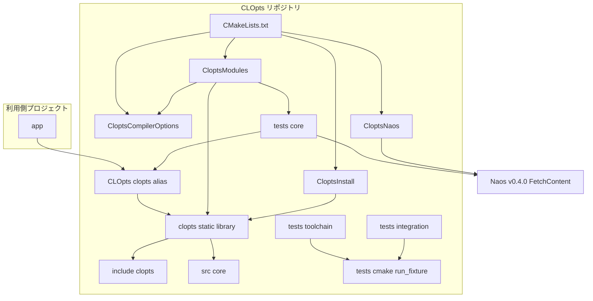
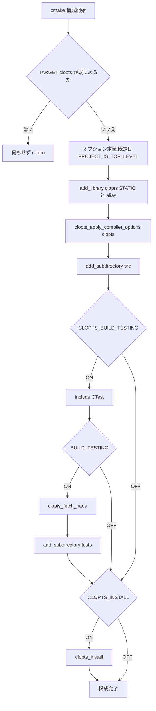
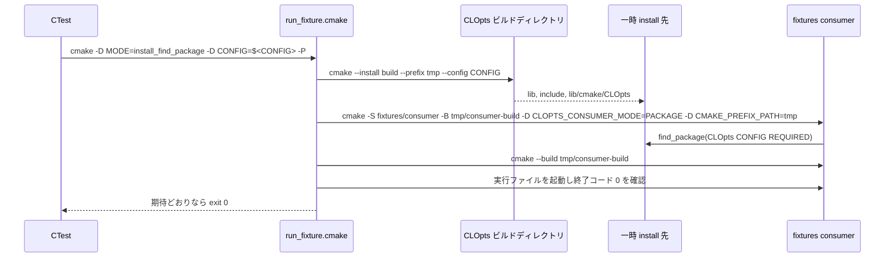

# Design Document: project-foundation

## Overview

**Purpose**: 本 spec は、CLOpts の後続 4 spec（core-parser、help-and-messages、platform-argv、docs-and-release）がソースとテストを追加するだけで開発を始められる土台を提供する。成果物は、引数解析の機能を持たない「空の」静的ライブラリ `clopts`（`CLOpts::clopts`）、ターゲット単位に閉じたビルド構成、Naos によるテスト基盤、5 環境の CI、install / export と package config、そして全モジュールが依存する内部ユーティリティ（書き込みコールバック、`FILE*` ライタ、可変長配列、サイズ計算の検査）である。

**Users**: CLOpts を開発する開発者と、後続 spec を実装するエージェントが直接の利用者である。間接的には、CLOpts を `add_subdirectory` / `FetchContent` / `find_package(CLOpts CONFIG)` で取り込む利用側の開発者が、「自分のビルド設定を汚されない」という形でこの設計の影響を受ける。

**Impact**: 現在のリポジトリ（`LICENSE`、1 行の `README.md`、`.gitignore`、Kiro の設定）に、ビルド定義・ソース・テスト・CI を新規に追加する。既存ファイルの変更は `.gitignore` のみ。

### Goals
- `cmake -S . -B build && cmake --build build && ctest --test-dir build` が 5 つの CI 環境すべてで通る（1.6）
- すべての設定がターゲット単位で、サブプロジェクトとして取り込まれても利用側のグローバル状態を変えない（2.1〜2.10）
- モジュール追加とテスト登録がそれぞれ 1 つのヘルパ呼び出しで完結する（4.1〜4.9）
- install 経路で `find_package(CLOpts CONFIG)` + `target_link_libraries(app PRIVATE CLOpts::clopts)` だけで使える（5.1〜5.7）
- 上記の構成要件がすべて CTest で自動検証される（6.1〜6.5）
- 内部ユーティリティが単体テスト付きで揃う（8.1〜9.9）

### Non-Goals
- 引数解析、宣言型、構造化エラー（core-parser）
- ヘルプ・エラー文面の生成（help-and-messages）。本 spec は writer 型と `FILE*` ライタを提供するだけ
- Windows の argv / 環境変数（platform-argv）
- README 本文、`docs/`、`examples/`、`release.yml`、FetchContent 経路の利用側テスト（docs-and-release）
- `CLOPTS_BUILD_EXAMPLES` オプションと `examples/` の CMake 関数（docs-and-release が追加する）
- 共有ライブラリとしてのビルド。`clopts` は常に STATIC

## Boundary Commitments

### This Spec Owns
- ルート `CMakeLists.txt` と `cmake/Clopts*.cmake` の 4 つのヘルパ（コンパイラオプション、モジュール / テスト登録、Naos 取得、install / export）、および package config テンプレート
- ライブラリターゲット `clopts` とエイリアス `CLOpts::clopts` の定義、`CLOPTS_BUILD_TESTING` / `CLOPTS_INSTALL` / `CLOPTS_WERROR` の 3 オプション
- ディレクトリ規約の実体: `include/clopts/`（傘ヘッダ `clopts.h`、`writer.h`）、`src/<module>/`、`tests/<module>/`、`tests/toolchain/`、`tests/integration/`、`tests/cmake/`
- 公開契約 `clopts_writer_t` / `clopts_write_fn` / `clopts_writer_file()`（`include/clopts/writer.h`）
- 内部契約 `core_internal.h`: `clopts_core_vec_*`、`clopts_core_size_*`、`clopts_core_write*`
- `.github/workflows/ci.yml`、`.gitignore`
- ビルド構成の検証テスト（`tests/toolchain/`、`tests/integration/`）とその共有スクリプト `tests/cmake/run_fixture.cmake`

### Out of Boundary
- 公開ヘッダに置く解析系の型と関数（`clopts_program_t` 等）。`clopts.h` は本 spec では `writer.h` を include するだけの傘ヘッダである
- `src/parser/`、`src/help/`、`src/platform/` の中身。本 spec はそれらのディレクトリを作らない
- 文面の内容や書式。`clopts_core_write_str` は文字列をそのまま渡すだけ
- `examples/`、`docs/`、`tests/docs/`、`release.yml`
- FetchContent 経路の利用側テスト（docs-and-release）。本 spec の integration テストは `add_subdirectory` 経路と install 経路の 2 つ
- Naos への Issue や修正。Naos の不足は `docs/dev/naos-feedback.md`（docs-and-release）に記録する

### Allowed Dependencies
- CMake 3.21 以上の標準モジュール: `CTest`、`FetchContent`、`GNUInstallDirs`、`CMakePackageConfigHelpers`
- Naos v0.4.0（コミット `09fde7172c4b63d416c32e98499cb0c0306d3dea`）。テスト実行ファイルの PRIVATE 依存のみ。`clopts` ターゲットからは参照しない
- C 標準ライブラリ（C99）。`src/core/` が include してよいのは `<stddef.h>`、`<stdint.h>`、`<stdlib.h>`、`<string.h>`、`<assert.h>` と、`core_writer_file.c` に限り `<stdio.h>`
- GitHub Actions の `actions/checkout`、`msys2/setup-msys2`、ランナー既定の CMake / コンパイラ
- 依存方向（違反はレビューでエラー扱い）:
  - C: `include/clopts/writer.h` ← `src/core/core_internal.h` ← `src/core/*.c`。`src/core/` は他モジュールを include しない
  - CMake: `CloptsCompilerOptions.cmake` ← `CloptsModules.cmake` ← ルート `CMakeLists.txt`。`CloptsNaos.cmake` と `CloptsInstall.cmake` はルートからのみ include される。`src/<module>/CMakeLists.txt` と `tests/<module>/CMakeLists.txt` はヘルパ関数を呼ぶだけで `cmake/` を include しない

### Revalidation Triggers
後続 spec が再確認すべき変更:
- `clopts_write_fn` の戻り値の意味（0 = 成功、非 0 = 失敗）や引数順の変更 → help-and-messages の文面生成全体
- `clopts_core_vec_t` のフィールド構成や `push` / `free` の契約（ゼロ初期化が有効、`free` 後に再利用可）の変更 → core-parser の結果ストア、platform-argv の argv 配列
- `clopts_add_module` / `clopts_add_module_tests` の引数形式の変更 → すべての `src/<module>/CMakeLists.txt` と `tests/<module>/CMakeLists.txt`
- CTest のラベルやテスト名の形式（`<module>_tests.<suite>.<test>`）の変更 → `tests/docs/` と CI の `-L` 指定
- Naos の版更新 → 0.4.0 の「アサーションなしは失敗」など挙動の変更がすべてのテストに波及する
- package 名 `CLOpts`、名前空間 `CLOpts::`、install 先 `lib/cmake/CLOpts` の変更 → docs-and-release の取り込み手順と利用側テスト
- 公開ヘッダの include 基点（`include/`）の変更 → 全モジュールの `#include`

## Architecture

### Architecture Pattern & Boundary Map



**Architecture Integration**:
- Selected pattern: 単一の静的ライブラリ + `target_sources` によるモジュール追加。利用側に見えるターゲットは `CLOpts::clopts` だけで、内部モジュールはディレクトリとヘルパ呼び出しで分ける（代替案の比較は `research.md`）。
- Domain/feature boundaries: CMake ヘルパ（構成）、`src/core/`（C の内部ユーティリティ）、`tests/toolchain/` + `tests/integration/`（構成の検証）、CI の 4 つの責務に分かれ、互いにファイルを共有しない。
- Existing patterns preserved: steering `structure.md` のディレクトリ規約・命名規約、`tech.md` の「ターゲット単位に閉じる」方針。
- New components rationale: ヘルパ 4 つは「ルート `CMakeLists.txt` を短く保ち、設定の場所を 1 か所にする」ため。`run_fixture.cmake` は toolchain / integration の両方が「子 CMake 項目を構成・ビルドして結果を判定する」必要があるため。
- Steering compliance: グローバル設定なし（2.1〜2.2）、`PROJECT_IS_TOP_LEVEL` 既定のオプション（2.5〜2.7）、Naos は 1 か所で固定（4.6）、依存は一方向。

### Technology Stack

| Layer | Choice / Version | Role in Feature | Notes |
|-------|------------------|-----------------|-------|
| 言語 | C99（`C_EXTENSIONS OFF`） | ライブラリと内部ユーティリティ | VLA と `_Complex` は使わない。MSVC では `/std:c11` を C99 として使う |
| ビルド | CMake 3.21 以上 | 構成、ヘルパ、install / export | `PROJECT_IS_TOP_LEVEL`、`CMakePackageConfigHelpers`、`FetchContent` |
| テスト | Naos v0.4.0（`Naos::naos`、静的） | `tests/<module>/` の単体テスト | `naos_add_executable` が CTest 登録を担う。アサーションのないテストは失敗 |
| テスト（構成検証） | CTest + `cmake -P` スクリプト | `tests/toolchain/`、`tests/integration/` | Naos を使わない。子プロセスで CMake 項目を構成・ビルドする |
| CI | GitHub Actions | 5 環境のビルドとテスト | `ubuntu-latest`（GCC、Clang）、`macos-latest`、`windows-latest`（MSVC、MSYS2 UCRT64） |

## File Structure Plan

### Directory Structure
```
CMakeLists.txt                          # project(clopts VERSION 0.1.0 LANGUAGES C)、オプション 3 つ、ヘルパの include、clopts ターゲット作成、add_subdirectory(src)、テストと install の条件付き有効化
cmake/
├── CloptsCompilerOptions.cmake         # clopts_apply_compiler_options(<target>): コンパイラ別の警告・定義・C 規格プロパティを PRIVATE に適用
├── CloptsModules.cmake                 # clopts_add_module(<module> SOURCES ...)、clopts_add_module_tests(<module> SOURCES ...)
├── CloptsNaos.cmake                    # clopts_fetch_naos(): CLOPTS_NAOS_TAG / CLOPTS_NAOS_COMMIT の定義、FetchContent、版照合
├── CloptsInstall.cmake                 # clopts_install(): install(TARGETS/DIRECTORY/EXPORT)、config と version file の生成と install
└── CLOptsConfig.cmake.in               # package config テンプレート: Targets の include、CRT 種別の記録と警告
include/clopts/
├── clopts.h                            # 傘ヘッダ。本 spec では writer.h を include するだけ
└── writer.h                            # 公開契約: clopts_write_fn、clopts_writer_t、clopts_writer_file()
src/
├── CMakeLists.txt                      # add_subdirectory(core) のみ。後続 spec がモジュールを 1 行ずつ追加する
└── core/
    ├── CMakeLists.txt                  # clopts_add_module(core SOURCES core_vec.c core_size.c core_writer.c core_writer_file.c)
    ├── core_internal.h                 # 内部契約: clopts_core_vec_*、clopts_core_size_*、clopts_core_write*
    ├── core_vec.c                      # 可変長配列
    ├── core_size.c                     # サイズ計算のオーバーフロー検査
    ├── core_writer.c                   # clopts_core_write / clopts_core_write_str（stdio 非依存）
    └── core_writer_file.c              # clopts_writer_file(): FILE* ライタ。stdio を include する唯一の翻訳単位
tests/
├── CMakeLists.txt                      # add_subdirectory(core / toolchain / integration)
├── cmake/
│   └── run_fixture.cmake               # 共有スクリプト: フィクスチャ項目を構成・ビルド（・install・実行）し、期待結果（成功 / 失敗）と照合
├── core/
│   ├── CMakeLists.txt                  # clopts_add_module_tests(core SOURCES ...)
│   ├── core_tests_main.c               # NAOS_MAIN と NAOS_DECLARE_SUITE
│   ├── test_vec.c                      # 可変長配列のスイート
│   ├── test_size.c                     # サイズ計算のスイート
│   └── test_writer.c                   # writer と FILE* ライタのスイート（tmpfile で検証）
├── toolchain/
│   ├── CMakeLists.txt                  # add_test × 3（no_global_state、warning_fails、vla_fails）。ラベル toolchain
│   └── fixtures/
│       ├── no_global_state/CMakeLists.txt   # CLOpts を add_subdirectory し、グローバル変数とディレクトリプロパティが空であることを構成時に検査
│       ├── warning/{CMakeLists.txt,warning.c} # clopts_apply_compiler_options を当てたターゲットに警告を含むソース。ビルド失敗が期待値
│       └── vla/{CMakeLists.txt,vla.c}         # 同上、VLA を含むソース。ビルド失敗が期待値
└── integration/
    ├── CMakeLists.txt                  # add_test × 2（subdirectory、install_find_package）。ラベル integration。install テストは CLOPTS_INSTALL が ON のときのみ
    └── fixtures/consumer/
        ├── CMakeLists.txt              # CLOPTS_CONSUMER_MODE=SUBDIRECTORY | PACKAGE で取り込み方を切り替える利用側プロジェクト
        └── main.c                      # <clopts/clopts.h> を include し clopts_writer_file で 1 行書く。未使用引数と #ifdef _CRT_SECURE_NO_WARNINGS #error を含む
.github/workflows/
└── ci.yml                              # 5 環境のマトリクス
.gitignore                              # build/、CMake 生成物、_deps/、エディタ / OS の一時ファイル
```

### Modified Files
- `.gitignore` — ビルドディレクトリ（`build/`、`build-*/`、`out/`）、CMake 生成物（`CMakeCache.txt`、`CMakeFiles/`、`cmake_install.cmake`、`CTestTestfile.cmake`、`Testing/`、`_deps/`）、`compile_commands.json`、`.cache/`、エディタ / OS の一時ファイル（`.vs/`、`.vscode/`（settings 以外）、`.idea/`、`.DS_Store`、`Thumbs.db`）を追加する（10.1、10.2）

## System Flows

### 構成フロー（トップレベル / サブプロジェクト）



- `if(TARGET clopts)` ガードは `project()` の直後に置く。二重取り込み時は `return()` で以降を一切実行しない（2.8）。
- `include(CTest)` は `CLOPTS_BUILD_TESTING` が ON のときだけ呼ぶ。サブプロジェクトでは `BUILD_TESTING` 変数自体を定義しない（2.5）。
- `CLOPTS_WERROR` は `clopts_apply_compiler_options` の中で参照する。オプションの定義はルートで行う。

### install 経路の検証フロー



- install 先はテストごとに `CMAKE_CURRENT_BINARY_DIR` 配下の一時ディレクトリとし、スクリプト冒頭で削除してから作り直す（再実行で安定させる）。
- MSVC のマルチ構成ジェネレータでは `--config` を使い、単一構成ジェネレータでは `CMAKE_BUILD_TYPE` を引き継ぐ。`CONFIG` が空のときは省略する。

## Requirements Traceability

| Requirement | Summary | Components | Interfaces | Flows |
|-------------|---------|------------|------------|-------|
| 1.1 | `clopts` と `CLOpts::clopts` | RootCMake | — | 構成フロー |
| 1.2, 1.3 | `include/clopts/`、傘ヘッダ、公開 include 基点 | RootCMake, PublicHeaders | `clopts.h` | — |
| 1.4 | `src/<module>/`、内部 include 基点 `src/` | RootCMake, ModulesHelper | `clopts_add_module` | — |
| 1.5 | バージョンは `project()` の 1 か所 | RootCMake, InstallHelper | — | — |
| 1.6 | 5 環境で構成・ビルド・テストが通る | CIWorkflow と全コンポーネント | — | — |
| 1.7 | CMake 3.21 以上 | RootCMake | — | — |
| 2.1, 2.2 | グローバル変数・ディレクトリ単位設定を置かない | RootCMake, CompilerOptions, ToolchainTests | — | 構成フロー |
| 2.3 | C99 を PUBLIC 機能として宣言、拡張オフ | CompilerOptions | `clopts_apply_compiler_options` | — |
| 2.4 | 警告・定義は PRIVATE、利用側に伝播しない | CompilerOptions, IntegrationTests | — | — |
| 2.5, 2.6, 2.7 | トップレベル既定のオプション 3 つ | RootCMake | `CLOPTS_BUILD_TESTING` 等 | 構成フロー |
| 2.8 | 二重取り込みで再定義しない | RootCMake | — | 構成フロー |
| 2.9 | CRT 種別を設定しない | RootCMake, CompilerOptions, ToolchainTests | — | — |
| 2.10 | Naos はテスト有効時のみ、`clopts` の依存に含めない | RootCMake, NaosHelper, ModulesHelper | `clopts_fetch_naos` | 構成フロー |
| 3.1〜3.5 | コンパイラ別フラグ | CompilerOptions | `clopts_apply_compiler_options` | — |
| 3.6 | 1 つのヘルパでライブラリとテストに適用 | CompilerOptions, ModulesHelper | 同上 | — |
| 3.7 | VLA でビルド失敗 | CompilerOptions, ToolchainTests | — | — |
| 4.1, 4.2 | モジュール追加ヘルパ | ModulesHelper | `clopts_add_module` | — |
| 4.3, 4.4, 4.8 | テスト登録ヘルパ、リンク、オプション、ラベル、テスト名 | ModulesHelper | `clopts_add_module_tests` | — |
| 4.5 | `ctest -L <module>` | ModulesHelper | — | — |
| 4.6, 4.7 | Naos のタグ + SHA 固定、ローカルパス | NaosHelper | `clopts_fetch_naos` | — |
| 4.9 | `tests/toolchain/`、`tests/integration/` とラベル | ToolchainTests, IntegrationTests | — | — |
| 5.1, 5.2 | install 対象と非対象 | InstallHelper | `clopts_install` | — |
| 5.3 | config がターゲット・include・C99 を提供 | InstallHelper, PackageConfig | `CLOptsConfig.cmake.in` | install 検証フロー |
| 5.4, 5.5 | version file、`ARCH_INDEPENDENT` なし | InstallHelper | — | — |
| 5.6 | CRT 種別の記録と警告 | InstallHelper, PackageConfig | `CLOptsConfig.cmake.in` | — |
| 5.7 | install → find_package の検証 | IntegrationTests, RunFixture | `run_fixture.cmake` | install 検証フロー |
| 6.1 | グローバル状態なしの検証 | ToolchainTests, RunFixture | fixtures/no_global_state | — |
| 6.2 | 警告・VLA でビルド失敗の検証 | ToolchainTests, RunFixture | fixtures/warning, fixtures/vla | — |
| 6.3 | add_subdirectory 経路と非伝播の検証 | IntegrationTests, RunFixture | fixtures/consumer | — |
| 6.4, 6.5 | install 経路の検証、`ctest` に含まれる | IntegrationTests | — | install 検証フロー |
| 7.1〜7.5 | CI マトリクス、`-Werror`、独立失敗、出力、リリース非包含 | CIWorkflow | `ci.yml` | — |
| 8.1, 8.2, 8.3 | コールバック型、ライタ型、`FILE*` ライタ | PublicHeaders, CoreWriter | `writer.h` | — |
| 8.4, 8.5 | `len` バイトを順序どおり、失敗の伝達 | CoreWriter | `clopts_writer_file`, `clopts_core_write` | — |
| 8.6 | stdio は 1 翻訳単位に閉じる | CoreWriter | — | — |
| 8.7 | writer の単体テスト | CoreTests | test_writer.c | — |
| 9.1, 9.2 | 可変長配列、容量拡張 | CoreVec | `clopts_core_vec_push` | — |
| 9.3, 9.4, 9.5 | OOM 時の状態保持、冪等な free、OOM 後の解放 | CoreVec | `clopts_core_vec_free` | — |
| 9.6, 9.7 | サイズ計算の検査、オーバーフロー時は確保しない | CoreSize, CoreVec | `clopts_core_size_mul` 等 | — |
| 9.8 | 契約違反は `assert` | CoreVec, CoreSize, CoreWriter | — | — |
| 9.9 | 可変長配列・サイズ計算の単体テスト | CoreTests | test_vec.c, test_size.c | — |
| 10.1, 10.2 | `.gitignore`、Naos を管理対象外 | GitIgnore | — | — |
| 11.1, 11.2, 11.3, 11.4 | Allman、波括弧、複合条件の括弧、コメント形式 | CoreVec, CoreSize, CoreWriter, CoreTests | — | — |
| 11.5, 11.6 | `clopts_core_` 接頭辞と `static`、ファイル名とヘッダガード | CoreVec, CoreSize, CoreWriter | `core_internal.h` | — |

## Components and Interfaces

| Component | Domain/Layer | Intent | Req Coverage | Key Dependencies (P0/P1) | Contracts |
|-----------|--------------|--------|--------------|--------------------------|-----------|
| RootCMake | ビルド構成 | ターゲット・オプション・条件付き有効化の入口 | 1.1〜1.5, 1.7, 2.1, 2.5〜2.10 | CompilerOptions (P0), ModulesHelper (P0), NaosHelper (P1), InstallHelper (P1) | Service（CMake 変数・ターゲット） |
| CompilerOptions | ビルド構成 | コンパイラ別フラグをターゲット単位に適用 | 2.3, 2.4, 2.9, 3.1〜3.7 | — | Service |
| ModulesHelper | ビルド構成 | モジュール追加とテスト登録 | 1.4, 4.1〜4.5, 4.8 | CompilerOptions (P0), Naos (P0, テスト時) | Service |
| NaosHelper | ビルド構成 | Naos の固定取得と版照合 | 2.10, 4.6, 4.7 | FetchContent (P0) | Service |
| InstallHelper / PackageConfig | 配布 | install / export、config、version file、CRT 記録 | 1.5, 5.1〜5.6 | CMakePackageConfigHelpers (P0), GNUInstallDirs (P0) | Service |
| PublicHeaders | 公開 API | 傘ヘッダと writer 契約 | 1.2, 1.3, 8.1〜8.3 | — | Service（C 型） |
| CoreWriter | 内部ユーティリティ | writer ヘルパと `FILE*` ライタ | 8.3〜8.6, 9.8 | PublicHeaders (P0) | Service |
| CoreVec | 内部ユーティリティ | 可変長配列 | 9.1〜9.5, 9.7, 9.8 | CoreSize (P0) | Service |
| CoreSize | 内部ユーティリティ | サイズ計算のオーバーフロー検査 | 9.6, 9.8 | — | Service |
| CoreTests | テスト | `tests/core/` の Naos テスト | 8.7, 9.9, 11.1, 11.2, 11.3, 11.4 | Naos (P0), ModulesHelper (P0) | — |
| RunFixture | テスト基盤 | 子 CMake 項目の構成・ビルド・判定 | 5.7, 6.1〜6.4 | CMake CLI (P0) | Batch |
| ToolchainTests | テスト | 構成要件の否定テスト | 2.1, 2.9, 3.7, 4.9, 6.1, 6.2 | RunFixture (P0) | — |
| IntegrationTests | テスト | add_subdirectory / install 経路 | 2.4, 4.9, 5.7, 6.3, 6.4 | RunFixture (P0), InstallHelper (P1) | — |
| CIWorkflow | CI | 5 環境のビルドとテスト | 1.6, 7.1〜7.5 | GitHub Actions (P0), msys2/setup-msys2 (P0) | Batch |
| GitIgnore | リポジトリ | 生成物の除外 | 10.1, 10.2 | — | — |

### ビルド構成

#### RootCMake

| Field | Detail |
|-------|--------|
| Intent | `CMakeLists.txt` 1 ファイルで、ガード・オプション・ターゲット・条件付き有効化を順に行う |
| Requirements | 1.1, 1.2, 1.3, 1.4, 1.5, 1.7, 2.1, 2.5, 2.6, 2.7, 2.8, 2.10 |

**Responsibilities & Constraints**
- `cmake_minimum_required(VERSION 3.21)`、`project(clopts VERSION 0.1.0 LANGUAGES C)`。バージョンを書くのはここだけ。
- `if(TARGET clopts) return() endif()` を `project()` 直後に置く。
- オプション: `option(CLOPTS_BUILD_TESTING "Build CLOpts tests" ${PROJECT_IS_TOP_LEVEL})`、`option(CLOPTS_INSTALL "Generate install rules for CLOpts" ${PROJECT_IS_TOP_LEVEL})`、`option(CLOPTS_WERROR "Treat warnings as errors in CLOpts targets" ${PROJECT_IS_TOP_LEVEL})`。
- `add_library(clopts STATIC)`、`add_library(CLOpts::clopts ALIAS clopts)`、`target_include_directories(clopts PUBLIC $<BUILD_INTERFACE:${PROJECT_SOURCE_DIR}/include> $<INSTALL_INTERFACE:${CMAKE_INSTALL_INCLUDEDIR}> PRIVATE ${PROJECT_SOURCE_DIR}/src)`、`clopts_apply_compiler_options(clopts)`。
- 禁止: `set(CMAKE_*)`、`add_compile_options`、`add_definitions`、`include_directories`、`link_libraries`、無条件の `include(CTest)` / `enable_testing()`。

**Dependencies**
- Outbound: CompilerOptions — `clopts` へのフラグ適用 (P0)
- Outbound: ModulesHelper — `src/` と `tests/` のヘルパ提供 (P0)
- Outbound: NaosHelper — テスト有効時の Naos 取得 (P1)
- Outbound: InstallHelper — `CLOPTS_INSTALL` 時の install 規則 (P1)

**Contracts**: Service [x]

##### Service Interface（CMake）
- 定義するターゲット: `clopts`（STATIC）、`CLOpts::clopts`（ALIAS）
- 定義するキャッシュ変数: `CLOPTS_BUILD_TESTING`、`CLOPTS_INSTALL`、`CLOPTS_WERROR`（BOOL）
- 事後条件: サブプロジェクトとして取り込まれたとき、利用側のディレクトリスコープに追加される変数はキャッシュ変数 3 つと FetchContent / GNUInstallDirs 由来のもの（テスト有効時のみ）に限られる。`BUILD_TESTING` は定義されない。

**Implementation Notes**
- Integration: `src/CMakeLists.txt` は `add_subdirectory(core)` だけを持ち、後続 spec が 1 行ずつ追加する。
- Validation: `tests/toolchain/fixtures/no_global_state/` が事後条件を検査する。
- Risks: `include(GNUInstallDirs)` は `CLOPTS_INSTALL` が ON のとき `clopts_install` 内で行う。`$<INSTALL_INTERFACE:${CMAKE_INSTALL_INCLUDEDIR}>` を使うため、install が OFF でも `CMAKE_INSTALL_INCLUDEDIR` が未定義にならないよう、ルートで `include(GNUInstallDirs)` を呼ぶ（キャッシュ変数を定義するだけで、Naos も同じことを無条件に行う。toolchain テストの許容リストに含める）。

#### CompilerOptions

| Field | Detail |
|-------|--------|
| Intent | `clopts_apply_compiler_options(<target>)` でコンパイラ別のフラグ・定義・C 規格プロパティを PRIVATE に適用する |
| Requirements | 2.3, 2.4, 2.9, 3.1, 3.2, 3.3, 3.4, 3.5, 3.6, 3.7 |

**Responsibilities & Constraints**
- 共通: `target_compile_features(<t> PUBLIC c_std_99)`（`clopts` では PUBLIC、テスト実行ファイルでは INTERFACE に意味がないので同じ呼び出しで問題ない）、`set_target_properties(<t> PROPERTIES C_STANDARD 99 C_STANDARD_REQUIRED ON C_EXTENSIONS OFF)`。
- GCC / Clang（`CMAKE_C_COMPILER_ID` が `GNU`、`Clang`、`AppleClang`）: `target_compile_options(<t> PRIVATE -Wall -Wextra -Wpedantic -Werror=vla)`。`CLOPTS_WERROR` が ON なら `-Werror` を追加。
- MinGW（`MINGW` 変数が真）: 上記に加えて `target_compile_definitions(<t> PRIVATE __USE_MINGW_ANSI_STDIO=1)`。
- MSVC（`MSVC` 変数が真）: `target_compile_options(<t> PRIVATE /std:c11 /W4 /utf-8 /Zc:preprocessor)`、`target_compile_definitions(<t> PRIVATE _CRT_SECURE_NO_WARNINGS)`。`CLOPTS_WERROR` が ON なら `/WX` を追加。
- `clang-cl`（`MSVC` かつ `CMAKE_C_COMPILER_ID` が `Clang`）は MSVC 側の分岐に入れる。CI マトリクスには含めない。
- CRT 種別（`MSVC_RUNTIME_LIBRARY` プロパティ）には触れない。

**Dependencies**
- Inbound: RootCMake — `clopts` に適用 (P0)
- Inbound: ModulesHelper — `<module>_tests` に適用 (P0)

**Contracts**: Service [x]

##### Service Interface（CMake）
```cmake
# <target> は同じディレクトリまたは子で定義済みの非 IMPORTED ターゲット
clopts_apply_compiler_options(<target>)
```
- 事前条件: `<target>` が存在する。`CLOPTS_WERROR` が定義済み。
- 事後条件: `<target>` の `COMPILE_OPTIONS` / `COMPILE_DEFINITIONS` に上記が追加され、`INTERFACE_COMPILE_OPTIONS` / `INTERFACE_COMPILE_DEFINITIONS` には何も追加されない。`INTERFACE_COMPILE_FEATURES` に `c_std_99` が含まれる。
- 不変条件: ディレクトリプロパティと `CMAKE_*` 変数を変更しない。

**Implementation Notes**
- Validation: `tests/toolchain/fixtures/warning/` と `fixtures/vla/` が「ビルドが失敗すること」で検証する。`tests/integration/fixtures/consumer/main.c` が非伝播を検証する。
- Risks: `-Wpedantic` 下で Naos マクロ末尾の `;` が空文警告になる。テストのコーディング規約に明記する（CoreTests）。

#### ModulesHelper

| Field | Detail |
|-------|--------|
| Intent | `clopts_add_module` と `clopts_add_module_tests` で、モジュール追加とテスト登録を各 1 行にする |
| Requirements | 1.4, 4.1, 4.2, 4.3, 4.4, 4.5, 4.8 |

**Responsibilities & Constraints**
- `clopts_add_module(<module> SOURCES <src>...)`: `target_sources(clopts PRIVATE <絶対パス化したソース>)`。別ターゲットを作らない。`<module>` は検証とメッセージにのみ使う（将来のモジュール一覧のためにグローバルプロパティ `CLOPTS_MODULES` に追記する）。
- `clopts_add_module_tests(<module> SOURCES <src>...)`: `naos_add_executable(<module>_tests SOURCES <src>... LIBRARIES CLOpts::clopts LABELS <module>)` を呼び、続けて `clopts_apply_compiler_options(<module>_tests)` を適用する。テスト実行ファイルにも `target_include_directories(<module>_tests PRIVATE ${PROJECT_SOURCE_DIR}/src)` を与える（内部ヘッダをテストするため）。
- テスト名は Naos の既定 prefix `<module>_tests.` により `<module>_tests.<suite>.<test>` になる。PREFIX は上書きしない。
- Linux で静的 Naos が `m` を要求する場合に備え、`if(UNIX AND NOT APPLE) target_link_libraries(<module>_tests PRIVATE m) endif()` を置く（research.md の未検証項目。CI で不要と分かれば削除する）。

**Dependencies**
- Inbound: `src/<module>/CMakeLists.txt`、`tests/<module>/CMakeLists.txt` (P0)
- Outbound: CompilerOptions (P0)
- External: Naos `naos_add_executable` (P0、テスト時のみ)

**Contracts**: Service [x]

##### Service Interface（CMake）
```cmake
clopts_add_module(<module> SOURCES <file>...)
clopts_add_module_tests(<module> SOURCES <file>...)
```
- 事前条件: `clopts_add_module` は `TARGET clopts` が存在する。`clopts_add_module_tests` は `TARGET Naos::naos` が存在し、`enable_testing()` 済み（`include(CTest)` 済み）。SOURCES が空なら `FATAL_ERROR`。
- 事後条件: `clopts_add_module_tests` 後、`<module>_tests` ターゲットが存在し、ラベル `<module>` の CTest テストが登録される。

**Implementation Notes**
- Integration: 後続 spec は `src/<module>/CMakeLists.txt` と `tests/<module>/CMakeLists.txt` に各 1 回ずつ呼び出しを書き、`src/CMakeLists.txt` と `tests/CMakeLists.txt` に `add_subdirectory(<module>)` を足す。
- Validation: `tests/core/` が最初の利用者であり、`ctest -L core` で core のテストだけが走ることを CI で確認する。
- Risks: Naos の `naos_add_executable` は未知キーワードを `FATAL_ERROR` にする。引数を増やすときは Naos 0.4.0 のシグネチャ（research.md）に従う。

#### NaosHelper

| Field | Detail |
|-------|--------|
| Intent | `clopts_fetch_naos()` で Naos を SHA 固定で取得し、タグとの対応を照合する |
| Requirements | 2.10, 4.6, 4.7 |

**Responsibilities & Constraints**
- `set(CLOPTS_NAOS_TAG "v0.4.0")`、`set(CLOPTS_NAOS_COMMIT "09fde7172c4b63d416c32e98499cb0c0306d3dea")` をファイル先頭に並べる。版更新はこの 2 行のみ。
- `FetchContent_Declare(Naos GIT_REPOSITORY https://github.com/vabelorg/naos.git GIT_TAG ${CLOPTS_NAOS_COMMIT} GIT_SHALLOW FALSE)`、`FetchContent_MakeAvailable(Naos)`。SHA 指定では `GIT_SHALLOW` を使わない。
- 取得後、`${naos_SOURCE_DIR}/include/naos/version.h` を読み、版文字列が `CLOPTS_NAOS_TAG` から `v` を除いたものと一致しなければ `message(FATAL_ERROR "Naos version mismatch: expected ... (update cmake/CloptsNaos.cmake)")`。`FETCHCONTENT_SOURCE_DIR_NAOS` が指定された場合も同じ照合を行う。
- Naos のオプションは既定（`NAOS_SELFTEST=OFF`、`NAOS_INSTALL=OFF`）に任せ、上書きしない。

**Dependencies**
- Inbound: RootCMake（`CLOPTS_BUILD_TESTING AND BUILD_TESTING` のときのみ） (P0)
- External: FetchContent、ネットワーク（または `FETCHCONTENT_SOURCE_DIR_NAOS`） (P0)

**Contracts**: Service [x]

##### Service Interface（CMake）
```cmake
clopts_fetch_naos()   # 事後条件: TARGET Naos::naos が存在する
```

**Implementation Notes**
- Validation: CI で初回取得が成功し、`ctest` が走ることで検証。オフライン構成は `-DFETCHCONTENT_SOURCE_DIR_NAOS=<path>` で手動確認。
- Risks: `version.h` のマクロ名は実装時に確認する（`NAOS_VERSION_MAJOR` / `MINOR` / `PATCH` または文字列マクロと推定）。

#### InstallHelper / PackageConfig

| Field | Detail |
|-------|--------|
| Intent | `clopts_install()` で install 規則、export、config、version file を生成する |
| Requirements | 1.5, 5.1, 5.2, 5.3, 5.4, 5.5, 5.6 |

**Responsibilities & Constraints**
- `include(GNUInstallDirs)`、`include(CMakePackageConfigHelpers)`。
- `install(TARGETS clopts EXPORT CLOptsTargets ARCHIVE DESTINATION ${CMAKE_INSTALL_LIBDIR})`、`install(DIRECTORY ${PROJECT_SOURCE_DIR}/include/clopts DESTINATION ${CMAKE_INSTALL_INCLUDEDIR})`。`src/` は install しない。
- `install(EXPORT CLOptsTargets NAMESPACE CLOpts:: FILE CLOptsTargets.cmake DESTINATION ${CMAKE_INSTALL_LIBDIR}/cmake/CLOpts)`。
- `configure_package_config_file(cmake/CLOptsConfig.cmake.in <build>/CLOptsConfig.cmake INSTALL_DESTINATION ${CMAKE_INSTALL_LIBDIR}/cmake/CLOpts)`、`write_basic_package_version_file(<build>/CLOptsConfigVersion.cmake VERSION ${PROJECT_VERSION} COMPATIBILITY SameMinorVersion)`（`ARCH_INDEPENDENT` なし）。両ファイルを同じ DESTINATION に install。
- CRT 記録: `set(CLOPTS_RECORDED_MSVC_RUNTIME_LIBRARY "${CMAKE_MSVC_RUNTIME_LIBRARY}")`（MSVC 以外では空）を config に埋め込む。

**Dependencies**
- Inbound: RootCMake（`CLOPTS_INSTALL` が ON） (P0)
- External: GNUInstallDirs、CMakePackageConfigHelpers (P0)

**Contracts**: Service [x]

##### Service Interface（CMake、`CLOptsConfig.cmake.in`）
```cmake
@PACKAGE_INIT@
set(CLOpts_RECORDED_MSVC_RUNTIME_LIBRARY "@CLOPTS_RECORDED_MSVC_RUNTIME_LIBRARY@")
if(MSVC AND CLOpts_RECORDED_MSVC_RUNTIME_LIBRARY AND CMAKE_MSVC_RUNTIME_LIBRARY
   AND NOT CLOpts_RECORDED_MSVC_RUNTIME_LIBRARY STREQUAL CMAKE_MSVC_RUNTIME_LIBRARY)
  message(WARNING "CLOpts was built with MSVC runtime '...' but this project uses '...'")
endif()
include("${CMAKE_CURRENT_LIST_DIR}/CLOptsTargets.cmake")
check_required_components(CLOpts)
```
- 事後条件: `find_package(CLOpts CONFIG)` 後に `CLOpts::clopts` が IMPORTED ターゲットとして存在し、`INTERFACE_INCLUDE_DIRECTORIES` に `<prefix>/include`、`INTERFACE_COMPILE_FEATURES` に `c_std_99` を持つ。`INTERFACE_COMPILE_OPTIONS` は空。
- 警告は文字列比較のベストエフォート（ジェネレータ式は評価しない）。config 内のコメントで明記し、どちらかが未設定（既定の CRT）のときは警告しない。

**Implementation Notes**
- Validation: `tests/integration/` の `install_find_package` テスト。
- Risks: `check_required_components` はコンポーネントなしでも呼ぶ（`configure_package_config_file` の慣習）。

### 公開 API と内部ユーティリティ（C）

#### PublicHeaders

| Field | Detail |
|-------|--------|
| Intent | `include/clopts/clopts.h`（傘）と `include/clopts/writer.h`（writer 契約） |
| Requirements | 1.2, 1.3, 8.1, 8.2, 8.3 |

**Contracts**: Service [x]

##### Service Interface（C、`include/clopts/writer.h`）
```c
#include <stddef.h>
#include <stdio.h>

/* 書き込みコールバック。data の len バイトをすべて書けたら 0、そうでなければ非 0 を返す。 */
typedef int (*clopts_write_fn)(void *ctx, const char *data, size_t len);

typedef struct clopts_writer
{
    clopts_write_fn write;
    void *ctx;
} clopts_writer_t;

/* stream へ書き込む writer を返す。stream は呼び出し側が所有し、writer より長く生存させる。 */
clopts_writer_t clopts_writer_file(FILE *stream);
```
- 事前条件: `clopts_writer_file(NULL)` は契約違反（`assert`）。
- 事後条件: 返された writer の `write` は `fwrite(data, 1, len, stream) == len` なら 0、そうでなければ非 0 を返す。`len == 0` では何も書かずに 0 を返す。
- 不変条件: ヘッダガードは `CLOPTS_WRITER_H`、`CLOPTS_CLOPTS_H`。C++ から include できるよう `extern "C"` で囲む。

**Implementation Notes**
- `clopts.h` は本 spec では `#include "clopts/writer.h"` のみ。core-parser が宣言型のヘッダを追加する。

#### CoreWriter

| Field | Detail |
|-------|--------|
| Intent | writer を介して書くための内部ヘルパと、`FILE*` ライタの実装 |
| Requirements | 8.3, 8.4, 8.5, 8.6, 9.8 |

**Responsibilities & Constraints**
- `core_writer.c`: `clopts_core_write` と `clopts_core_write_str`。`<stdio.h>` を include しない。
- `core_writer_file.c`: `clopts_writer_file` と、その `write` 実装（`static`）。`src/core/` で `<stdio.h>` を include してよい唯一のファイル。

**Dependencies**
- Inbound: help-and-messages（後続） — 文面出力 (P1)
- Outbound: PublicHeaders (P0)

**Contracts**: Service [x]

##### Service Interface（C、`src/core/core_internal.h`）
```c
/* writer->write(writer->ctx, data, len) をそのまま呼ぶ。失敗を再試行せず返す。 */
int clopts_core_write(const clopts_writer_t *writer, const char *data, size_t len);
/* NUL 終端文字列を書く。strlen(s) バイト。 */
int clopts_core_write_str(const clopts_writer_t *writer, const char *s);
```
- 事前条件: `writer`、`writer->write`、`data`（`len > 0` のとき）、`s` が非 NULL（`assert`）。
- 事後条件: 戻り値はコールバックの戻り値そのもの（0 = 成功）。

**Implementation Notes**
- Validation: `tests/core/test_writer.c` — `tmpfile()` に書いて読み戻しバイト比較（8.4）、常に失敗するコールバックで非 0 が返る（8.5）、`len == 0`、メモリに蓄積する自作コールバックで順序を確認。
- Risks: `tmpfile()` は MSVC で管理者権限なしでも動くが、一部の Windows 環境でルートに書こうとして失敗する例がある。失敗時はテストを `NAOS_SKIP` にせず、`fopen` で `CMAKE_CURRENT_BINARY_DIR` 配下に作る代替を実装側で選べるよう、テストはファイル作成を 1 つの `static` 関数に閉じる。

#### CoreVec

| Field | Detail |
|-------|--------|
| Intent | 要素サイズ指定の可変長配列 |
| Requirements | 9.1, 9.2, 9.3, 9.4, 9.5, 9.7, 9.8 |

**Contracts**: Service [x]

##### Service Interface（C、`src/core/core_internal.h`）
```c
typedef struct clopts_core_vec
{
    void *data;        /* cap * elem_size バイト。cap == 0 のとき NULL */
    size_t len;        /* 使用中の要素数 */
    size_t cap;        /* 確保済みの要素数 */
    size_t elem_size;  /* 1 要素のバイト数。> 0 */
} clopts_core_vec_t;

void  clopts_core_vec_init(clopts_core_vec_t *vec, size_t elem_size);
int   clopts_core_vec_push(clopts_core_vec_t *vec, const void *elem);   /* 0 = 成功、-1 = 確保失敗またはオーバーフロー */
void *clopts_core_vec_at(const clopts_core_vec_t *vec, size_t index);    /* index < len */
void  clopts_core_vec_free(clopts_core_vec_t *vec);
```
- 事前条件: `vec` 非 NULL。`init` は `elem_size > 0`。`push` は `elem` 非 NULL かつ `elem_size > 0`（ゼロ初期化のまま `push` するのは契約違反）。`at` は `index < len`。すべて `assert`。
- 事後条件:
  - `init`: `data = NULL, len = cap = 0, elem_size = 引数`。
  - `push` 成功: `len` が 1 増え、`at(len - 1)` が `elem` のコピーを指す。容量不足時は `cap` を `cap == 0 ? 8 : cap * 2` に拡張し、`clopts_core_size_mul(new_cap, elem_size)` がオーバーフローするなら拡張せず `-1`。`realloc` 失敗時は `data` / `len` / `cap` を変えず `-1`。
  - `free`: `data` を `free()` し、`data = NULL, len = cap = 0`。`elem_size` は保つ。ゼロ初期化の vec や `free` 済みの vec に対しても安全で、効果は同じ。
- 不変条件: `len <= cap`、`cap == 0` ⇔ `data == NULL`。

**Implementation Notes**
- Validation: `tests/core/test_vec.c` — 初期状態、`push` を 100 回して全要素一致、容量倍増の境界（8 → 16）、`elem_size = SIZE_MAX / 4` で `push` を続けてオーバーフロー経路（9.7）または `realloc` 失敗経路（9.3）に入り、戻り値 -1 と `len` / `cap` の不変を確認、`free` を 2 回、ゼロ初期化 `{0}` に `free`。
- Risks: 確保失敗を決定的に再現する手段は `elem_size` の巨大化のみ（フックは置かない）。環境によっては `realloc` が成功してしまう（オーバーコミット）ため、テストは「-1 が返るか、成功したら不変条件が保たれている」の両方を受理する形にし、オーバーフロー経路は `clopts_core_size_mul` の単体テストで確実に踏む。

#### CoreSize

| Field | Detail |
|-------|--------|
| Intent | `size_t` の加算・乗算のオーバーフロー検査 |
| Requirements | 9.6, 9.8 |

**Contracts**: Service [x]

##### Service Interface（C、`src/core/core_internal.h`）
```c
int clopts_core_size_mul(size_t a, size_t b, size_t *out);   /* 0 = 成功、-1 = オーバーフロー（*out は未変更） */
int clopts_core_size_add(size_t a, size_t b, size_t *out);
```
- 事前条件: `out` 非 NULL（`assert`）。
- 事後条件: 成功時 `*out = a * b`（または `a + b`）。オーバーフロー時 `*out` は変更されない。
- 実装方針: `mul` は `a != 0 && b > SIZE_MAX / a`、`add` は `b > SIZE_MAX - a` で判定（C99 の範囲で移植可能、組み込み関数に依存しない）。

**Implementation Notes**
- Validation: `tests/core/test_size.c` — 0 × 任意、`SIZE_MAX × 1`、`(SIZE_MAX / 2 + 1) × 2`、`SIZE_MAX + 1` 相当、通常値。

### テスト

#### CoreTests

| Field | Detail |
|-------|--------|
| Intent | `tests/core/` の Naos テスト（`core_tests` 実行ファイル、ラベル `core`） |
| Requirements | 8.7, 9.9, 11.1, 11.2, 11.3, 11.4, 11.5, 11.6 |

**Responsibilities & Constraints**
- `core_tests_main.c`: `NAOS_DECLARE_SUITE(vec)` / `(size)` / `(writer)` と `NAOS_MAIN(NAOS_ADD_SUITE(vec), NAOS_ADD_SUITE(size), NAOS_ADD_SUITE(writer))`。
- 各 `test_*.c` は 1 スイート。すべてのテストが少なくとも 1 つのアサーションを持つ（Naos 0.4.0 の既定）。
- Naos マクロ（`NAOS_TEST`、`NAOS_SUITE`、`NAOS_MAIN`）の閉じ括弧の後ろに `;` を置かない（`-Wpedantic`）。
- 内部ヘッダは `#include "core/core_internal.h"`（`src/` 基点）。

**Implementation Notes**
- Integration: `tests/core/CMakeLists.txt` は `clopts_add_module_tests(core SOURCES core_tests_main.c test_vec.c test_size.c test_writer.c)` の 1 行。
- Validation: CTest 名が `core_tests.vec.<test>` 等になり、`ctest -L core` で走る。

#### RunFixture

| Field | Detail |
|-------|--------|
| Intent | `tests/cmake/run_fixture.cmake`: 子 CMake 項目を構成・ビルド（・install・実行）し、期待結果と照合する `cmake -P` スクリプト |
| Requirements | 5.7, 6.1, 6.2, 6.3, 6.4 |

**Contracts**: Batch [x]

##### Batch / Job Contract
- Trigger: `add_test(NAME <name> COMMAND ${CMAKE_COMMAND} -D FIXTURE_SOURCE=<dir> -D WORK_DIR=<build>/<name> -D EXPECT=<configure_ok|build_ok|build_fail|run_ok> -D CONFIG=$<CONFIG> -D CLOPTS_SOURCE_DIR=... -D CLOPTS_BINARY_DIR=... -D EXTRA_ARGS=<;区切り> -D GENERATOR=${CMAKE_GENERATOR} -D C_COMPILER=${CMAKE_C_COMPILER} -P run_fixture.cmake)`
- Input / validation: 必須変数が欠けていれば `FATAL_ERROR`。`WORK_DIR` は毎回削除して作り直す。
- 処理:
  1. `EXPECT=configure_ok`: 構成のみ。終了コード 0 で成功。
  2. `EXPECT=build_ok` / `build_fail`: 構成後にビルド。`build_fail` は「構成は成功し、ビルドが非 0」で成功（構成失敗はテスト失敗）。
  3. `EXPECT=run_ok`: ビルド後に `WORK_DIR` 内の実行ファイル（フィクスチャが `RUNTIME_OUTPUT_DIRECTORY` を `WORK_DIR/bin` に固定する）を起動し、終了コード 0 で成功。
  4. `MODE=install_find_package`（integration 専用の追加フラグ）: 先に `cmake --install ${CLOPTS_BINARY_DIR} --prefix ${WORK_DIR}/prefix [--config CONFIG]` を実行し、`CMAKE_PREFIX_PATH=${WORK_DIR}/prefix` を利用側の構成に渡す。
- Output / destination: 失敗時は子プロセスの stdout / stderr をそのまま出力し `message(FATAL_ERROR)`。
- Idempotency & recovery: `WORK_DIR` を毎回作り直すので再実行は冪等。

**Implementation Notes**
- Integration: 子の構成には親と同じ `GENERATOR`、`C_COMPILER`、（単一構成なら）`CMAKE_BUILD_TYPE` を引き継ぐ。MSVC では `-A` も引き継ぐ（`CMAKE_GENERATOR_PLATFORM`）。
- Risks: 子プロセスでの Naos 再取得を避けるため、フィクスチャはすべて `CLOPTS_BUILD_TESTING=OFF` で CLOpts を取り込む。

#### ToolchainTests

| Field | Detail |
|-------|--------|
| Intent | `tests/toolchain/` の 3 テスト（ラベル `toolchain`） |
| Requirements | 2.1, 2.9, 3.7, 4.9, 6.1, 6.2 |

**Responsibilities & Constraints**
- `toolchain.no_global_state`（`EXPECT=configure_ok`）: フィクスチャは `project(fixture C)` → `add_subdirectory(${CLOPTS_SOURCE_DIR} clopts)` → 検査。検査項目: `CMAKE_MSVC_RUNTIME_LIBRARY`、`CMAKE_C_STANDARD`、`CMAKE_C_EXTENSIONS`、`CMAKE_RUNTIME_OUTPUT_DIRECTORY`、`CMAKE_LIBRARY_OUTPUT_DIRECTORY`、`CMAKE_ARCHIVE_OUTPUT_DIRECTORY`、`BUILD_SHARED_LIBS`、`BUILD_TESTING` が `DEFINED` でない（親で未定義のまま）こと、ディレクトリプロパティ `COMPILE_OPTIONS` / `COMPILE_DEFINITIONS` / `INCLUDE_DIRECTORIES` / `LINK_LIBRARIES` が空であること、`clopts` の `INTERFACE_COMPILE_OPTIONS` / `INTERFACE_COMPILE_DEFINITIONS` が空で `INTERFACE_COMPILE_FEATURES` が `c_std_99` のみであること、`TARGET Naos::naos` が存在しないこと。違反は `message(FATAL_ERROR)`。
- `toolchain.warning_fails`（`EXPECT=build_fail`）: フィクスチャは CLOpts を `add_subdirectory` し、`-DCLOPTS_WERROR=ON` で、未使用変数と符号比較の警告を含む `warning.c` から実行ファイルを作り `clopts_apply_compiler_options` を当てる。
- `toolchain.vla_fails`（`EXPECT=build_fail`）: 同上、`vla.c` に `int buf[n];` を含める。MSVC は VLA を言語としてサポートしないので、どのコンパイラでも失敗が期待値。

**Implementation Notes**
- Validation: 3 テストが `ctest -L toolchain` で走る。
- Risks: `warning_fails` は `CLOPTS_WERROR=ON` を明示する（親の設定に依存しない）。

#### IntegrationTests

| Field | Detail |
|-------|--------|
| Intent | `tests/integration/` の 2 テスト（ラベル `integration`） |
| Requirements | 2.4, 4.9, 5.7, 6.3, 6.4 |

**Responsibilities & Constraints**
- `fixtures/consumer/CMakeLists.txt`: `CLOPTS_CONSUMER_MODE` が `SUBDIRECTORY` なら `add_subdirectory(${CLOPTS_SOURCE_DIR} clopts)`（`CLOPTS_BUILD_TESTING=OFF`、`CLOPTS_INSTALL=OFF`、`CLOPTS_WERROR=OFF` を `set(... CACHE BOOL "" FORCE)` ではなく通常変数で事前に `set` する）、`PACKAGE` なら `find_package(CLOpts ${EXPECTED_VERSION} CONFIG REQUIRED)`。その後 `add_executable(app main.c)`、`target_link_libraries(app PRIVATE CLOpts::clopts)`。`app` には警告フラグを付けない。
- `main.c`: `#include <clopts/clopts.h>`、`#ifdef _CRT_SECURE_NO_WARNINGS #error ... #endif`、未使用引数 `argv` を持つ `main`、`clopts_writer_file(stdout)` で `"ok\n"` を書き、戻り値 0 を終了コードにする。
- `integration.subdirectory`（`EXPECT=run_ok`、`MODE=SUBDIRECTORY`）。
- `integration.install_find_package`（`EXPECT=run_ok`、`MODE=install_find_package`）。`CLOPTS_INSTALL` が ON のときだけ `add_test` する。

**Implementation Notes**
- Validation: 両テストが `ctest -L integration` で走る。非伝播は `-Wall -Wextra -Werror` が伝播していれば未使用引数でビルドが失敗し、`_CRT_SECURE_NO_WARNINGS` が伝播していれば `#error` で失敗することで検出する。
- Risks: install テストは親ビルドの成果物（`libclopts.a`）がビルド済みであることを前提にする。CTest は `cmake --build` 後に走るので通常は満たされる。

### CI とリポジトリ

#### CIWorkflow

| Field | Detail |
|-------|--------|
| Intent | `.github/workflows/ci.yml` |
| Requirements | 1.6, 7.1, 7.2, 7.3, 7.4, 7.5 |

**Contracts**: Batch [x]

##### Batch / Job Contract
- Trigger: `on: push: branches: [main]`、`pull_request:`。
- マトリクス（`fail-fast: false`）:

| name | runs-on | 構成 |
|------|---------|------|
| linux-gcc | ubuntu-latest | `CC=gcc`、Ninja または Unix Makefiles、`CMAKE_BUILD_TYPE=Release` |
| linux-clang | ubuntu-latest | `CC=clang` |
| macos-appleclang | macos-latest | 既定コンパイラ |
| windows-msvc | windows-latest | Visual Studio ジェネレータ、`--config Release`、`ctest -C Release` |
| windows-mingw | windows-latest | `msys2/setup-msys2` で `msystem: UCRT64`、`mingw-w64-ucrt-x86_64-{gcc,cmake,ninja}`、`-G Ninja`、`shell: msys2 {0}` |

- 各ジョブ: `cmake -S . -B build -DCLOPTS_WERROR=ON [-DCMAKE_BUILD_TYPE=Release]` → `cmake --build build [--config Release]` → `ctest --test-dir build [-C Release] --output-on-failure`。
- Output: 失敗したテストの出力は `--output-on-failure` でジョブログに出る（7.4）。
- `release.yml` に相当する処理は含めない（7.5）。

**Implementation Notes**
- Risks: `windows-latest` の MSVC で `/std:c11` と `/Zc:preprocessor` が使えることは VS 2019 16.8 以降で保証される。MSYS2 の初回セットアップは数分かかる。

#### GitIgnore

| Field | Detail |
|-------|--------|
| Intent | `.gitignore` の整備 |
| Requirements | 10.1, 10.2 |

**Implementation Notes**
- 除外対象は File Structure Plan の Modified Files を参照。FetchContent の取得先 `_deps/` は `build/` 配下にあるが、`build/` 以外のディレクトリ名でビルドされた場合に備えて `_deps/` も独立に除外する。

## Data Models

本 spec の永続データはない。内部の値型 `clopts_core_vec_t` と公開の値型 `clopts_writer_t` の構造と不変条件は Components and Interfaces に記載した。

## Error Handling

### Error Strategy
- **C（内部ユーティリティ）**: 回復可能な失敗（確保失敗、オーバーフロー、書き込み失敗）は戻り値 `int`（0 = 成功、非 0 = 失敗）で報告し、呼び出し側の状態を破壊しない。契約違反（NULL、範囲外 index、`elem_size == 0`）は `assert` で捕まえ、戻り値では報告しない（9.8）。ライブラリは stdout / stderr に書かず `exit` しない。
- **CMake（構成時）**: 事前条件違反（SOURCES が空、Naos の版不一致、`clopts_add_module_tests` が Naos なしで呼ばれた）は `message(FATAL_ERROR)` で構成を止め、修正箇所（ファイル名）をメッセージに含める。利用側に影響し得る状況（CRT 種別の不一致）は `message(WARNING)` にとどめる。
- **テストスクリプト（`run_fixture.cmake`）**: 子プロセスの失敗は stdout / stderr を転記した上で `FATAL_ERROR`。期待が `build_fail` のときは構成失敗とビルド失敗を区別し、構成失敗はテスト失敗とする。

### Error Categories and Responses
- 確保失敗 / オーバーフロー → `-1`、状態不変、呼び出し側が解放して伝播
- 書き込み失敗 → コールバックの非 0 をそのまま返す。再試行しない
- 構成時の契約違反 → `FATAL_ERROR`
- CRT 種別の不一致 → `WARNING`（ベストエフォート）

### Monitoring
CI のジョブログと `ctest --output-on-failure` のみ。ランタイムの監視対象はない。

## Testing Strategy

### Unit Tests（`tests/core/`、Naos、ラベル `core`）
- `vec`: 初期化直後の不変条件（9.1）、連続 `push` で要素保持と容量倍増（9.2）、巨大 `elem_size` での `-1` と状態不変（9.3、9.7）、`free` の冪等性とゼロ初期化への `free`（9.4）、`push` 失敗後の `free` で解放経路が通ること（9.5。リーク検出は CI では行わず、`data == NULL` 事後条件で代替）
- `size`: `mul` / `add` の境界値（9.6）
- `writer`: `FILE*` ライタがバイト列を順序どおり書く（8.4）、失敗コールバックの伝播（8.5）、`len == 0`、`clopts_core_write_str` の長さ（8.1〜8.3）

### Integration Tests（`tests/toolchain/`、`tests/integration/`、`cmake -P`）
- `toolchain.no_global_state`: サブプロジェクト取り込み後にグローバル変数・ディレクトリプロパティ・`INTERFACE_*` が汚れていない（2.1、2.2、2.4、2.5、2.9、6.1）
- `toolchain.warning_fails`、`toolchain.vla_fails`: 警告と VLA でビルドが失敗する（3.2、3.4、3.7、6.2）
- `integration.subdirectory`: `add_subdirectory` 経路で `CLOpts::clopts` だけでビルド・実行でき、警告フラグと `_CRT_SECURE_NO_WARNINGS` が伝播していない（2.4、6.3）
- `integration.install_find_package`: install → `find_package(CLOpts <version> CONFIG REQUIRED)` → ビルド・実行（5.1〜5.5、5.7、6.4）

### CI（E2E 相当）
- 5 環境で `cmake` / `cmake --build` / `ctest` が通る（1.6、7.1〜7.4）。`ctest -L core` / `-L toolchain` / `-L integration` の絞り込みは linux-gcc ジョブで 1 回だけ追加実行し、ラベル付与を確認する（4.5、4.9）。

## Security Considerations
対象外。外部入力を扱うコードはなく、CI は読み取り専用の権限で動く（`permissions: contents: read`）。

## Supporting References
- `research.md` — Naos v0.4.0 の API 詳細、CMake 標準機能の確認、設計判断の代替案
