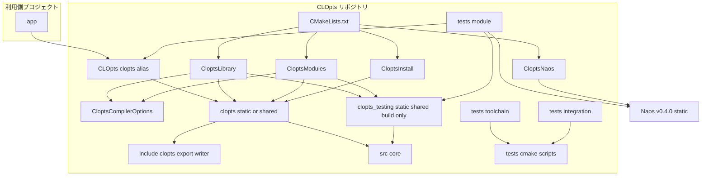
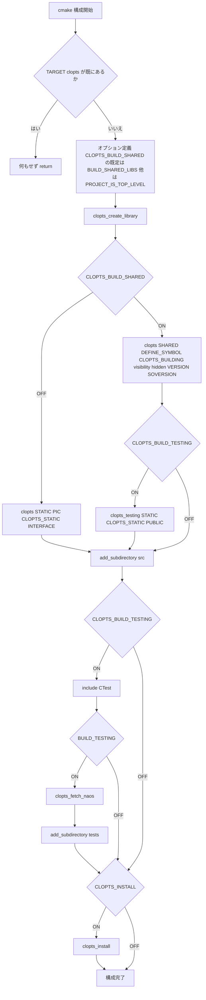
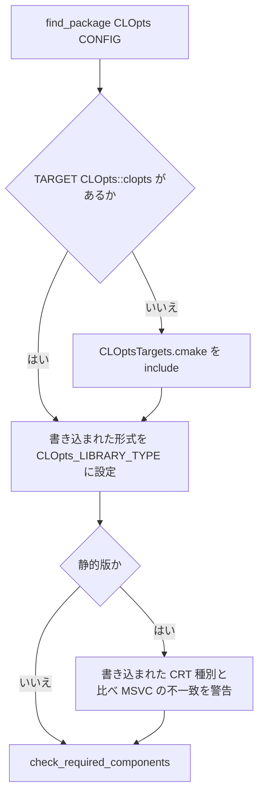
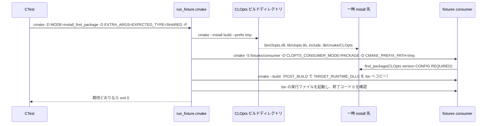

# Design Document: project-foundation

> **改訂（2026-11-08）**: 共有ライブラリと ABI 互換を範囲に入れた改訂要件（要件 12〜15 の追加と、要件 1〜11 の改訂）に合わせて作り直した。初版で実装済みのコードを出発点にした差分の設計で、初版から変えない部品（CompilerOptions、NaosHelper、CoreVec、CoreSize、GitIgnore）の契約はそのまま残している。差分の分析は `research.md` の Gap Analysis を参照。

## Overview

**Purpose**: 本 spec は、CLOpts の後続 spec がソースとテストを追加するだけで開発を始められる土台を提供する。後続 spec は core-parser、help-and-messages、platform-argv、abi-compat、docs-and-release である。提供するものは次のとおり。
- 引数解析の機能を持たないライブラリ `clopts`（`CLOpts::clopts`）。静的にも共有にもビルドできる
- ターゲット単位に閉じたビルド構成
- 公開シンボルの印（`CLOPTS_API`）と、それ以外のシンボルを出さない設定
- 共有ライブラリの版
- Naos によるテスト基盤
- 5 環境 × 2 形式の CI
- 静的版と共有版を並べられる install / export と package config
- 書き込みコールバック型と `FILE*` 用の便宜コールバック
- 全モジュールが依存する内部ユーティリティ

**Users**: 直接の利用者は、CLOpts の開発者と、後続 spec を実装するエージェントである。CLOpts を `add_subdirectory` / `FetchContent` / `find_package(CLOpts CONFIG)` で取り込む利用側の開発者も影響を受ける。影響の内容は、ビルド設定を汚されないこと、静的か共有かを選べること、共有版で内部関数に依存できないことである。

**Impact**: 初版で実装済みの構成を、次のように変える。
- **ターゲット**: 静的に固定していたターゲットを、2 つの形式から選べるようにする。
- **公開ヘッダ**: export マクロのヘッダを足す。
- **install**: install と package config を、形式ごとに分ける。
- **書き込みコールバック**: 構造体の値渡しと `FILE*` を受け取るライブラリ関数をやめる。
- **テスト登録**: 単体テストを、共有版でも内部関数にリンクできる形にする。
- **検証テストと CI**: 両方の形式に広げる。
- **core-parser との関係**: core-parser の公開関数には、作り直しまでの間だけ印を付ける（Boundary Commitments を参照）。

### Goals
- 5 つの CI 環境のすべてで、静的版と共有版のどちらでも `cmake -S . -B build && cmake --build build && ctest --test-dir build` が通る（1.6）
- すべての設定がターゲット単位で、サブプロジェクトとして取り込まれても利用側のグローバル状態を変えない（2.1〜2.10）
- 形式を `CLOPTS_BUILD_SHARED`（既定は `BUILD_SHARED_LIBS`）で選べて、リンクする名前は常に `CLOpts::clopts`（12.1〜12.7）
- 共有版では `CLOPTS_API` を付けた関数だけが出て、内部関数は利用側から見えない（14.1〜14.6）
- 共有版に、プロジェクトの版から導いた VERSION / SOVERSION が付く（15.1〜15.6）
- install した形式が `find_package` でそのまま提供され、形式を `CLOpts_LIBRARY_TYPE` で確かめられる。1 つの prefix に 1 つの形式（5.1〜5.7、13.1、13.6）
- モジュール追加とテスト登録がそれぞれ 1 つのヘルパ呼び出しで完結し、共有版でも内部関数を単体テストできる（4.1〜4.11）
- 上記の構成要件がすべて CTest で自動検証される（6.1〜6.8）
- 書き込みコールバックが、構造体と `FILE*` の受け渡しなしで使える（8.1〜8.8）

### Non-Goals
- 引数解析、公開 API のハンドル型、構造化エラー（core-parser）
- ヘルプ・エラー文面の生成（help-and-messages）。本 spec は書き込みコールバック型と、`FILE*` 用の便宜コールバックを提供するだけ
- Windows の argv / 環境変数（platform-argv）
- 公開シンボル一覧との照合、公開ヘッダの静的検査、版の間の ABI 比較、ABI 方針の文書（abi-compat）
- README 本文、`docs/`、`examples/`、`release.yml`、FetchContent 経路の利用側テスト（docs-and-release）
- pkg-config ファイル、1 つのビルドツリーで静的版と共有版を同時に作ること、ELF のシンボルバージョニング

## Boundary Commitments

### This Spec Owns
- **ビルド構成**
  - ルート `CMakeLists.txt` と `cmake/Clopts*.cmake` の 5 つのヘルパ（コンパイラオプション、ライブラリの作成、モジュール / テスト登録、Naos 取得、install / export）
  - package config のテンプレート `CLOptsConfig.cmake.in`
- **ターゲットとオプション**
  - ライブラリターゲット `clopts`（STATIC または SHARED）とエイリアス `CLOpts::clopts`
  - 共有版のビルドでテストのためだけに作る内部ターゲット `clopts_testing`（install も export もしない）
  - オプション `CLOPTS_BUILD_SHARED` / `CLOPTS_BUILD_TESTING` / `CLOPTS_INSTALL` / `CLOPTS_WERROR`
- **契約**
  - export の契約 `CLOPTS_API` / `CLOPTS_STATIC` / `CLOPTS_BUILDING`（`include/clopts/export.h`）
  - package config の契約: `CLOpts_LIBRARY_TYPE`（コンポーネントは持たない）
  - 公開契約 `clopts_write_fn` / `clopts_file_write()`（`include/clopts/writer.h`）
  - 内部契約 `core_internal.h`: `clopts_core_vec_*`、`clopts_core_size_*`、`clopts_core_write*`
  - 注記（2026-11-09）: `core_internal.h` には、確保の窓口（`clopts_core_malloc` など、`src/core/core_alloc.c`）も置いた。窓口と公開ヘッダ `include/clopts/alloc.h`（`clopts_set_allocator`）の契約は core-parser の design.md の Alloc が定める。vec の再確保と解放も、この窓口を通す
- **ディレクトリ規約の実体**: `include/clopts/`（傘ヘッダ `clopts.h`、`export.h`、`writer.h`）、`src/<module>/`、`tests/<module>/`、`tests/toolchain/`、`tests/integration/`、`tests/cmake/`
- **CI とリポジトリ**: `.github/workflows/ci.yml`、`.gitignore`
- **検証テスト**: ビルド構成の検証テスト（`tests/toolchain/`、`tests/integration/`）と、その共有スクリプト（`tests/cmake/run_fixture.cmake`）
- **暫定の変更（core-parser の作り直しまで）**: `include/clopts/parse.h` に `#include "clopts/export.h"` を 1 行足し、公開関数の宣言の先頭に `CLOPTS_API` を付ける。この 2 点に限る（理由は research.md の Decision「core-parser の作り直しまでの間の扱い」）。型・関数・コメントは変えない。

### Out of Boundary
- **公開ヘッダの解析系の型と関数**（`clopts_program_t`、`clopts_parse` など）の中身と設計
  - 上の暫定の変更以外では `decl.h` / `parse.h` に触れない。
  - `decl.h` の構造体定義（要件 14.5 の対象外）は core-parser の作り直しで消える。
- **他モジュールの中身**: `src/parser/`、`src/help/`、`src/platform/`、`tests/parser/` の中身
- **文面の内容や書式**: `clopts_core_write_str` は文字列をそのまま渡すだけ
- **ABI の検査**: 公開シンボル一覧（例: `abi/clopts.symbols`）、`tests/abi/`、abidiff の CI ジョブ、ABI 方針の文書（abi-compat）
  - 本 spec が検証するのは「印のない内部関数が共有版から見えない」ことまで（6.8）。
- **docs-and-release が担うもの**: `examples/`、`docs/`、`tests/docs/`、`release.yml`、FetchContent 経路の利用側テスト、Windows の DLL 名の衝突に関する文書
- **Naos への Issue や修正**

### Allowed Dependencies
- **CMake 3.21 以上の標準モジュールと機能**: `CTest`、`FetchContent`、`GNUInstallDirs`、`CMakePackageConfigHelpers`、`$<TARGET_RUNTIME_DLLS:...>`（3.21）。CMP0077 は `cmake_minimum_required(VERSION 3.21)` で NEW になる。
- **Naos v0.4.0**（コミット `09fde7172c4b63d416c32e98499cb0c0306d3dea`）: テスト実行ファイルの PRIVATE 依存に限る。サブプロジェクトの Naos は常に STATIC（research.md の初版の調査）。
- **C 標準ライブラリ（C99）**
  - `src/core/` が include してよいのは `<stddef.h>`、`<stdint.h>`、`<stdlib.h>`、`<string.h>`、`<assert.h>` だけ。`src/core/` は `<stdio.h>` を include しない。
  - 公開ヘッダ `writer.h` だけが `<stdio.h>` を include する。
- **GitHub Actions**: `actions/checkout`、`msys2/setup-msys2`、ランナー既定の CMake / コンパイラ
- **依存方向**（違反はレビューでエラー扱い）
  - C: `include/clopts/export.h`（依存なし）。`include/clopts/writer.h`（標準ヘッダのみ）と `include/clopts/alloc.h`（2026-11-09 に追加。`export.h` と `<stddef.h>`）← `src/core/core_internal.h` ← `src/core/*.c`。`src/core/` は他のモジュールを include しない。
  - CMake: `CloptsCompilerOptions.cmake` ← `CloptsLibrary.cmake` / `CloptsModules.cmake` ← ルート `CMakeLists.txt`。`CloptsNaos.cmake` と `CloptsInstall.cmake` は、ルートからだけ include される。`src/<module>/CMakeLists.txt` と `tests/<module>/CMakeLists.txt` はヘルパ関数を呼ぶだけで、`cmake/` を include しない。

### Revalidation Triggers
次の変更があったら、後続 spec が影響を再確認する。
- **`CLOPTS_API` の判定順や、`CLOPTS_STATIC` / `CLOPTS_BUILDING` の名前の変更**
  - 影響: 公開関数を持つすべての spec（core-parser、help-and-messages、platform-argv）
  - 影響: abi-compat の公開ヘッダの検査
- **`clopts_write_fn` の戻り値の意味（0 = 成功、非 0 = 失敗）や引数順、`clopts_core_write(fn, ctx, ...)` の形の変更**
  - 影響: help-and-messages の文面生成の全体
- **`clopts_core_vec_t` の契約の変更**: core-parser の結果ストアと、platform-argv の argv 配列
- **`clopts_add_module` / `clopts_add_module_tests` の引数形式、または「共有版の単体テストは `clopts_testing` にリンクする」方式の変更**
  - 影響: すべての `src/<module>/CMakeLists.txt` と `tests/<module>/CMakeLists.txt`
  - 影響: 単体テストが内部関数を呼べるかどうか
- **package config の契約（`CLOpts_LIBRARY_TYPE`）や export ファイル名（`CLOptsTargets.cmake`）の変更**
  - 影響: docs-and-release の取り込み手順と利用側テスト
- **SOVERSION の規則（`0.<minor>` / major）の変更**: abi-compat の ABI 方針と abidiff の基準、docs-and-release のリリース手順
- **CTest のラベルやテスト名の形式（`<module>_tests.<suite>.<test>`）の変更**: `tests/docs/`、abi-compat のテスト、CI の `-L` 指定
- **Naos の版更新**: すべてのテスト
- **公開ヘッダの include 基点（`include/`）の変更**: 全モジュールの `#include`

## Architecture

### Existing Architecture Analysis
初版の次の 3 つの形は保つ。
- 1 つのライブラリターゲット + `target_sources` によるモジュール追加
- `PROJECT_IS_TOP_LEVEL` を既定にしたオプション
- `cmake -P` のスクリプトで fixture を構成・ビルドして判定する検証

この上に足すものは 3 つある。
1. **形式の選択**: 新しいヘルパ `CloptsLibrary.cmake` に集約する。
2. **install / config**: `CloptsInstall.cmake` を作り直す（1 つの prefix に 1 つの形式）。
3. **共有版での単体テスト**: `clopts_testing` を新設する。

### Architecture Pattern & Boundary Map



**Architecture Integration**:
- **Selected pattern**: 1 つのライブラリターゲット（形式は構成時に 1 つ選ぶ）+ `target_sources` によるモジュール追加。
  - 共有版のビルドに限り、同じソースを静的にまとめた内部ターゲット `clopts_testing` を作る。単体テストは静的版では `CLOpts::clopts` に、共有版では `clopts_testing` にリンクする。
  - 代替案（OBJECT ライブラリの共有、内部関数のテストを静的版のジョブに限る）との比較は research.md。
- **Domain/feature boundaries**: 責務は 5 つに分かれ、互いにファイルを共有しない。
  - CMake のヘルパ（構成）
  - 公開ヘッダ（`export.h`、`writer.h`）
  - `src/core/`（C の内部ユーティリティ）
  - `tests/toolchain/` と `tests/integration/`（構成の検証）
  - CI
- **Existing patterns preserved**: steering `structure.md` のディレクトリ規約と命名規約、`tech.md` の「ターゲット単位に閉じる」「共有ライブラリと ABI」の方針。
- **New components rationale**:
  - `CloptsLibrary.cmake`: 形式の選択と形式ごとのプロパティを、ルートから外して 1 か所にする。
  - `export.h`: 公開ヘッダの共通の印。
- **Steering compliance**:
  - グローバル設定なし（2.1〜2.2）
  - `PROJECT_IS_TOP_LEVEL` を既定にしたオプション（2.5〜2.7）
  - 版の記述は 1 か所（1.5、15.4）
  - 公開ヘッダに構造体の定義なし（14.5）
  - 依存は一方向

### Technology Stack

| Layer | Choice / Version | Role in Feature | Notes |
|-------|------------------|-----------------|-------|
| 言語 | C99（`C_EXTENSIONS OFF`） | ライブラリと内部ユーティリティ | VLA と `_Complex` は使わない。MSVC では `/std:c11` を C99 として使う。公開ヘッダの `static inline` は MSVC の C モード（VS 2015 以降）でも使える |
| 言語（検証のみ） | C++（ランナー既定のコンパイラ） | 利用側 fixture の C++ 翻訳単位 | 公開ヘッダを C++ から include できることの確認（14.6）。ライブラリ本体は C のみ |
| ビルド | CMake 3.21 以上 | 構成、ヘルパ、install / export | `PROJECT_IS_TOP_LEVEL`、`CMakePackageConfigHelpers`、`FetchContent`、`$<TARGET_RUNTIME_DLLS>`、CMP0077 |
| テスト | Naos v0.4.0（`Naos::naos`、常に静的） | `tests/<module>/` の単体テスト | `naos_add_executable` が CTest 登録を担う |
| テスト（構成検証） | CTest + `cmake -P` スクリプト | `tests/toolchain/`、`tests/integration/` | Naos を使わない。子プロセスで CMake 項目を構成・ビルドする |
| CI | GitHub Actions | 5 環境 × 2 形式のビルドとテスト | `ubuntu-latest`（GCC、Clang）、`macos-latest`、`windows-latest`（MSVC、MSYS2 UCRT64） |

## File Structure Plan

### Directory Structure
```
CMakeLists.txt                          # project(clopts VERSION 0.1.0 LANGUAGES C)、オプション 4 つ、ヘルパの include、clopts_create_library()、add_subdirectory(src)、テストと install の条件付き有効化
cmake/
├── CloptsCompilerOptions.cmake         # （変更なし）clopts_apply_compiler_options(<target>)
├── CloptsLibrary.cmake                 # 新規: clopts_create_library(): 形式の決定、clopts と CLOpts::clopts、形式ごとのプロパティ（PIC、CLOPTS_STATIC、visibility、DEFINE_SYMBOL、VERSION/SOVERSION）、共有版のビルドでの clopts_testing
├── CloptsModules.cmake                 # 変更: clopts_add_module は clopts と clopts_testing（あれば）の両方にソースを足す。clopts_add_module_tests はリンク先を選ぶ
├── CloptsNaos.cmake                    # （変更なし）clopts_fetch_naos()
├── CloptsInstall.cmake                 # 変更: 1 つの export セット（CLOptsTargets）、LIBRARY/RUNTIME の行き先、形式と静的版の CRT 種別を config に書き込む、版の互換規則
└── CLOptsConfig.cmake.in               # 作り直し: CLOptsTargets.cmake を読み込み、書き込まれた形式を CLOpts_LIBRARY_TYPE に、静的版なら CRT の不一致を警告
include/clopts/
├── clopts.h                            # （変更なし）傘ヘッダ。decl.h / parse.h / writer.h を include
├── export.h                            # 新規: CLOPTS_API の定義
├── writer.h                            # 作り直し: clopts_write_fn と static inline の clopts_file_write。構造体と clopts_writer_file を削除
└── parse.h                             # 暫定の変更（core-parser 所有）: export.h の include と、公開関数への CLOPTS_API のみ
src/
├── CMakeLists.txt                      # （変更なし）
└── core/
    ├── CMakeLists.txt                  # 変更: core_writer_file.c をソース一覧から外す
    ├── core_internal.h                 # 変更: clopts_core_write / _str の引数を (fn, ctx, ...) にする
    ├── core_vec.c                      # （変更なし）
    ├── core_size.c                     # （変更なし）
    ├── core_writer.c                   # 変更: 新しい引数の形
    └── core_writer_file.c              # 削除
tests/
├── CMakeLists.txt                      # （変更なし）
├── cmake/
│   └── run_fixture.cmake               # 変更: EXPECT=configure_fail、FAIL_REGEX、run_ok の実行ファイル探索で .dll / .so / .dylib を除外
├── core/
│   ├── CMakeLists.txt                  # （変更なし）
│   ├── core_tests_main.c               # （変更なし）
│   ├── test_vec.c                      # （変更なし）
│   ├── test_size.c                     # （変更なし）
│   └── test_writer.c                   # 変更: clopts_file_write と新しい clopts_core_write を検証
├── toolchain/
│   ├── CMakeLists.txt                  # 変更: library_type の 3 ケースを追加
│   └── fixtures/
│       ├── no_global_state/CMakeLists.txt   # 変更: CMAKE_C_VISIBILITY_PRESET / CMAKE_POSITION_INDEPENDENT_CODE を検査に追加。INTERFACE_COMPILE_DEFINITIONS は静的版なら CLOPTS_STATIC のみ、共有版なら空
│       ├── library_type/CMakeLists.txt      # 新規: 形式の決定（既定、BUILD_SHARED_LIBS、CLOPTS_BUILD_SHARED の上書き）と形式ごとのプロパティを構成時に検査
│       ├── warning/{CMakeLists.txt,warning.c} # （変更なし）
│       └── vla/{CMakeLists.txt,vla.c}         # （変更なし）
└── integration/
    ├── CMakeLists.txt                  # 変更: 形式を fixture に渡す。internal_hidden（共有版のみ）を追加
    └── fixtures/
        ├── consumer/
        │   ├── CMakeLists.txt          # 変更: C と C++ を有効化、形式の照合、Windows の共有版で DLL を実行ファイルの横へコピー
        │   ├── main.c                  # 変更: clopts_file_write で 1 行書く
        │   └── consumer_cpp.cpp        # 新規: C++ から <clopts/clopts.h> を include し clopts_file_write を使う
        └── internal_symbol/
            ├── CMakeLists.txt          # 新規: CLOpts を add_subdirectory し、内部関数を参照する実行ファイルを作る（リンク失敗が期待値）
            └── main.c                  # 新規: clopts_core_size_mul を extern 宣言して呼ぶ
.github/workflows/
└── ci.yml                              # 変更: toolchain × library（static / shared）の 10 ジョブ
.gitignore                              # （変更なし）
```

### Modified Files
- `CMakeLists.txt`: `add_library(clopts STATIC)` と alias の行を削除する。`CLOPTS_BUILD_SHARED` の定義、`CloptsLibrary.cmake` の include、`clopts_create_library()` の呼び出しに置き換える（1.1、12.1〜12.3）。
- `cmake/CloptsModules.cmake`
  - `clopts_add_module`: `clopts_testing` があればソースを両方に足す。
  - `clopts_add_module_tests`: リンク先をグローバルプロパティ `CLOPTS_TEST_LINK_TARGET` で選ぶ（4.4、4.11）。
- `cmake/CloptsInstall.cmake`、`cmake/CLOptsConfig.cmake.in`: 形式ごとの export と、config での選択（5.1、5.4、5.6、13.1〜13.6、15.5）。
- `include/clopts/writer.h`: 作り直す（8.1〜8.4、8.6、14.5）。
- `include/clopts/parse.h`: 暫定で印を付ける（14.2 を core-parser の作り直しまで成り立たせるため）。
- `src/core/core_internal.h`、`core_writer.c`、`src/core/CMakeLists.txt`: `core_writer_file.c` を削除する（8.5、8.6）。
- `tests/core/test_writer.c`（8.8）
- `tests/cmake/run_fixture.cmake`（6.6〜6.8）
- `tests/toolchain/CMakeLists.txt`、`tests/toolchain/fixtures/no_global_state/CMakeLists.txt`（2.1、6.1、12.x、15.x）
- `tests/integration/CMakeLists.txt`、`tests/integration/fixtures/consumer/*`（5.7、6.3、6.6、14.3、14.6）
- `.github/workflows/ci.yml`（1.6、7.1〜7.5）

## System Flows

### 構成フロー（トップレベル / サブプロジェクト）



- `if(TARGET clopts)` のガードは、`project()` の直後に置く（2.8）。
- `option()` が既定値を決めるのは、最初の構成のときだけである。後から `BUILD_SHARED_LIBS` を変えても、`CLOPTS_BUILD_SHARED` は変わらない（研究の注意点。docs-and-release で文書化）。
- `clopts_testing` を作るかどうかは、`CLOPTS_BUILD_TESTING` だけで決める（`BUILD_TESTING` は `include(CTest)` の後でしか分からないため）。`EXCLUDE_FROM_ALL` にして、テストが無効なら作られないようにする。

### package config の読み込み（13.1、13.6）



- 形式は install した時点で決まっており、config は選ばない。コンポーネントは定義しないので、必須のコンポーネントを指定されたら `check_required_components` が検索を失敗させる。

### install 経路の検証フロー（共有版、Windows）



- Linux / macOS では、CMake がビルドツリーの実行ファイルに、リンクした共有ライブラリのディレクトリを RPATH として入れる。そのため、追加の設定なしで install 先の `.so` / `.dylib` を読み込める（macOS の install name は `@rpath/libclopts.0.1.dylib`）。

## Requirements Traceability

| Requirement | Summary | Components | Interfaces | Flows |
|-------------|---------|------------|------------|-------|
| 1.1 | `clopts` と `CLOpts::clopts` | RootCMake, LibraryHelper | `clopts_create_library` | 構成フロー |
| 1.2, 1.3 | `include/clopts/`、傘ヘッダ、公開 include 基点 | LibraryHelper, PublicHeaders | `clopts.h` | — |
| 1.4 | `src/<module>/`、内部 include 基点 `src/` | LibraryHelper, ModulesHelper | `clopts_add_module` | — |
| 1.5 | 版は `project()` の 1 か所 | RootCMake, LibraryHelper, InstallHelper | — | — |
| 1.6 | 5 環境 × 2 形式で通る | CIWorkflow と全コンポーネント | — | — |
| 1.7 | CMake 3.21 以上 | RootCMake | — | — |
| 2.1 | グローバル変数を設定しない（`BUILD_SHARED_LIBS`、`CMAKE_C_VISIBILITY_PRESET` を含む） | RootCMake, LibraryHelper, ToolchainTests | — | 構成フロー |
| 2.2 | ディレクトリ単位の設定なし | RootCMake, CompilerOptions, ToolchainTests | — | — |
| 2.3 | C99 を PUBLIC 機能として宣言 | CompilerOptions | `clopts_apply_compiler_options` | — |
| 2.4 | 警告・内部定義は PRIVATE | CompilerOptions, IntegrationTests | — | — |
| 2.5, 2.6, 2.7 | トップレベル既定のオプション | RootCMake | `CLOPTS_BUILD_TESTING` / `CLOPTS_INSTALL` / `CLOPTS_WERROR` | 構成フロー |
| 2.8 | 二重取り込みで再定義しない | RootCMake | — | 構成フロー |
| 2.9 | CRT 種別を設定しない | CompilerOptions, ToolchainTests | — | — |
| 2.10 | Naos はテスト有効時のみ | RootCMake, NaosHelper, ModulesHelper | `clopts_fetch_naos` | 構成フロー |
| 3.1, 3.2, 3.3, 3.4, 3.5, 3.6, 3.7 | コンパイラ別フラグ、1 ヘルパ、VLA | CompilerOptions, ToolchainTests | `clopts_apply_compiler_options` | — |
| 4.1, 4.2 | モジュール追加ヘルパ | ModulesHelper | `clopts_add_module` | — |
| 4.3, 4.4, 4.8 | テスト登録、リンク、ラベル、テスト名 | ModulesHelper | `clopts_add_module_tests` | — |
| 4.5 | `ctest -L <module>` | ModulesHelper, CIWorkflow | — | — |
| 4.6, 4.7 | Naos の固定とローカルパス | NaosHelper | `clopts_fetch_naos` | — |
| 4.9 | `tests/toolchain/`、`tests/integration/` | ToolchainTests, IntegrationTests | — | — |
| 4.10 | Windows の共有版でテストが DLL を見つける | ModulesHelper, LibraryHelper, IntegrationTests | `clopts_testing`、consumer の POST_BUILD コピー | install 検証フロー |
| 4.11 | 共有版でも内部関数を単体テスト | LibraryHelper, ModulesHelper | `clopts_testing`、`CLOPTS_TEST_LINK_TARGET` | 構成フロー |
| 5.1 | install の内容（実行時ファイル、インポートライブラリ） | InstallHelper | `clopts_install` | — |
| 5.2 | 内部ヘッダを install しない | InstallHelper | — | — |
| 5.3 | config がターゲット・include・C99 を提供 | InstallHelper, PackageConfig | `CLOptsConfig.cmake.in` | config の読み込み |
| 5.4 | 版の互換規則 | LibraryHelper, InstallHelper | `CLOPTS_VERSION_COMPATIBILITY` | — |
| 5.5 | `ARCH_INDEPENDENT` なし | InstallHelper | — | — |
| 5.6 | 静的版の CRT 記録と警告 | InstallHelper, PackageConfig | `CLOptsConfig.cmake.in` | config の読み込み |
| 5.7 | install → find_package → ビルド・実行（ビルドツリーの形式で） | IntegrationTests, RunFixture | `run_fixture.cmake` | install 検証フロー |
| 6.1 | グローバル状態なしの検証 | ToolchainTests | fixtures/no_global_state | — |
| 6.2 | 警告・VLA でビルド失敗の検証 | ToolchainTests | fixtures/warning, fixtures/vla | — |
| 6.3 | add_subdirectory 経路と非伝播 | IntegrationTests | fixtures/consumer | — |
| 6.4 | install 経路の検証 | IntegrationTests | — | install 検証フロー |
| 6.5 | `ctest` にすべて含まれる | ToolchainTests, IntegrationTests | — | — |
| 6.6 | add_subdirectory 経路を形式ごとに実行まで | IntegrationTests, RunFixture | fixtures/consumer | — |
| 6.8 | 内部関数でリンク失敗（共有版） | IntegrationTests, RunFixture | fixtures/internal_symbol、`FAIL_REGEX` | — |
| 7.1, 7.2, 7.3, 7.4, 7.5 | CI マトリクス、`-Werror`、独立失敗、出力、リリースなし | CIWorkflow | `ci.yml` | — |
| 8.1 | コールバック型 | PublicHeaders | `clopts_write_fn` | — |
| 8.2 | 組にした構造体を定義しない | PublicHeaders, CoreWriter | `clopts_core_write(fn, ctx, ...)` | — |
| 8.3, 8.4 | `FILE*` 用の既製コールバック（利用側でコンパイル） | PublicHeaders | `clopts_file_write` | — |
| 8.5 | 失敗の伝達 | CoreWriter | `clopts_core_write` | — |
| 8.6 | 本体は stdio に依存しない | CoreWriter, PublicHeaders | — | — |
| 8.7 | 未使用のとき警告なし | PublicHeaders, CoreTests | — | — |
| 8.8 | 書き込みの単体テスト | CoreTests | test_writer.c | — |
| 9.1, 9.2, 9.3, 9.4, 9.5, 9.6, 9.7, 9.8, 9.9 | 可変長配列とサイズ計算 | CoreVec, CoreSize, CoreTests | `clopts_core_vec_*`、`clopts_core_size_*` | — |
| 10.1, 10.2 | `.gitignore` | GitIgnore | — | — |
| 11.1, 11.2, 11.3, 11.4, 11.5, 11.6 | コーディング規約 | CoreVec, CoreSize, CoreWriter, CoreTests | `core_internal.h` | — |
| 12.1 | どちらか一方の形式 | LibraryHelper | `clopts_create_library` | 構成フロー |
| 12.2 | `CLOPTS_BUILD_SHARED`（既定は `BUILD_SHARED_LIBS`） | RootCMake, ToolchainTests | `CLOPTS_BUILD_SHARED` | 構成フロー |
| 12.3 | 利用側の指定が優先 | RootCMake, ToolchainTests | — | 構成フロー |
| 12.4 | 静的版は PIC | LibraryHelper, ToolchainTests | — | — |
| 12.5 | 静的版の定義を伝える | LibraryHelper, PublicHeaders, ToolchainTests | `CLOPTS_STATIC` | — |
| 12.7 | リンク名は `CLOpts::clopts` のみ | LibraryHelper, PackageConfig | — | — |
| 13.1 | 1 つの prefix に 1 つの形式（形式によらない同じファイル名） | InstallHelper | `CLOptsTargets.cmake` | config の読み込み |
| 13.6 | 提供した形式を変数で知らせる | PackageConfig | `CLOpts_LIBRARY_TYPE` | config の読み込み |
| 14.1 | export マクロの切り替え | PublicHeaders, LibraryHelper | `CLOPTS_API` | — |
| 14.2 | 印のある関数だけを出す | LibraryHelper, IntegrationTests | `C_VISIBILITY_PRESET`、dllexport | — |
| 14.3 | Windows の利用側は自動で取り込み | PublicHeaders, IntegrationTests | `CLOPTS_API` | install 検証フロー |
| 14.4 | 5 環境 × 2 形式で警告なし | PublicHeaders, CIWorkflow | — | — |
| 14.5 | 本 spec の公開ヘッダに構造体なし | PublicHeaders | `export.h`、`writer.h` | — |
| 14.6 | C / C++ から include でき C リンケージ | PublicHeaders, IntegrationTests | consumer_cpp.cpp | — |
| 15.1, 15.2, 15.3, 15.4 | VERSION / SOVERSION の規則 | LibraryHelper, ToolchainTests | `CLOPTS_SOVERSION` | — |
| 15.5 | Linux / macOS の版付きファイルと namelink | InstallHelper | `install(TARGETS ... LIBRARY)` | — |
| 15.6 | Windows の DLL 名に版なし | LibraryHelper | — | — |

## Components and Interfaces

| Component | Domain/Layer | Intent | Req Coverage | Key Dependencies (P0/P1) | Contracts |
|-----------|--------------|--------|--------------|--------------------------|-----------|
| RootCMake | ビルド構成 | オプションと条件付き有効化の入口 | 1.1, 1.5, 1.7, 2.1, 2.5, 2.6, 2.7, 2.8, 2.10, 12.2, 12.3 | LibraryHelper (P0), ModulesHelper (P0), NaosHelper (P1), InstallHelper (P1) | Service |
| CompilerOptions | ビルド構成 | コンパイラ別フラグをターゲット単位に適用（変更なし） | 2.3, 2.4, 2.9, 3.1〜3.7 | — | Service |
| LibraryHelper | ビルド構成 | 形式の決定、`clopts` / `clopts_testing` の作成と形式ごとのプロパティ、版 | 1.1〜1.5, 4.11, 5.4, 12.1, 12.4, 12.5, 12.7, 14.1, 14.2, 15.1〜15.4, 15.6 | CompilerOptions (P0) | Service |
| ModulesHelper | ビルド構成 | モジュール追加とテスト登録 | 1.4, 4.1〜4.5, 4.8, 4.10, 4.11 | LibraryHelper (P0), CompilerOptions (P0), Naos (P0, テスト時) | Service |
| NaosHelper | ビルド構成 | Naos の固定取得と版照合（変更なし） | 2.10, 4.6, 4.7 | FetchContent (P0) | Service |
| InstallHelper / PackageConfig | 配布 | install / export、install した形式を提供する config、版の互換、CRT 記録 | 5.1〜5.6, 13.1, 13.6, 15.5 | LibraryHelper (P0), CMakePackageConfigHelpers (P0) | Service |
| PublicHeaders | 公開 API | `export.h`、`writer.h`、傘ヘッダ、`parse.h` の暫定の印 | 1.2, 1.3, 8.1〜8.4, 8.6, 8.7, 12.5, 14.1, 14.3〜14.6 | — | Service（C） |
| CoreWriter | 内部ユーティリティ | コールバックを介して書く内部ヘルパ | 8.2, 8.5, 8.6, 9.8 | PublicHeaders (P0) | Service |
| CoreVec | 内部ユーティリティ | 可変長配列（変更なし） | 9.1〜9.5, 9.7, 9.8 | CoreSize (P0) | Service |
| CoreSize | 内部ユーティリティ | サイズ計算の検査（変更なし） | 9.6, 9.8 | — | Service |
| CoreTests | テスト | `tests/core/` の Naos テスト | 8.7, 8.8, 9.9, 11.1〜11.6 | Naos (P0), ModulesHelper (P0) | — |
| RunFixture | テスト基盤 | 子 CMake 項目の構成・ビルド・実行・判定 | 5.7, 6.1〜6.4, 6.6, 6.8 | CMake CLI (P0) | Batch |
| ToolchainTests | テスト | 構成要件の検証 | 2.1, 2.2, 2.9, 3.7, 4.9, 6.1, 6.2, 12.2〜12.5, 15.1〜15.4 | RunFixture (P0) | — |
| IntegrationTests | テスト | add_subdirectory / install 経路、内部関数の非公開、C++ | 2.4, 4.9, 4.10, 5.7, 6.3, 6.4, 6.6, 6.8, 14.2, 14.3, 14.6 | RunFixture (P0), InstallHelper (P1) | — |
| CIWorkflow | CI | 5 環境 × 2 形式 | 1.6, 4.5, 7.1〜7.5, 14.4 | GitHub Actions (P0), msys2/setup-msys2 (P0) | Batch |
| GitIgnore | リポジトリ | 生成物の除外（変更なし） | 10.1, 10.2 | — | — |

### ビルド構成

#### RootCMake

| Field | Detail |
|-------|--------|
| Intent | `CMakeLists.txt` で、ガード・オプション・ライブラリ作成・条件付き有効化を順に行う |
| Requirements | 1.1, 1.5, 1.7, 2.1, 2.5, 2.6, 2.7, 2.8, 2.10, 12.2, 12.3 |

**Responsibilities & Constraints**
- `cmake_minimum_required(VERSION 3.21)` と `project(clopts VERSION 0.1.0 LANGUAGES C)` を置く。版を書くのはここだけ。
- `if(TARGET clopts) return() endif()` を、`project()` の直後に置く。
- `CLOPTS_BUILD_SHARED` を定義する。
  - `option(CLOPTS_BUILD_SHARED ...)` の既定値は、`BUILD_SHARED_LIBS` の真偽を `ON` / `OFF` に正規化した値にする。
  - `BUILD_SHARED_LIBS` が未定義のときに `option()` へ空文字を渡さないよう、`if(BUILD_SHARED_LIBS)` で分けて一時変数に入れる。この一時変数は `unset` してスコープに残さない。
  - CMP0077 が NEW なので、親が通常変数で `CLOPTS_BUILD_SHARED` を設定していれば、`option()` は何もしない（12.3）。
- 既存の 3 つのオプション（`CLOPTS_BUILD_TESTING`、`CLOPTS_INSTALL`、`CLOPTS_WERROR`）は初版のまま（既定は `PROJECT_IS_TOP_LEVEL`）。
- `include(GNUInstallDirs)` の後に、`CloptsCompilerOptions.cmake`、`CloptsLibrary.cmake`、`CloptsModules.cmake` を include し、`clopts_create_library()` を呼ぶ。
- 以降（`add_subdirectory(src)`、テスト、install）は初版と同じ。
- 禁止事項
  - `set(CMAKE_*)`、`set(BUILD_SHARED_LIBS)`、`add_compile_options`、`add_definitions`、`include_directories`、`link_libraries`
  - 無条件の `include(CTest)` / `enable_testing()`

**Contracts**: Service [x]

##### Service Interface（CMake）
- **定義するターゲット**: `clopts`、`CLOpts::clopts`。共有版でテストが有効なときは `clopts_testing` も定義する。
- **定義するキャッシュ変数**: `CLOPTS_BUILD_SHARED`、`CLOPTS_BUILD_TESTING`、`CLOPTS_INSTALL`、`CLOPTS_WERROR`（BOOL）
- **事後条件**: サブプロジェクトとして取り込まれたとき、利用側のディレクトリスコープに足される変数は、上のキャッシュ変数 4 つと、`GNUInstallDirs` / FetchContent 由来のものに限られる。`BUILD_TESTING`、`BUILD_SHARED_LIBS`、`CMAKE_C_VISIBILITY_PRESET`、`CMAKE_POSITION_INDEPENDENT_CODE` は定義されない。

#### LibraryHelper

| Field | Detail |
|-------|--------|
| Intent | `cmake/CloptsLibrary.cmake` の `clopts_create_library()` で、形式を 1 つ決めてターゲットを作り、形式ごとのプロパティを付ける |
| Requirements | 1.1, 1.2, 1.3, 1.4, 1.5, 4.11, 5.4, 12.1, 12.4, 12.5, 12.7, 14.1, 14.2, 15.1, 15.2, 15.3, 15.4, 15.6 |

**Responsibilities & Constraints**
- **版の計算**（15.2〜15.4、5.4）。親スコープに `CLOPTS_SOVERSION` と `CLOPTS_VERSION_COMPATIBILITY` を設定する（ディレクトリスコープの通常変数。キャッシュには入れない）。
  - `PROJECT_VERSION_MAJOR` が 0 のとき: `CLOPTS_SOVERSION = 0.<PROJECT_VERSION_MINOR>`、`CLOPTS_VERSION_COMPATIBILITY = SameMinorVersion`
  - それ以外: `CLOPTS_SOVERSION = <PROJECT_VERSION_MAJOR>`、`CLOPTS_VERSION_COMPATIBILITY = SameMajorVersion`
- **共通**
  - `add_library(clopts <STATIC|SHARED>)` で、型を明示的に渡す（`CLOPTS_BUILD_SHARED` に従う）。
  - `add_library(CLOpts::clopts ALIAS clopts)`。
  - `target_include_directories(clopts PUBLIC $<BUILD_INTERFACE:include> $<INSTALL_INTERFACE:${CMAKE_INSTALL_INCLUDEDIR}> PRIVATE src)`。
  - `clopts_apply_compiler_options(clopts)`。
- **静的版**
  - `POSITION_INDEPENDENT_CODE ON`（12.4）
  - `target_compile_definitions(clopts PUBLIC CLOPTS_STATIC)`（12.5。PUBLIC なので、ライブラリ自身にも利用側にも伝わり、`install(EXPORT)` にも載る）
  - `OUTPUT_NAME` は付けない。MSVC でも静的ライブラリは `clopts.lib` になる（1 つの prefix に 1 つの形式なので、インポートライブラリと同じディレクトリに並ばない）
- **共有版**
  - `DEFINE_SYMBOL CLOPTS_BUILDING`（ライブラリ自身のコンパイルにだけ付く）
  - `if(NOT WIN32)` のときは `C_VISIBILITY_PRESET hidden`（14.2）。PE では visibility は効かず、GCC が `-Wattributes` を出す恐れがあるので付けない。PE で export を絞るのは、dllexport の印である。
  - `VERSION ${PROJECT_VERSION}`、`SOVERSION ${CLOPTS_SOVERSION}`（15.1〜15.3）。Windows の DLL 名には、CMake の既定で版が入らない（15.6）。
- **`clopts_testing`**（共有版で、`CLOPTS_BUILD_TESTING` が ON のときだけ）（4.11）
  - `add_library(clopts_testing STATIC EXCLUDE_FROM_ALL)`。include パスは `clopts` と同じ。
  - `target_compile_definitions(clopts_testing PUBLIC CLOPTS_STATIC)`、`clopts_apply_compiler_options(clopts_testing)`。
  - グローバルプロパティ `CLOPTS_TEST_LINK_TARGET` を `clopts_testing` にする。静的版では `CLOpts::clopts` にする。
  - install も export もしない。
- 1 つのビルドツリーで作る `clopts` は 1 つだけ（12.1）。

**Dependencies**
- Inbound: RootCMake (P0)
- Outbound: CompilerOptions (P0)
- Inbound（読み取り）: ModulesHelper（`clopts_testing` の有無と `CLOPTS_TEST_LINK_TARGET`）、InstallHelper（`CLOPTS_VERSION_COMPATIBILITY`、ターゲットの型）

**Contracts**: Service [x]

##### Service Interface（CMake）
```cmake
clopts_create_library()
# 事前条件: CLOPTS_BUILD_SHARED と CLOPTS_BUILD_TESTING が定義済み。TARGET clopts が存在しない。
# 事後条件: TARGET clopts（TYPE が STATIC_LIBRARY または SHARED_LIBRARY）と CLOpts::clopts が存在する。
#   GLOBAL プロパティ CLOPTS_TEST_LINK_TARGET が clopts_testing または CLOpts::clopts。
#   呼び出し元スコープに CLOPTS_SOVERSION と CLOPTS_VERSION_COMPATIBILITY がある。
```

**Implementation Notes**
- **Validation**: `tests/toolchain/fixtures/library_type/` が、型・PIC・`INTERFACE_COMPILE_DEFINITIONS`・`OUTPUT_NAME`・`VERSION`・`SOVERSION` を構成時に検査する。
- **Risks**: 共有版でテストが有効だと、全ソースを 2 回コンパイルする。ソースが小さいので許容する（research.md の Decision）。

#### ModulesHelper

| Field | Detail |
|-------|--------|
| Intent | `clopts_add_module` と `clopts_add_module_tests` で、モジュール追加とテスト登録を各 1 行にする |
| Requirements | 1.4, 4.1, 4.2, 4.3, 4.4, 4.5, 4.8, 4.10, 4.11 |

**Responsibilities & Constraints**
- **`clopts_add_module(<module> SOURCES <src>...)`**
  - `target_sources(clopts PRIVATE <絶対パス>)` を行い、`TARGET clopts_testing` があれば同じソースを `clopts_testing` にも足す。
  - 別のライブラリターゲットは作らない（4.1）。
  - `CLOPTS_MODULES` への追記は初版のまま。
- **`clopts_add_module_tests(<module> SOURCES <src>...)`**
  - `get_property(link GLOBAL PROPERTY CLOPTS_TEST_LINK_TARGET)` でリンク先を得て、`naos_add_executable(<module>_tests SOURCES ... LIBRARIES ${link} LABELS <module>)` を呼ぶ。
  - 以降（`src/` の include、コンパイラオプション、Linux の `m`）は初版と同じ。
- **4.10（Windows の DLL）**: 共有版の単体テストは静的な `clopts_testing` にリンクするので、DLL を必要としない。Naos のテスト発見（POST_BUILD で実行ファイルを起動する）も、DLL の配置を待たずに動く。DLL を読み込む実行ファイルは integration の fixture だけで、そちらでは fixture 自身が DLL をコピーする（IntegrationTests）。
- テスト名は `<module>_tests.<suite>.<test>`（初版のまま）。

**Contracts**: Service [x]

##### Service Interface（CMake）
```cmake
clopts_add_module(<module> SOURCES <file>...)
clopts_add_module_tests(<module> SOURCES <file>...)
```
- **事前条件**
  - `clopts_add_module`: `clopts_create_library()` を呼んだ後であること。
  - `clopts_add_module_tests`: `TARGET Naos::naos` が存在し、`include(CTest)` を済ませていること。
  - どちらも SOURCES が空なら `FATAL_ERROR`。
- **事後条件**: `<module>_tests` が `CLOPTS_TEST_LINK_TARGET` にリンクされ、ラベル `<module>` の CTest テストが登録される。

#### InstallHelper / PackageConfig

| Field | Detail |
|-------|--------|
| Intent | `clopts_install()` で、install 規則、export、config、version file を生成する。config は、install した形式のターゲット定義を読み込む |
| Requirements | 5.1, 5.2, 5.3, 5.4, 5.5, 5.6, 13.1, 13.6, 15.5 |

**Responsibilities & Constraints**
- **形式**: `get_target_property(type clopts TYPE)` から、`STATIC` か `SHARED` を得て config に書き込む。
- **ターゲットの install**: `install(TARGETS clopts EXPORT CLOptsTargets ...)` で、行き先を次のようにする。
  - `ARCHIVE` → `${CMAKE_INSTALL_LIBDIR}`
  - `LIBRARY` → `${CMAKE_INSTALL_LIBDIR}`（版付きファイルと namelink。15.5）
  - `RUNTIME` → `${CMAKE_INSTALL_BINDIR}`（DLL）
- **ヘッダ**: `install(DIRECTORY include/clopts ...)` は初版のまま。`src/` は install しない（5.2）。
- **ターゲット定義のファイル**（13.1）: `install(EXPORT CLOptsTargets NAMESPACE CLOpts:: FILE CLOptsTargets.cmake DESTINATION ${CMAKE_INSTALL_LIBDIR}/cmake/CLOpts)`。
- **静的版の CRT 記録**（5.6）: 静的版で MSVC なら `CMAKE_MSVC_RUNTIME_LIBRARY`、それ以外は空の文字列を、config に書き込む。別のファイルにはしない（同じ prefix に別の形式を上書き install したとき、古い記録だけが残らないように）。
- **version file**（5.4、5.5）: `write_basic_package_version_file(... VERSION ${PROJECT_VERSION} COMPATIBILITY ${CLOPTS_VERSION_COMPATIBILITY})`。`ARCH_INDEPENDENT` は付けない。
- **config の生成**: `configure_package_config_file(cmake/CLOptsConfig.cmake.in ...)`（`@ONLY` で、形式と CRT 種別を埋め込む）。
- **1 つの prefix に 1 つの形式**（13.1）: package の 3 つのファイルは、形式によらず同じ名前である。同じ prefix に別の形式を install すると、3 つとも後から install した形式のものに置き換わり、一貫した状態になる。前の形式のライブラリのファイルは残るが、ターゲット定義からは参照されない。検出も警告もしない。docs-and-release が文書化する。

**Contracts**: Service [x]

##### Service Interface（CMake、`CLOptsConfig.cmake.in` の振る舞い）
- **入力**: 書き込まれた形式と CRT 種別、利用側の `CMAKE_MSVC_RUNTIME_LIBRARY`
- **規則**
  1. `if(NOT TARGET CLOpts::clopts)` のときだけ、`CLOptsTargets.cmake` を include する。
  2. コンポーネントは定義しない。必須のコンポーネントを指定されたら、`check_required_components` が検索を失敗させる。
- **事後条件（成功時）**
  - `CLOpts::clopts` が IMPORTED ターゲットとして存在する。
  - `CLOpts_LIBRARY_TYPE` が `STATIC` または `SHARED`（13.6）。
  - `check_required_components(CLOpts)` を最後に呼ぶ。
  - `INTERFACE_INCLUDE_DIRECTORIES` に `<prefix>/include`、`INTERFACE_COMPILE_FEATURES` に `c_std_99` がある。静的版なら `INTERFACE_COMPILE_DEFINITIONS` に `CLOPTS_STATIC` がある（5.3、12.5）。
- **CRT の警告**: 静的版のときだけ、初版と同じ条件で `message(WARNING)` を出す。

**Implementation Notes**
- **Validation**
  - install 経路: `install_find_package`（ビルドツリーの形式を install し、`CLOpts_LIBRARY_TYPE` と `CLOpts::clopts` の `TYPE` を照合する）
- **Design Decision（2026-11-09）**: 当初は静的版と共有版を同じ prefix に並べて install でき、`COMPONENTS static|shared` → `CLOPTS_SHARED_LIBS` → `BUILD_SHARED_LIBS` → 入っている方、の順で config が形式を選んでいた（形式ごとの `CLOptsStaticTargets.cmake` / `CLOptsSharedTargets.cmake`、静的版だけが置く `CLOptsStaticRuntime.cmake`、MSVC の `OUTPUT_NAME clopts_static`、検証の `integration.package_selection`）。config の大半が形式の選択になり、pkg-config に対応するときにも `.pc` を形式ごとに分ける必要が出る（`--static` では `Cflags` の `-DCLOPTS_STATIC` を切り替えられない）。並存を必要とする利用者は具体的に想定されず、両方を使うなら prefix を分ければ足りるので、1 つの prefix に 1 つの形式とした。

#### PublicHeaders

| Field | Detail |
|-------|--------|
| Intent | `include/clopts/export.h`（印）、`include/clopts/writer.h`（書き込み契約）、傘ヘッダ、`parse.h` の暫定の印 |
| Requirements | 1.2, 1.3, 8.1, 8.2, 8.3, 8.4, 8.6, 8.7, 12.5, 14.1, 14.3, 14.4, 14.5, 14.6 |

**Contracts**: Service [x]

##### Service Interface（C、`include/clopts/export.h`）
```c
#ifndef CLOPTS_EXPORT_H
#define CLOPTS_EXPORT_H

#if defined(CLOPTS_STATIC)
#define CLOPTS_API
#elif defined(_WIN32) || defined(__CYGWIN__)
#if defined(CLOPTS_BUILDING)
#define CLOPTS_API __declspec(dllexport)
#else
#define CLOPTS_API __declspec(dllimport)
#endif
#elif defined(__GNUC__) && (__GNUC__ >= 4)
#define CLOPTS_API __attribute__((visibility("default")))
#else
#define CLOPTS_API
#endif

#endif /* CLOPTS_EXPORT_H */
```
- **判定の順**: `CLOPTS_STATIC` → Windows → GCC / Clang（14.1、14.4）。MinGW の GCC は `__GNUC__` も定義するが、Windows の分岐が先なので visibility 属性を見ない。
- **定義の付き方**（利用側は何も設定しない。14.3）
  - `CLOPTS_STATIC`: 静的版の `clopts` と `clopts_testing` に PUBLIC で付く（LibraryHelper）。
  - `CLOPTS_BUILDING`: 共有版の `clopts` 自身のコンパイルにだけ付く（`DEFINE_SYMBOL`）。
- **使い方**: 公開関数の宣言の先頭に付ける（例: `CLOPTS_API clopts_status_t clopts_parse(...);`）。型・列挙・`static inline` 関数には付けない。

##### Service Interface（C、`include/clopts/writer.h`）
```c
#include <stddef.h>
#include <stdio.h>

/* 書き込みコールバック。data の len バイトをすべて書けたら 0、そうでなければ非 0 を返す。 */
typedef int (*clopts_write_fn)(void *ctx, const char *data, size_t len);

/*
 * FILE* 用の既製コールバック。ctx に FILE* を渡す。利用側の翻訳単位でコンパイルされ、
 * ライブラリ本体には含まれない（FILE* が DLL の境界を越えない）。
 */
static inline int clopts_file_write(void *ctx, const char *data, size_t len)
{
    if (len == 0)
    {
        return 0;
    }
    return (fwrite(data, 1, len, (FILE *)ctx) == len) ? 0 : 1;
}
```
- **事前条件**: `ctx` は有効な `FILE*`。`len > 0` なら `data` は非 NULL。違反は未定義動作として文書化する（公開ヘッダに `<assert.h>` を持ち込まない）。
- **事後条件**: 全バイトを書けたら 0、そうでなければ 1 を返す。`len == 0` なら何もせず 0 を返す（8.4）。
- **不変条件**
  - 構造体は定義しない（8.2、14.5）。
  - `extern "C"` で囲む（14.6）。
  - ヘッダガードは `CLOPTS_WRITER_H`。
  - ヘッダで定義した未使用の `static inline` は、GCC / Clang の `-Wall -Wextra -Wpedantic` でも MSVC の `/W4` でも警告にならない（8.7。`/Wall` は使わない）。
- **暫定の `parse.h`**: `#include "clopts/export.h"` を足し、13 個の公開関数（`clopts_decl_validate` 〜 `clopts_result_free`）の宣言の先頭に `CLOPTS_API` を付ける。それ以外は変えない。

**Implementation Notes**
- **Validation**
  - `src/core/*.c` と `tests/core/*.c` は、`core_internal.h` を通じて `writer.h` を include する。そのうえで、ほとんどの翻訳単位は `clopts_file_write` を使わない。これらが `-Werror` / `/WX` でコンパイルできることが、8.7 の検証になる。
  - C++ からの利用は、`consumer_cpp.cpp` が検証する（14.6）。

#### CoreWriter

| Field | Detail |
|-------|--------|
| Intent | コールバックを介して書くための内部ヘルパ |
| Requirements | 8.2, 8.5, 8.6, 9.8 |

**Responsibilities & Constraints**
- `core_writer.c` は `clopts_core_write` と `clopts_core_write_str` を持つ。`<stdio.h>` は include しない。
- `core_writer_file.c` は削除する（`FILE*` の実装は公開ヘッダの `static inline` に移す）。

##### Service Interface（C、`src/core/core_internal.h`）
```c
/* fn(ctx, data, len) をそのまま呼ぶ。失敗を再試行せず返す。 */
int clopts_core_write(clopts_write_fn fn, void *ctx, const char *data, size_t len);
/* NUL 終端文字列を書く。strlen(s) バイト。 */
int clopts_core_write_str(clopts_write_fn fn, void *ctx, const char *s);
```
- **事前条件**: `fn` が非 NULL。`len > 0` なら `data` が非 NULL。`s` が非 NULL（いずれも `assert`）。`ctx` は検査しない（コールバックの持ち物）。
- **事後条件**: 戻り値はコールバックの戻り値そのもの（8.5）。

#### CoreVec / CoreSize（変更なし）

契約は初版と同じ。
- **可変長配列**
  - `clopts_core_vec_t { data, len, cap, elem_size }`
  - 関数: `init` / `push`（0 または -1） / `at` / `free`（冪等）
  - ゼロ初期化した状態は、有効な空の配列である。
  - 拡張は `cap == 0 ? 8 : cap * 2` で、オーバーフローすると -1 を返す。
  - 注記（2026-11-09）: バッファの再確保と解放は、`realloc` / `free` を直接呼ばず、core の確保の窓口（`clopts_core_realloc` / `clopts_core_free`）を通す。関数の引数は変えない
- **サイズ計算**
  - `clopts_core_size_mul` / `clopts_core_size_add`（0 または -1。オーバーフロー時は `*out` を変えない）
- 内部関数なので、`CLOPTS_API` は付けない。共有版では見えない（6.8 の fixture が `clopts_core_size_mul` を使う）。

### テスト

#### CoreTests

| Field | Detail |
|-------|--------|
| Intent | `tests/core/` の Naos テスト（`core_tests`、ラベル `core`） |
| Requirements | 8.7, 8.8, 9.9, 11.1, 11.2, 11.3, 11.4, 11.5, 11.6 |

**Responsibilities & Constraints**
- `test_writer.c` を書き直す。
  - `clopts_file_write` を `tmpfile()` に対して呼び、読み戻してバイト単位で比べる。
  - `len == 0` では 0 が返り、何も書かれない。
  - 読み取り専用で開いた `FILE*` への書き込みが非 0 を返す（失敗の報告。8.4）。
  - `clopts_core_write` / `_str` の検証: メモリに貯める自作コールバックで、順序と長さを確かめる。常に失敗するコールバックでは、非 0 がそのまま返る（8.5）。
- 他のスイートは初版のまま。Naos マクロの末尾に `;` を置かない。すべてのテストにアサーションを置く。

#### RunFixture

| Field | Detail |
|-------|--------|
| Intent | `tests/cmake/run_fixture.cmake`: 子 CMake 項目を構成・ビルド（・install・実行）し、期待結果と照合する |
| Requirements | 5.7, 6.1, 6.2, 6.3, 6.4, 6.6, 6.8 |

**Contracts**: Batch [x]

##### Batch / Job Contract（初版からの差分）
- **`EXPECT`**: `configure_fail` を足す（構成が非 0 で終わればテスト成功）。
- **`FAIL_REGEX`**（任意）: `build_fail` / `configure_fail` のとき、子プロセスの出力がこの正規表現に一致しなければテスト失敗にする。「別の理由で失敗した」のを成功と取り違えないためである（6.8）。
- **`run_ok`**: 実行ファイルを探すとき、`\.(dll|so|dylib)` で終わるファイルと版付きの `\.so\.[0-9.]+$` も除外する（Windows の共有版で、DLL が `bin` にコピーされるため）。
- その他（`MODE=install_find_package`、引き継ぐ変数、`WORK_DIR` の作り直し）は初版のまま。

#### ToolchainTests

| Field | Detail |
|-------|--------|
| Intent | `tests/toolchain/` のテスト（ラベル `toolchain`） |
| Requirements | 2.1, 2.2, 2.9, 3.7, 4.9, 6.1, 6.2, 12.2, 12.3, 12.4, 12.5, 15.1, 15.2, 15.3, 15.4 |

**Responsibilities & Constraints**
- **`toolchain.no_global_state`（変更）**
  - 検査する変数に、`CMAKE_C_VISIBILITY_PRESET` と `CMAKE_POSITION_INDEPENDENT_CODE` を足す。
  - `clopts` の `INTERFACE_COMPILE_DEFINITIONS` の検査を、型に応じて変える。`STATIC_LIBRARY` なら、ちょうど `CLOPTS_STATIC` であること。`SHARED_LIBRARY` なら空であること。
  - fixture は親の `-DCLOPTS_BUILD_SHARED=<ビルドツリーの値>` を受け取り、その形式で検査する。
- **`toolchain.library_type.<case>`（新規、3 ケース、`EXPECT=configure_ok`）**: fixture `library_type` は `CASE` に応じて、`add_subdirectory` の前に変数を設定する。

| case | 事前設定 | 期待する TYPE |
|------|----------|---------------|
| default | なし | STATIC_LIBRARY |
| build_shared_libs | `set(BUILD_SHARED_LIBS ON)` | SHARED_LIBRARY |
| override | `set(BUILD_SHARED_LIBS ON)` と `set(CLOPTS_BUILD_SHARED OFF)` | STATIC_LIBRARY |

- 型ごとの検査
  - STATIC: `POSITION_INDEPENDENT_CODE` が真（12.4）、`INTERFACE_COMPILE_DEFINITIONS` が `CLOPTS_STATIC`（12.5）、`OUTPUT_NAME` が空（MSVC を含む）
  - SHARED: `VERSION` が `PROJECT_VERSION` と一致、`SOVERSION` が規則どおり（0.x なら `0.<minor>`）、`DEFINE_SYMBOL` が `CLOPTS_BUILDING`、WIN32 以外なら `C_VISIBILITY_PRESET` が `hidden`（15.1〜15.3）
- 両方で、`TARGET CLOpts::clopts` があること（12.7）。
- 15.3（1.0 以上の規則）は、現在の版では実行時に踏めない。規則の計算を 1 つの関数にしたうえで、fixture が `0.1.0` と、仮の `1.2.3` に対する計算結果を検査する。そのために `CloptsLibrary.cmake` は、版の文字列から値を返す小関数 `clopts_compute_soversion(<version> <out_soversion> <out_compat>)` を持つ（15.4）。
- `toolchain.warning_fails` / `toolchain.vla_fails` は初版のまま。

#### IntegrationTests

| Field | Detail |
|-------|--------|
| Intent | `tests/integration/` のテスト（ラベル `integration`） |
| Requirements | 2.4, 4.9, 4.10, 5.7, 6.3, 6.4, 6.6, 6.8, 14.2, 14.3, 14.6 |

**Responsibilities & Constraints**
- **`tests/integration/CMakeLists.txt`**
  - 全テストの `EXTRA_ARGS` に `-DCLOPTS_BUILD_SHARED=${CLOPTS_BUILD_SHARED}` を足し、ビルドツリーの形式を `EXPECTED_TYPE` として渡す。
- **`fixtures/consumer`**
  - `project(fixture_consumer C CXX)` にし、`add_executable(app main.c consumer_cpp.cpp)`。
  - 構成時に、`CLOpts::clopts` の `TYPE` が `EXPECTED_TYPE` と一致することを確認する。
  - `TYPE` が `SHARED_LIBRARY` で `WIN32` のときは、`add_custom_command(TARGET app POST_BUILD COMMAND ${CMAKE_COMMAND} -E copy_if_different $<TARGET_RUNTIME_DLLS:app> $<TARGET_FILE_DIR:app> COMMAND_EXPAND_LISTS)` で、DLL を実行ファイルの横へ置く（4.10）。add_subdirectory 経路でも install 経路でも同じ。
  - 非伝播の検査（警告フラグ、`_CRT_SECURE_NO_WARNINGS`）は初版のまま。
- **`main.c`**: `clopts_file_write(stdout, ...)` で 1 行書き、`consumer_cpp_check()`（C++ 側で定義し、`extern "C"`）を呼ぶ。
- **`consumer_cpp.cpp`**: `#include <clopts/clopts.h>` し、`clopts_file_write` を `clopts_write_fn` 型の変数に代入して呼ぶ（14.6）。
- **`integration.subdirectory`**（`run_ok`、6.3、6.6）と **`integration.install_find_package`**（`run_ok`、5.7、6.4）
  - 形式はビルドツリーに従う。
  - 共有版の Windows で両方が通れば、自動の dllimport（14.3）と DLL の配置（4.10）の検証になる。
- **`integration.internal_hidden`**（新規、`build_fail`、`FAIL_REGEX=clopts_core_size_mul`、`CLOPTS_BUILD_SHARED` が ON のときだけ登録。6.8、14.2）
  - fixture は CLOpts を add_subdirectory する。
  - `main.c` で `int clopts_core_size_mul(size_t, size_t, size_t *);` を自分で宣言して呼ぶ。
  - 共有版では、未解決シンボルとしてリンクに失敗するのが期待値である。

**Implementation Notes**
- **Risks**: C++ コンパイラが必要になる。CI の 5 環境にはすべてある（MSYS2 は `mingw-w64-ucrt-x86_64-gcc` に g++ を含む）。

### CI とリポジトリ

#### CIWorkflow

| Field | Detail |
|-------|--------|
| Intent | `.github/workflows/ci.yml` |
| Requirements | 1.6, 4.5, 7.1, 7.2, 7.3, 7.4, 7.5, 14.4 |

**Contracts**: Batch [x]

##### Batch / Job Contract
- **Trigger**: `on: push: branches: [main]`、`pull_request:`（初版のまま）
- **マトリクス**（`fail-fast: false`）
  - `toolchain: [linux-gcc, linux-clang, macos-appleclang, windows-msvc, windows-mingw]` × `library: [static, shared]`
  - `include:` で、toolchain ごとの `os` / `shell` / `cc` / `configure_args` / `build_args` / `ctest_args` を足す（初版の値と同じ）。
  - ジョブ名は `${toolchain}-${library}`。
- **各ジョブ**
  - 構成: `cmake -S . -B build -DCLOPTS_WERROR=ON -DCLOPTS_BUILD_SHARED=<ON|OFF> ...`
  - ビルド: `cmake --build build ...`
  - テスト: `ctest --test-dir build ... --output-on-failure`
- **ラベル別の再実行**（`-L core` / `toolchain` / `integration`）は、`linux-gcc` の両方の形式で行う（4.5）。
- **MSYS2 の準備**: `mingw-w64-ucrt-x86_64-{gcc,cmake,ninja}` を入れる（g++ を含む）。
- リリースの処理は含めない（7.5）。

## Data Models

本 spec に永続データはない。内部の値型 `clopts_core_vec_t` の構造と不変条件は、CoreVec に記載した。本 spec が所有する公開ヘッダには値型を置かない（14.5）。注記（2026-11-09）: steering の規則は「公開構造体は凍結する」に変わり、配置を凍結した `clopts_allocator_t`（`include/clopts/alloc.h`、core-parser が所有）が公開ヘッダにある。

## Error Handling

### Error Strategy
- **C（内部ユーティリティ）**: 初版のまま。
  - 回復できる失敗は、戻り値の `int` で返す。
  - 契約違反は `assert` で捕まえる（9.8）。
  - 公開ヘッダの `clopts_file_write` は `assert` を使わない。前提を破った場合は未定義動作で、その旨を文書化する。
- **CMake（構成時）**
  - 事前条件違反は `FATAL_ERROR` にする。
  - package config の失敗（両方の指定、未知のコンポーネント、入っていない形式）は、`CLOpts_FOUND FALSE` と `CLOpts_NOT_FOUND_MESSAGE` で返す。`REQUIRED` なら、CMake がそのメッセージで構成を止める。
  - CRT 種別の不一致は `WARNING`（静的版のみ）にする。
- **テストスクリプト**
  - 子プロセスの失敗は、出力を転記したうえで `FATAL_ERROR` にする。
  - 期待が失敗のケースでは、`FAIL_REGEX` で失敗の理由も照合する。

### Error Categories and Responses
- 確保失敗 / オーバーフロー → `-1`。状態は変えない。
- 書き込み失敗 → コールバックの非 0 をそのまま返す。
- 構成時の契約違反 → `FATAL_ERROR`。

### Monitoring
CI のジョブログと、`ctest --output-on-failure` だけで見る。

## Testing Strategy

### Unit Tests（`tests/core/`、Naos、ラベル `core`。共有版では `clopts_testing` にリンク）
- `vec` / `size`: 初版のまま（9.1〜9.9）。
- `writer`: `clopts_file_write` の全バイト書き込み・長さ 0・書き込み失敗（8.4）、`clopts_core_write` / `_str` の順序・長さ・失敗の伝播（8.5）。共有版のジョブでも内部関数が呼べること自体が、4.11 の検証になる。

### Integration Tests（`tests/toolchain/`、`tests/integration/`、`cmake -P`）
- `toolchain.no_global_state`: グローバル変数とディレクトリプロパティを汚さないこと、`INTERFACE_*` が形式どおりであること（2.1、2.2、2.4、2.5、2.9、6.1）
- `toolchain.library_type.{default,build_shared_libs,override}`: 形式の決定と、形式ごとのプロパティ、SOVERSION の計算（12.2〜12.5、12.7、15.1〜15.4）
- `toolchain.warning_fails`、`toolchain.vla_fails`: 初版のまま（3.2、3.4、3.7、6.2）
- `integration.subdirectory`: ビルドツリーの形式で、`add_subdirectory` → ビルド → 実行。C++ の翻訳単位を含み、Windows の共有版では DLL をコピーする（2.4、4.10、6.3、6.6、14.3、14.6）
- `integration.install_find_package`: ビルドツリーの形式で、install → `find_package` → ビルド → 実行。`CLOpts_LIBRARY_TYPE` が形式どおり（5.1〜5.5、5.7、6.4、13.6、15.5）
- `integration.internal_hidden`（共有版のみ）: 内部関数の参照がリンクエラーになる（6.8、14.2）

### CI（E2E 相当）
- 5 環境 × 2 形式で、`cmake` / `cmake --build` / `ctest` が `-Werror` 付きで通る（1.6、7.1〜7.4、14.4）。
- linux-gcc の両方の形式で、ラベル別の再実行を行う（4.5、4.9）。

## Security Considerations
対象外。外部入力を扱うコードはなく、CI は読み取り専用の権限で動く（`permissions: contents: read`）。

## Supporting References
- `research.md`
  - Naos v0.4.0 の API の詳細
  - 初版の設計判断
  - Gap Analysis（2026-11-08）
  - 改訂の Design Decisions（単体テストの扱い、core-parser の作り直しまでの間の扱い、visibility を PE で付けない理由、config の形式選択。形式選択は 2026-11-09 にやめた。InstallHelper の Design Decision を参照）
