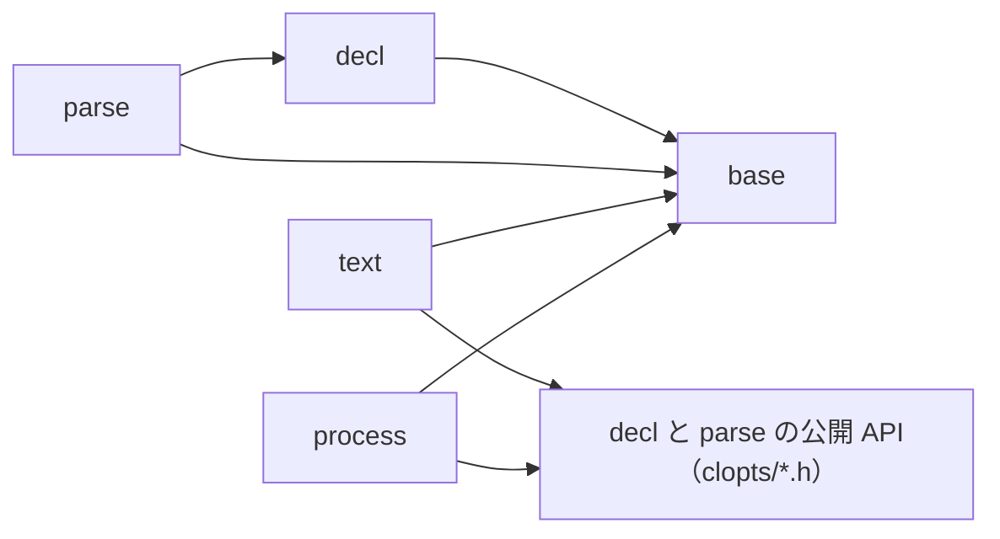

# TODO: モジュール構成・公開ヘッダ・名前の整理

この文書は、`src/` と `include/clopts/` を目標の構成に直す作業の一覧である。機能（宣言、解析、文面、UTF-8 の argv と環境変数、アロケーターの差し替え）は変えない。互換は保たない（`AGENTS.md`）。

作業がすべて終わったら、この文書を消す。

## 1. 規則

### 1.1 名前

1. 名前は概念に付ける。モジュール（`src/` のディレクトリ）の名前は、関数や型の名前に入れない。
2. 内部の関数と型は、宣言するヘッダの名前を接頭辞にする。`src/<モジュール>/x.h` で宣言するものは `clopts_x` か `clopts_x_*` と名付け、同じディレクトリの `x.c` で定義する。OS ごとの実装は `x_win32.c` と `x_posix.c` に置く。
3. `<module>_internal.h` は置かない。内部ヘッダは概念ごとに 1 つである。
4. 公開の型 `clopts_x_t` と、その関数 `clopts_x_<動詞>` は、`include/clopts/x.h` で宣言し、`src/` の `x.c` で定義する。
5. 公開の動詞の関数（`clopts_parse`、`clopts_write_*`、`clopts_set_allocator`）は、動詞か対象の名前のヘッダで宣言する。定義する場所は 2.2 の表に書く。
6. 公開か内部かは、宣言するヘッダの場所（`include/clopts/` か `src/`）と `abi/clopts.symbols` で決まる。名前では区別しない。同じ概念なら、公開の関数と内部の関数が同じ接頭辞を持ってよい（公開の `clopts_argv_create` と内部の `clopts_argv_sentinel`）。
7. `static` 関数には `clopts_` も概念の名前も付けなくてよい。
8. 名前がぶつかったら、接頭辞を足して避けない。概念の分け方を見直す。

### 1.2 依存

モジュールは依存の向きを表す。名前空間ではない。

- 中心は base、decl、parse である。OS も出力先も知らない。
- 外側は text と process である。中心には公開ヘッダだけで触る。text は宣言と結果を読んで文面にし、process は OS から入力を得て `clopts_parse_with_env` に渡す。



| モジュール | include してよいもの |
|------------|----------------------|
| base | `clopts/export.h` と `clopts/allocator.h` だけ |
| decl | base、公開ヘッダ |
| parse | decl、base、公開ヘッダ |
| text | base、公開ヘッダ |
| process | base、公開ヘッダ |

- `<windows.h>` を include できるのは `src/process/*_win32.c` だけである。
- 環境変数を読む関数（`getenv` など）を呼べるのは process だけである。
- ファイルごとの例外（今の `parser/parse.c:process`）は置かない。

## 2. 目標の構成

### 2.1 src

`x.c` と書いた行は、ほかのファイルから使うものがあれば `x.h` を伴う。★は新しく作るファイルである。

```
src/
  base/                  ドメインを知らない部品（今の core）
    mem.c                アロケーターの窓口。clopts_set_allocator もここ（今の alloc.c）
    size.c               桁あふれを検査するサイズの計算
    vec.c                可変長配列
    utf8.c             ★ UTF-8 の並びの読み取り（妥当性の検査、コードポイントの数）
  decl/                  宣言モデル
    name.c               名前の規則（今の names.c の前半）
    option.c
    positional.c
    scope.c              Scope。並び、Scope の中の名前の照合、重なりの検査、隠す判定、読み取り
    command.c
    program.c
    lookup.c           ★ 書かれた名前がどのオプションを指すか（選ばれたコマンド、プログラムの順）
    decl_error.c         今の error.c
  parse/                 解析（今の parser）。OS に触らない
    token.c            ★ argv の 1 要素の分類
    matches.c          ★ 解析が記録するもの（今の result.c の前半）
    usage_error.c      ★ 使い方エラー（今の clopts_parser_error_t）
    scan.c               トークンを宣言に照らして matches に記録する
    resolve.c            環境変数と既定値
    require.c          ★ 必須の検査（今は parse.c の中）
    result.c             完成した結果。一度だけ作り、以後は読むだけ
    parse.c              手順と clopts_parse_with_env
  text/                  文面。公開 API だけで宣言と結果を読む
    out.c                出力先（書き込みと計測の 2 つのモード）
    help.c               ヘルプと Usage 行（今の layout.c）
    message.c            版、使い方のヒント、エラーの 1 行
  process/               OS から argv と環境変数を UTF-8 で得る
    argv.c               argv のハンドル
    argv_posix.c         そのまま渡す
    argv_win32.c         コマンドラインを分割して UTF-8 にする
    cmdline.c            コマンドラインの分割（純粋。今の split.c）
    environ.c            プロセスの環境変数の参照と、clopts_parse
    environ_posix.c
    environ_win32.c
    utf16_win32.c      ★ UTF-16 から UTF-8 への変換（utf16.h に符号単位の型）
```

- プロセスの環境変数は `environ` と呼ぶ。公開の `env`（参照元のインターフェース、`clopts/env.h`）とは別の概念なので、別の名前にする。
- `tests/` は `src/` と同じディレクトリ名にする（`tests/base/`、`tests/parse/`）。

### 2.2 include

```
include/clopts/
  clopts.h          全部入り
  export.h          CLOPTS_API
  types.h           不透明な型の前方宣言（今の decl_types.h）
  allocator.h       clopts_allocator_t、clopts_set_allocator（今の alloc.h）
  decl.h            宣言の全部入りと、宣言に共通の規則の説明
  decl_error.h
  program.h
  command.h
  option.h
  positional.h
  scope.h         ★ Scope の読み取り
  env.h             環境変数の参照元のインターフェース
  parse.h           clopts_parse、clopts_parse_with_env
  result.h        ★ clopts_parse_status_t、clopts_source_t、clopts_result_*
  usage_error.h   ★ clopts_usage_error_kind_t、clopts_usage_error_get_*
  write.h           書き込みのコールバックと clopts_write_*（今の text.h と writer.h）
  argv.h
```

| 公開ヘッダ | 定義するファイル |
|------------|------------------|
| `allocator.h` | `base/mem.c` |
| `decl_error.h`、`program.h`、`command.h`、`option.h`、`positional.h`、`scope.h` | `decl/` の同じ名前の `.c` |
| `parse.h` | `clopts_parse_with_env` は `parse/parse.c`、`clopts_parse` は `process/environ.c` |
| `result.h`、`usage_error.h` | `parse/` の同じ名前の `.c` |
| `write.h` | `text/help.c`（`clopts_write_help`、`clopts_write_usage`）、`text/message.c`（残り） |
| `argv.h` | `process/argv.c`、`argv_posix.c`、`argv_win32.c` |

- `types.h` は、`clopts_program_t`、`clopts_command_t`、`clopts_option_t`、`clopts_positional_t`、`clopts_scope_t`、`clopts_result_t`、`clopts_usage_error_t` を前方宣言する。今の `decl_types.h` は、宣言の型ではない `clopts_result_t` も持っている。
- `parse.h` は `env.h`、`result.h`、`usage_error.h` を include する。解析して結果を読むには `parse.h` だけで足りる。
- どのヘッダも単独で include できる（`abi.headers_c`、`abi.headers_cxx`）。

### 2.3 公開 API の変更

| 変更 | 今 | 目標 |
|------|----|------|
| A. Scope の読み取り | `clopts_program_get_option_count` / `_at`、`clopts_program_get_positional_count` / `_at`、コマンドの同じ 4 つ | `clopts_program_get_scope`、`clopts_command_get_scope`、`clopts_scope_get_option_count` / `_at`、`clopts_scope_get_positional_count` / `_at` |
| A. 隠す判定 | なし（text が公開 API で規則を書き直している） | `clopts_scope_shadows_option(scope, option)` |
| B. 使い方エラーの型 | 列挙 `clopts_usage_error_t`、列挙子 `CLOPTS_USAGE_*` | 不透明な型 `clopts_usage_error_t`、列挙 `clopts_usage_error_kind_t`、列挙子 `CLOPTS_USAGE_ERROR_*` |
| B. 使い方エラーの読み取り | `clopts_result_get_usage_error` が種類を返す。`clopts_result_get_error_command` など 7 つ | `clopts_result_get_usage_error` が `const clopts_usage_error_t *` を返す。`clopts_usage_error_get_kind`、`_get_command`、`_get_option`、`_get_positional`、`_get_token`、`_get_argv_index`、`_get_name_len`、`_get_short_name` |
| C. `clopts_parse_with_env` の `getenv_fn` が NULL | プロセスの環境を読む | 環境変数を読まない |
| D. ヘッダの名前 | `decl_types.h`、`alloc.h`、`text.h` と `writer.h`、`parse.h` | `types.h`、`allocator.h`、`write.h`、`parse.h` と `result.h` と `usage_error.h` |

- A では、足す関数（`clopts_program_add_option`、`clopts_command_add_positional` など）は変えない。足すときの規則は持ち主ごとに違い（`MIXED_LAYOUT`、所有権の移動）、読むときはどちらも同じだからである。
- B の `clopts_usage_error_get_*` は、NULL を「エラーなし」として読む（`NONE`、NULL、-1、0、`'\0'` を返す）。

## 3. 判断が要る点

2.3 の A から D は公開 API を変える。どれも推奨するが、採らない場合は該当する作業（4 章で印を付けてある）を外す。

| 点 | 推奨 | 理由 | 採らない場合 |
|----|------|------|--------------|
| A. Scope を読み取り専用で公開する | する | 今は同じデータに読み取りの経路が 2 本ある（公開の `clopts_program_get_option_at` と、内部の `clopts_scope_option_at`）。text は 2 つの持ち主を同じに扱うための `text_scope_t` を自前で持っている。公開関数は 8 個減り 7 個増える | 公開の読み取り関数は今のまま。`clopts_command_shadows_option(command, option)` だけを足す |
| B. 使い方エラーを型にする | する | `clopts_result_get_error_*` の `error_` は、名前のない概念が接頭辞になったものである。内部にはすでに構造体がある | 内部の構造体の改名（`clopts_parser_error_t` を `clopts_usage_error_t` に）だけを行い、公開の列挙は `clopts_usage_error_kind_t` に変えない |
| C. NULL の `getenv_fn` は環境変数を読まない | する | parse から process への依存がなくなり、ファイルごとの例外規則が消える | `parse/parse.c` が process を include する例外を残す |
| D. ヘッダの改名と統合 | する | 接頭辞からヘッダが決まる（`clopts_write_*` は `write.h`、`clopts_result_*` は `result.h`） | 今の名前のまま、`parse.h` の分割だけを行う |

## 4. 作業

### 共通の完了条件

フェーズごとに、次のすべてを満たしてからコミットする。

- 静的と共有の両方でビルドでき、`ctest` がすべて通る。
- 公開関数を足すか消すかしたら、同じコミットで `abi/clopts.symbols` と `docs/api.md` を直す（`abi.symbols`、`docs.api_coverage`）。
- モジュールやファイルを動かしたら、同じコミットで `tests/structure/check_structure.cmake` の規則と `tests/structure/fixtures/` を直す。
- `docs/dev/architecture.md` のうち、そのフェーズで変わった部分を直す。

### フェーズ 1: base

振る舞いは変えない。

- [ ] `src/core/` を `src/base/` に、`alloc.c` を `mem.c` に改名する。
- [ ] `core_internal.h` を `mem.h`、`size.h`、`vec.h` に分ける。
- [ ] 関数と型を改名する。`clopts_core_vec_*` は `clopts_vec_*`、`clopts_core_size_*` は `clopts_size_*`、`clopts_core_malloc` などの確保と文字列の複製は `clopts_mem_*` にする。
- [ ] `base/utf8.c` を作る。`decl/names.c` の `decl_valid_utf8` と `text/out.c` の `text_utf8_sequence` は同じ規則（最短形、サロゲート、U+10FFFF の上限）を 2 回書いているので、1 つの読み取りにまとめる。`clopts_text_width` は `clopts_utf8_*` の関数にする。
- [ ] `tests/core/` を `tests/base/` に改名し、`test_utf8.c` を足す（`tests/text/test_out.c` の幅のテストを移す）。
- [ ] テストのラベル `core` を `base` にする（`.github/workflows/ci.yml` の「Test (label core)」）。
- [ ] `tests/integration/fixtures/internal_symbol/main.c` と `tests/integration/CMakeLists.txt` の `clopts_core_size_mul` を新しい名前にする。

### フェーズ 2: decl

- [ ] `decl_internal.h` をなくし、`scope.h`、`name.h`、`lookup.h` に分ける。
- [ ] `names.c` を `name.c` に改名し、名前の規則だけを残す（`clopts_decl_valid_*_name` は `clopts_name_valid_*`）。
- [ ] `error.c` を `decl_error.c` に改名する。
- [ ] Scope の中の名前の照合を `scope.c` に集める。完全一致、次に否定できる FLAG の `--no-<name>`、短い名前の 3 つである。今は `names.c` の後半、`scope.c` の `scope_has_negatable` と `scope_has_negation_name`、`parser/scan.c` の `lookup_long_in` に分かれている。
- [ ] `lookup.c` を作る。`parser/scan.c` の `lookup_long`、`lookup_short`、`clopts_parser_ref_t` を移し、`clopts_lookup_long`、`clopts_lookup_short`、`clopts_lookup_t` にする。
- [ ] （A）`include/clopts/scope.h` を作り、Scope の読み取りを公開する。内部の `clopts_scope_option_count` などと `clopts_program_scope` / `clopts_command_scope` は、公開の関数に置き換える。プログラムとコマンドの読み取り関数 8 つを消す。
- [ ] （A）`clopts_scope_shadows_option` を足す。`text/layout.c` の `text_long_taken`、`text_short_taken`、`text_negation_taken`、`text_shadowed` をこれに置き換える。
- [ ] （A）`text/layout.c` の `text_scope_t` と `text_option_count` などの 4 つを消し、`const clopts_scope_t *` を渡す。
- [ ] （A）`tests/decl/`、`tests/parser/`、`examples/`、`README.md`、`docs/` の読み取り関数の呼び出しを直す。

### フェーズ 3: parse

- [ ] `src/parser/` を `src/parse/` に、`tests/parser/` を `tests/parse/` に改名する（ラベルも）。
- [ ] `usage_error.c` を作る。`clopts_parser_error_t` を `clopts_usage_error_t` にし、構造体を `parse/usage_error.h` に置く。
- [ ] （B）`include/clopts/usage_error.h` を作り、2.3 の B のとおりに公開 API を変える。`text/message.c` は結果ではなく `const clopts_usage_error_t *` を読む。
- [ ] `matches.c` を作る。選ばれたコマンド、オプションごとの値と出所、位置引数を持つ。`result.c` の `clopts_parser_result_select`、`clopts_parser_result_slot`、`clopts_parser_slot_*`、`clopts_parser_result_add_positional`、`clopts_parser_result_get_slots`、`clopts_parser_result_find_slot`、`clopts_parser_result_get_positional_count` を `clopts_matches_*` に移す。スロットの構造体は `matches.c` の中だけに置く。
- [ ] `result.c` を、一度だけ作って以後は書かない形にする。`clopts_result_create` が状態、終端オプション、使い方エラー、matches を受け取る。`clopts_parser_result_set_error`、`_set_terminal`、`_finish` を消す。値のアクセサは、状態を確かめてから matches を読む。
- [ ] メモリ不足と `CLOPTS_ENV_FAILED` は、matches を解放して共有の番兵を返す。`CLOPTS_PARSE_OUT_OF_MEMORY` の結果はつねに番兵になる。
- [ ] `token.c` を作る。argv の 1 要素を、`--`、`--name[=value]`、`-abc`、ただの語に分類する。宣言を知らない。`scan.c` の `main_token`、`prelude_token`、`recover_terminal`、`scan_long_option` が同じ分類を別々に書いているので、置き換える。
- [ ] `require.c` を作り、`parse.c` の必須の検査（`clopts_parser_check_required`）を移す。
- [ ] `scan.c`、`resolve.c`、`require.c` の入口を `clopts_scan`、`clopts_resolve`、`clopts_require` にし、ヘッダを 1 つずつ持たせる。`parser_internal.h` を消す。
- [ ] （C）`clopts_parse_with_env` は、`getenv_fn` が NULL なら環境変数を読まない。`clopts_parse` を `process/environ.c` に移し、公開の `clopts_parse_with_env` を呼ぶ形にする。
- [ ] （C）`tests/structure/check_structure.cmake` の `_file_rules`（`parser/parse.c:process`）と、`fixtures/bad/scan_reads_process` を直す。
- [ ] `tests/parse/` を新しい内部 API に書き直す。結果を手で組み立てているテストは、matches を組み立てて `clopts_result_create` に渡す。
- [ ] `include/clopts/result.h` を作り、`parse.h` から `clopts_parse_status_t`、`clopts_source_t`、`clopts_result_*` を移す。

### フェーズ 4: text

- [ ] `text_internal.h` をなくし、`out.h` と、必要なら `help.h`、`message.h` に分ける。
- [ ] `layout.c` を `help.c` に改名する。`clopts_text_out_*` は `clopts_out_*`、`clopts_text_usage_text` は `clopts_message_usage_text` にする。
- [ ] 固定行の経路を消す。`clopts_text_write_list` と `clopts_text_row_t`（`text_list_t` の `rows` と `row_count`）は、テストだけが使っている。`tests/text/test_option_row.c` は、オプションを 1 つ持つプログラムを作って `clopts_write_help` で確かめる形に書き直す。
- [ ] text が include できるモジュールを base だけにする（今の規則 `text:core` と同じ内容を、新しい名前で）。

### フェーズ 5: process

- [ ] `process_internal.h` をなくし、`argv.h`、`cmdline.h`、`environ.h`、`utf16.h` に分ける。
- [ ] `split.c` を `cmdline.c` に改名する（`clopts_process_split` は `clopts_cmdline_split`）。
- [ ] `env.c` を `environ.c` に改名する（`clopts_process_env_*` は `clopts_environ_*`、`clopts_process_env_ctx_t` は `clopts_environ_t`）。
- [ ] `clopts_process_argv_*` を `clopts_argv_*` にする。
- [ ] `win32.c` と `posix.c` を概念ごとに分ける（`argv_win32.c`、`argv_posix.c`、`environ_win32.c`、`environ_posix.c`）。
- [ ] `utf16_win32.c` を作る。`win32.c` の `process_win32_length` と `process_win32_measure`、argv と環境変数の両方にある `WideCharToMultiByte` の呼び出しをまとめる。`clopts_process_u16_t` は `utf16.h` の型にする。
- [ ] OS の境界の検査を、「`<windows.h>` は `process/*_win32.c` だけ」に狭める。
- [ ] `tests/process/` のファイル名と呼び出しを直す（`test_env.c` は `test_environ.c`）。

### フェーズ 6: 公開ヘッダ

フェーズ 2 と 3 で作った `scope.h`、`usage_error.h`、`result.h` のほかを直す。

- [ ] （D）`decl_types.h` を `types.h` にする。前方宣言だけを残し、宣言に共通の規則の説明は `decl.h` に移す。`clopts_decl_error_t` が要るヘッダは `decl_error.h` を自分で include する。
- [ ] （D）`text.h` と `writer.h` を `write.h` にまとめる。
- [ ] （D）`alloc.h` を `allocator.h` に改名する。
- [ ] `clopts.h` の include を直す。
- [ ] `abi/clopts.symbols` の `# clopts/<header>.h` の組を、新しいヘッダに合わせて並べ直す。
- [ ] ヘッダの説明の中の、ほかのヘッダへの参照（`(clopts/parse.h)` など）を直す。

### フェーズ 7: 検査と文書

- [ ] 名前の検査 `structure.names` を足す。`src/<モジュール>/x.h` で宣言する関数の名前が `clopts_x` で始まること、`*_internal.h` がないことを確かめる。
- [ ] `docs/dev/architecture.md` を書き直す。モジュールの表、依存の図、1 章の規則、構造体の置き場所の表、解析の流れ（token、scan、resolve、require、result）を今の構成に合わせる。
- [ ] `docs/api.md` を直す。「関数名の付け方」の表、Scope、使い方エラー、ヘッダの名前、`clopts_parse_with_env` の NULL の意味。
- [ ] `docs/parsing.md`、`docs/windows.md`、`README.md` の関数名とヘッダ名を直す（`docs.sources`、`docs.outputs` で照合される）。
- [ ] `docs/dev/abi-checks.md` の内部ヘッダの案内（`src/<module>/<module>_internal.h`）を直す。
- [ ] `CHANGELOG.md` の `## [Unreleased]` の記述を、新しい API とヘッダの名前に直す。まだリリースしていないので、`### 互換性のない変更` には書かない。
- [ ] `examples/taskbook` と `examples/textcount` を新しい API に直す。
- [ ] `cmake/CloptsModules.cmake` と `.github/workflows/ci.yml` のコメントにあるモジュール名を直す。
- [ ] この文書を消す。

## 5. 見送ったもの

| 案 | 見送った理由 |
|----|--------------|
| Scope に足す操作も公開する（`clopts_scope_add_option`） | 組み立て用（非 const）と読み取り用（const）で Scope の取得関数が 2 つ要る。`MIXED_LAYOUT` のような持ち主ごとの規則を Scope が知ることになる |
| プログラム自身の範囲を Command で表す、コマンドを入れ子にする | `docs/dev/architecture.md` の「設計の判断」のとおり。深さ 1 の仕様では、root は Command の一種ではない |
| `src/` を平置きにする | この規模（約 30 ファイル）なら可能だが、依存の向きを機械的に検査するためにディレクトリを使う |
| 層をまたぐ関数を置く `src/clopts.c` | process を「公開 API の上に書く外側のモジュール」にすれば要らない。text と同じ扱いになる |
| 名前からオプションを引く汎用の公開関数 | `--no-<name>` の形の名前を、確保なしでは渡せない。text に要るのは隠す判定だけである |
| `win32.c` / `posix.c` を OS ごとの 1 ファイルのままにする | 「接頭辞からファイルが決まる」規則の例外になる。`clopts_argv_create` の定義が名前から引けない |
| `decl`、`text`、`process` の改名 | 今の名前で役割を表せている |

## 6. 参考にした設計

| ライブラリ | 取り入れた点 |
|------------|--------------|
| Lua | 概念ごとに `.c`、`.h`、接頭辞を 1 組にする（`ltable.c`、`ltable.h`、`luaH_`）。補助ライブラリ `lauxlib` は公開 API だけで書く（text と process） |
| clap（Rust） | builder、parser、output の分け方。字句の読み取りを別の部品にする（`clap_lex`、ここでは `token`）。解析が記録する `ArgMatches` と、それを包む解析の結果を分ける（`matches` と `result`） |
| glibc argp | 解析、ヘルプ、整形つきの出力先（`argp-fmtstream`、ここでは `out`）を分ける |
| SQLite | 中心は OS を知らず、OS との接続を端に置く |
