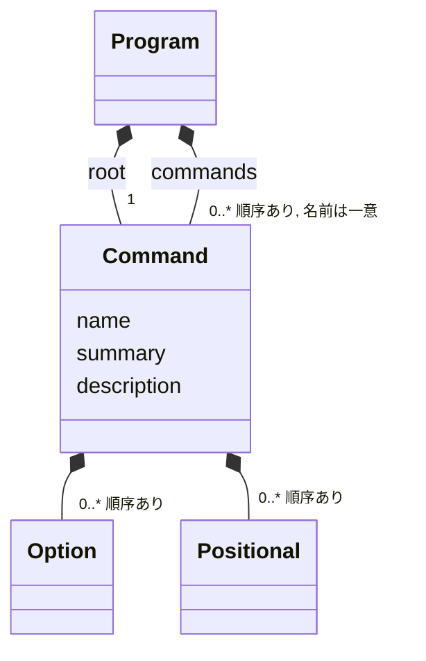
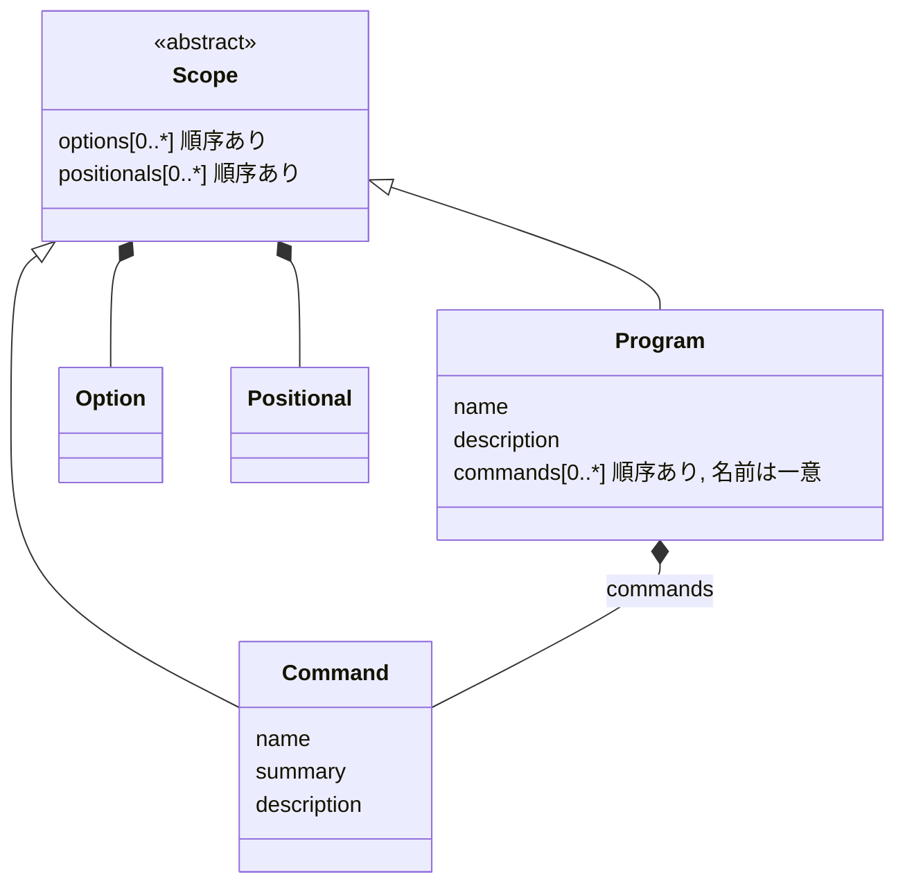

# TODO

## Program と Command を Scope ベースに分ける（A 案）

### 動機

今の概念モデルでは、root も Command で表している。



ここから次の歪みが出ている。

1. root は「Command の一種」ではなく「Program 自身の範囲」である。同じ型に役割の違う 2 つを詰めているので、例外が生まれる。root の name はプログラム名、description はプログラムの説明になり、summary は使われない。位置引数はサブコマンドがないときだけ持てる（`MIXED_LAYOUT`）。
2. Program 自体の中身がほとんどない。持っているのは root へのポインタとサブコマンドの配列だけで、「root を包んで凍結するための箱」になっている。
3. パーサーが実際に扱っているのは「オプションと位置引数を持つ範囲（スコープ）」の 2 段の入れ子だが、この概念がコードに名前を持っていない。子が親を知らないので、(program, command) の組を毎回渡している（`clopts_parser_find_long(program, command, ...)`、`decl_lookup` の `command != root` の判定）。

### 目標の概念モデル



- Program がプログラム自身の範囲になる。名前・説明・グローバルオプション・（サブコマンドがないときの）位置引数を直接持つ。
- Command はサブコマンド専用になる。summary はいつも意味を持つ。
- Scope は内部だけの概念で、公開 API には出さない。オプションと位置引数を持つことと、それに関わる検査（名前の重なり、否定形との衝突、位置引数の順序）をまとめた部品にする。

### 公開 API の変化

| 今 | A 案 |
|---|---|
| `clopts_command_create("tool", &root)` → root を埋める → `clopts_program_create(root, cmds, n, &p)` | `clopts_program_create("tool", &p)` → `clopts_program_add_option` / `add_positional` / `add_command` |
| `clopts_command_set_description(root, …)` | `clopts_program_set_description(p, …)` |
| `clopts_program_root(p)` + `clopts_command_option_at(root, i)` | `clopts_program_option_count/at`、`clopts_program_positional_count/at`、`clopts_program_name`、`clopts_program_description` |
| `clopts_program_command_count/at/find_command` | そのまま |
| `clopts_write_help(p, command)`：command が NULL か root ならプログラムのヘルプ | NULL ならプログラムのヘルプ（「root」という値がなくなる） |
| `clopts_help_add_help_option(command, &out)`：作って渡す | `clopts_help_option_create(&out)` は作るだけ。渡す先（program か command か）は呼び出し側が決める。version も同じ |
| `clopts_result_command` / `error_command`：NULL ならルート | 変わらない（NULL ならプログラムの範囲） |

使う側のコードは次のようになる。

```c
clopts_program_t *p;
clopts_command_t *add;
clopts_option_t *help;

CHECK(clopts_program_create("taskbook", &p));
CHECK(clopts_program_set_description(p, "Manage tasks."));
CHECK(clopts_help_option_create(&help));
CHECK(clopts_program_add_option(p, help));   /* グローバルオプション */

CHECK(clopts_command_create("add", &add));
CHECK(clopts_command_set_summary(add, "Add a task."));
/* add にオプションと位置引数を足す */
CHECK(clopts_program_add_command(p, add));   /* 成功したら p が add を持つ */
```

### 制約をどこで検査するか

今の方針（「検査はその関係を作る関数が行い、失敗したら何も変えない」）をそのまま当てはめる。

| 検査 | 今 | A 案 |
|---|---|---|
| サブコマンドの名前の重なり | `program_create` でまとめて | `program_add_command` |
| `MIXED_LAYOUT` | `program_create` でまとめて | `program_add_command`（位置引数が既にあるとき）と `program_add_positional`（サブコマンドが既にあるとき） |
| オプションの名前の重なり・否定形との衝突・位置引数の順序 | `command_add_*` | Scope の共通処理（program と command の両方から使う） |

### 内部の構造

```c
/* parser/scope.c（新規）。command.c にある配列と検査をここに移す */
typedef struct clopts_scope {
    clopts_option_t **options;         size_t option_count, option_cap;
    clopts_positional_t **positionals; size_t positional_count, positional_cap;
} clopts_scope_t;

clopts_error_t clopts_scope_add_option(clopts_scope_t *, clopts_option_t *);
clopts_error_t clopts_scope_add_positional(clopts_scope_t *, clopts_positional_t *);
void clopts_scope_release(clopts_scope_t *);

/* program.c / command.c はこれを埋め込み、内部用のアクセサで渡す */
const clopts_scope_t *clopts_program_scope(const clopts_program_t *);
const clopts_scope_t *clopts_command_scope(const clopts_command_t *);
```

- パーサーの引数を、(program, command) の組から (グローバルの scope, 選ばれた scope) の組に変える。`decl_lookup` の `command != root` の判定も、`resolve_scope` や `alloc_slots` に root を渡しているところも、scope を受け取る形にそろえる。
- 公開の `clopts_command_option_at` などは、scope の読み取りに処理を任せるだけの薄い関数にする。

### 未決事項

- [ ] **プログラムの凍結の時点。** 今は「1 回の呼び出しで作り、その後は変わらない」ので、凍結の時点がはっきりしている。A 案では Program が組み立て途中にも存在するので、どこで凍結するかを決める必要がある。
  - (a) 契約にする（推奨）。最初の `clopts_parse` / `clopts_write_*` より後でビルダー関数を呼ぶのは契約違反とし、検出はしない。今の「渡した後のハンドルは読み取り専用」と同じ扱い。複数スレッドからの同時解析も、この契約の下で今まで通り安全になる。
  - (b) `clopts_program_seal(p)` で明示的に凍結する。凍結の後のビルダー呼び出しは assert で検出できる。ただし呼ぶべき関数が 1 つ増え、seal 前に解析したときの扱いも決める必要がある。
- [ ] **help のオプションを「作るだけ」に変えてよいか。** `clopts_help_add_help_option` / `clopts_help_add_version_option` を `clopts_help_option_create` / `clopts_help_version_option_create` にする。

### 進め方

1. [ ] **scope の切り出し（公開 API は変えない）。** command.c の配列と検査を scope.c に移す。テストはそのまま通るはず。
2. [ ] **パーサーとヘルプを scope ベースにする。** まだ root の Command の scope を使う。この時点でも公開 API は変えない。
3. [ ] **公開 API の切り替え。** Program が自分の scope と name/description を持つようにし、`clopts_program_create(name)` と `clopts_program_add_*` を足し、`clopts_program_root` を削除する。help のオプションは作るだけにする。テスト・examples・docs・`abi/clopts.symbols`・CHANGELOG も、このコミットでまとめて直す。
4. [ ] **残った「root」という言葉を整理する。** コメント、エラーメッセージ、ヘルプの内部名が対象。

1 と 2 はそれだけでも価値がある（公開 API を変えずに内部を整える）ので、先に入れておけば、3 をやめることになっても無駄にならない。

### 影響範囲

- `clopts_program_create` / `make_program` / `test_decl_finish` を使っている箇所：tests に約 90 か所、docs/api.md に 19 か所、examples（taskbook、textcount）、README、`docs/windows.md`、`tests/docs/readme_minimal.c`、`tests/integration/fixtures/consumer/main.c`。
- examples と README のコードは docs ラベルのテストで照合しているので、同じ変更でそろえる必要がある。
- `abi/clopts.symbols`、`docs/dev/abi-checks.md`、`tests/abi/fixtures/exports/*` の関数名。
- CHANGELOG は全部 Unreleased なので、「追加」の記述を書き直すだけでよい。
