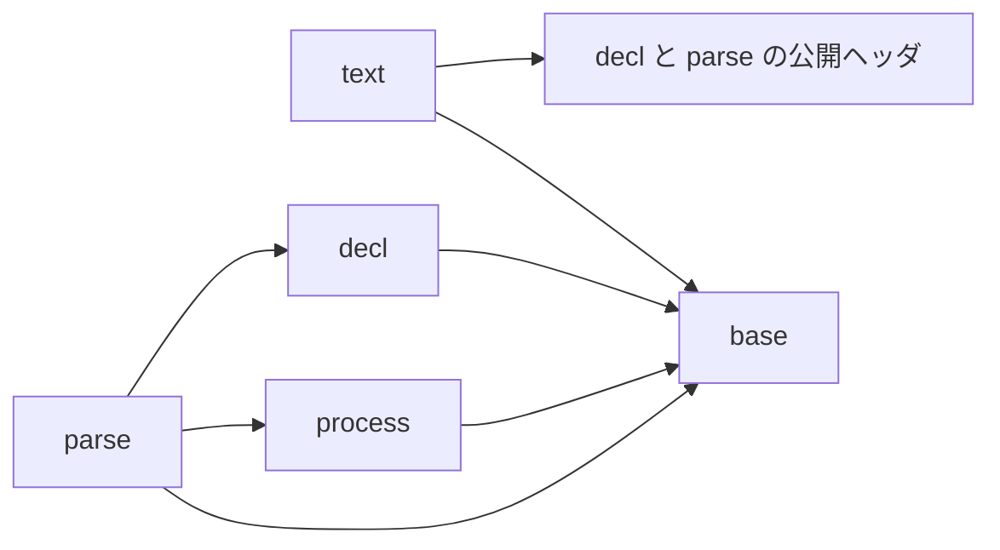

# TODO: モジュール構成・公開ヘッダ・名前の整理

この文書は、`src/`、`include/clopts/`、`tests/` を目標の構成に直す作業の一覧である。機能（宣言、解析、文面、UTF-8 の argv と環境変数、アロケーターの差し替え）は変えない。互換は保たない（`AGENTS.md`）。

規則とその理由は `docs/dev/design.md`（設計の考え方）にある。この文書には、目標の構成と作業だけを書く。

作業がすべて終わったら、この文書を消す。

## 1. 目標の構成

### 1.1 モジュールと依存

| モジュール | 役割 | 内部ヘッダまで include できる | 公開ヘッダだけ include できる |
|------------|------|------------------------------|------------------------------|
| base | ドメインを知らない部品（今の core） | なし | なし |
| process | OS から argv と環境変数を UTF-8 で得る | base | なし |
| decl | 宣言モデル | base | なし |
| parse | 解析（今の parser） | base、process、decl | なし |
| text | 文面 | base | decl、parse |

- どのモジュールも、自分の内部ヘッダと公開ヘッダを include できる。
- 公開ヘッダどうしの include も、同じ表に従う（`clopts/parse/*.h` は `clopts/decl/*.h` を include できるが、逆はできない）。
- `<windows.h>` を include できるのは `src/process/*_win32.c` だけである。
- 環境変数を読む関数（`getenv` など）を呼べるのは process だけである。
- ファイルごとの規則（今の `parser/parse.c:process`）はなくす。parse は process を include できる。走査と解決が参照のコールバックだけを見ることは、関数の引数で保つ。

### 1.2 src と include

`src/<モジュール>/x.c` と `include/clopts/<モジュール>/x.h` を対応させる。公開ヘッダが宣言する関数は、同じ行の `.c` が定義する。`.c` は、ほかのファイルから使うものがあれば、内部ヘッダ `src/<モジュール>/x.h` を伴う。★は新しく作るファイルである。

モジュールに属さない公開ヘッダは、全部入りの `clopts/clopts.h` だけである。

**base**

| `src/base/` | `include/clopts/base/` | 中身 |
|-------------|------------------------|------|
| `allocator.c` ★ | `allocator.h` | 使うアロケーター。`clopts_allocator_t`、`clopts_set_allocator`（今の `alloc.c` の前半と `alloc.h`） |
| `mem.c` | | アロケーターを通した確保、解放、文字列の複製（今の `alloc.c` の後半） |
| `size.c` | | 桁あふれを検査するサイズの計算 |
| `vec.c` | | 可変長配列 |
| `utf8.c` ★ | | UTF-8 の並びの読み取り（妥当性の検査、コードポイントの数） |
| | `export.h` | `CLOPTS_API`。マクロだけで関数を宣言しないので、`.c` はない |

**process**

| `src/process/` | `include/clopts/process/` | 中身 |
|----------------|---------------------------|------|
| `argv.c`、`argv_posix.c`、`argv_win32.c` | `argv.h` | argv のハンドル。POSIX はそのまま渡し、Windows はコマンドラインを分割して UTF-8 にする |
| `env.c`、`env_posix.c`、`env_win32.c` | `env.h` | 環境変数の参照。公開するのは参照元のインターフェース（`clopts_getenv_fn`、`clopts_env_status_t`）で、プロセスの環境変数を読む実装は内部にある |
| `cmdline.c` | | コマンドラインの分割（OS に触らない。今の `split.c`） |
| `utf16_win32.c` ★ | | UTF-16 から UTF-8 への変換（内部ヘッダ `utf16.h` に符号単位の型） |

**decl**

| `src/decl/` | `include/clopts/decl/` | 中身 |
|-------------|------------------------|------|
| `name.c` | | 名前の規則（今の `names.c` の前半） |
| `option.c` | `option.h` | |
| `positional.c` | `positional.h` | |
| `scope.c` | `scope.h` ★ | Scope。並び、Scope の中の名前の照合、重なりの検査、隠す判定。公開するのは読み取りである |
| `command.c` | `command.h` | |
| `program.c` | `program.h` | 宣言に共通の規則の説明（今は `decl_types.h` にある）もここに置く |
| `lookup.c` ★ | | 書かれた名前がどのオプションを指すか（選ばれたコマンド、プログラムの順） |
| `decl_error.c` | `decl_error.h` | 今の `error.c` |

**parse**

| `src/parse/` | `include/clopts/parse/` | 中身 |
|--------------|-------------------------|------|
| `token.c` ★ | | argv の 1 要素の分類 |
| `matches.c` ★ | | 解析が記録するもの（今の `result.c` の前半） |
| `usage_error.c` ★ | `usage_error.h` ★ | 使い方エラー（今の `clopts_parser_error_t`） |
| `scan.c` | | トークンを宣言に照らして matches に記録する |
| `resolve.c` | | 環境変数と既定値 |
| `require.c` ★ | | 必須の検査（今は `parse.c` の中） |
| `result.c` | `result.h` ★ | 完成した結果。一度だけ作り、以後は読むだけ。`clopts_parse_status_t`、`clopts_source_t`、`clopts_result_*` |
| `parse.c` | `parse.h` | 手順。`clopts_parse`、`clopts_parse_with_env` |

**text**

| `src/text/` | `include/clopts/text/` | 中身 |
|-------------|------------------------|------|
| `out.c` | | 出力先（書き込みと計測の 2 つのモード） |
| `help.c` | | ヘルプと Usage 行の組み立て（今の `layout.c`） |
| `message.c` | | 版、使い方のヒント、エラーの 1 行の組み立て |
| `write.c` ★ | `write.h` | 公開の入口 `clopts_write_*`。書き込みのコールバックの型と `clopts_file_write`（今の `text.h` と `writer.h`） |

- 不透明な型は、その型のヘッダが前方宣言する。`decl_types.h` と `decl.h` はなくす。公開ヘッダの include に循環はない（`program.h` → `command.h` → `option.h`、`positional.h`、`scope.h`。`result.h` → `usage_error.h` → 宣言のヘッダ）。
- `clopts/decl/program.h` を include すれば、宣言の API がすべて入る。`clopts/parse/parse.h` を include すれば、解析して結果を読める。
- `tests/` も同じ形にする（`tests/base/test_vec.c`、`tests/parse/test_scan.c`）。

### 1.3 公開 API の変更

| 変更 | 今 | 目標 |
|------|----|------|
| A. Scope の読み取り | `clopts_program_get_option_count` / `_at`、`clopts_program_get_positional_count` / `_at`、コマンドの同じ 4 つ | `clopts_program_get_scope`、`clopts_command_get_scope`、`clopts_scope_get_option_count` / `_at`、`clopts_scope_get_positional_count` / `_at` |
| A. 隠す判定 | なし（text が公開 API で規則を書き直している） | `clopts_scope_shadows_option(scope, option)` |
| B. 使い方エラーの型 | 列挙 `clopts_usage_error_t`、列挙子 `CLOPTS_USAGE_*` | 不透明な型 `clopts_usage_error_t`、列挙 `clopts_usage_error_kind_t`、列挙子 `CLOPTS_USAGE_ERROR_*` |
| B. 使い方エラーの読み取り | `clopts_result_get_usage_error` が種類を返す。`clopts_result_get_error_command` など 7 つ | `clopts_result_get_usage_error` が `const clopts_usage_error_t *` を返す。`clopts_usage_error_get_kind`、`_get_command`、`_get_option`、`_get_positional`、`_get_token`、`_get_argv_index`、`_get_name_len`、`_get_short_name` |
| C. ヘッダの場所と名前 | `include/clopts/` に平置き。`export.h`、`decl_types.h`、`decl.h`、`alloc.h`、`text.h`、`writer.h`、`parse.h`、`env.h`、`argv.h` | 1.2 の表のとおり。モジュールごとのディレクトリに置く |

- A では、足す関数（`clopts_program_add_option`、`clopts_command_add_positional` など）は変えない。足すときの規則は持ち主ごとに違い（`MIXED_LAYOUT`、所有権の移動）、読むときはどちらも同じだからである。
- B の `clopts_usage_error_get_*` は、NULL を「エラーなし」として読む（`NONE`、NULL、-1、0、`'\0'` を返す）。
- `clopts_parse` と `clopts_parse_with_env` の引数と意味は変えない。

## 2. 判断が要る点

1.3 の A から C は公開 API を変える。どれも推奨するが、採らない場合は該当する作業（3 章で印を付けてある）を外す。

| 点 | 推奨 | 理由 | 採らない場合 |
|----|------|------|--------------|
| A. Scope を読み取り専用で公開する | する | 今は同じデータに読み取りの経路が 2 本ある（公開の `clopts_program_get_option_at` と、内部の `clopts_scope_option_at`）。text は 2 つの持ち主を同じに扱うための `text_scope_t` を自前で持っている。公開関数は 8 個減り 7 個増える | 公開の読み取り関数は今のまま。`clopts_command_shadows_option(command, option)` だけを足す |
| B. 使い方エラーを型にする | する | `clopts_result_get_error_*` の `error_` は、名前のない概念が接頭辞になったものである。内部にはすでに構造体がある | 内部の構造体の改名（`clopts_parser_error_t` を `clopts_usage_error_t` に）だけを行い、公開の列挙は `clopts_usage_error_kind_t` に変えない |
| C. 公開ヘッダを階層にする | する | `src/` と同じ形になり、公開の関数の宣言と定義が同じパスで引ける。公開ヘッダどうしの依存の向きも検査できる。`clopts/clopts.h` だけを include する利用者には影響しない | なし（階層にしないなら、`docs/dev/design.md` の 3 章を書き直す） |

## 3. 作業

### 共通の完了条件

フェーズごとに、次のすべてを満たしてからコミットする。

- 静的と共有の両方でビルドでき、`ctest` がすべて通る。
- 公開関数を足すか消すかしたら、同じコミットで `abi/clopts.symbols` と `docs/api.md` を直す（`abi.symbols`、`docs.api_coverage`）。
- 公開ヘッダを動かしたら、同じコミットで `clopts/clopts.h`、`abi/clopts.symbols` の `# clopts/<ヘッダ>` の見出し、`tests/`、`examples/`、`README.md`、`docs/` の include と、ヘッダの説明の中のほかのヘッダへの参照を直す。
- モジュールやファイルを動かしたら、同じコミットで `tests/structure/check_structure.cmake` の規則と `tests/structure/fixtures/` を直す。
- `docs/dev/architecture.md` のうち、そのフェーズで変わった部分を直す。

### フェーズ 0: 設計の考え方

- [x] `docs/dev/design.md` を置く。名前、ファイル、依存、公開 API を決めるときの考え方と理由、採らなかった案、参考にした設計を書く。
- [x] `AGENTS.md` と `docs/dev/architecture.md` から案内する。

### フェーズ 1: base

振る舞いは変えない。

- [ ] `src/core/` を `src/base/` に、`tests/core/` を `tests/base/` に改名する。テストのラベル `core` も `base` にする（`.github/workflows/ci.yml` の「Test (label core)」）。
- [ ] `alloc.c` を `allocator.c` と `mem.c` に分ける。`allocator.c` は使うアロケーターを持つ（標準の実装、`clopts_set_allocator`、内部の `clopts_allocator_get`）。`mem.c` は、それを通して確保する関数を持つ。`allocator.c` の内部の関数を呼ぶのは `mem.c` だけである。
- [ ] `core_internal.h` を `allocator.h`、`mem.h`、`size.h`、`vec.h` に分ける。
- [ ] 関数と型を改名する。`clopts_core_vec_*` は `clopts_vec_*`、`clopts_core_size_*` は `clopts_size_*`、`clopts_core_malloc` などの確保と文字列の複製は `clopts_mem_*` にする。
- [ ] `base/utf8.c` を作る。`decl/names.c` の `decl_valid_utf8` と `text/out.c` の `text_utf8_sequence` は同じ規則（最短形、サロゲート、U+10FFFF の上限）を 2 回書いているので、1 つの読み取りにまとめる。`clopts_text_width` は `clopts_utf8_*` の関数にする。`tests/base/test_utf8.c` を足す（`tests/text/test_out.c` の幅のテストを移す）。
- [ ] （C）`include/clopts/alloc.h` を `include/clopts/base/allocator.h` に動かす。
- [ ] （C）`include/clopts/export.h` を `include/clopts/base/export.h` に動かし、公開ヘッダの include を直す。
- [ ] （C）公開ヘッダを列挙する検査を、下のディレクトリまで読むようにする（`tests/abi/check_header_rules.cmake` の `file(GLOB ... "${HEADER_DIR}/*.h")`、`abi.headers_c`、`abi.headers_cxx`）。
- [ ] `tests/integration/fixtures/internal_symbol/main.c` と `tests/integration/CMakeLists.txt` の `clopts_core_size_mul` を新しい名前にする。

### フェーズ 2: process

- [ ] `process_internal.h` をなくし、`argv.h`、`env.h`、`cmdline.h`、`utf16.h` に分ける。
- [ ] `split.c` を `cmdline.c` に改名する（`clopts_process_split` は `clopts_cmdline_split`）。
- [ ] `clopts_process_env_*` を `clopts_env_*` に、`clopts_process_env_ctx_t` を `clopts_env_t` にする。
- [ ] `clopts_process_argv_*` を `clopts_argv_*` にする。
- [ ] `win32.c` と `posix.c` を概念ごとに分ける（`argv_win32.c`、`argv_posix.c`、`env_win32.c`、`env_posix.c`）。
- [ ] `utf16_win32.c` を作る。`win32.c` の `process_win32_length` と `process_win32_measure`、argv と環境変数の両方にある `WideCharToMultiByte` の呼び出しをまとめる。`clopts_process_u16_t` は `utf16.h` の型にする。
- [ ] （C）`include/clopts/argv.h` と `include/clopts/env.h` を `include/clopts/process/` に動かす。
- [ ] OS の境界の検査を、「`<windows.h>` は `process/*_win32.c` だけ」に狭める。
- [ ] `tests/process/` のファイル名と呼び出しを直す（`test_split.c` は `test_cmdline.c`）。

### フェーズ 3: decl

- [ ] `decl_internal.h` をなくし、`scope.h`、`name.h`、`lookup.h` と、構造体を持つ型ごとのヘッダに分ける。
- [ ] `names.c` を `name.c` に改名し、名前の規則だけを残す（`clopts_decl_valid_*_name` は `clopts_name_valid_*`）。
- [ ] `error.c` を `decl_error.c` に改名する。
- [ ] Scope の中の名前の照合を `scope.c` に集める。完全一致、次に否定できる FLAG の `--no-<name>`、短い名前の 3 つである。今は `names.c` の後半、`scope.c` の `scope_has_negatable` と `scope_has_negation_name`、`parser/scan.c` の `lookup_long_in` に分かれている。
- [ ] `lookup.c` を作る。`parser/scan.c` の `lookup_long`、`lookup_short`、`clopts_parser_ref_t` を移し、`clopts_lookup_long`、`clopts_lookup_short`、`clopts_lookup_t` にする。
- [ ] （A）`include/clopts/decl/scope.h` を作り、Scope の読み取りを公開する。内部の `clopts_scope_option_count` などと `clopts_program_scope` / `clopts_command_scope` は、公開の関数に置き換える。プログラムとコマンドの読み取り関数 8 つを消す。
- [ ] （A）`clopts_scope_shadows_option` を足す。`text/layout.c` の `text_long_taken`、`text_short_taken`、`text_negation_taken`、`text_shadowed` をこれに置き換える。
- [ ] （A）`text/layout.c` の `text_scope_t` と `text_option_count` などの 4 つを消し、`const clopts_scope_t *` を渡す。
- [ ] （A）`tests/`、`examples/`、`README.md`、`docs/` の読み取り関数の呼び出しを直す。
- [ ] （C）`command.h`、`decl_error.h`、`option.h`、`positional.h`、`program.h` を `include/clopts/decl/` に動かす。
- [ ] （C）`decl_types.h` と `decl.h` をなくす。型の前方宣言は、その型のヘッダに移す。宣言に共通の規則の説明は `program.h` に移す。`clopts_result_t` の前方宣言は `parse.h` に移す（フェーズ 4 で `result.h` に移る）。`clopts_decl_error_t` が要るヘッダは `decl_error.h` を自分で include する。

### フェーズ 4: parse

- [ ] `src/parser/` を `src/parse/` に、`tests/parser/` を `tests/parse/` に改名する（ラベルも）。
- [ ] `usage_error.c` を作る。`clopts_parser_error_t` を `clopts_usage_error_t` にし、構造体を `parse/usage_error.h` に置く。
- [ ] （B）`include/clopts/parse/usage_error.h` を作り、1.3 の B のとおりに公開 API を変える。`text/message.c` は結果ではなく `const clopts_usage_error_t *` を読む。
- [ ] `matches.c` を作る。選ばれたコマンド、オプションごとの値と出所、位置引数を持つ。`result.c` の `clopts_parser_result_select`、`clopts_parser_result_slot`、`clopts_parser_slot_*`、`clopts_parser_result_add_positional`、`clopts_parser_result_get_slots`、`clopts_parser_result_find_slot`、`clopts_parser_result_get_positional_count` を `clopts_matches_*` に移す。スロットの構造体は `matches.c` の中だけに置く。
- [ ] `result.c` を、一度だけ作って以後は書かない形にする。`clopts_result_create` が状態、終端オプション、使い方エラー、matches を受け取る。`clopts_parser_result_set_error`、`_set_terminal`、`_finish` を消す。値のアクセサは、状態を確かめてから matches を読む。
- [ ] メモリ不足と `CLOPTS_ENV_FAILED` は、matches を解放して共有の番兵を返す。`CLOPTS_PARSE_OUT_OF_MEMORY` の結果はつねに番兵になる。
- [ ] `token.c` を作る。argv の 1 要素を、`--`、`--name[=value]`、`-abc`、ただの語に分類する。宣言を知らない。`scan.c` の `main_token`、`prelude_token`、`recover_terminal`、`scan_long_option` が同じ分類を別々に書いているので、置き換える。
- [ ] `require.c` を作り、`parse.c` の必須の検査（`clopts_parser_check_required`）を移す。
- [ ] `scan.c`、`resolve.c`、`require.c` の入口を `clopts_scan`、`clopts_resolve`、`clopts_require` にし、ヘッダを 1 つずつ持たせる。`parser_internal.h` を消す。
- [ ] `tests/structure/check_structure.cmake` の `_file_rules`（`parser/parse.c:process`）をなくし、parse が process を include できる規則にする。`fixtures/bad/scan_reads_process` を消す。
- [ ] `tests/parse/` を新しい内部 API に書き直す。結果を手で組み立てているテストは、matches を組み立てて `clopts_result_create` に渡す。
- [ ] `include/clopts/parse/result.h` を作り、`parse.h` から `clopts_parse_status_t`、`clopts_source_t`、`clopts_result_*` を移す。
- [ ] （C）`parse.h` を `include/clopts/parse/` に動かす。

### フェーズ 5: text

- [ ] `text_internal.h` をなくし、`out.h`、`help.h`、`message.h` に分ける。
- [ ] `layout.c` を `help.c` に改名する。`clopts_text_out_*` は `clopts_out_*` にする。
- [ ] `write.c` を作り、公開の入口 `clopts_write_*` の 5 つを集める。入口は、引数の契約を確かめ、出力先を用意し、`help.c` か `message.c` の組み立ての関数（`clopts_help_*`、`clopts_message_*`）を呼んで、書き込みの状態を返す。`clopts_text_has_command` は `write.c` の `static` 関数にし、`clopts_text_usage_text` は `clopts_message_usage_text` にする。
- [ ] 固定行の経路を消す。`clopts_text_write_list` と `clopts_text_row_t`（`text_list_t` の `rows` と `row_count`）は、テストだけが使っている。`tests/text/test_option_row.c` は、オプションを 1 つ持つプログラムを作って `clopts_write_help` で確かめる形に書き直す。
- [ ] （C）`text.h` と `writer.h` を `include/clopts/text/write.h` にまとめる。
- [ ] text の規則を 1.1 の表のとおりにする。内部ヘッダは base だけ、公開ヘッダは `clopts/decl/` と `clopts/parse/` を include できる。

### フェーズ 6: 検査と文書

- [ ] 名前の検査 `structure.names` を足す。`src/<モジュール>/x.h` で宣言する関数の名前が `clopts_x` で始まること、`*_internal.h` がないことを確かめる。
- [ ] 対応の検査を足す。`include/clopts/<モジュール>/x.h` に、`src/<モジュール>/x.c` か、関数を宣言しないことが対応すること、公開ヘッダどうしの include が 1.1 の表に従うことを確かめる。
- [ ] `docs/dev/architecture.md` を書き直す。モジュールの表、依存の図、構造体の置き場所の表、解析の流れ（token、scan、resolve、require、result）を今の構成に合わせる。
- [ ] `docs/api.md` を直す。「関数名の付け方」の表、Scope、使い方エラー、ヘッダの場所と名前。
- [ ] `docs/parsing.md`、`docs/windows.md`、`docs/integration.md`、`README.md` の関数名とヘッダ名を直す（`docs.sources`、`docs.outputs` で照合される）。
- [ ] `docs/dev/abi-checks.md` の内部ヘッダの案内（`src/<module>/<module>_internal.h`）を直す。
- [ ] `CHANGELOG.md` の `## [Unreleased]` の記述を、新しい API とヘッダの名前に直す。まだリリースしていないので、`### 互換性のない変更` には書かない。
- [ ] `examples/taskbook` と `examples/textcount` を新しい API に直す。
- [ ] `cmake/CloptsModules.cmake` と `.github/workflows/ci.yml` のコメントにあるモジュール名を直す。
- [ ] `docs/dev/design.md` の冒頭にある、この文書への案内を消す。
- [ ] この文書を消す。
