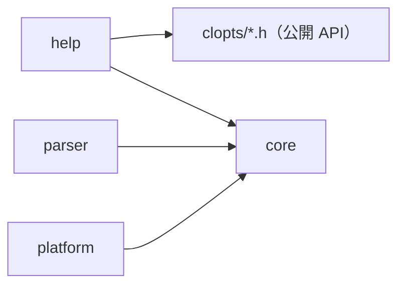
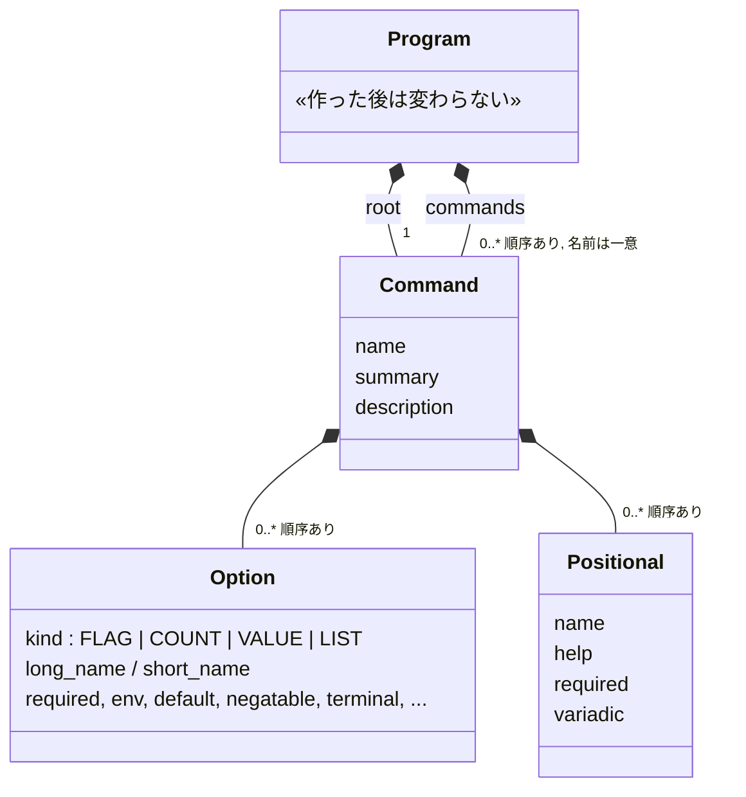
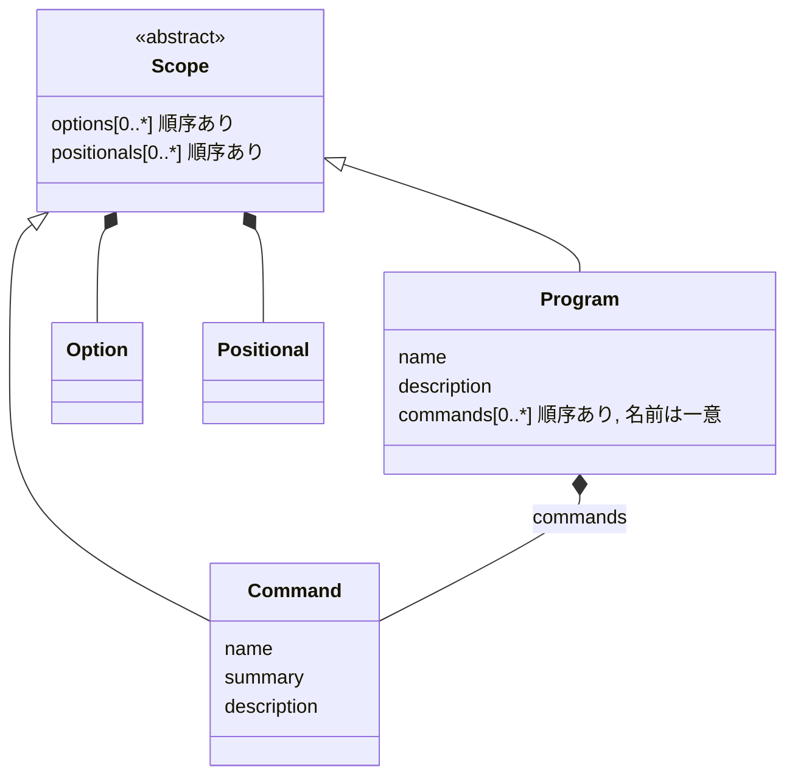

# アーキテクチャ（保守者向け）

この文書は、CLOpts の内部の構成について、モジュールの分け方と依存の向き、宣言モデル（プログラム・コマンド・オプション・位置引数の関係）、解析の流れ、予定している設計の変更を示す。公開 API の使い方は利用者向けの章 `docs/api.md` を参照する。

宣言モデルを変える変更では、同じ変更の中でこの文書も更新する。予定している変更（「[予定している変更](#予定している変更scope-を基底にして-program-と-command-を分ける)」）を実装したら、その節の内容を「[宣言モデル](#宣言モデル)」に移し、予定の節は消す。

## モジュール

| モジュール | ディレクトリ | 役割 |
|------------|--------------|------|
| core | `src/core/` | アロケーターの窓口（ライブラリの確保と解放はすべてここを通る）、サイズの計算、可変長配列、書き込みのコールバック、宣言エラーの説明 |
| parser | `src/parser/` | 宣言のビルダー（プログラム・コマンド・オプション・位置引数）、名前の規則と検索、argv の走査、環境変数と既定値の解決、結果のハンドル |
| help | `src/help/` | ヘルプ・使い方・版・エラーの文面の出力と、help サブコマンドなどの宣言の補助 |
| platform | `src/platform/` | Windows のコマンドラインの分割と UTF-8 への変換、環境変数の参照 |

依存の向きは次のとおりである。



- parser、help、platform は core の内部ヘッダ `core/core_internal.h` を使う。core はほかのモジュールに依存しない。
- help は parser の内部ヘッダを読まない。宣言と結果は公開の読み取り関数とアクセサだけで読む。help は、ライブラリの利用者が書けることしかしていない。
- 各モジュールの内部ヘッダ（`<module>/<module>_internal.h`）の関数は、共有ライブラリから export しない。

## 宣言モデル

### 概念クラス図



- 関係はすべてコンポジション（所有）である。子は親を指さない。オプションと位置引数は自分を渡したコマンドを、コマンドは自分を渡したプログラムを知らない。
- root は `clopts_program_create` の最初の引数に渡すコマンドで、プログラム自身の範囲を表す。root の name はプログラムの名前、description はプログラムの説明になり、summary は使わない。root のオプションはグローバルオプションである。
- サブコマンドがあるとき、root は位置引数を持てない（`CLOPTS_ERROR_MIXED_LAYOUT`）。

### 構造体の置き場所

各ハンドルの構造体は、そのビルダーのファイルだけが知っている。ほかのファイルは、parser の中であっても公開の読み取り関数で読む。

| ハンドル | 構造体の定義 |
|----------|--------------|
| `clopts_program_t` | `src/parser/parser_program.c` |
| `clopts_command_t` | `src/parser/command.c` |
| `clopts_option_t` | `src/parser/option.c`（parser の中で使う追加の読み取り関数は `parser_internal.h` にある） |
| `clopts_positional_t` | `src/parser/positional.c` |
| `clopts_result_t` | `src/parser/parser_internal.h`（走査・解決・結果のファイルが共有する） |

読み取り関数に NULL のハンドルを渡すのは契約違反で、`assert` で検出する。

### 検査の置き場所

宣言の誤りは、誤った呼び出しの戻り値としてその場で返す。検査はその関係を作る関数が行い、決まった順に検査して最初に破れた規則を返す。失敗した呼び出しは何も変えない。そのため、組み立てたプログラムはつねに正しく、解析が宣言の誤りを返すことはない。

| 検査 | 行う関数 |
|------|----------|
| オプション・位置引数だけで決まるもの（種類、名前の形、属性の組み合わせ） | 作る関数と属性の関数（`option.c`、`positional.c`） |
| 同じコマンドのほかのオプション・位置引数との関係（名前の重なり、否定形との衝突、位置引数の順序） | コマンドに渡す関数（`command.c`） |
| コマンドの間の関係（サブコマンドの名前の重なり、`MIXED_LAYOUT`） | `clopts_program_create` だけ（`parser_program.c`） |

名前の規則と検索は `parser_decl.c` にまとめてあり、ビルダーと走査が共有する。

### 不変条件

- プログラムに渡されたものは、すべての宣言の規則を満たす。これは利用者が所有権の契約（渡した後に属性を変える関数や渡す関数を呼ばない、同じハンドルを 2 回渡さない）を守る限り成り立ち、契約は検査しない。
- 各ハンドルのアドレスは、解放されるまで変わらない。子は 1 つずつ確保し、配列はポインタだけを持つ。
- プログラムは `clopts_program_create` の後は変わらない。解析もプログラムに書き込まないので、同じプログラムを複数のスレッドから同時に解析できる。

## 解析の流れ

`clopts_parse`（`parser_scan.c`）は次の順に進む。

1. 入口：NULL のプログラムを番兵として扱い、結果を確保する（失敗したらメモリ不足の番兵を返す）。
2. 走査：サブコマンドがあれば、サブコマンドの前の走査をしてから本体の走査をする。なければ本体の走査だけをする。
3. 使い方の誤りがあればそこで終わる。ただし、回復の走査がその位置から後ろに終端オプションを見つけたときは除く。
4. 環境変数と既定値から値を解決する（`parser_resolve.c`）。
5. 終端オプションがあれば `CLOPTS_TERMINATED` で終わる。
6. 必須のオプションと位置引数を検査する。
7. `CLOPTS_OK`。サブコマンドがあるのに選ばれていなければ `CLOPTS_NO_COMMAND`。

- オプションの検索は、選ばれたコマンドを先に、root を後に探す。そのため、コマンドの名前が root の同じ名前を隠す。
- 結果は、root のオプションと選ばれたコマンドのオプションそれぞれに、オプションと同じ添字のスロットを 1 つずつ持つ（`parser_result.c`）。
- 結果はプログラムを指さない。`clopts_result_free` は宣言を読まないので、結果はプログラムより後に解放してよい。
- 結果ができた後の確保や環境変数の参照の失敗は、その結果を `CLOPTS_OUT_OF_MEMORY` にして終わる。

## 予定している変更：Scope を基底にして Program と Command を分ける

作業の手順と影響範囲は `TODO.md` にある。この節は設計と、その理由を残す。

### 動機

今の宣言モデルには、root を Command で表していることによる歪みがある。

1. root は「Command の一種」ではなく「Program 自身の範囲」である。同じ型に役割の違う 2 つを詰めているので、例外が生まれる（summary を使わない、位置引数はサブコマンドがないときだけ持てる）。
2. Program 自体の中身がほとんどない。持っているのは root へのポインタとサブコマンドの配列だけで、「root を包んで凍結するための箱」になっている。
3. パーサーが実際に扱っているのは「オプションと位置引数を持つ範囲（スコープ）」の 2 段の入れ子だが、この概念がコードに名前を持っていない。子が親を知らないので、(program, command) の組を毎回渡している。

### 目標の宣言モデル



- Program がプログラム自身の範囲になる。名前・説明・グローバルオプション・（サブコマンドがないときの）位置引数を直接持つ。root という概念はなくなる。
- Command はサブコマンド専用になり、summary はいつも意味を持つ。
- Scope は内部だけの概念（`src/parser/scope.c`）で、公開 API には出さない。オプションと位置引数の配列と、それに関わる検査（名前の重なり、否定形との衝突、位置引数の順序）をまとめる。Program と Command はこれを構造体に埋め込む。
- パーサーは (program, command) の組の代わりに、(グローバルの scope, 選ばれた scope) の組を扱う。

### 公開 API

```c
clopts_program_t *p;
clopts_command_t *add;
clopts_option_t *help;

CHECK(clopts_program_create("taskbook", &p));
CHECK(clopts_program_set_description(p, "Manage tasks."));

/* -h / --help は普通の終端オプションとして作る */
CHECK(clopts_option_create(CLOPTS_OPTION_FLAG, "help", 'h', &help));
CHECK(clopts_option_set_terminal(help, true));
CHECK(clopts_option_set_help(help, "Show this help"));
CHECK(clopts_program_add_option(p, help));   /* グローバルオプション */

CHECK(clopts_command_create("add", &add));
CHECK(clopts_command_set_summary(add, "Add a task."));
/* add にオプションと位置引数を足す */
CHECK(clopts_program_add_command(p, add));   /* 成功したら p が add を持つ */
```

- プログラムは名前だけで作り、`clopts_program_add_option` / `add_positional` / `add_command` で組み立てる。`clopts_program_root` はなくなり、プログラムのオプションと位置引数は `clopts_program_option_count/at`、`clopts_program_positional_count/at` で読む。
- 文面の関数の `command` 引数は、NULL がプログラムの範囲を表す（root を渡す書き方はなくなる）。

### 検査の置き場所

今の方針（その関係を作る関数が検査し、失敗したら何も変えない）をそのまま当てはめる。

| 検査 | 行う関数 |
|------|----------|
| サブコマンドの名前の重なり | `clopts_program_add_command` |
| `MIXED_LAYOUT` | `clopts_program_add_command`（位置引数が既にあるとき）と `clopts_program_add_positional`（サブコマンドが既にあるとき） |
| オプションの名前の重なり・否定形との衝突・位置引数の順序 | Scope の共通処理（program と command の両方に渡すときに使う） |

### 決めたこと

- **凍結は契約にする。** 今は「1 回の呼び出しで作り、その後は変わらない」ので凍結の時点がはっきりしているが、目標のモデルでは Program が組み立て途中にも存在する。最初の `clopts_parse` / `clopts_write_*` より後で、program か、program が持つハンドルにビルダー関数を呼ぶのは契約違反とし、動作は未定義で検出しない。今の「渡した後のハンドルは読み取り専用」と同じ扱いで、凍結を守るのは利用者の責務である。`clopts_program_seal` のような関数は足さない。複数スレッドからの同時解析は、この契約の下で今まで通り安全である。
- **help・version のオプションを作る関数は削除する。** `clopts_help_add_help_option` / `clopts_help_add_version_option` は、オプションを作り、終端にし、説明を付けて渡す 4 手順をまとめているだけで、利用者がオプションの API で簡単に書ける（上のコード例）。program と command のどちらに渡すかで関数を分ける必要もなくなる。`clopts_help_command_create` と `clopts_help_target` は残すが、要るかどうかは実装のときに改めて検討する。

### 採らなかった案

- **Composite（Command が子コマンドを持つ木）にして Program を消す。** 入れ子のサブコマンドにもそのまま対応できるが、今の仕様は深さ 1 が前提である（検索の順、ヘルプ、`MIXED_LAYOUT`）。また、凍結とスレッド安全の境界を Program が担っているので、消すと失うものが多い。入れ子が要らないなら過剰である。
- **公開 API は変えず、内部だけスコープの値型で整える。** (program, command) の組を渡す煩雑さは減るが、root が Command であることの歪みは残る。この案は目標の変更の途中段階（`TODO.md` のステップ 1・2）に含まれる。
- **レイアウト（単一コマンドかディスパッチか）を型で分ける。** `MIXED_LAYOUT` を型で表せるが、C ではハンドル型と関数が倍近くに増える。検査のままにする。
