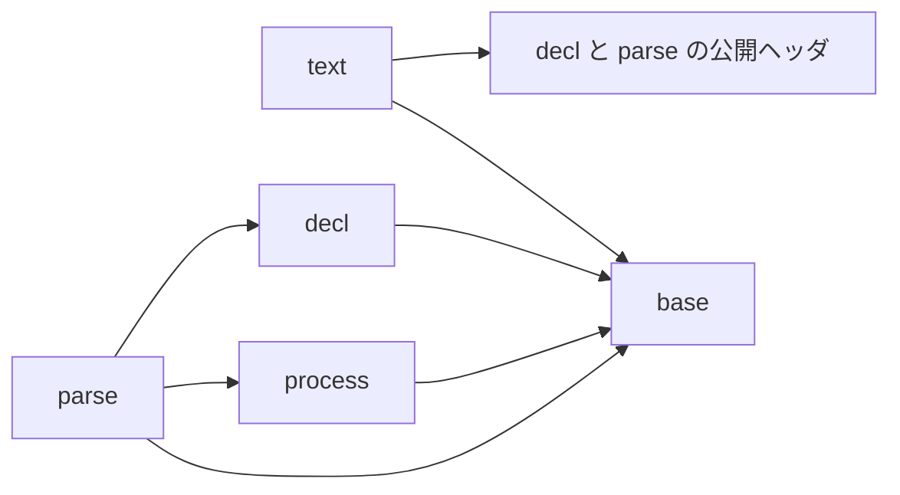
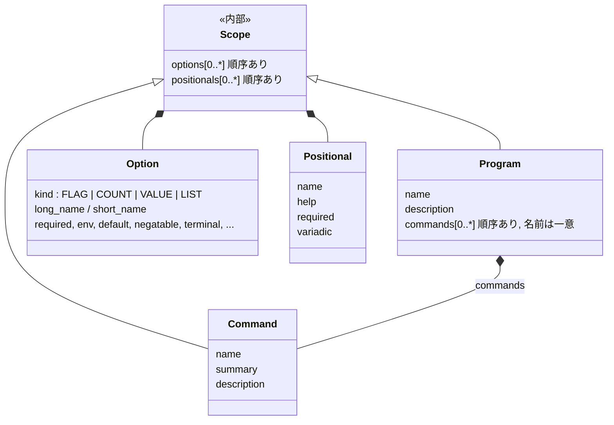

# アーキテクチャ（保守者向け）

この文書は、CLOpts の内部の構成について、モジュールの分け方と依存の向き、宣言モデル（プログラム・コマンド・オプション・位置引数の関係）、解析の流れ、設計の判断とその理由を示す。公開 API の使い方は利用者向けの章 `docs/api.md` を参照する。構成と名前を決めるときの考え方は[設計の考え方](design.md)にある。

宣言モデルを変える変更では、同じ変更の中でこの文書も更新する。

## モジュール

| モジュール | ディレクトリ | 役割 |
|------------|--------------|------|
| base | `src/base/` | ドメインを知らない部品。メモリ（使うアロケーターと、その差し替え `clopts/base/memory.h`、確保の窓口。ライブラリの確保と解放はすべてここを通る）、サイズの計算、可変長配列、UTF-8 の読み取り、`CLOPTS_API`（`clopts/base/export.h`）、エラーの種類とその説明（`error.c`、`clopts/base/error.h`。ビルダー関数が返す） |
| decl | `src/decl/` | 宣言のビルダー（プログラム・コマンド・オプション・位置引数と、その共通部品の Scope）、名前の規則（`name.c`）と 1 つの範囲の中での比べ方（`scope.c`）、書かれた名前がどのオプションを指すか（`lookup.c`）。公開ヘッダは `clopts/decl/` |
| parse | `src/parse/` | 解析の入口と手順（`parse.c`）、argv の要素の読み取り（`token.c`）、走査（`scan.c`）、環境変数と既定値の解決（`resolve.c`）、必須の検査（`require.c`）、途中の記録（`matches.c`、`slot.c`）、使い方エラー（`usage_error.c`）、結果（`result.c`）。公開ヘッダは `clopts/parse/` |
| text | `src/text/` | 利用者向けの文面（ヘルプ・使い方・版・使い方のヒント・エラー）を書き込みのコールバックへ出す。公開の入口（`write.c`、`clopts/text/write.h`）、ヘルプと Usage 行（`help.c`）、1 行の文面（`message.c`）、書き込みと計測の 2 つのモードを持つ出力先（`out.c`） |
| process | `src/process/` | プロセスの入力（argv と環境変数）を OS から UTF-8 で得る。argv のハンドル（`argv.c`、`clopts/process/argv.h`）、環境変数の参照（`env.c`、`clopts/process/env.h`。プロセスの環境変数の参照は解析の入口が使う）、Windows のコマンドラインの分割（`cmdline.c`）、UTF-16 から UTF-8 への変換（`utf16_win32.c`）。OS ごとの実装は `*_posix.c` と `*_win32.c` に置き、`<windows.h>` を include するのは `*_win32.c` だけである |

名前とファイルの付け方は [設計の考え方](design.md) に従う。内部ヘッダの関数の接頭辞はテスト `structure.names`（`tests/structure/check_names.cmake`）で、宣言のない定義はコンパイラ（`-Wmissing-prototypes`）で検査する。1 つの概念に、内部ヘッダ `src/<モジュール>/x.h`、定義 `x.c`、接頭辞 `clopts_x_` を 1 組持たせる（`src/parse/matches.h`、`matches.c`、`clopts_matches_*`）。公開ヘッダは `include/clopts/<モジュール>/x.h` に置き、その関数は `src/<モジュール>/x.c` で定義する。

依存の向きは次のとおりである。

- decl、parse、text、process は base の内部ヘッダ（`base/memory.h`、`base/vec.h` など）を使う。base はほかのモジュールに依存しない。
- decl は解析を知らない。parse は宣言を公開の読み取り関数で読み、書かれた名前を decl の内部ヘッダ `decl/lookup.h`（選ばれたコマンド、プログラムの順に引く）で引く。宣言には書き込まない。
- parse は、プロセスの環境変数を process の内部ヘッダ `process/env.h`（`clopts_env_lookup` と、その文脈 `clopts_env_t`）で読む。参照のコールバックが渡されなかったときに、解析の入口（`parse.c`）が文脈をスタックに置いてプロセスの環境変数の参照をつなぎ、解析ごとに作って解放する。走査・解決・検査（`scan.c`、`resolve.c`、`require.c`）は参照のコールバックを引数で受け取るだけで、OS を知らない。プロセスの環境を読むのは process だけである。
- text は decl と parse の内部ヘッダを読まない。宣言と結果は公開の読み取り関数とアクセサだけで読む。text は、ライブラリの利用者が書けることしかしていない。
- 内部ヘッダの関数は、共有ライブラリから export しない。
- 依存の向きはテスト `structure.modules`（ラベル `structure`、`tests/structure/check_structure.cmake`）で、`src/` と `include/clopts/` の両方について検査する。各モジュールが include してよいほかのモジュールは上の図のとおりで（text は decl と parse の公開ヘッダだけ）、ファイルごとの例外はない。実装ヘッダ（`x_impl.h`）は、同じモジュールのファイルしか include できない。`<windows.h>` の include は `process/*_win32.c` の外に、環境変数を読む関数（`getenv` など）の呼び出しは process の外に置けない。モジュールを足すときは、このスクリプトの規則にも足す。

## 宣言モデル

### 概念クラス図

- Program はプログラム自身の範囲である。名前（プログラムの名前）・説明・グローバルオプション・サブコマンドのないプログラムの位置引数を直接持つ。
- Command はサブコマンドだけを表す。
- Scope（`src/decl/scope.c`、`clopts_scope_t`）は、オプションと位置引数の配列と、それに関わる検査（名前の重なり、否定形との衝突、位置引数の順序）と、1 つの範囲の中での名前の比べ方をまとめる。Program と Command はこれを構造体に埋め込み、`clopts_program_get_scope()` / `clopts_command_get_scope()` で読み取り専用で渡す。公開するのは読み取り（`clopts/decl/scope.h`）だけで、オプションと位置引数を足す関数は持ち主に残す。足すときの規則は持ち主ごとに違う（プログラムは、サブコマンドがあると位置引数を持てない）からである。
- 関係はすべてコンポジション（所有）である。子は親を指さない。オプションと位置引数は自分を渡したプログラムやコマンドを、コマンドは自分を渡したプログラムを知らない。
- Program が位置引数を持つなら、サブコマンドは持てない（`CLOPTS_ERROR_CONFLICT`）。この排他は型ではなく検査で守る（「[設計の判断](#設計の判断)」）。

### 構造体の置き場所

構造体の中身をどこまで見せるかは、[設計の考え方](design.md) の 3 章「構造体の中身の見せ方」に従う。ハンドルの構造体は、それを作るファイルだけが知っている。ほかのファイルは、parse の中であっても公開の読み取り関数（Scope は `clopts_scope_*`）で読む。

| 型 | 種類 | 構造体の定義 |
|----|------|--------------|
| `clopts_program_t` | ハンドル | `src/decl/program.c` |
| `clopts_command_t` | ハンドル | `src/decl/command.c` |
| `clopts_option_t` | ハンドル | `src/decl/option.c` |
| `clopts_positional_t` | ハンドル | `src/decl/positional.c` |
| `clopts_scope_t` | 継承される型 | `src/decl/scope_impl.h`（Program と Command が埋め込む。配列は `scope.c` の関数だけで書く） |
| `clopts_matches_t` | ハンドル | `src/parse/matches.c`（解析の途中の記録） |
| `clopts_slot_t` | 値の型 | `src/parse/slot.h`（1 つのオプションの記録） |
| `clopts_usage_error_t` | 値の型（公開では不透明） | `src/parse/usage_error.h`（解析の各段が書き、結果が写しを持つ） |
| `clopts_result_t` | ハンドル | `src/parse/result.c`（一度だけ作り、以後は読むだけ） |
| `clopts_argv_t` | 継承される型（公開では不透明） | `src/process/argv_impl.h`（`argv.c` と OS ごとの `argv_posix.c`、`argv_win32.c` が使う） |
| `clopts_env_t` | 値の型 | `src/process/env.h`（解析の入口がスタックに置く） |

読み取り関数に NULL のハンドルを渡すのは契約違反で、`assert` で検出する。

text は公開 API だけを読む。プログラム自身の範囲とサブコマンドは、どちらも Scope として同じに読む。

### 検査の置き場所

宣言の誤りは、誤った呼び出しの戻り値としてその場で返す。検査はその関係を作る関数が行い、決まった順に検査して最初に破れた規則を返す。失敗した呼び出しは何も変えず、渡そうとしたハンドルは呼び出し側が持ったままになる。そのため、組み立てたプログラムはつねに正しく、解析が宣言の誤りを返すことはない。

| 検査 | 行う関数 |
|------|----------|
| オプション・位置引数だけで決まるもの（種類、名前の形、属性の組み合わせ） | 作る関数と属性の関数（`option.c`、`positional.c`） |
| 同じ範囲のほかのオプション・位置引数との関係（名前の重なり、否定形との衝突、位置引数の順序） | Scope の共通処理（`scope.c`）。`clopts_program_add_option/positional` と `clopts_command_add_option/positional` から使う |
| サブコマンドの名前の重なり | `clopts_program_add_command` |
| 位置引数とサブコマンドの排他 | `clopts_program_add_command`（位置引数が既にあるとき、名前の重なりの後）と `clopts_program_add_positional`（サブコマンドが既にあるとき、Scope の検査の前） |

名前の規則（名前の形）は `src/decl/name.c` に、1 つの範囲の中での名前の比べ方（バイト単位の完全一致、`--no-<name>`、短い名前）は `src/decl/scope.c` にまとめてある。ビルダーの検査も、解析の検索（`src/decl/lookup.c`）も、ヘルプがグローバルオプションを隠すかの判定（`clopts_scope_shadows_option`）も、名前はここで比べる。

### 不変条件と契約

- プログラムに渡されたものは、すべての宣言の規則を満たす。これは利用者が所有権の契約（渡した後に属性を変える関数や渡す関数を呼ばない、同じハンドルを 2 回渡さない）を守る限り成り立ち、契約は検査しない。
- 各ハンドルのアドレスは、解放されるまで変わらない。子は 1 つずつ確保し、配列はポインタだけを持つ。
- プログラムは、最初に解析するか文面を出した後は変えない。これは契約で、守るのは利用者の責務である（検出しない）。解析もプログラムに書き込まないので、この契約の下で同じプログラムを複数のスレッドから同時に解析できる。

## 解析の流れ

`clopts_parse`（`parse.c`）は次の順に進む。解析が書き込むのは途中の記録（matches）だけで、結果は最後に一度だけ作る。

1. 入口：NULL のプログラムを番兵として扱い、途中の記録（`matches.c`）を確保する（失敗したらメモリ不足の番兵を返す）。
2. 走査（`scan.c`）：サブコマンドがあれば、サブコマンドの前の走査をしてから本体の走査をする。なければ本体の走査だけをする。argv の要素の形（`--`、`--name=value`、`-abc`、ただの語）は `token.c` が読み、書かれた名前がどのオプションを指すかは decl の `lookup.c` が決める。
3. 使い方の誤りがあればそこで終わる。ただし、回復の走査（`scan.c`）がその位置から後ろに終端オプションを見つけたときは除く。
4. 環境変数と既定値から値を解決する（`resolve.c`）。環境変数は参照のコールバックで読む。`clopts_parse` と、コールバックに NULL を渡した `clopts_parse_with_env` では、入口がプロセスの環境変数の参照（process）をつなぐ。UTF-8 で読めない環境変数の値は、そのオプションを値なしのまま残し、最初の 1 つを誤りとして記録する。
5. 終端オプションがあれば `CLOPTS_PARSE_TERMINATED` で終わる。なければ、4 で記録した誤りがあれば `CLOPTS_PARSE_USAGE_ERROR` で終わる。
6. 必須のオプションと位置引数を検査する（`require.c`）。
7. `CLOPTS_PARSE_OK`。サブコマンドがあるのに選ばれていなければ `CLOPTS_PARSE_NO_COMMAND`。
8. 状態、終端オプション、使い方エラー（`usage_error.c`）、途中の記録から、結果（`result.c`）を作る。結果は途中の記録を引き取り、以後は書かれない。

- オプションの検索は、選ばれたコマンドの Scope を先に、プログラムの Scope を後に探す（`decl/lookup.c`）。そのため、コマンドの名前が同じ名前のグローバルオプションを隠す。位置引数は、選ばれたコマンドの Scope か、サブコマンドのないプログラムの Scope から取る。
- 途中の記録は、グローバルオプションと選ばれたコマンドのオプションそれぞれに、オプションと同じ添字のスロット（`slot.c`）を 1 つずつ持つ。スロットはオプションのアドレスで探す。
- 結果はプログラムを指さない。`clopts_result_destroy` は宣言を読まないので、結果はプログラムより後に解放してよい。
- 解析の途中の確保や環境変数の参照の失敗は、それまでの記録を解放し、メモリ不足の番兵を返して終わる。`CLOPTS_PARSE_OUT_OF_MEMORY` の結果は、つねに番兵である。

## 設計の判断

宣言モデルは、はじめ root（プログラム自身の範囲）を Command で表し、`clopts_program_create(root, commands, count, out)` で 1 回で作っていた。それを今の形に変えた理由と、採らなかった案を残す。

### root を Command で表すのをやめた理由

1. root は「Command の一種」ではなく「Program 自身の範囲」である。同じ型に役割の違う 2 つを詰めていたので、例外が生まれていた（root の summary は使われない、root の位置引数はサブコマンドがないときだけ持てる）。
2. Program 自体の中身がほとんどなく、「root を包んで凍結するための箱」になっていた。
3. パーサーが実際に扱っているのは「オプションと位置引数を持つ範囲」の 2 段の入れ子だが、この概念がコードに名前を持っておらず、(program, command) の組を毎回渡していた。

### 決めたこと

- **凍結は契約にする。** 1 回の呼び出しで作る形をやめたので、Program は組み立て途中にも存在する。最初の `clopts_parse` / `clopts_write_*` より後でビルダー関数を呼ぶのは契約違反とし、検出しない。今の「渡した後のハンドルは読み取り専用」と同じ扱いで、`clopts_program_seal` のような関数は足さない。
- **help・version のオプションを作る関数は置かない。** 終端の FLAG を作って説明を付けて渡すだけで、利用者がオプションの API で簡単に書ける。program と command のどちらに渡すかで関数を分ける必要もない。同じ理由で、`help` コマンドを作る関数と、その対象のコマンドを引く関数も置かない。コマンドと位置引数を作って渡すだけで、対象は `clopts_program_find_command` で引ける。

### 採らなかった案

- **Composite（Command が子コマンドを持つ木）にして Program を消す。** 入れ子のサブコマンドにもそのまま対応できるが、仕様は深さ 1 が前提である（検索の順、ヘルプ、位置引数とサブコマンドの排他）。また、凍結とスレッド安全の境界を Program が担っているので、消すと失うものが多い。
- **公開 API は変えず、内部だけ Scope で整える。** (program, command) の組を渡す煩雑さは減るが、root が Command であることの歪みは残る。移行の途中段階として実際に通った。
- **レイアウト（単一コマンドかディスパッチか）を型で分ける。** 位置引数とサブコマンドの排他を型で表せるが、C ではハンドル型と関数が倍近くに増える。検査のままにした。
