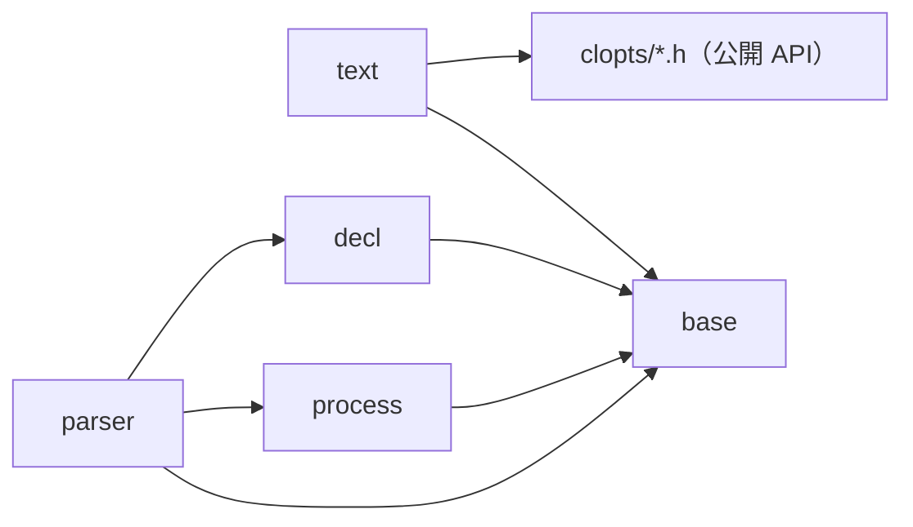
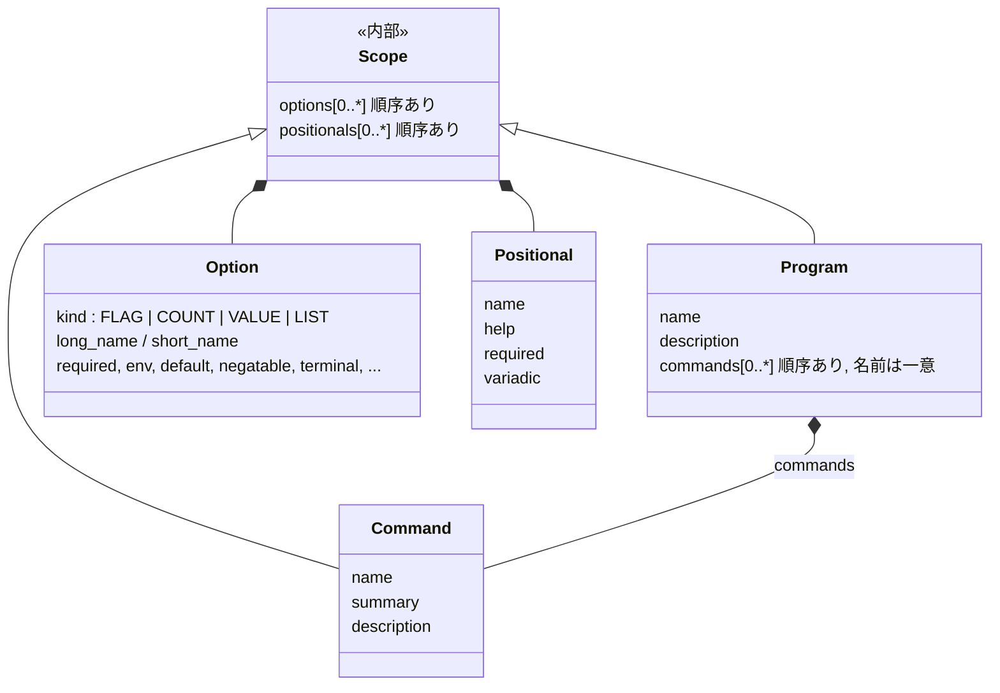

# アーキテクチャ（保守者向け）

この文書は、CLOpts の内部の構成について、モジュールの分け方と依存の向き、宣言モデル（プログラム・コマンド・オプション・位置引数の関係）、解析の流れ、設計の判断とその理由を示す。公開 API の使い方は利用者向けの章 `docs/api.md` を参照する。構成と名前を決めるときの考え方は[設計の考え方](design.md)にある。

宣言モデルを変える変更では、同じ変更の中でこの文書も更新する。

## モジュール

| モジュール | ディレクトリ | 役割 |
|------------|--------------|------|
| base | `src/base/` | ドメインを知らない部品。使うアロケーター（`clopts/base/allocator.h`）と確保の窓口（ライブラリの確保と解放はすべてここを通る）、サイズの計算、可変長配列、UTF-8 の読み取り、`CLOPTS_API`（`clopts/base/export.h`） |
| decl | `src/decl/` | 宣言のビルダー（プログラム・コマンド・オプション・位置引数と、その共通部品の Scope）、名前の規則と比べ方、宣言エラーの説明 |
| parser | `src/parser/` | 解析の入口と手順、名前での検索、argv の走査、環境変数と既定値の解決、必須の検査、結果のハンドル |
| text | `src/text/` | 利用者向けの文面（ヘルプ・使い方・版・使い方のヒント・エラー）の書き込みのコールバックへの出力と、help サブコマンドの宣言と結果の読み取りの補助 |
| process | `src/process/` | プロセスの入力（argv と環境変数）を OS から UTF-8 で得る。Windows のコマンドラインの分割と UTF-8 への変換、argv のハンドル（`clopts/process/argv.h`）、プロセスの環境変数の UTF-8 での参照（解析の入口が使う）。OS に触るのはこのモジュールだけである |

ソースファイルの名前にはモジュール名を付けない（`src/process/cmdline.c`）。ディレクトリが名前空間を兼ねる。内部ヘッダだけは、ほかのモジュールからも include されるので `<module>/<module>_internal.h` とする。

依存の向きは次のとおりである。

- decl、parser、text、process は base の内部ヘッダ（`base/mem.h`、`base/vec.h` など）を使う。base はほかのモジュールに依存しない。
- decl は解析を知らない。parser は decl の内部ヘッダ `decl/decl_internal.h`（Scope の読み取りと名前の比べ方）で宣言を読み、書き込まない。
- parser は、プロセスの環境変数を process の内部ヘッダ（`clopts_env_lookup` と、その文脈 `clopts_env_t`）で読む。process に依存するのは解析の入口（`parse.c`）だけで、参照のコールバックが渡されなかったときに、文脈を入口のスタックに置いてプロセスの環境変数の参照をつなぎ、解析ごとに作って解放する。走査・解決・検査（`scan.c`、`resolve.c`、`result.c`）は参照のコールバックだけを見て、OS を知らない。プロセスの環境を読むのは process だけである。
- text は decl と parser の内部ヘッダを読まない。宣言と結果は公開の読み取り関数とアクセサだけで読む。text は、ライブラリの利用者が書けることしかしていない。
- 各モジュールの内部ヘッダ（`<module>/<module>_internal.h`）の関数は、共有ライブラリから export しない。
- 依存の向きはテスト `structure.modules`（ラベル `structure`、`tests/structure/check_structure.cmake`）で検査する。各モジュールが include してよいほかのモジュールは上の図のとおりで（parser から process へは `parse.c` だけ）、`<windows.h>` の include と環境変数を読む関数（`getenv` など）の呼び出しは process の外に置けない。モジュールを足すときは、このスクリプトの規則にも足す。

## 宣言モデル

### 概念クラス図

- Program はプログラム自身の範囲である。名前（プログラムの名前）・説明・グローバルオプション・サブコマンドのないプログラムの位置引数を直接持つ。
- Command はサブコマンドだけを表す。
- Scope は内部だけの部品（`src/decl/scope.c`、`clopts_scope_t`）で、公開 API には出ない。オプションと位置引数の配列と、それに関わる検査（名前の重なり、否定形との衝突、位置引数の順序）をまとめる。Program と Command はこれを構造体に埋め込み、`clopts_program_scope()` / `clopts_command_scope()` で渡す。
- 関係はすべてコンポジション（所有）である。子は親を指さない。オプションと位置引数は自分を渡したプログラムやコマンドを、コマンドは自分を渡したプログラムを知らない。
- Program が位置引数を持つなら、サブコマンドは持てない（`CLOPTS_DECL_ERROR_MIXED_LAYOUT`）。この排他は型ではなく検査で守る（「[設計の判断](#設計の判断)」）。

### 構造体の置き場所

各ハンドルの構造体は、そのビルダーのファイルだけが知っている。ほかのファイルは、parser の中であっても公開の読み取り関数（Scope は `clopts_scope_*`）で読む。

| 型 | 構造体の定義 |
|----|--------------|
| `clopts_program_t` | `src/decl/program.c` |
| `clopts_command_t` | `src/decl/command.c` |
| `clopts_option_t` | `src/decl/option.c` |
| `clopts_positional_t` | `src/decl/positional.c` |
| `clopts_scope_t` | `src/decl/decl_internal.h`（Program と Command に埋め込むため。読み書きは `scope.c` の関数だけで行う） |
| `clopts_result_t` | `src/parser/result.c`（解析のほかのファイルとテストは、`result.c` の関数で読み、記録する） |

読み取り関数に NULL のハンドルを渡すのは契約違反で、`assert` で検出する。

text は公開 API だけを読むので、プログラム自身の範囲とサブコマンドを同じに扱うための小さな値型 `text_scope_t`（`src/text/layout.c`）を持つ。`command` が NULL ならプログラムを表す。

### 検査の置き場所

宣言の誤りは、誤った呼び出しの戻り値としてその場で返す。検査はその関係を作る関数が行い、決まった順に検査して最初に破れた規則を返す。失敗した呼び出しは何も変えず、渡そうとしたハンドルは呼び出し側が持ったままになる。そのため、組み立てたプログラムはつねに正しく、解析が宣言の誤りを返すことはない。

| 検査 | 行う関数 |
|------|----------|
| オプション・位置引数だけで決まるもの（種類、名前の形、属性の組み合わせ） | 作る関数と属性の関数（`option.c`、`positional.c`） |
| 同じ範囲のほかのオプション・位置引数との関係（名前の重なり、否定形との衝突、位置引数の順序） | Scope の共通処理（`scope.c`）。`clopts_program_add_option/positional` と `clopts_command_add_option/positional` から使う |
| サブコマンドの名前の重なり | `clopts_program_add_command` |
| `MIXED_LAYOUT` | `clopts_program_add_command`（位置引数が既にあるとき、名前の重なりの後）と `clopts_program_add_positional`（サブコマンドが既にあるとき、Scope の検査の前） |

名前の規則と比べ方（バイト単位の完全一致）は `src/decl/names.c` にまとめてある。ビルダーの検査も、解析の検索（`src/parser/scan.c`）も、名前はここの関数で比べる。

### 不変条件と契約

- プログラムに渡されたものは、すべての宣言の規則を満たす。これは利用者が所有権の契約（渡した後に属性を変える関数や渡す関数を呼ばない、同じハンドルを 2 回渡さない）を守る限り成り立ち、契約は検査しない。
- 各ハンドルのアドレスは、解放されるまで変わらない。子は 1 つずつ確保し、配列はポインタだけを持つ。
- プログラムは、最初に解析するか文面を出した後は変えない。これは契約で、守るのは利用者の責務である（検出しない）。解析もプログラムに書き込まないので、この契約の下で同じプログラムを複数のスレッドから同時に解析できる。

## 解析の流れ

`clopts_parse`（`parse.c`）は次の順に進む。

1. 入口：NULL のプログラムを番兵として扱い、結果を確保する（失敗したらメモリ不足の番兵を返す）。
2. 走査（`scan.c`）：サブコマンドがあれば、サブコマンドの前の走査をしてから本体の走査をする。なければ本体の走査だけをする。
3. 使い方の誤りがあればそこで終わる。ただし、回復の走査（`scan.c`）がその位置から後ろに終端オプションを見つけたときは除く。
4. 環境変数と既定値から値を解決する（`resolve.c`）。環境変数は参照のコールバックで読む。`clopts_parse` と、コールバックに NULL を渡した `clopts_parse_with_env` では、入口がプロセスの環境変数の参照（process）をつなぐ。UTF-8 で読めない環境変数の値は、そのオプションを値なしのまま残し、最初の 1 つを誤りとして記録する。
5. 終端オプションがあれば `CLOPTS_PARSE_TERMINATED` で終わる。なければ、4 で記録した誤りがあれば `CLOPTS_PARSE_USAGE_ERROR` で終わる。
6. 必須のオプションと位置引数を検査する（`parse.c`）。
7. `CLOPTS_PARSE_OK`。サブコマンドがあるのに選ばれていなければ `CLOPTS_PARSE_NO_COMMAND`。

- オプションの検索は、選ばれたコマンドの Scope を先に、プログラムの Scope を後に探す（`scan.c` の `lookup_long` / `lookup_short`）。そのため、コマンドの名前が同じ名前のグローバルオプションを隠す。位置引数は、選ばれたコマンドの Scope か、サブコマンドのないプログラムの Scope から取る。
- 結果は、グローバルオプションと選ばれたコマンドのオプションそれぞれに、オプションと同じ添字のスロットを 1 つずつ持つ（`result.c`）。
- 結果はプログラムを指さない。`clopts_result_destroy` は宣言を読まないので、結果はプログラムより後に解放してよい。
- 結果ができた後の確保や環境変数の参照の失敗は、その結果を `CLOPTS_PARSE_OUT_OF_MEMORY` にして終わる。

## 設計の判断

宣言モデルは、はじめ root（プログラム自身の範囲）を Command で表し、`clopts_program_create(root, commands, count, out)` で 1 回で作っていた。それを今の形に変えた理由と、採らなかった案を残す。

### root を Command で表すのをやめた理由

1. root は「Command の一種」ではなく「Program 自身の範囲」である。同じ型に役割の違う 2 つを詰めていたので、例外が生まれていた（root の summary は使われない、root の位置引数はサブコマンドがないときだけ持てる）。
2. Program 自体の中身がほとんどなく、「root を包んで凍結するための箱」になっていた。
3. パーサーが実際に扱っているのは「オプションと位置引数を持つ範囲」の 2 段の入れ子だが、この概念がコードに名前を持っておらず、(program, command) の組を毎回渡していた。

### 決めたこと

- **凍結は契約にする。** 1 回の呼び出しで作る形をやめたので、Program は組み立て途中にも存在する。最初の `clopts_parse` / `clopts_write_*` より後でビルダー関数を呼ぶのは契約違反とし、検出しない。今の「渡した後のハンドルは読み取り専用」と同じ扱いで、`clopts_program_seal` のような関数は足さない。
- **help・version のオプションを作る関数は置かない。** 終端の FLAG を作って説明を付けて渡すだけで、利用者がオプションの API で簡単に書ける。program と command のどちらに渡すかで関数を分ける必要もない。同じ理由で、`help` コマンドを作る関数と、その対象のコマンドを引く関数も置かない。コマンドと位置引数を作って渡すだけで、対象は `clopts_program_find_command` で引ける。

### 採らなかった案

- **Composite（Command が子コマンドを持つ木）にして Program を消す。** 入れ子のサブコマンドにもそのまま対応できるが、仕様は深さ 1 が前提である（検索の順、ヘルプ、`MIXED_LAYOUT`）。また、凍結とスレッド安全の境界を Program が担っているので、消すと失うものが多い。
- **公開 API は変えず、内部だけ Scope で整える。** (program, command) の組を渡す煩雑さは減るが、root が Command であることの歪みは残る。移行の途中段階として実際に通った。
- **レイアウト（単一コマンドかディスパッチか）を型で分ける。** `MIXED_LAYOUT` を型で表せるが、C ではハンドル型と関数が倍近くに増える。検査のままにした。
